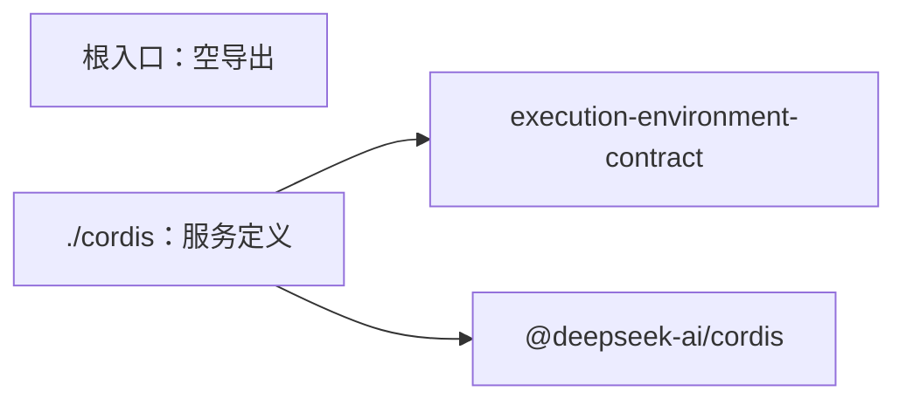

# 执行环境 Cordis 定义的内部架构

本页说明本成员怎样组织两个入口与依赖，来兑现 [SPEC](../SPEC.md)。服务键、抽象类、方法分面、intercept 配置与登记协议的正文归 [Cordis 说明](cordis.md)。组内成员的分解与依赖方向归[组架构](../../docs/architecture.md)。本页不另立公共规则。

本成员不持有状态，也不持有资源。提供者表、设施表、获取表与租约视图归 [execution-environment](../../execution-environment/docs/architecture.md)。Service 实现与撤除归 [execution-environment-host-local](../../execution-environment-host-local/docs/cordis.md)。

## 模块与依赖

本成员有两个入口，各一个源文件。

| 入口 | 源文件 | 承载 | 现状 |
| --- | --- | --- | --- |
| `@omne-harness/execution-environment-cordis-contract` | `src/index.ts` | 空导出，不导入 Cordis（[IC-4](../../../../docs/architecture/cordis-integration-conventions.md#ic-4)） | 已实现，带模板标记 |
| `@omne-harness/execution-environment-cordis-contract/cordis` | `src/cordis.ts` | 抽象类 `ExecutionEnvironmentService
`、键常量 `executionEnvironmentKey`、恢复授权的抽象类 `ExecutionRecoveryAuthorityService` 与键常量 `executionRecoveryAuthorityKey`、intercept 配置类型 `ExecutionEnvironmentIntercept`、`Context` 增补 | 已实现，带模板标记；调用方类核对没有接受 |

包外依赖只有两项，都在 `package.json` 里：

- `@omne-harness/execution-environment-contract`：`ExecutionEnvironment
`、`ProviderRegistrations`、`FacilityDescriptor`、`FacilityKey`。只做类型导入。
- `@deepseek-ai/cordis`：`Service` 与 `Context`，只由 `./cordis` 使用。

本成员不导入 `@omne-harness/execution-environment` 或 `@omne-harness/execution-environment-host-local`（[性质 8](../SPEC.md#结果与不变量)）。依赖方向是 Service 实现依赖本成员，反方向不成立。本成员也不导入任何上层领域的契约。

## 关键机制与理由

### 服务定义单独成为一个成员

服务定义与纯契约的变化原因不同。访问身份、要求、落点、租约与设施协议随领域语义变。服务键、登记的效应与调用方类随装配约定变。分成两个成员后，工具宿主、集成方与提供者导入契约类型时不加载 Cordis（[IC-4](../../../../docs/architecture/cordis-integration-conventions.md#ic-4)）。服务定义也不和 Service 实现放在一起，所以调用方插件只依赖定义，不依赖被选择的实现（[IC-5](../../../../docs/architecture/cordis-integration-conventions.md#ic-5)）。

代价：组内多一个包。契约的操作类型改变时，本成员的抽象类要一起检查。

### 签名从契约类型推出

八个抽象方法的参数与结果用 `Parameters` 与 `ReturnType` 从 `ExecutionEnvironment
` 与 `ProviderRegistrations` 推出。契约改一个方法的签名，抽象类随之改变，不需要手动同步第二份签名（[IC-3](../../../../docs/architecture/cordis-integration-conventions.md#ic-3)）。

代价：抽象类的方法名仍要手写。契约新增或删除一个方法时，类型检查会报错，维护者要补上或删去对应的抽象方法。

### 一个服务三面，不按设施或提供者建服务

本成员只定义一个服务键 `executionEnvironment`。环境面、恢复面与登记面都在这一个抽象类上。设施与提供者都经登记面登记，不各自成为服务。理由如下：

1. 每种设施一个服务键，键的数量随设施种类增长，也不合 [IC-7](../../../../docs/architecture/cordis-integration-conventions.md#ic-7) 的能力名词键名。
2. 设施键进入获取路径要同时满足设施声明已登记、提供者声明了这个键、守卫接受（[契约的设施协议](../../execution-environment-contract/SPEC.md#设施协议)）。调用方直接 `inject` 一个设施服务会绕过这三项核对，也会绕过租约的访问身份核对。
3. 一个设施键缺席要给获取时的拒绝原因。`inject` 一个设施服务会让调用方在设施缺席时停在 `PENDING`（[inject-has-no-optional-form](../../../../.meta_harness/design/basis/cordis/inject-has-no-optional-form.md)）。

代价：「某个提供者或设施在不在场」不能由 Cordis 服务表直接回答，要由登记表的提供者表与设施表回答。

### 登记面写成方法，登记落在调用方 fiber

登记面两个成员写成方法，提供者在方法里用 `this.ctx.effect` 登记。这样登记的寿命等于调用方插件的寿命，提供者插件卸载就开始退役，不需要登记表自己记名单再等人注销（[IC-13](../../../../docs/architecture/cordis-integration-conventions.md#ic-13)、[service-method-ctx-is-caller](../../../../.meta_harness/design/basis/cordis/service-method-ctx-is-caller.md)）。

代价：登记必须在插件内经 `ctx.executionEnvironment` 调用。在根 Context 上调用，登记属于根 fiber，不随任何提供者撤除。

### 调用方类由装配声明

调用方类写在调用方插件自己的 intercept 配置里，随插件进入装配，调用方在运行时不能改。恢复两操作只给 `maintainer`。这样「谁在用恢复面」是装配里可以核对的声明，恢复能不能做仍由恢复授权决定（[IC-18](../../../../docs/architecture/cordis-integration-conventions.md#ic-18)）。如果调用方类是普通参数，每次调用都可以换一类，核对就失去依据。

边界：调用方类由插件自己写，所以它是装配声明的一致性检查，不是访问控制。它能发现装配写错，不能拦住有意冒充的插件。登记环境提供者与设施声明的权限归装配，见 Cordis 说明的 [intercept 配置与调用方类](cordis.md#intercept-配置与调用方类)。

代价：核对现在没有实现。这条机制只有源码读数，见 Cordis 说明的[机制读数与假设](cordis.md#机制读数与假设)。

### 不声明事件

本成员不增补 `Events`。落点与宿主事实对读者是观察，经 Runtime Context 的块声明供给（[INV-EE17](../../execution-environment-contract/SPEC.md#inv-ee17-真实落点痕迹与诊断可定位且守住披露)）。再加一个 Cordis 事件会形成第二条通知路径，读者无法判断以哪一条为准。

## SOLID 与扩展边界

| 原则 | 本成员的具体选择 | 必须防止的反例 |
| --- | --- | --- |
| 单一职责 | 根入口没有内容，`./cordis` 只因装配约定改而改 | 在本成员里写匹配、幂等、租约视图或恢复编排的逻辑 |
| 开闭 | 新设施只由设施拥有者登记声明，新提供者只登记自己，本成员不改。沙箱是新的提供者，登记到同一个登记表，不是新的 Service 实现 | 为某种设施或某个提供者加一个服务键或特例方法 |
| 里氏替换 | 任何 Service 实现都 `extends` 同一个抽象类，实现同一组操作类型，遵守同一个登记协议 | 某个实现用 `ctx.provide` 另写键，或把登记放在服务自己的 fiber 上 |
| 接口隔离 | 三面在契约里是两个操作类型。集成方、维护者与提供者各声明自己的调用方类，只调用自己那一面 | 给集成方暴露恢复面，或让恢复面绕过恢复授权 |
| 依赖倒置 | 本成员只依赖契约类型与 Cordis。Service 实现依赖本成员，调用方依赖本成员，二者互不依赖 | `./cordis` 导入登记表机制或宿主提供者 |

## 验证与维护

| 保证 | 现在的验证 | 后续义务 |
| --- | --- | --- |
| 根入口没有运行值 | [public-entry.spec.ts](../tests/public-entry.spec.ts) 断言根入口没有导出 | 无 |
| `./cordis` 只有定义 | [cordis-entry.spec.ts](../tests/cordis-entry.spec.ts) 核对导出集合与键常量 | 新增导出时同步测试 |
| 子类在键上提供服务并随插件卸载撤除 | [cordis-entry.spec.ts](../tests/cordis-entry.spec.ts) 用一个探针子类装载与卸载 | 无 |
| 不导入实现成员（性质 8） | 没有逐文件检查 | 核对源码、生成声明与产物的导入 |
| 调用方类核对（性质 4） | 没有 | 先补 basis probe，再由 Service 实现实现并测试 |

维护规则：

1. 契约的 `ExecutionEnvironment
` 或 `ProviderRegistrations` 增删方法时，同步抽象类、本页与[公开接口页](public-api.md)。
2. 改服务键或 intercept 配置时，同步 [Cordis 说明](cordis.md)与 Service 实现 [execution-environment-host-local](../../execution-environment-host-local/README.md)。
3. Cordis 升版时，先重跑 Cordis 说明列出的 basis probe。
