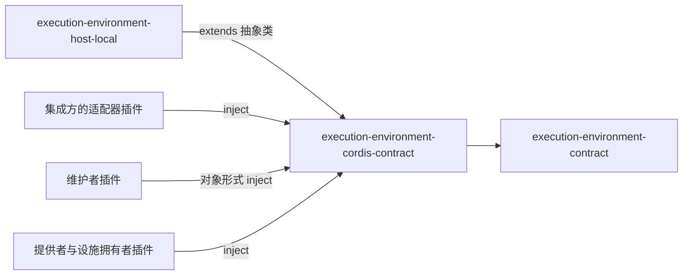

# 执行环境 Cordis 定义的使用与定位

本页说明谁依赖本成员、怎样依赖，以及本成员在能力组中的位置。系统关系归[系统页执行环境](../../../../docs/architecture/runtime/execution-environment.md)，组内分解归[组入口](../../README.md)。本页不另立架构。

## 使用方式

### 集成方的适配器插件

集成方的适配器插件 `inject` 本服务，调用环境面四个方法。访问身份、环境要求、幂等键、原调用引用、账本与守卫都作为参数传入：

```ts
import type {} from '@omne-harness/execution-environment-cordis-contract/cordis'

export const inject = ['executionEnvironment']
```

```text
插件体：placement = ctx.executionEnvironment.resolvePlacement(访问身份, 环境要求)
        acquired  = ctx.executionEnvironment.acquire(访问身份, { 幂等键, 原调用, 落点, 账本, 守卫 })
        lease.facility(键) 取设施，每次操作带请求身份与访问身份
```

上面的伪代码只表示调用位置。参数与结果归[契约的获取与租约](../../execution-environment-contract/SPEC.md#获取与租约)。

### 维护者插件

维护者插件用对象形式 `inject` 声明调用方类，再凭集成方签发的恢复授权调用恢复面：

```ts
export const inject = {
  executionEnvironment: { caller: 'maintainer' },
}
```

```text
插件体：ctx.executionEnvironment.releaseScope(作用域, 恢复授权)
        或 ctx.executionEnvironment.recoverOwned(作用域, 恢复授权)
```

调用方类现在没有核对，见 [Cordis 说明](cordis.md#intercept-配置与调用方类)。恢复授权每次由端口核对。

### 提供者插件与设施拥有者插件

提供者插件与设施拥有者插件 `inject` 本服务，在插件体里经 `ctx.executionEnvironment` 登记。登记随插件的 fiber 撤除，不需要手动注销：

```text
inject: ['executionEnvironment']
插件体：ctx.executionEnvironment.registerFacility(设施声明)
        ctx.executionEnvironment.registerProvider(提供者)
        插件卸载时两项登记自动撤除，提供者开始退役
```

`files` 设施声明的插件 `filesFacilityPlugin` 与宿主文件提供者的插件 `hostFilesPlugin` 就是这样分别登记的，见 [execution-environment-host-local 的 Cordis 说明](../../execution-environment-host-local/docs/cordis.md)。

### 独立使用

不装配 Cordis 的调用方不需要本成员。只用类型与纯函数时依赖 [execution-environment-contract](../../execution-environment-contract/docs/context.md)。要不含 Cordis 的登记表时，调用 [execution-environment](../../execution-environment/docs/context.md) 的 `createEnvironmentRegistry`。

### 初始化与释放

本成员不持有资源，没有初始化或释放步骤。登记的释放由 Cordis 的效应完成，见 [Cordis 说明](cordis.md#登记与撤除协议)。

## 消费者与定位

本成员处在纯契约与 Service 实现之间。下图投影[组架构](../../docs/architecture.md#成员与依赖)里与本成员相关的边，两者不一致时以组架构为准。



| 依赖方 | 怎样依赖 | 用什么 |
| --- | --- | --- |
| [execution-environment-host-local](../../execution-environment-host-local/README.md) | `extends ExecutionEnvironmentService`；`filesFacilityPlugin` 与 `hostFilesPlugin` 的 `inject` 用 `executionEnvironmentKey`；恢复授权每次用 `executionRecoveryAuthorityKey` 现取 | 抽象类、键常量 |
| 集成方的适配器插件 | 数组形式 `inject`，或对象形式带 `caller: 'integrator'` | 环境面四个方法 |
| 维护者插件 | 对象形式 `inject` 带 `caller: 'maintainer'` | 恢复面两个方法 |
| 提供者与设施拥有者插件 | 数组形式 `inject` | 登记面两个方法 |

依赖方不导入 Service 实现的入口（[IC-5](../../../../docs/architecture/cordis-integration-conventions.md#ic-5)）。

### 现在的真实消费者

execution-environment-host-local 是唯一在 `package.json` 里依赖本成员的包。集成方与维护者的插件还没有进入仓库。

### 上层页面

- 系统关系与成员分工：[系统页执行环境](../../../../docs/architecture/runtime/execution-environment.md#环境选择与资源准备)。
- 组内成员与阅读路径：[组入口](../../README.md)、[组协作入口](../../docs/key-flows.md)。
- 共同集成规则：[IC 约定](../../../../docs/architecture/cordis-integration-conventions.md)。
