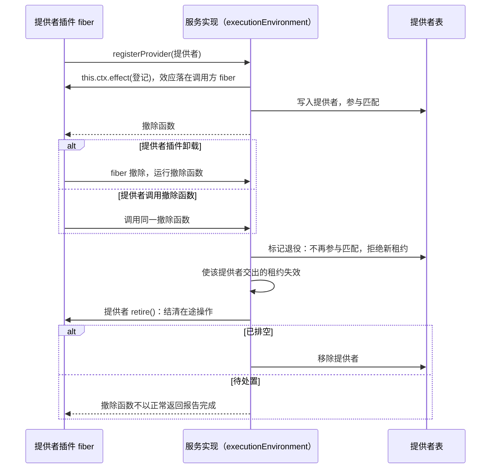
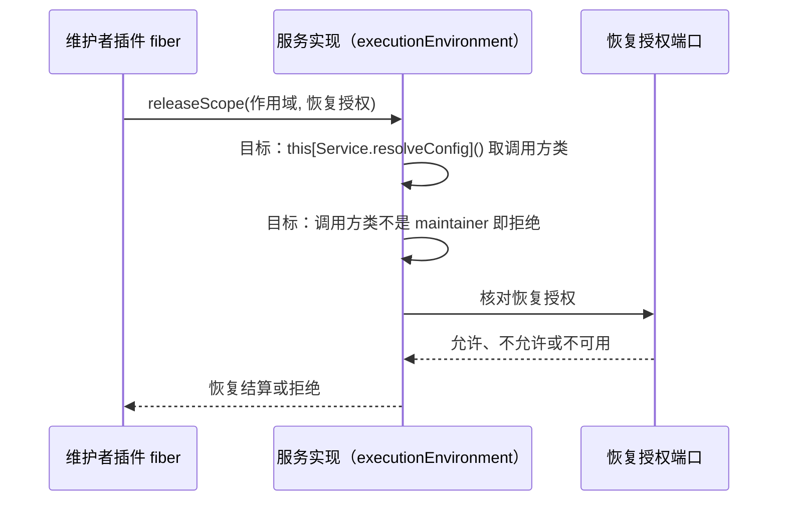

# 执行环境 Cordis 定义的机制流程

本页给出本成员定义的两条机制级流程。每条有一张时序图和一张「失败与责任交接」表。行为以 [SPEC](../SPEC.md) 和 [Cordis 说明](cordis.md)为准，图只投影它们。

协议级流程归 [execution-environment-contract 的流程](../../execution-environment-contract/docs/flows.md)：落点、获取、设施操作、释放、退役与恢复都在那里。登记表的机制流程归 [execution-environment 的流程](../../execution-environment/docs/flows.md)。Service 实现的装载、卸载与关闭归 [execution-environment-host-local 的流程](../../execution-environment-host-local/docs/flows.md)。图中的「服务实现」是继承本成员抽象类的 Service 子类。

## 流程

### F-EED01 提供者登记与撤除

依据：[性质 5](../SPEC.md#结果与不变量)、[IC-13](../../../../docs/architecture/cordis-integration-conventions.md#ic-13)、[INV-EE18](../../execution-environment-contract/SPEC.md#inv-ee18-提供者换代和-cordis-集成保留原责任)。

前提：提供者插件 `inject` 了 `executionEnvironment`，在自己的插件体里经 `ctx.executionEnvironment` 调用登记面。设施拥有者登记设施声明走同一条路径，撤除时没有退役步骤。

| 环节 | 结果 | 失败与责任交接 |
| --- | --- | --- |
| 登记 | 登记的寿命等于提供者插件 fiber 的寿命 | 同名同代的提供者重复登记被拒绝。拒绝发生在插件体里时，插件的 fiber 进入 `FAILED`（[plugin-throw-fails-fiber](../../../../.meta_harness/design/basis/cordis/plugin-throw-fails-fiber.md)） |
| 在根 Context 上登记 | 效应属于根 fiber，不随任何提供者撤除 | 只允许测试或装配入口这样用 |
| 撤除开始 | 提供者不再参与新的落点与获取 | 退役先拒新租约再排空，次序写在同一个撤除函数里（[effect-disposal-concurrent-not-ordered](../../../../.meta_harness/design/basis/cordis/effect-disposal-concurrent-not-ordered.md)） |
| 已交租约 | 失效可见，失效后的设施操作返回 `closed` | 规则归[契约的获取与租约](../../execution-environment-contract/SPEC.md#获取与租约) |
| 退役待处置 | 撤除函数不以正常返回报告完成。提供者留在提供者表里，不参与匹配 | 确认不了停止的受管资源留在集成方账本里，由维护者的恢复操作处置（[INV-EE15](../../execution-environment-contract/SPEC.md#inv-ee15-准备持有回收与确认保持一致)） |
| 撤除之后 | 新的落点解析不再选中这个提供者 | 撤除不撤回已发生的外部效果 |

### F-EED02 调用方类声明与读取

依据：[性质 4](../SPEC.md#结果与不变量)、[IC-18](../../../../docs/architecture/cordis-integration-conventions.md#ic-18)、[契约的恢复](../../execution-environment-contract/SPEC.md#恢复)。

前提：维护者插件以对象形式 `inject` 声明 `caller: 'maintainer'`，并持有集成方签发的恢复授权。

现状：服务实现还没有读取调用方类。下图中标为「目标」的两步没有实现。现在恢复两操作只经过恢复授权端口。

| 环节 | 结果 | 失败与责任交接 |
| --- | --- | --- |
| 声明调用方类 | 调用方类随调用方 fiber 存在，运行时不能改 | 对象形式仍是必需依赖，服务不在场时插件停在 `PENDING` |
| 读取调用方类 | 目标：每次调用从调用方 fiber 读取 | 没有实现。只有源码读数，见 [Cordis 说明](cordis.md#机制读数与假设) |
| 核对恢复授权 | 每次恢复调用都核对 | 调用方类不代替恢复授权。端口失败按不可用拒绝 |

## 失败与生命周期

| 情形 | 结果 | 责任方 | 依据 |
| --- | --- | --- | --- |
| 提供者插件卸载 | 它的登记被撤除，提供者开始退役 | 服务实现验证 | [IC-13](../../../../docs/architecture/cordis-integration-conventions.md#ic-13) |
| 设施拥有者插件卸载 | 它的设施声明被撤除，新获取取不到这个键 | 服务实现验证 | [契约的设施协议](../../execution-environment-contract/SPEC.md#设施协议) |
| 服务实现不在场 | `inject` 了本服务的插件停在 `PENDING` | 装配者 | [inject-has-no-optional-form](../../../../.meta_harness/design/basis/cordis/inject-has-no-optional-form.md) |
| 服务实现换代 | `inject` 了本服务的插件体重跑，重新登记 | 各依赖方的插件体可重复执行 | [plugin-body-reruns-on-provider-change](../../../../.meta_harness/design/basis/cordis/plugin-body-reruns-on-provider-change.md) |
| 服务撤除 | 关闭顺序与退役待处置的报告 | 服务实现 | [execution-environment-host-local SPEC](../../execution-environment-host-local/SPEC.md#所有权失败与生命周期) |
| 运行 disposer | 不撤回外部效果，不丢弃受管资源的处置责任 | 受管资源的提供者与集成方账本 | [INV-EE18](../../execution-environment-contract/SPEC.md#inv-ee18-提供者换代和-cordis-集成保留原责任) |
