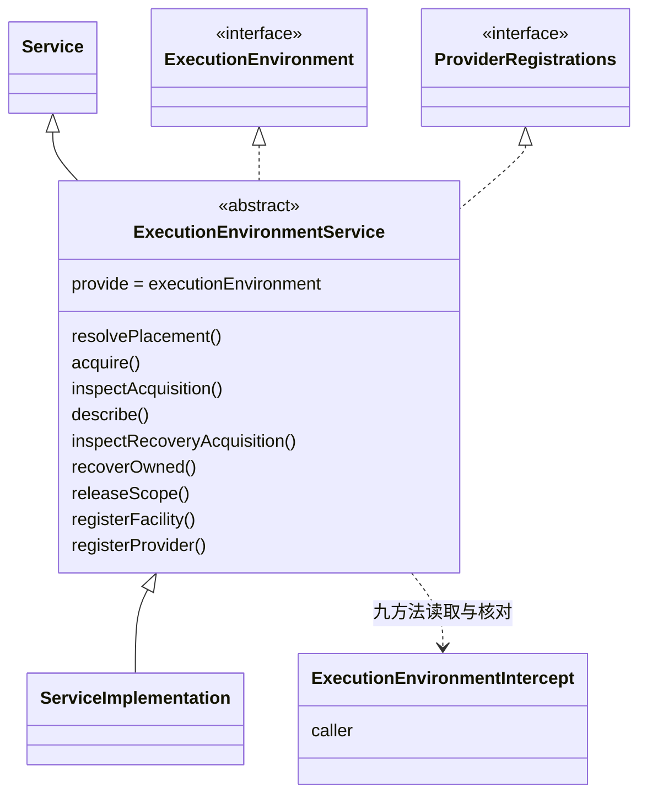

# 执行环境 Cordis 定义的对象模型

本成员没有自己的领域对象。访问身份、环境要求、落点、获取、采用记录、租约、受管资源、设施声明与恢复授权都归 [execution-environment-contract 的对象模型](../../execution-environment-contract/docs/object-model.md)，本成员只在服务方法的签名里引用它们。理由是本成员只拥有一个装配接缝：它规定这些对象经哪个服务键、以哪种 Cordis 方式交换，不规定对象本身。

本成员定义服务、调用方声明与登记面错误等技术对象，另有类型增补。它们不自动成为产品领域对象。精确形状归 `src/cordis.ts`，导出索引归[公开接口页](public-api.md)。

## 对象与关系

| 对象 | 身份 | 拥有者 | 可变性 | 关联 |
| --- | --- | --- | --- | --- |
| `ExecutionEnvironmentService
` 抽象类 | 服务键 `executionEnvironment` | 本成员 | 静态，随包发布 | `extends` Cordis 的 `Service<ExecutionEnvironmentIntercept>`，`implements` 契约的 `ExecutionEnvironment
` 与 `ProviderRegistrations`。Service 实现 `extends` 它 |
| intercept 配置 `ExecutionEnvironmentIntercept` | 调用方插件 fiber 上的一份配置 | 声明它的调用方插件 | 随该插件的 `inject` 声明，运行时不改 | `caller` 取 `integrator`、`maintainer` 或 `provider` |
| `CallerClassMismatch` | 一次登记拒绝 | 本成员 | 创建后保留操作、期望类和实际声明 | 不是资源或获取记录 |
| 端口服务抽象类 `ExecutionRecoveryAuthorityService`、`ExecutionEnvironmentAuthorityService
`、`ExecutionScopeBindingService` | 服务键 `executionRecoveryAuthority`、`executionEnvironmentAuthority`、`executionScopeBinding` | 本成员定义；子类由装配入口装载 | 静态，随包发布 | 分别 `implements` 契约的 `RecoveryAuthority`、`EnvironmentAuthority
` 与 Runtime Context 契约的 `ScopeBindingSource`。Service 实现每次从自己装载时的上下文现取 |
| `Context` 增补 | `executionEnvironment` 与三个端口服务属性 | 本成员 | 静态 | `executionEnvironment` 的类型是 `ExecutionEnvironmentService<unknown>`，其余三个是对应的端口服务抽象类 |

图中 `ServiceImplementation` 是说明用的名字，代表 [execution-environment-host-local](../../execution-environment-host-local/docs/object-model.md) 的具体子类 `ExecutionEnvironmentRegistry`。`ExecutionEnvironment` 与 `ProviderRegistrations` 是契约根入口的操作类型。

## 生命周期

| 对象 | 创建 | 变化 | 结束 |
| --- | --- | --- | --- |
| 抽象类 | 包发布 | 契约的操作类型改变时随包升版 | 包退出 |
| intercept 配置 | 调用方插件装载，Cordis 把对象形式 `inject` 的值写进该 fiber 的 intercept | 不变。改调用方类就是改装配 | 随调用方插件的 fiber 结束 |
| `Context` 增补 | 包发布 | 抽象类的类型参数改变时随包升版 | 包退出 |

本成员定义的协议还约束两类运行期登记，它们的实例都不归本成员：

- 设施声明的登记：归设施拥有者插件的 fiber。插件卸载、调用撤除函数或服务撤除时结束。
- 提供者的登记：归提供者插件的 fiber。结束即开始退役，退役结果是已排空或待处置。协议见 [Cordis 说明](cordis.md#登记与撤除协议)，状态见契约对象模型的[提供者](../../execution-environment-contract/docs/object-model.md#提供者)。
