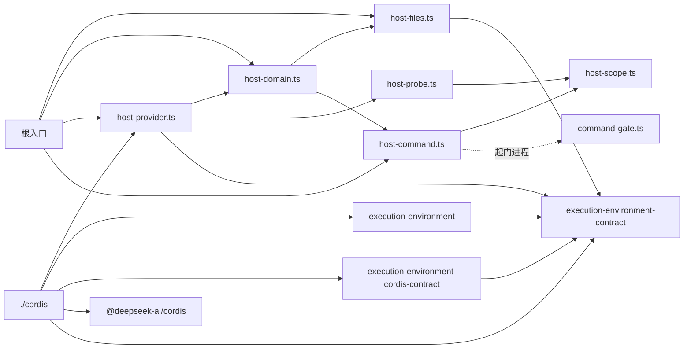
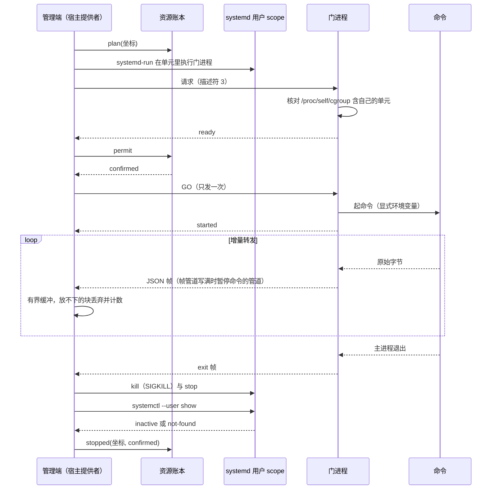

# execution-environment-host-local 的内部架构

本页说明本成员怎样组织两个入口与依赖，来兑现 [SPEC](../SPEC.md)。它是组内「宿主文件使用、宿主机制、撤除保留」这一主题的唯一拥有者（[组架构](../../docs/architecture.md#主题与唯一拥有者)）。Service 子类、插件、配置与撤除顺序的正文归 [Cordis 说明](cordis.md)。登记表机制归 [execution-environment](../../execution-environment/docs/architecture.md)。本页不另立公共规则。

## 模块与依赖

| 入口 | 源文件 | 承载 |
| --- | --- | --- |
| `@omne-harness/execution-environment-host-local` | `src/index.ts` | 重导出下面三个模块的四个函数与类型，不导入 Cordis（[IC-4](../../../../docs/architecture/cordis-integration-conventions.md#ic-4)） |
| 同上 | `src/host-files.ts` | 宿主文件设施 `createHostFiles`、对象身份读取 `hostObjectToken` 与共用文件引擎（不从根入口导出） |
| 同上 | `src/host-domain.ts` | 宿主文件责任域 `createHostFilesDomain`：获取记录、门面、配额与排空 |
| 同上 | `src/host-provider.ts` | 宿主文件提供者 `createHostFilesProvider` |
| 同上 | `src/host-command.ts`、`src/host-scope.ts`、`src/host-probe.ts` | 宿主命令设施、systemd 用户 scope 与平台前提探测，见[宿主命令机制](#宿主命令机制) |
| 门进程脚本，不是入口 | `src/command-gate.ts` | 命令的门进程，由宿主命令设施按文件路径起 |
| `@omne-harness/execution-environment-host-local/cordis` | `src/cordis.ts` | Service 子类 `ExecutionEnvironmentRegistry`、插件 `filesFacilityPlugin`、插件工厂 `createHostFilesPlugin`、空配置 Schema |

| 模块 | 持有的状态 | 承担的 SPEC 行为 |
| --- | --- | --- |
| 共用文件引擎与宿主文件设施 | 已发出的句柄代际表（带所有者）、关闭失败待重试的描述符（带所有者）、引擎内唯一的下一个代次 | [宿主文件使用](#宿主文件使用)与[其余现行行为](../SPEC.md#宿主文件设施的其余现行行为) |
| 宿主文件责任域 | 共用文件引擎、签发过的提供者代、获取记录（原描述、指纹、状态、门面、租约）、配额策略 | [宿主文件责任域](../SPEC.md#宿主文件责任域) |
| 宿主文件提供者（一代） | 是否已退役、上界与诊断出口；记录都在责任域 | [宿主提供者的事实](../SPEC.md#宿主提供者的事实) |
| 宿主命令设施（每份获取） | 准入开关、在途的启动、停止未确认的进程；每个进程的帧读取、输出缓冲与结局 | [宿主命令与终端](../SPEC.md#宿主命令与终端) |
| 平台前提探测（一代） | 探测结果、解析出的两个工具路径与上次探测的时刻 | [宿主命令与终端](../SPEC.md#宿主命令与终端) |
| Service 与插件 | 一个登记表实例 | [Service 实现](../SPEC.md#service-实现)与[撤除顺序](../SPEC.md#撤除顺序) |

包外依赖都在 `package.json` 里：

- `@omne-harness/execution-environment-contract`：类型与 `filesFacility` 设施声明。
- `@omne-harness/execution-environment`：`createEnvironmentRegistry` 与 `RetirementPending`，只由 `./cordis` 使用。
- `@omne-harness/execution-environment-cordis-contract`：抽象类与键常量，只由 `./cordis` 使用。
- `@deepseek-ai/cordis`：只由 `./cordis` 使用。
- `@omne-harness/legal-identity`：责任域用 `tenantCodec` 把租户编成记录键。
- `@omne-harness/runtime-context-contract`：只用类型（作用域引用与可信绑定来源）。

宿主文件设施只用 Node 的 `node:fs`、`node:fs/promises` 与 `node:path`。提供者另用 `node:crypto` 生成代，用 `node:os` 读操作系统版本，用 `node:fs` 读本包 `package.json` 的版本。没有包应依赖本成员的 `./cordis` 来调用环境操作。调用方依赖服务定义，Service 实现的选择归应用装配（[IC-5](../../../../docs/architecture/cordis-integration-conventions.md#ic-5)）。

## 关键机制与理由

### 宿主文件设施不依赖登记表

宿主文件设施只核对对象身份，不核对租户，也不问守卫。租户与守卫由登记表的租约视图在调用设施之前核对（[execution-environment 的逐操作门](../../execution-environment/SPEC.md#租约视图与逐操作门)）。理由：身份核对是宿主机特有的机制，租户与守卫是每个提供者都要做的事。把后者放在登记表里，每个提供者只写自己特有的部分。

代价：直接调用 `createHostFiles` 的一方得到一个不核对租户的设施。根入口导出它，是为了测试与独立组合。生产装配应经租约取设施。

### 一个责任域，一个共用文件引擎，每份获取一个门面

进程宿主保管一个宿主文件责任域，它持有一个共用的文件引擎。每份获取有自己的门面：准入开关与在途操作集合。引擎给每个签发的句柄与每个关闭失败的描述符记上这份获取的所有者标签。理由：句柄代际表与关闭失败的描述符要跨请求存在，关闭请求要能找到读取时发出的代次；同时，一份获取的释放只能排空它自己的操作与描述符，不能关闭另一份获取的门面或替它结清（[契约的提供者的进程内证据边界](../../execution-environment-contract/SPEC.md#提供者的进程内证据边界)）。代次在引擎内唯一，所以同一对象上两份获取的句柄不碰撞。

责任域比提供者与登记表活得久。提供者每一代都把自己的代登记进责任域，接纳、查询、枚举与结清都读写责任域的记录。理由：一代卸载之后，原占用、原记录与仍打开的描述符必须有人承接；新的一代经同一责任域看到它们，不会每代各拿一份完整额度，也不会把旧获取当成新获取。

代价：句柄代际表与已结清的记录随责任域存在，不随租约释放清空（[SPEC 明确缺项](../SPEC.md#明确缺项)）。责任域只在本进程内，进程结束之后的冷恢复需要域外证据。

### 排空有上界，名额只在什么都不剩时返还

释放、结清与退役都排空获取：封门面，标为释放中，最多等 `drainBoundMs` 让在途操作结束，然后重试这份获取的失败关闭。在途操作已结束且没有打开的描述符时，记录结清，名额恰好返还一次；否则答待处置，资源清单为空，名额仍占用，诊断写明在途操作数与打开的描述符数。理由：契约的排空要求已接纳的操作都已结束、关闭责任都已结清（[INV-EE18](../../execution-environment-contract/SPEC.md#inv-ee18-提供者换代和-cordis-集成保留原责任)）；替换写入截断文件之后、写完之前被卸载时，立即报已排空会让原请求的未知结果无人承接；空的受管资源列表不证明没有描述符。上界归提供者，登记表不设计时器；上界是配置，`10000` 毫秒只是初值。代价：一个卡住的文件操作会让释放或卸载等满上界；超界之后它仍在运行，结果仍交回原请求。

### 配额接纳是一个同步段

接纳在一个没有 `await` 的同步段里读配额策略、数尚未结清的记录、写入新记录。理由：同一配额域里抢最后一个名额的两次获取必须只有一次得到；JavaScript 单线程下，同步段就是这次判定与占用的原子边界。代价：策略函数必须是同步的；策略抛出或给出非法上界时答未知，不接纳。

### 账本关闭由登记表的门核对

提供者不读账本。经租约的每个文件操作在登记表的门里先核对这次获取的账本的 `closed` 信号（[INV-EE15](../../execution-environment-contract/SPEC.md#inv-ee15-准备持有回收与确认保持一致)）。理由：门是所有设施操作的唯一入口，核对放在门里只做一次。本提供者没有在门之外自己发起的效果，所以不另查。代价：直接调用 `createHostFilesProvider` 得到的租约原件不经过门，不查账本。

### Service 子类转发，登记落在调用方 fiber

`ExecutionEnvironmentRegistry` 只做转发与生命周期：七个环境与恢复方法原样转给登记表，两个登记方法用 `this.ctx.effect` 包住登记表的同名方法，构造时登记一个关闭效应。`registerProvider` 返回给调用方的撤除函数直接调用登记表的撤除函数，不经效应，因为效应撤除只运行一次，经效应就不能重试待处置的退役。匹配、核验与恢复的规则都留在登记表。理由是登记表可以不装配 Cordis 独立使用，Service 子类不应改变它的行为（[IC-4](../../../../docs/architecture/cordis-integration-conventions.md#ic-4)）。

### 三个端口缺省为不可用

没有装载 `executionRecoveryAuthority` 服务时，恢复面一律以 `unavailable` 拒绝；没有装载 `executionEnvironmentAuthority` 或 `executionScopeBinding` 服务时，环境面一律以 `unavailable` 拒绝。理由：没有授权来源时，访问与恢复都不能默认允许。三个端口都是运行时对象，不进插件树，也不写进配置（[IC-16](../../../../docs/architecture/cordis-integration-conventions.md#ic-16)）。装配入口装载对应抽象类的子类来提供它们。Service 子类每次使用时从自己装载时的上下文现取，不持有旧引用，也不从调用方的上下文取（[IC-9](../../../../docs/architecture/cordis-integration-conventions.md#ic-9)）。

### `files` 声明与宿主提供者分成两个插件

`filesFacilityPlugin` 只登记 `files` 设施声明，宿主文件插件只登记一代宿主文件提供者。理由：声明的拥有者是 `files` 设施，宿主提供者只是它的一个实现者。两者有不同的变化原因；合在一个插件里时，宿主提供者卸载会带走声明，别的 `files` 提供者也就无法独立存在。

### 撤除失败不报告完成

服务卸载与提供者撤除在退役待处置时抛出 `RetirementPending`。理由：撤除函数正常返回会被当作资源已清理。待处置的受管资源仍在集成方账本里，由维护者处置（[INV-EE18](../../execution-environment-contract/SPEC.md#inv-ee18-提供者换代和-cordis-集成保留原责任)）。代价：fiber 卸载时 Cordis 只把这个抛出写入 `ctx.logger`，卸载本身照常完成。装配从 `ctx.logger` 与登记表的结果观察待处置，不从卸载结果观察。

Cordis 对撤除函数抛出的处置见 basis 条目 [effect-disposal-concurrent-not-ordered](../../../../.meta_harness/design/basis/cordis/effect-disposal-concurrent-not-ordered.md) 的第二条：并发驱动时异常只写日志，不上抛。

## 宿主文件使用

状态：PanQiWei 已接受这一节的设计，见 [技术设计接受](https://github.com/nemori-ai/omne-harness-lite/issues/278#issuecomment-6197369869)。它不改写契约[获取与租约](../../execution-environment-contract/SPEC.md#获取与租约)的准备顺序，也不新建设施目录或沙箱实现。

文件使用发生在落点已经算完之后。条件选择仍按 [INV-EE02](../../execution-environment-contract/SPEC.md#inv-ee02-策略在域外求值环境只在允许清单内匹配) 决定宿主机或沙箱。环境提供者只对宿主机落点提供这一次文件使用。执行适配核对使用对象。观察与控制按同一次请求身份记下一种结果。`Files()` 消费读取、查看、写入和关闭这四项。编辑、补丁、查找和图片附件留在工具。`Shell()` 不进入这次确认。命令碰到的文件也不进入。

一次使用的结果只能是下面一种。

| 结果 | 同时成立的事实 |
| --- | --- |
| 读取已绑定 | 打开到的设备号与 inode 等于授权点名时的对象。字节来自该对象 |
| 查看或写入已绑定 | 对象身份与点名一致。没有把文件字节当作查看或写入的完成载荷 |
| 关闭已完成 | 该句柄代际有成功回执。没有文件字节 |
| 未解析 | 路径上没有对象。没有读取，也没有写入 |
| 拒绝 | 带有拒绝原因。落点保持为请求里的那一个 |
| 未知 | 请求身份仍在。不知道动作是否已经作用到对象上。关闭没有成功回执时用这一结果 |

句柄代际由使用时点的设备号、inode，以及提供者为这次使用发出的代次组成。同一次设施里，成功的读取、查看和写入各发出一个新代次，从 `1` 递增。元数据版本可以参与对象身份。它单独不是原子的外部写入防护。

授权在使用前点名对象的设备号与 inode。点名可以落在工作区目录之外。工作区目录是地址，不是宿主机上的围栏。未点名则拒绝。路径含空字节则拒绝。

调用方（执行适配/授权层）负责按当前授权点名对象，并把点名结果作为 `named` 提供给本设施；本设施只核对打开到的对象与 `named` 一致。`hostObjectToken` 仅按路径识别当前对象的设备号与 inode，不授予访问权，也不替调用方重新核对授权。

宿主机去掉路径末尾的斜杠，然后用 `O_NOFOLLOW` 打开该路径；打开步骤本身拒绝末段是符号链接的情况，不使用先 `lstat` 再打开的竞态预检。没有 `O_NOFOLLOW` 的宿主（Windows 的 Node）在打开之后对同一路径 `lstat` 一次：末段是链接则拒绝为 `unsupported`，末段的设备号与 inode 和描述符不一致则拒绝为 `conflict`；这是打开后的核对，不是预检，剩余的竞态窗口是 open 与 lstat 之间末段被换成点名对象本身，那时返回的仍是点名对象。末尾的 `.` 或 `..` 不往父路径收。祖先符号链接本身不构成拒绝。打开后读取描述符的设备号与 inode，与 `named` 一致才读取或写入字节。不一致就关闭描述符并且拒绝。这一步关闭失败，也不把已经确认的不一致改成未知。中间目录被换成链接时，若打开到的对象不是点名对象，结果同样是拒绝。平台路径可以经过符号链接到达点名对象。

公开的 Node 文件接口没有 `openat`。核对发生在打开之后。完成的读取或写入可以声称字节属于点名对象。不能声称内核在拒绝前没有打开过另一个对象。声称把文件限制在授予根内的落点，本成员这次不实现。该类请求拒绝，不改由宿主机执行。授予根是该落点声明的根身份。请求不能另带一个绝对路径充当这个根。

撤权之后的下一次使用重新核对当前授权。上一次已经返回的字节留在那一次结果里。同一路径上的后一次请求使用新的请求身份，并重新点名对象。读取、查看和写入在返回结果前关闭自己打开的描述符。关闭是另一次请求。成功回执表示该代次已经发出并且描述符已在那次使用结束时关闭。再关一次仍是成功回执。没有成功回执时结果是未知。路径含空字节在关闭时同样拒绝。已经读到或写到的结果不因关闭失败被抹掉。调用方丢掉引用不是关闭成功。对已经关闭的描述符再次关闭，不是活句柄关闭失败。

写入（替换模式）在身份一致后先把文件截断，再写入新字节。截断已经发生而后续没有写完时，结果是未知。文件可能已经变短。

读取、查看或写入返回前尝试关闭这次操作打开的描述符。关闭成功时该句柄代次得到成功回执；关闭失败时该描述符被保留在内部 pending-close 集合中，每次公开操作前会再次尝试关闭，仍然失败则结果保持未知，不抹掉已返回的读取或写入事实。身份不一致、读取/写入失败或 fstat 失败等错误路径同样保留无法关闭的描述符，而不是在 catch 中丢弃唯一引用。这些未发出句柄的描述符没有公开清理接缝，由本设施实例在后续操作中重试；实例释放时由运行时回收。

2026-10-16 在 Node v26.0.0、darwin 上，`FileHandle.close()` 对已经关闭的句柄再调用一次没有报错；句柄关闭之后对原来的 fd 调用 `closeSync` 得到 `ERR_OUT_OF_RANGE`。这两次都不是活句柄还开着时关闭失败。

授权决定可以用替身。文件字节、符号链接和对象替换使用真实文件系统。

### 接受之后的补充（未接受）

下列内容是接受之后补写的，不在上面的接受范围内：

- 上面「条件选择仍按 INV-EE02」引用的 INV-EE02 已按产品正文第 2 版改写：策略在域外求值，执行环境只在允许清单内匹配。改写后的 INV-EE02 未经技术接受。
- 上表的六种结果对应契约的设施结果四态：前三种是 `done`，未解析是 `unresolved`，拒绝是 `rejected`，未知是 `unknown`。同一次请求身份 `requestId` 只得到其中一种。
- 经宿主文件责任域使用时，上文的「本设施实例」是责任域的共用引擎：pending-close 集合里的每个描述符带所属获取的标记，排空该获取时也重试它们；提供者代退役后它们仍留在责任域里，由之后的结清或 `maintain()` 再试。句柄代次在共用引擎内唯一，不按每份获取从 `1` 起。直接调用 `createHostFiles` 的设施仍按上文。
- 本成员的包测试的运行记录见 [SPEC 的组合与验证](../SPEC.md#组合与验证)。其中包括读取、查看与写入时关闭失败后关闭返回未知的三个测试。这些运行没有重做 2026-10-16 的两次 `close` 观察。

## 宿主命令机制

本节说明宿主提供者怎样承担 `command`。行为以 SPEC 的[宿主命令与终端](../SPEC.md#宿主命令与终端)为准。设施的协议规则归契约的[设施协议](../../execution-environment-contract/SPEC.md#设施协议)，逐设施的展开见契约内部架构的 [`command`](../../execution-environment-contract/docs/architecture.md#command命令)，协议级流程见契约的 [F-EEC07](../../execution-environment-contract/docs/flows.md#f-eec07-命令的增量输出与终局)。`command` 只在 Linux 上实现。`terminal` 未实现，不在 M2：本成员没有 PTY、终端腿与 node-pty。

`command` 加在已有的宿主提供者上，与 `files` 由同一个提供者声明，不另立宿主提供者。理由：登记表在一层里只选一个提供者。按设施拆成几个宿主提供者时，需要 `files` 加 `command` 的工具在宿主层得不到落点（`missingFacility`）。再加一个合并的提供者，又会有两个提供者同时合格（`ambiguousEnvironment`）。

| 模块 | 承担 |
| --- | --- |
| `src/host-probe.ts` | 平台前提 P1、P3～P6 的探测与这一代的探测结果 |
| `src/host-scope.ts` | systemd 用户 scope：起单元、强制停止与确认、按描述列举、引用的读写 |
| `src/command-gate.ts` | 门进程脚本。它在命令的单元里运行，只用 Node 的内置模块，不被任何模块导入 |
| `src/host-command.ts` | 每份获取的命令门面：前置检查、启动、帧的读取、有界缓冲、进程句柄与停止 |

| 机制 | 设计 |
| --- | --- |
| 执行域 | 每个进程一个 systemd 用户 scope：`systemd-run --user --scope --collect --unit=omne-host-<资源键>.scope -p KillMode=control-group`。坐标 `{ unit, bootId }` 是 `ManagedResource.reference`。单元描述记下请求方作用域的摘要与资源键，供冷恢复列举 |
| 门与许可 | `systemd-run` 在单元里执行门进程。门先核对 `/proc/self/cgroup` 含有自己的单元，再报就绪。管理端在账本 `permit` 确认之后才发 GO，GO 只发一次。没有 GO 时门不起命令，控制管道关闭就退出 |
| 两条私有通道 | 控制通道是描述符 3，管理端写给门：先写请求（可执行文件、参数、目录、环境变量、标准输入），再写 GO 与平和停止。请求不进命令行参数，因为环境变量可能带秘密。帧通道是门的标准输出，一行一个 JSON 帧。门起命令时用第四条管道占住命令的描述符 3，控制通道不会漏进命令 |
| 门一侧的暂停与恢复 | 门把命令的字节按单块上限切块并编码成帧。帧管道的写端返回 false 时，门暂停读命令的两条管道，`drain` 之后恢复。所以管理端读得慢时，命令被阻塞在自己的输出管道上，门的内存不随输出增长，字节也不丢 |
| 帧的读取 | 管理端按行读帧，每行有上界（单块上限的 base64 长度加固定余量）。帧的次序固定：就绪，然后起来或映像失败，然后数据，最后一个退出。超长、非 JSON、未知帧、次序不对、超过单块上限，都使资源失效并强制停止 |
| 有界缓冲 | 管理端立刻读帧，两条流共用一个缓冲。放不下的块整块丢弃并计数，下一块的 `observedOffset` 写出缺口。只有一个读者，读者放弃后全部计入丢弃 |
| 结局 | 门在主进程退出后等两条管道关闭，或者等输出安静 100 毫秒，再发退出帧。命令留在后台的进程可能占着管道，所以不能只等管道关闭。只有收到退出帧才是 `completed`，其余是 `failed`（`effectUnknown`）。不写回执文件，也没有身份目录 |
| 停止与确认 | 强制停止：`systemctl --user kill --kill-whom=all --signal=SIGKILL`，再 `stop`（退出码 5 按已不在），等门进程退出，最后用 `systemctl --user show -p LoadState -p ActiveState` 读到 `inactive` 或 `not-found` 才报 `confirmed`，上界内会再读。平和停止只把 `SIGTERM` 发给主进程，超时报 `unconfirmed`，不升级 |
| 超时 | 启动、平和停止与强制停止都有上界。启动超时答 `unknown`，资源留在这份获取，由释放、结清或退役停止 |
| 平台前提 | P1 Linux、P3 `systemd-run` 与 `systemctl`、P4 用户管理器、P5 cgroup v2、P6 探测单元往返。提供者创建时在后台探测。不满足时启动答 `unavailable`，`files` 照常可用。不用猜测的进程号或假后端顶替 |
| 冷恢复 | 列举读 `omne-host-*.scope` 单元的描述，选出这个作用域的单元。恢复只接受本提供者写下的单元名。启动身份变了直接视为已停止，否则按强制停止序列停止并核对。它不重启命令，也不接回输出 |

理由：

- 停止的确认只来自域外的监督者 `systemctl --user show`。门与命令都在被停止的单元里，它们的自报不能证明自己已经停止。
- 每个进程一个单元，所以停止只作用于这一次调用。同一份获取的另一个进程照常运行。
- 门一侧的暂停与管理端的丢弃分开处理两种压力：前者限制门的内存，后者限制管理端的内存，命令不会因为没有读者而被永远阻塞。
- 退役强制停止这一代仍在运行的命令。把它们列为待处置资源再交给后继的一代需要更多机制，M2 没有这个需求（D1 结论第 3 条）。代价：配置重载以 `effectUnknown` 结束这些命令。

下图是一次命令的时序：管理端在宿主提供者里，门进程与命令在执行域里。

## SOLID 与扩展边界

| 原则 | 本成员的具体选择 | 必须防止的反例 |
| --- | --- | --- |
| 单一职责 | 宿主文件设施只管宿主机上的对象身份与字节，责任域只管获取记录、门面、名额与排空，提供者只管事实、租约原件与契约端口，Service 子类只管转发与生命周期 | 在宿主文件设施里核对租户或问守卫，或在 Service 子类里重写匹配规则 |
| 开闭 | `command` 与 `terminal` 加在同一个宿主提供者上，宿主层仍由一个提供者提供全部所需设施。沙箱是新的提供者，放在新的提供者成员里，登记到同一个登记表，不是新的 Service 实现，不改本成员 | 为新设施另立宿主提供者，使宿主层出现两个提供者；在 Service 子类里为某种设施加分支 |
| 里氏替换 | 宿主文件提供者满足契约的 `EnvironmentProvider`：真实声明只支持宿主层、不确认隔离；资源枚举答完整的空列表，原获取查询、获取枚举与结清读写责任域；排空在 `drainBoundMs` 内等在途操作并重试失败的关闭，什么都不剩才报已排空或已结清 | 把空的受管资源列表当作没有描述符或在途操作；对责任域没有签发过的代答未分配 |
| 接口隔离 | 根入口只给宿主文件设施与提供者，`./cordis` 只给插件与 Service 子类 | 让调用方导入 `./cordis` 的子类来调用环境操作 |
| 依赖倒置 | 本成员依赖契约、服务定义与登记表工厂。三个端口由装配经服务键提供，Service 从自己装载时的上下文现取；责任域由装配入口作为运行时对象交给插件工厂；租户与授权随操作参数进入 | 从 `ctx`、isolate 标签或插件实例推断租户或恢复授权 |

## 验证与维护

| 保证 | 现在的验证 | 后续义务 |
| --- | --- | --- |
| 宿主文件使用（已接受） | [host-file-results.spec.ts](../tests/host-file-results.spec.ts)、[host-files.spec.ts](../tests/host-files.spec.ts)，真实文件系统 | 授予根限制没有实现与测试 |
| 八项未实现操作 | [host-files-unsupported.spec.ts](../tests/host-files-unsupported.spec.ts) | 实现时改为真实行为并复用对象绑定 |
| Service 装载、撤除、恢复缺省 | [cordis-entry.spec.ts](../tests/cordis-entry.spec.ts)，真实 Cordis | 重复装载失败、配置校验失败、调用方类核对 |
| 退役等在途操作、超界待处置与诊断 | [host-provider-drain.spec.ts](../tests/host-provider-drain.spec.ts)，用 `vi.mock` 让一次 `open` 停住，其余是真实文件系统与真实 Cordis | 无 |
| 责任域：每份获取的排空、关闭失败的归属、跨代共用配额与原记录、查询与结清、冷恢复的保守答复 | [host-domain.spec.ts](../tests/host-domain.spec.ts)，用 `vi.mock` 让 `open` 停住、让活描述符上的 `close` 失败，其余是真实文件系统与真实描述符 | 真实进程退出之后的冷恢复结清（[#323](https://github.com/nemori-ai/omne-harness-lite/issues/323)）；行为模型；独立验收场景 |
| 登记表与提供者经契约套件 | [contract-conformance.spec.ts](../tests/contract-conformance.spec.ts) | 无 |
| 根入口不导入 Cordis | [public-entry.spec.ts](../tests/public-entry.spec.ts) | 新增根入口模块时加入文件清单 |
| 两条块的发布 | 没有 | 随 Runtime Context 生产者插件进入 |
| `command` 的宿主机制 | [host-command.spec.ts](../tests/host-command.spec.ts)（真实 `systemd-run`、门进程与 `systemctl`，只在 Linux 且设了 `OMNE_HOST_COMMAND_LINUX=1` 时运行）、[host-command-frames.spec.ts](../tests/host-command-frames.spec.ts)（帧读取、缓冲与确认判断，两个平台）、[host-probe.spec.ts](../tests/host-probe.spec.ts)（改变真实环境后的前提探测） | 真实的 `failed` 单元状态未验证；Windows 上的 `unavailable` 由派发者在 Windows 复跑；`terminal` 不在 M2 |

维护规则：

1. 改宿主文件使用的已接受行为，要经原接受入口重新接受，再同步本页、SPEC 与测试。
2. 服务定义改变时，同步 Service 子类、[Cordis 说明](cordis.md)与测试。
3. 登记表工厂的签名改变时，同步 Service 子类。
4. 新的宿主设施进入时，同步[公开接口页](public-api.md)、SPEC 的宿主提供者事实与 [Cordis 说明](cordis.md)。
