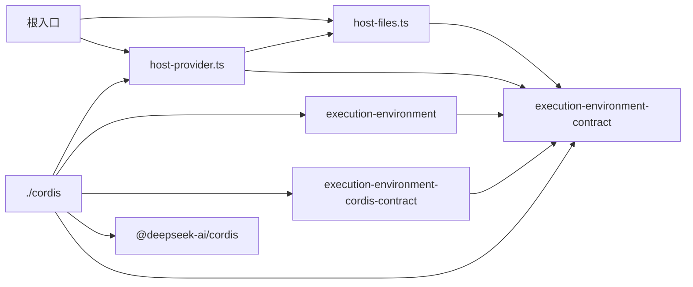

# execution-environment-host-local 的内部架构

本页说明本成员怎样组织两个入口与依赖，来兑现 [SPEC](../SPEC.md)。它是组内「宿主文件使用、宿主机制、撤除保留」这一主题的唯一拥有者（[组架构](../../docs/architecture.md#主题与唯一拥有者)）。Service 子类、插件、配置与撤除顺序的正文归 [Cordis 说明](cordis.md)。登记表机制归 [execution-environment](../../execution-environment/docs/architecture.md)。本页不另立公共规则。

## 模块与依赖

| 入口 | 源文件 | 承载 |
| --- | --- | --- |
| `@omne-harness/execution-environment-host-local` | `src/index.ts` | 重导出下面两个模块的三个函数，不导入 Cordis（[IC-4](../../../../docs/architecture/cordis-integration-conventions.md#ic-4)） |
| 同上 | `src/host-files.ts` | 宿主文件设施 `createHostFiles` 与对象身份读取 `hostObjectToken` |
| 同上 | `src/host-provider.ts` | 宿主文件提供者 `createHostFilesProvider` |
| `@omne-harness/execution-environment-host-local/cordis` | `src/cordis.ts` | Service 子类 `ExecutionEnvironmentRegistry`、插件工厂 `executionEnvironmentRegistryWith`、插件 `hostFilesPlugin`、空配置 Schema、`unavailableRecoveryAuthority` |

| 模块 | 持有的状态 | 承担的 SPEC 行为 |
| --- | --- | --- |
| 宿主文件设施 | 已发出的句柄代际表、关闭失败待重试的描述符集合、下一个代次 | [宿主文件使用](#宿主文件使用)与[其余现行行为](../SPEC.md#宿主文件设施的其余现行行为) |
| 宿主文件提供者 | 一个宿主文件设施实例、已交租约的失效回调、是否已退役 | [宿主提供者的事实](../SPEC.md#宿主提供者的事实) |
| Service 与插件 | 一个登记表实例 | [Service 实现](../SPEC.md#service-实现)与[撤除顺序](../SPEC.md#撤除顺序) |

包外依赖都在 `package.json` 里：

- `@omne-harness/execution-environment-contract`：类型与 `filesFacility` 设施声明。
- `@omne-harness/execution-environment`：`createEnvironmentRegistry` 与 `RetirementPending`，只由 `./cordis` 使用。
- `@omne-harness/execution-environment-cordis-contract`：抽象类与键常量，只由 `./cordis` 使用。
- `@deepseek-ai/cordis`：只由 `./cordis` 使用。
- `@omne-harness/legal-identity` 只是开发依赖，测试用它构造租户。

宿主文件设施只用 Node 的 `node:fs`、`node:fs/promises` 与 `node:path`，提供者另用 `node:crypto` 生成代。没有包应依赖本成员的 `./cordis` 来调用环境操作。调用方依赖服务定义，Service 实现的选择归应用装配（[IC-5](../../../../docs/architecture/cordis-integration-conventions.md#ic-5)）。

## 关键机制与理由

### 宿主文件设施不依赖登记表

宿主文件设施只核对对象身份，不核对租户，也不问守卫。租户与守卫由登记表的租约视图在调用设施之前核对（[execution-environment 的逐操作门](../../execution-environment/SPEC.md#租约视图与逐操作门)）。理由：身份核对是宿主机特有的机制，租户与守卫是每个提供者都要做的事。把后者放在登记表里，每个提供者只写自己特有的部分。

代价：直接调用 `createHostFiles` 的一方得到一个不核对租户的设施。根入口导出它，是为了测试与独立组合。生产装配应经租约取设施。

### 一个提供者一个设施实例

一个宿主文件提供者只造一个宿主文件设施，它交出的全部租约共用这个实例。理由：句柄代际表与关闭失败的描述符集合要跨请求存在，关闭请求要能找到读取时发出的代次。每个租约一个实例会让关闭找不到别的租约发出的代次。

代价：句柄代际表随提供者实例存在，不随租约释放清空。

### Service 子类转发，登记落在调用方 fiber

`ExecutionEnvironmentRegistry` 只做转发与生命周期：六个环境与恢复方法原样转给登记表，两个登记方法用 `this.ctx.effect` 包住登记表的同名方法，构造时登记一个关闭效应。匹配、核验与恢复的规则都留在登记表。理由是登记表可以不装配 Cordis 独立使用，Service 子类不应改变它的行为（[IC-4](../../../../docs/architecture/cordis-integration-conventions.md#ic-4)）。

### 恢复授权缺省为不可用

直接装载 Service 子类时没有恢复授权端口，恢复两操作一律以 `unavailable` 拒绝。理由：没有维护拥有者签发授权时，恢复不能默认允许。装配者要恢复，就装载 `executionEnvironmentRegistryWith(恢复授权)`。恢复授权端口是运行时对象，不进插件树，所以用插件工厂的参数给出，不写进配置（[IC-16](../../../../docs/architecture/cordis-integration-conventions.md#ic-16)）。

### 撤除失败不报告完成

服务卸载与提供者撤除在退役待处置时抛出 `RetirementPending`。理由：撤除函数正常返回会被当作资源已清理。待处置的受管资源仍在集成方账本里，由维护者处置（[INV-EE18](../../execution-environment-contract/SPEC.md#inv-ee18-提供者换代和-cordis-集成保留原责任)）。

代价：Cordis 怎样处置撤除函数抛出的错误，现在没有 basis 条目。

## 宿主文件使用

状态：PanQiWei 已接受这一节的设计，见 [技术设计接受](https://github.com/nemori-ai/omne-harness-lite/issues/278#issuecomment-6197369869)。它不改写契约[获取与租约](../../execution-environment-contract/SPEC.md#获取与租约)的准备顺序，也不新建设施目录或沙箱实现。

文件使用发生在落点已经算完之后。条件选择仍按 [INV-EE02](../../execution-environment-contract/SPEC.md#inv-ee02-策略在域外求值环境只在允许清单内匹配)（本次修订，未接受）决定宿主机或沙箱。环境提供者只对宿主机落点提供这一次文件使用。执行适配核对使用对象。观察与控制按同一次请求身份记下一种结果。`Files()` 消费读取、查看、写入和关闭这四项。编辑、补丁、查找和图片附件留在工具。`Shell()` 不进入这次确认。命令碰到的文件也不进入。

一次使用的结果只能是下面一种。

| 结果 | 同时成立的事实 |
| --- | --- |
| 读取已绑定 | 打开到的设备号与 inode 等于授权点名时的对象。字节来自该对象 |
| 查看或写入已绑定 | 对象身份与点名一致。没有把文件字节当作查看或写入的完成载荷 |
| 关闭已完成 | 该句柄代际有成功回执。没有文件字节 |
| 未解析 | 路径上没有对象。没有读取，也没有写入 |
| 拒绝 | 带有拒绝原因。落点保持为请求里的那一个 |
| 未知 | 请求身份仍在。不知道动作是否已经作用到对象上。关闭没有成功回执时用这一结果 |

（本次补充）这六种结果对应契约的设施结果四态：前三种是 `done`，未解析是 `unresolved`，拒绝是 `rejected`，未知是 `unknown`。同一次请求身份 `requestId` 只得到其中一种。

句柄代际由使用时点的设备号、inode，以及提供者为这次使用发出的代次组成。同一次设施里，成功的读取、查看和写入各发出一个新代次，从 `1` 递增。元数据版本可以参与对象身份。它单独不是原子的外部写入防护。

授权在使用前点名对象的设备号与 inode。点名可以落在工作区目录之外。工作区目录是地址，不是宿主机上的围栏。未点名则拒绝。路径含空字节则拒绝。

调用方（执行适配/授权层）负责按当前授权点名对象，并把点名结果作为 `named` 提供给本设施；本设施只核对打开到的对象与 `named` 一致。`hostObjectToken` 仅按路径识别当前对象的设备号与 inode，不授予访问权，也不替调用方重新核对授权。

宿主机去掉路径末尾的斜杠，然后用 `O_NOFOLLOW` 打开该路径；打开步骤本身拒绝末段是符号链接的情况，不使用先 `lstat` 再打开的竞态预检。末尾的 `.` 或 `..` 不往父路径收。祖先符号链接本身不构成拒绝。打开后读取描述符的设备号与 inode，与 `named` 一致才读取或写入字节。不一致就关闭描述符并且拒绝。这一步关闭失败，也不把已经确认的不一致改成未知。中间目录被换成链接时，若打开到的对象不是点名对象，结果同样是拒绝。平台路径可以经过符号链接到达点名对象。

公开的 Node 文件接口没有 `openat`。核对发生在打开之后。完成的读取或写入可以声称字节属于点名对象。不能声称内核在拒绝前没有打开过另一个对象。声称把文件限制在授予根内的落点，本成员这次不实现。该类请求拒绝，不改由宿主机执行。授予根是该落点声明的根身份。请求不能另带一个绝对路径充当这个根。

撤权之后的下一次使用重新核对当前授权。上一次已经返回的字节留在那一次结果里。同一路径上的后一次请求使用新的请求身份，并重新点名对象。读取、查看和写入在返回结果前关闭自己打开的描述符。关闭是另一次请求。成功回执表示该代次已经发出并且描述符已在那次使用结束时关闭。再关一次仍是成功回执。没有成功回执时结果是未知。路径含空字节在关闭时同样拒绝。已经读到或写到的结果不因关闭失败被抹掉。调用方丢掉引用不是关闭成功。对已经关闭的描述符再次关闭，不是活句柄关闭失败。

写入（替换模式）在身份一致后先把文件截断，再写入新字节。截断已经发生而后续没有写完时，结果是未知。文件可能已经变短。

读取、查看或写入返回前尝试关闭本次打开的描述符。关闭成功时该句柄代次得到成功回执；关闭失败时该描述符被保留在内部 pending-close 集合中，每次公开操作前会再次尝试关闭，仍然失败则结果保持未知，不抹掉已返回的读取或写入事实。身份不一致、读取/写入失败或 fstat 失败等错误路径同样保留无法关闭的描述符，而不是在 catch 中丢弃唯一引用。这些未发出句柄的描述符没有公开清理接缝，由本设施实例在后续操作中重试；实例释放时由运行时回收。

2026-10-16 在 Node v26.0.0、darwin 上，`FileHandle.close()` 对已经关闭的句柄再调用一次没有报错；句柄关闭之后对原来的 fd 调用 `closeSync` 得到 `ERR_OUT_OF_RANGE`。这两次都不是活句柄还开着时关闭失败。

（本次补充）2026-10-21 在 Node v24.18.0、linux 上，本成员的包测试 `pnpm --filter @omne-harness/execution-environment-host-local test` 的 5 个测试文件、50 个测试全部通过，退出码 0。其中包括读取、查看与写入时关闭失败后关闭返回未知的三个测试。这次运行没有重做上一段的两次 `close` 观察。

授权决定可以用替身。文件字节、符号链接和对象替换使用真实文件系统。

## SOLID 与扩展边界

| 原则 | 本成员的具体选择 | 必须防止的反例 |
| --- | --- | --- |
| 单一职责 | 宿主文件设施只管宿主机上的对象身份与字节，提供者只管事实与租约原件，Service 子类只管转发与生命周期 | 在宿主文件设施里核对租户或问守卫，或在 Service 子类里重写匹配规则 |
| 开闭 | `command` 与 `terminal` 的宿主提供者以新的提供者与插件加入，经同一个登记面登记。沙箱是新的 Service 实现成员，不改本成员 | 为新设施在宿主文件提供者或 Service 子类里加分支 |
| 里氏替换 | 宿主文件提供者满足契约的 `EnvironmentProvider`：真实声明只支持宿主层、不确认隔离、没有受管资源与恢复 | 声明不支持的绑定层或隔离断言，或在退役待处置时报告已排空 |
| 接口隔离 | 根入口只给宿主文件设施与提供者，`./cordis` 只给插件与 Service 子类 | 让调用方导入 `./cordis` 的子类来调用环境操作 |
| 依赖倒置 | 本成员依赖契约、服务定义与登记表工厂。恢复授权由装配作为插件工厂参数给出，租户与授权随操作参数进入 | 从 `ctx`、isolate 标签或插件实例推断租户或恢复授权 |

## 验证与维护

| 保证 | 现在的验证 | 后续义务 |
| --- | --- | --- |
| 宿主文件使用（已接受） | [host-file-results.spec.ts](../tests/host-file-results.spec.ts)、[host-files.spec.ts](../tests/host-files.spec.ts)，真实文件系统 | 授予根限制没有实现与测试 |
| 八项未实现操作 | [host-files-unsupported.spec.ts](../tests/host-files-unsupported.spec.ts) | 实现时改为真实行为并复用对象绑定 |
| Service 装载、撤除、恢复缺省 | [cordis-entry.spec.ts](../tests/cordis-entry.spec.ts)，真实 Cordis | 重复装载失败、配置校验失败、调用方类核对 |
| 根入口不导入 Cordis | [public-entry.spec.ts](../tests/public-entry.spec.ts) | 新增根入口模块时加入文件清单 |
| 两条块的发布 | 没有 | 随 Runtime Context 生产者插件进入 |

维护规则：

1. 改宿主文件使用的已接受行为，要经原接受入口重新接受，再同步本页、SPEC 与测试。
2. 服务定义改变时，同步 Service 子类、[Cordis 说明](cordis.md)与测试。
3. 登记表工厂的签名改变时，同步 Service 子类与 `executionEnvironmentRegistryWith`。
4. 新的宿主设施进入时，同步[公开接口页](public-api.md)、SPEC 的宿主提供者事实与 [Cordis 说明](cordis.md)。
