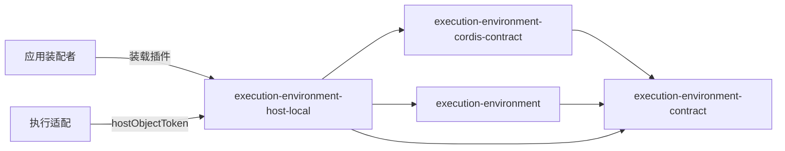

# execution-environment-host-local 的使用与定位

本页说明谁使用本成员、怎样使用，以及本成员在能力组中的位置。系统关系归[系统页执行环境](../../../../docs/architecture/runtime/execution-environment.md)，组内分解归[组入口](../../README.md)，文件使用的跨领域交接归[领域交接设计](../../../../docs/domains/execution-environments/architecture.md#文件使用的交接)。本页不另立架构。

## 使用方式

### 装配

应用装配者在进程里装载服务、`files` 声明插件与宿主文件插件：

```ts
import { Context } from '@deepseek-ai/cordis'
import {
  ExecutionEnvironmentRegistry,
  filesFacilityPlugin,
  hostFilesPlugin,
} from '@omne-harness/execution-environment-host-local/cordis'

const ctx = new Context()
await ctx.plugin(ExecutionEnvironmentRegistry)
await ctx.plugin(MyRecoveryAuthority)
await ctx.plugin(filesFacilityPlugin)
await ctx.plugin(hostFilesPlugin)
```

`MyRecoveryAuthority` 是 `ExecutionRecoveryAuthorityService` 的子类，由集成方维护拥有者实现。服务每次恢复操作现取它。不需要恢复时不装它，恢复两操作随之一律返回 `unavailable`。Service 与 `filesFacilityPlugin` 不接受配置字段。`hostFilesPlugin` 只接受 `drainBoundMs`，例如 `ctx.plugin(hostFilesPlugin, { drainBoundMs: 5000 })`；它是宿主提供者退役等在途文件操作的上界，缺省为初值 10000 毫秒。

装载之后，集成方、维护者、提供者与设施拥有者的插件经服务定义使用服务，见 [execution-environment-cordis-contract 的使用](../../execution-environment-cordis-contract/docs/context.md#使用方式)。它们不导入本成员。

### 点名对象

执行适配按当前授权点名对象时，用根入口的 `hostObjectToken(路径)` 读出对象的设备号与 inode，把结果作为请求的 `named` 交给 `files` 设施。`hostObjectToken` 只识别对象，不授予访问权，也不替调用方核对授权。新建文件时 `named` 是父目录的身份。

### 一次文件使用

集成方经租约取 `files` 设施，每次操作带新的请求身份：

```text
files = lease.facility('files')
read  = files.read({ requestId, access, origin, binding: lease.placement.binding, path, named })
close = files.close({ requestId: 新的请求身份, access, origin, binding, path, named, handle: read.value.handle })
```

上面的伪代码只表示调用位置。参数与结果归契约的[设施协议](../../execution-environment-contract/SPEC.md#设施协议)，本成员的行为归 [SPEC 宿主文件使用](../SPEC.md#宿主文件使用)。

### 独立使用

不装配 Cordis 的调用方可以把 `createHostFilesProvider()` 登记到 [execution-environment](../../execution-environment/docs/context.md#独立使用) 的登记表上，经租约使用，得到租户核对与守卫。直接调用 `createHostFiles()` 得到的设施不核对租户，也不问守卫，只适合测试或调用方自己承担这两项核对的组合。

### 初始化与释放

宿主文件设施没有初始化步骤。读取、查看与写入在返回前关闭自己打开的描述符。关闭失败的描述符留在设施实例里，下一次公开操作前重试关闭。服务卸载时关闭登记表，`hostFilesPlugin` 卸载时宿主文件提供者退役。退役不再接纳新的文件操作，并等在途操作结束，最多 `drainBoundMs`；超界为待处置，诊断写入 `ctx.logger`。

## 消费者与定位

本成员是组里唯一的 Service 实现。下图投影[组架构](../../docs/architecture.md#成员与依赖)里与本成员相关的边，两者不一致时以组架构为准。



| 使用方 | 怎样使用 | 用什么 |
| --- | --- | --- |
| 应用装配者 | 装载 `./cordis` 的插件与恢复授权服务 | `ExecutionEnvironmentRegistry`、`filesFacilityPlugin`、`hostFilesPlugin`；`ExecutionRecoveryAuthorityService` 的子类 |
| 执行适配 | 点名对象 | 根入口的 `hostObjectToken` |
| 独立调用方 | 登记到不含 Cordis 的登记表 | 根入口的 `createHostFilesProvider` |

### 现在的真实消费者

现在没有应用装配本成员，也没有包在 `package.json` 里依赖本成员。本成员的测试是现在唯一的使用方。

### 上层页面

- 系统关系与成员分工：[系统页执行环境](../../../../docs/architecture/runtime/execution-environment.md#环境选择与资源准备)。
- 文件使用的跨领域交接：[领域交接设计](../../../../docs/domains/execution-environments/architecture.md#文件使用的交接)。
- 组内成员与阅读路径：[组入口](../../README.md)、[组协作入口](../../docs/key-flows.md)。
- 共同集成规则：[IC 约定](../../../../docs/architecture/cordis-integration-conventions.md)。
