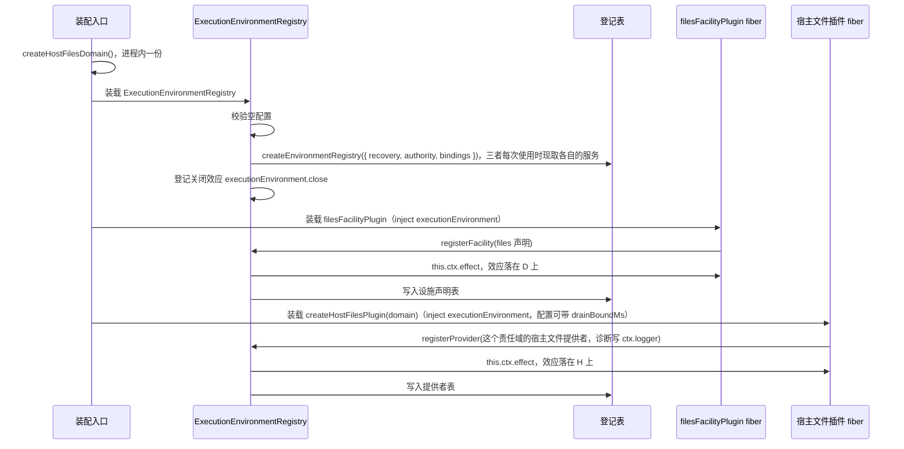
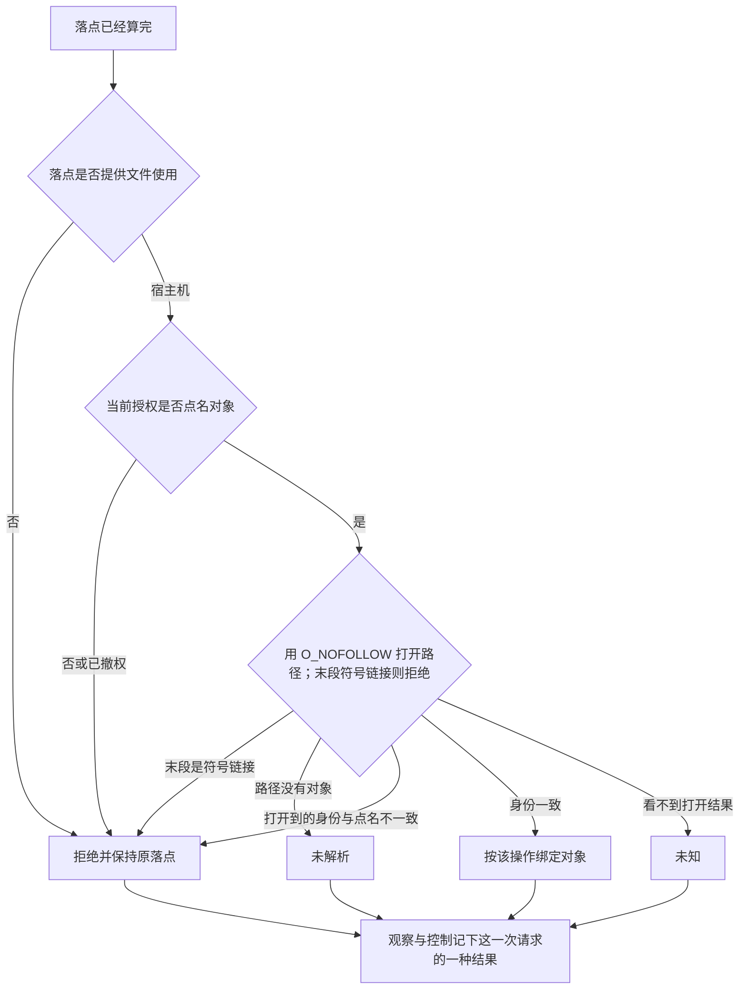
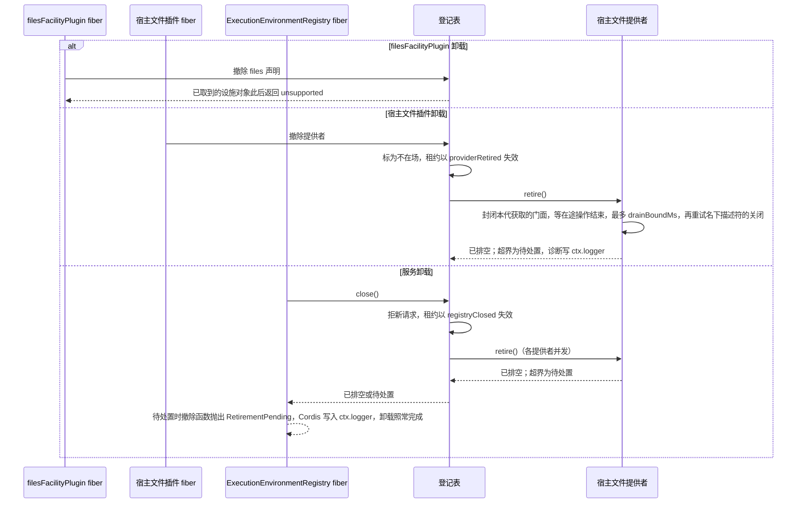
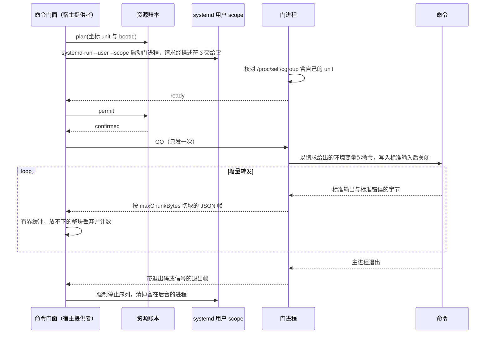
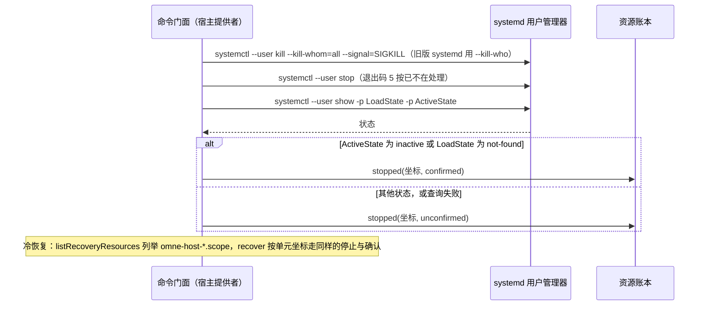

# execution-environment-host-local 的机制流程

本页给出本成员的六条机制级流程。F-EEH01 至 F-EEH04 与 F-EEH06 有一张图和一张「失败与责任交接」表，F-EEH05 只有一段说明。行为以 [SPEC](../SPEC.md) 为准，图只投影它。F-EEH04 与 F-EEH06 是 Linux 上的 `command`；`terminal` 未实现，F-EEH05 只写它为什么没有图。机制见[架构的宿主命令机制](architecture.md#宿主命令机制)。

协议级流程归 [execution-environment-contract 的流程](../../execution-environment-contract/docs/flows.md)。登记表内部的获取、过门、释放与恢复归 [execution-environment 的流程](../../execution-environment/docs/flows.md)。登记协议的定义归 [execution-environment-cordis-contract 的流程](../../execution-environment-cordis-contract/docs/flows.md)。

## 流程

### F-EEH01 装载服务与宿主文件提供者

依据：[SPEC Service 实现](../SPEC.md#service-实现)、[Cordis 说明的插件与配置](cordis.md#插件与配置)。

| 环节             | 结果                                                                                                        | 失败与责任交接                                                                  |
| ---------------- | ----------------------------------------------------------------------------------------------------------- | ------------------------------------------------------------------------------- |
| 配置             | Service 与 `filesFacilityPlugin` 只接受缺省、`null` 或空对象；宿主文件插件另接受有限、非负的 `drainBoundMs` | 其余值校验失败，插件不装载                                                      |
| 恢复授权         | 每次恢复操作现取 `executionRecoveryAuthority` 服务                                                          | 装配入口装载 `ExecutionRecoveryAuthorityService` 的子类。没有装载时恢复答不可用 |
| 访问端口         | 每次访问核验现取 `executionEnvironmentAuthority` 与 `executionScopeBinding` 服务                            | 装配入口装载两者的子类。任一缺席时核验答不可用，获取不发生                      |
| 责任域           | 同一进程的所有宿主文件插件共用装配入口给的一个责任域                                                        | 每次装载另建责任域会让配额和原获取查询看不到旧代的获取；责任域由进程宿主拥有    |
| 登记             | 设施声明的寿命等于 `filesFacilityPlugin` 的 fiber，提供者登记的寿命等于宿主文件插件的 fiber                 | 重复登记抛出，该插件的 fiber 进入 `FAILED`                                      |
| 只装其中一个插件 | 只有提供者时落点解析返回 `missingFacility`；只有声明时返回 `noMatchingEnvironment`                          | 装配者两个都装                                                                  |
| 服务不在场       | 两个插件都停在 `PENDING`                                                                                    | 装配者装载服务                                                                  |

### F-EEH02 宿主文件使用

依据：[SPEC 宿主文件使用](../SPEC.md#宿主文件使用)、[架构的宿主文件使用](architecture.md#宿主文件使用)。对应契约设施协议里文件操作的最小调用事实，以及 [INV-EE04](../../execution-environment-contract/SPEC.md#inv-ee04-原主体在实际边界继续受约束) 与 [INV-EE09](../../execution-environment-contract/SPEC.md#inv-ee09-资源和秘密以最小必要条件提供)。本节已由 PanQiWei 接受，见 [技术设计接受](https://github.com/nemori-ai/omne-harness-lite/issues/278#issuecomment-6197369869)。

末段符号链接由打开时的 `O_NOFOLLOW` 拒绝，不再使用先 `lstat` 再打开的竞态预检；没有 `O_NOFOLLOW` 的宿主（Windows）在打开之后 `lstat` 末段核对，见架构正文「宿主文件使用」。设备号和 inode 的核对发生在打开之后。核对失败不返回字节。后一次请求重新点名。上一次字节留在上一次结果里。`Shell()` 不经过这张图。

经 Cordis 装配时，这张图之前还有登记表的逐操作门：请求形状、租约是否仍接纳新操作、这次获取的账本是否已关闭、此刻的设施声明、租户一致、绑定层一致与守卫。宿主提供者不再查账本。门之后、这张图之前，这次获取的门面只把操作计入在途；门面已封闭（释放、结清或所属代退役之后）时返回 `closed`，不触碰文件系统。门的流程归 [execution-environment 的 F-EER02](../../execution-environment/docs/flows.md#f-eer02-一次设施操作过门)。

| 环节             | 结果                             | 失败与责任交接                                                                            |
| ---------------- | -------------------------------- | ----------------------------------------------------------------------------------------- |
| 不是宿主层       | `rejected`，原因 `unsupported`   | 落点保持为请求里的那一个                                                                  |
| 未点名           | `rejected`，原因 `notAuthorized` | 调用方按当前授权点名后用新的请求身份再请求                                                |
| 身份不一致       | `rejected`，原因 `conflict`      | 本设施关闭描述符。关闭失败的描述符留待后续重试                                            |
| 路径没有对象     | 未解析                           | 写入的替换模式也返回未解析，见 [SPEC 其余现行行为](../SPEC.md#宿主文件设施的其余现行行为) |
| 打开或核对后出错 | 未知                             | 请求身份仍在。截断之后没写完时文件可能已变短                                              |
| 关闭             | 有成功回执为完成，否则为未知     | 已读到或写到的结果留在原请求上                                                            |

### F-EEH03 卸载与关闭

依据：[SPEC 撤除顺序](../SPEC.md#撤除顺序)、[Cordis 说明的撤除顺序](cordis.md#撤除顺序)。

| 环节                   | 结果                                                                                                      | 失败与责任交接                                                                                                                                                                                                                                               |
| ---------------------- | --------------------------------------------------------------------------------------------------------- | ------------------------------------------------------------------------------------------------------------------------------------------------------------------------------------------------------------------------------------------------------------ |
| 两个插件的卸载先后     | 不固定                                                                                                    | 各自独立，先后不影响结果                                                                                                                                                                                                                                     |
| 已交租约               | 失效，之后的设施操作返回 `closed`                                                                         | 集成方释放租约。丢掉引用不是释放，获取表保留记录                                                                                                                                                                                                             |
| 退役待处置             | 撤除函数抛出 `RetirementPending`。fiber 卸载时这个错误只进 `ctx.logger`；调用方直接调用撤除函数时可以重试 | 未停的受管资源在集成方账本里，由维护者处置。宿主文件提供者没有受管资源；它的待处置表示本代某些获取在上界内没有结清（在途文件操作未结束或名下描述符关闭失败），诊断写明数目，这些操作的结果仍交回原请求；获取记录留在责任域里，之后的结清或 `maintain()` 再试 |
| 服务卸载时依赖它的插件 | 随之卸载或重跑，与 `close()` 并发                                                                         | 同一个提供者的退役共用一次 `retire()`                                                                                                                                                                                                                        |
| 外部效果               | 不撤回                                                                                                    | 已写入的字节留在文件里                                                                                                                                                                                                                                       |

### F-EEH04 宿主命令：门、许可与转发

依据：[SPEC 宿主命令与终端](../SPEC.md#宿主命令与终端未实现)、[架构的宿主命令机制](architecture.md#宿主命令机制)。只在 Linux 上实现。协议级流程是契约的 [F-EEC07](../../execution-environment-contract/docs/flows.md#f-eec07-命令的增量输出与终局)。

| 环节     | 结果                                                                                  | 失败与责任交接                                                                                 |
| -------- | ------------------------------------------------------------------------------------- | ---------------------------------------------------------------------------------------------- |
| 平台前提 | P1 Linux、P3 `systemd-run` 与 `systemctl`、P4 用户管理器、P5 cgroup v2、P6 往返都满足 | 缺任一项时启动答 `unavailable`，诊断写明缺项，不调用账本；不用猜测的进程号或假后端顶替         |
| 门就绪   | 门进程核对自己在 scope 的 cgroup 里，才报就绪                                         | 就绪之前退出答 `unavailable`；超过 `startBoundMs` 答 `unknown`，资源留给释放、结清或退役去停止 |
| GO       | 账本 `permit` 为 `confirmed` 才发 GO，GO 之前不启动用户命令                           | 其余答案或门面已封住时，强制停止这个单元并答 `rejected`，不发 GO                               |
| 转发     | 门一侧管道写满时暂停读命令的两条管道，`drain` 后恢复；提供者一侧缓冲放不下时整块丢弃  | 非法帧、超长行、未知帧与次序不对的帧使资源失效，`result` 答 `failed`（`effectUnknown`）        |
| 完成     | 只在收到退出帧时给出 `completed`                                                      | 没有收到退出帧时为 `failed`（`effectUnknown`）                                                 |

### F-EEH05 终端腿与回执（未实现，不在 M2）

依据：[SPEC 宿主命令与终端](../SPEC.md#宿主命令与终端未实现)的第一段。`terminal` 不在 M2（D-05）：宿主提供者不声明它，`outputMode` 为 `terminal` 的启动答 `unsupported`。本成员没有终端腿的代码，没有测试，也不引入 node-pty。协议级流程是契约的 [F-EEC08](../../execution-environment-contract/docs/flows.md#f-eec08-终端腿)。需要终端的工具在落点解析时得到 `missingFacility`。终端的机制设计等 D-05 放开后再写，这里不保留未经实现核对的图。

### F-EEH06 停止确认与冷恢复

依据：[SPEC 宿主命令与终端](../SPEC.md#宿主命令与终端未实现)的停止两态与资源级冷恢复。协议级流程是契约的 [F-EEC05](../../execution-environment-contract/docs/flows.md#f-eec05-恢复授权收场与作用域释放)。

| 环节   | 结果                                                                                                                                      | 失败与责任交接                                                                                 |
| ------ | ----------------------------------------------------------------------------------------------------------------------------------------- | ---------------------------------------------------------------------------------------------- |
| 停止   | 强制结束执行域的全部进程，再停止执行域；平和停止只发 `SIGTERM` 给主进程，最多等 `graceMs`                                                 | 超时答 `unconfirmed`，不自动升级为强制停止，由调用方决定                                       |
| 确认   | 单元为 `inactive` 或 `not-found` 才报 `confirmed`；`failed` 与 `deactivating` 不算停止                                                    | 其余情况为 `unconfirmed`，保留处置责任，进程留在这份获取的待停止集合                           |
| 冷恢复 | 进程重启后，`listRecoveryResources` 按作用域摘要列举单元，`recover` 按 `{ unit, bootId }` 核对再停止；启动身份已变时答 `confirmedStopped` | 不重启命令，不接回输出，不重授旧许可，也不结清获取；没有可达的用户管理器时列举答 `unavailable` |

## 失败与生命周期

| 情形                                                                                           | 结果                                                                                                                                     | 责任方                     | 依据                                                                                       |
| ---------------------------------------------------------------------------------------------- | ---------------------------------------------------------------------------------------------------------------------------------------- | -------------------------- | ------------------------------------------------------------------------------------------ |
| 关闭失败的描述符                                                                               | 留在共用引擎里并带所属获取的标记，每次公开操作前和排空该获取时重试关闭                                                                   | 宿主文件责任域             | [架构的宿主文件使用](architecture.md#宿主文件使用)                                         |
| 提供者代退役或被丢弃                                                                           | 责任域保留获取记录、句柄代际表和待关闭的描述符；新代仍能查询和结清它们                                                                   | 宿主文件责任域             | [SPEC 所有权、失败与生命周期](../SPEC.md#所有权失败与生命周期)                             |
| 进程失败                                                                                       | 责任域随进程消失，没有东西证明旧名额已结清；新进程的责任域对旧代的获取键答未知。需要域外可信进程退出证据的冷恢复结清是 M2 之后的剩余责任 | 集成方据账本处置           | [execution-environment SPEC](../../execution-environment/SPEC.md#所有权失败与生命周期)     |
| 重复装载服务                                                                                   | 第二份在 `provide` 时失败                                                                                                                | 装配者                     | [Cordis 说明的 isolate 绑定](cordis.md#isolate-绑定)                                       |
| 配置不合 Schema（Service 与声明插件不是空对象；宿主文件插件带其他字段或非法的 `drainBoundMs`） | 校验失败，插件不装载                                                                                                                     | 装配者                     | [Cordis 说明的插件与配置](cordis.md#插件与配置)                                            |
| 撤除函数抛出                                                                                   | Cordis 写入 `ctx.logger`，卸载照常完成                                                                                                   | 装配者经 `ctx.logger` 观察 | [Cordis 说明的机制读数](cordis.md#机制读数与假设)                                          |
| 获取账本已关闭                                                                                 | 登记表的门使这份获取的文件操作返回 `closed`，不调用宿主设施                                                                              | 集成方                     | [execution-environment 的逐操作门](../../execution-environment/SPEC.md#租约视图与逐操作门) |
| 退役时有在途文件操作                                                                           | 等它们结束，最多 `drainBoundMs`；超界为待处置，诊断写明数目                                                                              | 宿主文件提供者             | [SPEC 宿主提供者的事实](../SPEC.md#宿主提供者的事实)                                       |
