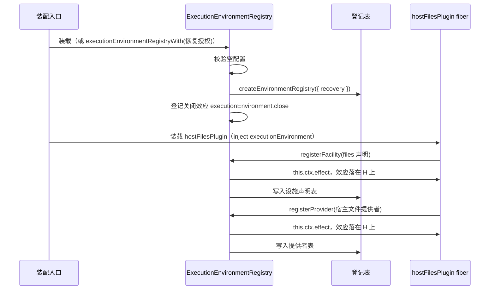
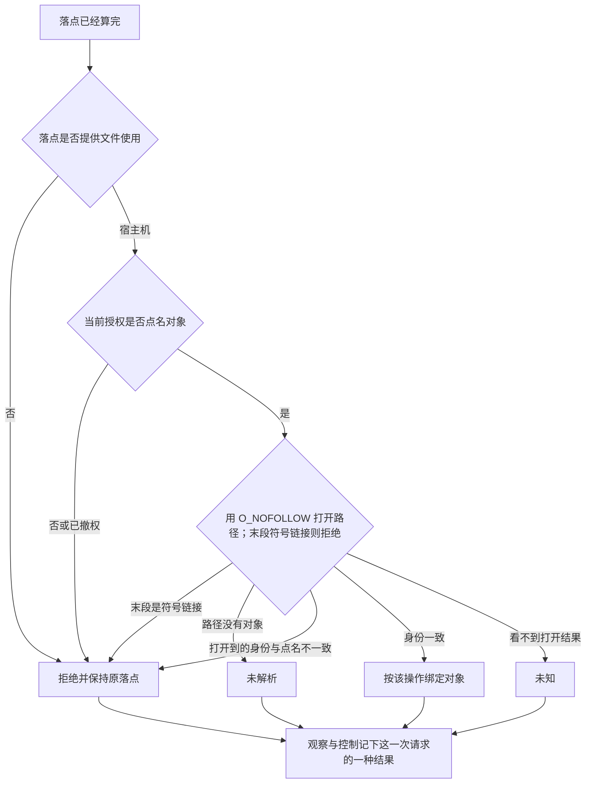
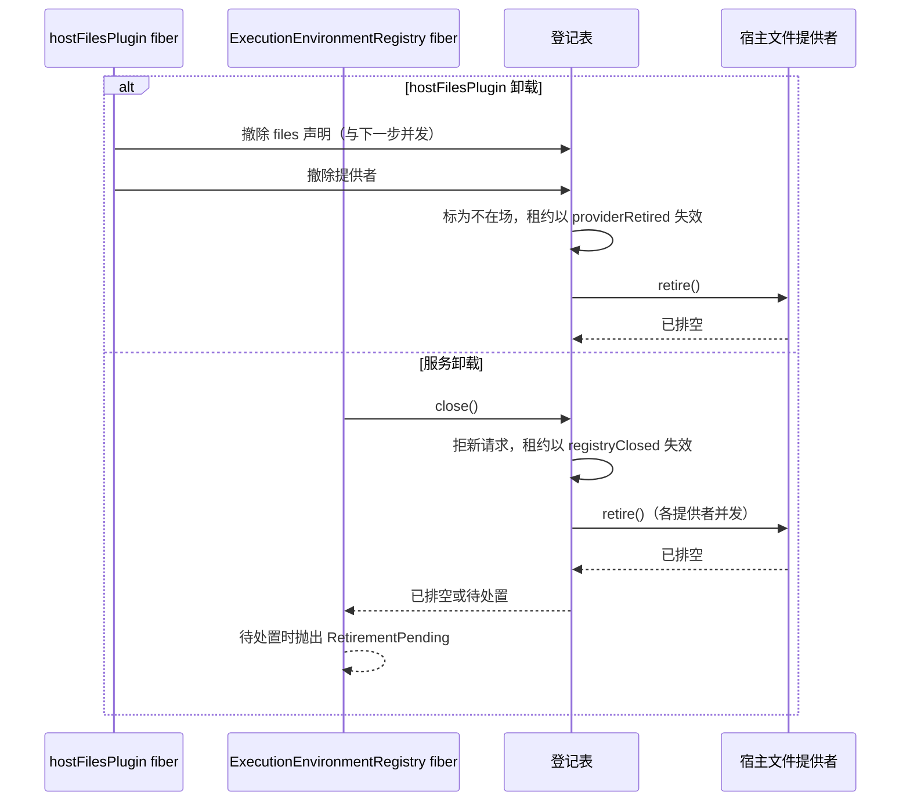

# execution-environment-host-local 的机制流程

本页给出本成员的三条机制级流程。每条有一张图和一张「失败与责任交接」表。行为以 [SPEC](../SPEC.md) 为准，图只投影它。

协议级流程归 [execution-environment-contract 的流程](../../execution-environment-contract/docs/flows.md)。登记表内部的获取、过门、释放与恢复归 [execution-environment 的流程](../../execution-environment/docs/flows.md)。登记协议的定义归 [execution-environment-cordis-contract 的流程](../../execution-environment-cordis-contract/docs/flows.md)。

## 流程

### F-EEH01 装载服务与宿主文件提供者

依据：[SPEC Service 实现](../SPEC.md#service-实现)、[Cordis 说明的插件与配置](cordis.md#插件与配置)。

| 环节 | 结果 | 失败与责任交接 |
| --- | --- | --- |
| 配置 | 只接受缺省、`null` 或空对象 | 其余值校验失败，插件不装载 |
| 恢复授权 | 直接装载时缺省为不可用 | 装配者要恢复，改装 `executionEnvironmentRegistryWith` 返回的插件 |
| 登记 | 两项登记的寿命等于 `hostFilesPlugin` 的 fiber | 重复登记抛出，`hostFilesPlugin` 的 fiber 进入 `FAILED` |
| 服务不在场 | `hostFilesPlugin` 停在 `PENDING` | 装配者装载服务 |

### F-EEH02 宿主文件使用

依据：[SPEC 宿主文件使用](../SPEC.md#宿主文件使用)、[架构的宿主文件使用](architecture.md#宿主文件使用)。对应契约设施协议里文件操作的最小调用事实，以及 [INV-EE04](../../execution-environment-contract/SPEC.md#inv-ee04-原主体在实际边界继续受约束) 与 [INV-EE09](../../execution-environment-contract/SPEC.md#inv-ee09-资源和秘密以最小必要条件提供)。本节已由 PanQiWei 接受，见 [技术设计接受](https://github.com/nemori-ai/omne-harness-lite/issues/278#issuecomment-6197369869)。

末段符号链接由打开时的 `O_NOFOLLOW` 拒绝，不再使用先 `lstat` 再打开的竞态预检。设备号和 inode 的核对发生在打开之后。核对失败不返回字节。后一次请求重新点名。上一次字节留在上一次结果里。`Shell()` 不经过这张图。

经 Cordis 装配时，这张图之前还有登记表的逐操作门：请求形状、租约有效、租户一致与守卫。门的流程归 [execution-environment 的 F-EER02](../../execution-environment/docs/flows.md#f-eer02-一次设施操作过门)。

| 环节 | 结果 | 失败与责任交接 |
| --- | --- | --- |
| 不是宿主层 | `rejected`，原因 `unsupported` | 落点保持为请求里的那一个 |
| 未点名 | `rejected`，原因 `notAuthorized` | 调用方按当前授权点名后用新的请求身份再请求 |
| 身份不一致 | `rejected`，原因 `conflict` | 本设施关闭描述符。关闭失败的描述符留待后续重试 |
| 路径没有对象 | 未解析 | 写入的替换模式也返回未解析，见 [SPEC 其余现行行为](../SPEC.md#宿主文件设施的其余现行行为) |
| 打开或核对后出错 | 未知 | 请求身份仍在。截断之后没写完时文件可能已变短 |
| 关闭 | 有成功回执为完成，否则为未知 | 已读到或写到的结果留在原请求上 |

### F-EEH03 卸载与关闭

依据：[SPEC 撤除顺序](../SPEC.md#撤除顺序)、[Cordis 说明的撤除顺序](cordis.md#撤除顺序)。

| 环节 | 结果 | 失败与责任交接 |
| --- | --- | --- |
| 两个效应的先后 | 不固定 | 两者都让新获取取不到宿主文件设施 |
| 已交租约 | 失效，之后的设施操作返回 `closed` | 集成方释放租约，或丢弃引用 |
| 退役待处置 | 撤除函数抛出 `RetirementPending` | 未停的受管资源在集成方账本里，由维护者处置。宿主文件提供者没有受管资源 |
| 服务卸载时依赖它的插件 | 随之卸载或重跑，与 `close()` 并发 | 同一个提供者的退役共用一次 `retire()` |
| 外部效果 | 不撤回 | 已写入的字节留在文件里 |

## 失败与生命周期

| 情形 | 结果 | 责任方 | 依据 |
| --- | --- | --- | --- |
| 关闭失败的描述符 | 留在设施实例里，每次公开操作前重试关闭 | 宿主文件设施 | [架构的宿主文件使用](architecture.md#宿主文件使用) |
| 提供者实例被丢弃 | 句柄代际表随之消失，未关闭的描述符由运行时回收 | 运行时 | [SPEC 所有权、失败与生命周期](../SPEC.md#所有权失败与生命周期) |
| 进程失败 | 没有可恢复的东西。宿主文件提供者没有受管资源 | 集成方据账本处置 | [execution-environment SPEC](../../execution-environment/SPEC.md#所有权失败与生命周期) |
| 重复装载服务 | 第二份在 `provide` 时失败 | 装配者 | [Cordis 说明的 isolate 绑定](cordis.md#isolate-绑定) |
| 配置不是空对象 | 校验失败，插件不装载 | 装配者 | [Cordis 说明的插件与配置](cordis.md#插件与配置) |
| 撤除函数抛出 | Cordis 的处置没有 basis 条目 | 装配者观察 | [Cordis 说明的机制读数](cordis.md#机制读数与假设) |
