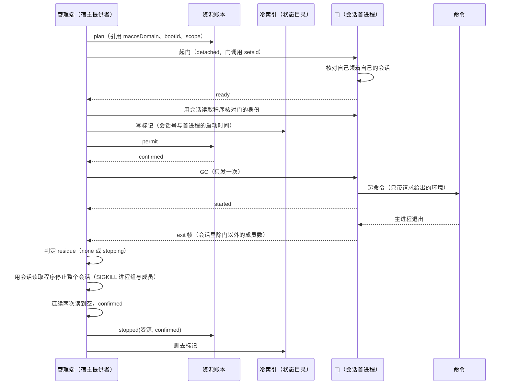

# macOS 的命令与终端执行

本页说明宿主提供者在 macOS（`darwin`）上怎样承担 `command` 与 `terminal`。行为以 SPEC 的 [macOS 的兑现](../SPEC.md#macos-的兑现)与 [macOS 终端](../SPEC.md#macos-终端)为准。本页解释机制、理由与平台实验，不另立行为条款。实现由 [#1137](https://github.com/nemori-ai/omne-harness-lite/issues/1137) 交付，未经技术接受。

## 范围

- macOS 上，宿主提供者有一次性命令后端与持久终端后端。
- `files` 照常提供已接受的四项。其余八项照旧答 `unavailable`。
- 执行域是 POSIX 会话。会话不满足封闭收纳，所以本后端不保留进程。主进程退出之后，提供者停止整个会话。
- 代码在 `src/macos-execution/`。`src/host-platform.ts` 在 `darwin` 上选用本后端。

## 与 Linux 门协议的差别

命令门与终端门的控制通道、帧格式与 GO 的次序都与 Linux 相同。命令门复用 `command-gate-core.ts`，终端门复用 `terminal-gate-core.ts`。差别如下：

| 方面         | Linux                                         | macOS                                                                                          |
| ------------ | --------------------------------------------- | ---------------------------------------------------------------------------------------------- |
| 执行域       | systemd 用户 scope 单元                       | 门领的 POSIX 会话。终端另有 shell 领的第二个会话                                               |
| 起门         | `systemd-run` 在单元里执行门                  | 提供者以 `detached: true` 起门，门调用 setsid，领一个新会话                                    |
| 门的自核     | 门核对 `/proc/self/cgroup` 含有自己的单元     | 门在读第一条控制行之前核对自己领着自己的会话                                                   |
| 退出帧的计数 | 门读单元的 `cgroup.procs`                     | 门用会话读取程序读会话里除门以外的成员                                                         |
| 退出帧之后   | 门留在单元里读管道，等处置                    | 提供者停止整个会话，门随会话停止                                                               |
| 提供者走掉   | 门留在单元里，单元由冷恢复处理                | GO 之后控制通道结束时，门停止自己会话里的其他全部成员，然后退出。终端门停止两个会话           |
| 停止的确认   | `systemctl --user show` 读到单元不活动        | 会话读取程序连续两次读到空                                                                     |
| 冷索引       | 单元描述与保留进程的标记文件                  | 状态目录里每个执行域一个标记                                                                   |

macOS 的门的环境只有 `PATH=/usr/bin:/bin:/usr/sbin:/sbin`。所以提供者的环境变量与其中的秘密不进入门的会话。命令的环境只有请求给出的变量，与 Linux 相同。

## 一个执行域的生命周期

下图是一次性命令的执行域。终端的执行域在 GO 之后多一步：shell 起来之后，提供者把 shell 的会话写进同一个标记。



- 标记在 GO 之前写。所以每个起过命令的执行域都有标记，提供者死去之后冷恢复能找到它。
- 身份核对或标记写不成时，提供者停止门，启动答 `unavailable`。账本不许可时，启动停止执行域并答 `rejected`。
- `residue` 的次序与各项原因见 SPEC [macOS 的兑现](../SPEC.md#macos-的兑现)。各项都不成立时原因是 `uncontained`。不论原因，提供者都停止整个会话。
- 停止的记账去获取账本。确认的停止记入账本之后，提供者才删去标记。删不掉的标记留在列表里，它的恢复会读到会话已空。

## 会话读取程序

macOS 的 `pgrep` 没有 `-s`，`ps` 的 `sess` 列显示 0，所以系统自带的工具读不出会话成员。本后端带一个 C 程序做这件事。

- 源码在 `src/macos-execution/native-source.ts`。它只用公开接口：`proc_listpids`（全部进程号与 `PROC_PPID_ONLY`）、`getsid`、`getpgid`、`kill`、`killpg`，以及带 `PROC_PIDT_SHORTBSDINFO` 与 `PROC_PIDTBSDINFO` 的 `proc_pidinfo`。
- `src/macos-execution/compile.ts` 在运行时用 `/usr/bin/cc` 把它编译到 `$TMPDIR/omne-macos-execution/<源码的 sha256>/omne-session`。Windows 后端的 bridge 用同样的做法。
- 编译之前先运行 `xcode-select -p`。没有 Command Line Tools 时，`/usr/bin/cc` 会弹出安装对话框，而不是失败。所以先核对，缺工具时答前提项 `command-line-tools`，不调用编译器。编译失败时答前提项 `session-reader`。
- 缺工具或编译失败的结果不保留，下一次用到时再试。
- 子命令：

| 子命令     | 作用                                                                                     |
| ---------- | ---------------------------------------------------------------------------------------- |
| `members`  | 列出给定会话里活着的成员，每行是进程号、进程组号与会话号                                 |
| `identity` | 读一个进程的会话号与启动时间，进程不在时答 `gone`                                        |
| `children` | 列出一个进程活着的子进程。终端用它找 gate 起的 shell                                     |
| `stop`     | 向每个成员的进程组与每个成员发 `SIGKILL`，再读；连续两次读到空答 `confirmed`，到上界答 `unconfirmed` |

- 读取程序从不把自己算作成员。僵尸进程不是成员。
- 读取失败、超时或输出读不懂时，`src/macos-execution/session.ts` 按未知处理。成员数未知按有留下的进程处理，停止答 `unconfirmed`。

`src/macos-execution/session.ts` 也承担执行域的身份核对：

- 启动身份是 `kern.bootsessionuuid`。`kern.boottime` 不用，因为时钟调整会改变它。标记的启动身份不是当前的时，执行域按已停止处理。
- 停止一个记下的执行域之前，提供者核对每个会话首进程的身份。首进程号活着而启动时间不同时，这个进程号已被重用，跳过这个会话。首进程已不在时，仍带这个会话号的成员属于这个执行域。

## 冷索引

`src/macos-execution/domain-index.ts` 是 macOS 执行域的冷索引。没有状态目录时没有冷索引。

- 每个执行域一个标记：`<stateDirectory>/macos-domains/<资源键>.json`。标记记下资源、请求方作用域与会话坐标（启动身份，以及每个会话的会话号与首进程的启动时间）。
- 写法是先写临时文件，再改名。目录的权限是 0700，标记的权限是 0600。
- 资源引用是 `{ macosDomain, bootId, scope }`。引用在 `plan` 时就要给出，那时还没有门，所以引用只写资源键与启动身份，会话坐标在标记里。
- 列举要么完整，要么答 `unavailable`。有一个标记读不出，或目录里有不是本索引写的文件时，列举答 `unavailable`。没有状态目录时答 `unavailable`，不答空列表。
- `listRecoveryResources` 合并冷索引的列举与责任域已知的保留终端。
- `recover` 的各种答复见 SPEC [macOS 的兑现](../SPEC.md#macos-的兑现)。`src/macos-execution/recovery.ts` 承担列举与恢复。

## 终端

`src/macos-execution/terminals.ts` 实现 `host-terminal.ts` 的 `TerminalPlatform`。`host-terminal.ts` 接受可注入的 `TerminalPlatform`。没有注入时，它是不变的 Linux scope 实现。

- 终端的执行域是两个会话：gate 的会话与 shell 的会话。node-pty 经 `spawn-helper` 以 `POSIX_SPAWN_SETSID` 起 shell，所以 shell 领第二个会话。
- `spawn-helper` 的路径取自 node-pty 自己的 `loadNativeModule`，与 node-pty 加载原生模块的位置相同。
- 标记在 GO 之前写 gate 的会话，shell 起来之后带上 shell 的会话重写。停止时，若标记里只有 gate 的会话而 gate 还活着，提供者先经 gate 的子进程找 shell 的会话，再一起停止。
- 两个 FIFO 在 `$TMPDIR/omne-terminal-<资源键>.terminal` 里，用 `mkfifo -m 600` 创建。确认停止之后删去这个目录。
- `close` 停止两个会话。两个会话都空时才答 `confirmed`。
- Session 保留终端在 macOS 上照常可用。

Bash 3.2 的结论：Linux 的 Bash 驱动与分段源码不改动，在系统的 `/bin/bash` 3.2.57 上运行。所以段的完成与字节归属的规则在 macOS 上同样兑现。慢层的 C8（200 段）、C9 与契约终端套件在真实 PTY 与 Bash 3.2 上确认了这一点。

## 前提

| 前提项名             | 核对                                                     | 约束       |
| -------------------- | -------------------------------------------------------- | ---------- |
| `command-line-tools` | `xcode-select -p` 成功                                   | 命令与终端 |
| `session-reader`     | 会话读取程序编译成功                                     | 命令与终端 |
| `bash`               | `/bin/bash` 可执行                                       | 终端       |
| `node-pty`           | node-pty 与它的原生模块可以加载                          | 终端       |
| `spawn-helper`       | node-pty 的 `spawn-helper` 可执行                        | 终端       |

依赖补丁：node-pty 1.1.0 把 darwin 的 `spawn-helper` 装成 0644，它的 postinstall 不改正。仓库的 `patches/node-pty@1.1.0.patch` 把这些文件的权限设为 0755，它登记在 `pnpm-workspace.yaml` 的 `patchedDependencies` 里。没有这个补丁时，终端的前提项 `spawn-helper` 不满足。

## 已知偏离

偏离的正文与负责人见 SPEC 的[已知偏离](../SPEC.md#留下的进程的兑现)。摘要如下：

- 调用 `setsid` 的进程离开执行域。它不被停止，也不被列出，`close` 仍答 `confirmed`。`terminals.spec.ts` 的用例「known deviation」断言这一点。
- Shell 工具的帮助文本说留下的进程被保留，这在 macOS 上不成立。模型看到 `residue=stopping reason=uncontained`、`retained_processes=unavailable` 与 `process_containment=none`。
- 提供者死去时，门停止自己的会话。
- 提供者与门在 GO 之后、终端的 shell 会话记入标记之前一起死去时，标记里没有 shell 的会话。
- 读到一个成员与向它发信号之间，进程号在理论上可以被重用。这个窗口很窄，与按进程号 `kill` 的窗口同类。

## 平台实验

实验在 macOS 15.8、arm64、SIP 打开、无特权的条件下做。详细记录在仓库之外。

| 实验 | 结论                                                                                                                                                                                                                               |
| ---- | ---------------------------------------------------------------------------------------------------------------------------------------------------------------------------------------------------------------------------------- |
| E4   | 进程可以用 setsid 离开会话与进程组                                                                                                                                                                                                 |
| E2   | 无特权时，创建 coalition 或在 coalition 里起进程都答 `EPERM`                                                                                                                                                                       |
| E1   | launchd 给用户域的每个 job 一个新的 coalition，setsid 的后代离不开它。但这依赖私有的 flavor 编号与没有文档的 launchd 行为，并且需要 `gui` 域（`user/<uid>` 的 bootstrap 答 EIO）。#1137 的负责人在 2026-11-06 决定不采用 |
| E7   | 哨兵经真实 PTY 传递，2000 个中 2000 个按次序到达                                                                                                                                                                                   |
| E8   | node-pty 起的 shell 领自己的会话。`kill()` 留下 nohup 的进程                                                                                                                                                                       |
| E9   | `kern.bootsessionuuid` 稳定                                                                                                                                                                                                        |
| E10  | 一个不停 fork、有 2075 个成员的会话被停止到空                                                                                                                                                                                      |

E4 说明会话不是封闭收纳。E2 说明无特权时不能自建 coalition。E1 的路径没有被采用。所以本后端按会话收纳，不保留进程。

## 验证

测试在 `tests/macos-execution/`，清单见 [tests/README.md](../tests/README.md#macos-验证)。运行记录见 SPEC [组合与验证](../SPEC.md#组合与验证)。慢层只在 macOS 且设了 `OMNE_HOST_MACOS=1` 时运行。在本包目录执行：

```sh
OMNE_HOST_MACOS=1 pnpm run test:slow
```

只跑 macOS 的测试时执行：

```sh
OMNE_HOST_MACOS=1 pnpm exec vitest run --mode slow --typecheck.enabled=false tests/macos-execution/
```
