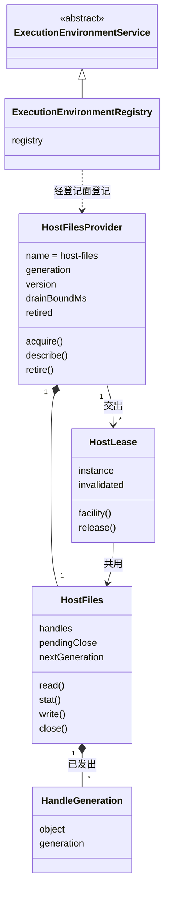

# execution-environment-host-local 的对象模型

本页说明本成员内部对象的身份、关系与生灭。领域对象（落点、租约、设施请求、设施结果、对象身份、句柄代际）的含义归 [execution-environment-contract 的对象模型](../../execution-environment-contract/docs/object-model.md)，登记表内部的对象归 [execution-environment 的对象模型](../../execution-environment/docs/object-model.md)。本页只写宿主机与 Cordis 一侧的对象。行为条款归 [SPEC](../SPEC.md)。

## 对象与关系

| 对象 | 身份 | 拥有者 | 内容 |
| --- | --- | --- | --- |
| `ExecutionEnvironmentRegistry` 服务实例 | 服务键 `executionEnvironment`，每个 isolate 标签一份 | 装载它的插件 fiber | 一个登记表实例 |
| 宿主文件提供者 | `host-files` 加随机 UUID 的代（一次登记化身），版本取本包 `package.json` | 登记它的 `hostFilesPlugin` fiber | 宿主事实、一个带在途计数的宿主文件设施实例、退役的等待上界、尚未释放的租约的失效回调、是否已退役 |
| 宿主租约原件 | 实例身份 `host` 加提供者的代 | 宿主文件提供者 | 落点、连续性、失效通知；`facility('files')` 返回提供者共用的、带在途计数的设施。账本关闭由登记表的门核对，租约原件不查 |
| 在途文件操作 | 一次已接纳、尚未结束的文件操作 | 宿主文件提供者 | 退役时等它们结束，最多 `drainBoundMs` |
| `files` 设施声明的登记 | 设施键 `files` | 登记它的 `filesFacilityPlugin` fiber | 契约的 `filesFacility` |
| 宿主文件设施实例 | 每个提供者一个 | 宿主文件提供者 | 已发出的句柄代际表、关闭失败待重试的描述符集合、下一个代次 |
| 对象身份 `ObjectToken` | 设备号加 inode | 宿主文件系统 | 由 `hostObjectToken` 或打开后的 `fstat` 读出 |
| 句柄代际 `HandleGeneration` | 对象身份加代次 | 宿主文件设施实例 | 成功的读取、查看与写入各发出一个，从 `1` 递增 |
| 文件版本 | 修改时间加字节数 | 宿主文件系统 | 参与替换写入的预期版本比较 |

图中 `HostFilesProvider`、`HostLease` 与 `HostFiles` 是说明用的名字。源码里它们是 `createHostFilesProvider`、提供者 `acquire` 与 `createHostFiles` 返回的对象，没有独立的类。

## 生命周期

### 句柄代际

发出（读取、查看或写入成功，描述符已关闭）→ 关闭请求得到成功回执，再关仍是成功回执。

发出时描述符关闭失败：代际记下这个仍开着的描述符 → 关闭请求重试关闭，成功为完成，失败为未知。

没有发出过的代际，关闭请求得到未知。

### 关闭失败待重试的描述符

身份不一致、读写失败或 `fstat` 失败的错误路径上关不掉的描述符进入集合 → 每次公开操作前重试关闭 → 成功即移出。它们没有公开的清理接口，设施实例被丢弃时由运行时回收。

### 宿主文件提供者

创建（生成代，读本包版本）→ 经 `hostFilesPlugin` 登记 → 在场，交出租约；租约释放时删除它的失效回调 → 退役：标为已退役，停止接纳新文件操作（之后的操作返回 `closed`），尚未释放的租约以来源 `provider`、原因 `providerRetired` 失效，再等在途文件操作结束，最多 `drainBoundMs` → 都结束为已排空；超界为待处置，给出在途数目的诊断，再次退役会再等 → 之后的 `acquire` 返回 `providerUnavailable`。

### 服务实例

装载（校验配置，建立登记表，登记关闭效应）→ 提供服务 → 卸载：关闭登记表，待处置时撤除函数抛出，Cordis 写入 `ctx.logger`，卸载照常完成 → 键上没有服务。
