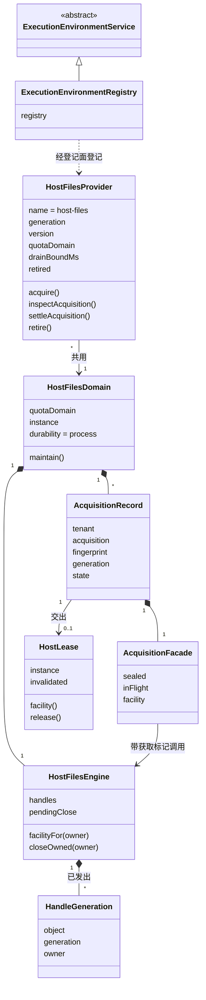

# execution-environment-host-local 的对象模型

本页说明本成员内部对象的身份、关系与生灭。领域对象（落点、租约、设施请求、设施结果、对象身份、句柄代际）的含义归 [execution-environment-contract 的对象模型](../../execution-environment-contract/docs/object-model.md)，登记表内部的对象归 [execution-environment 的对象模型](../../execution-environment/docs/object-model.md)。本页只写宿主机与 Cordis 一侧的对象。行为条款归 [SPEC](../SPEC.md)。

## 对象与关系

| 对象 | 身份 | 拥有者 | 内容 |
| --- | --- | --- | --- |
| `ExecutionEnvironmentRegistry` 服务实例 | 服务键 `executionEnvironment`，每个 isolate 标签一份 | 装载它的插件 fiber | 一个登记表实例 |
| 宿主文件责任域 `HostFilesDomain` | 配额域名（默认 `host-files`）加进程实例 UUID | 进程宿主的唯一拥有者，比每个提供者代和每个登记表都活得久 | 配额策略、共用文件引擎、获取记录表、本域发出过的提供者代集合；持久性只到本进程 |
| 共用文件引擎 | 每个责任域一个 | 宿主文件责任域 | 已发出的句柄代际表（代次在引擎内唯一，每个代际带所属获取的标记）、关闭失败待重试的描述符集合 |
| 获取记录 | 键为（租户，获取键），附原获取描述的指纹 | 宿主文件责任域 | 原获取描述、所属提供者代、获取门面、状态（打开、释放中、已结清）、租约原件与失效回调 |
| 获取门面 | 每条获取记录一个 | 获取记录 | 封闭标记与在途文件操作集合；`facility('files')` 返回它；封闭后新操作返回 `closed` |
| 宿主文件提供者 | `host-files` 加随机 UUID 的代（一次登记化身），版本取本包 `package.json` | 用 `createHostFilesPlugin(domain)` 登记它的插件 fiber | 宿主事实、所属责任域、排空的等待上界、是否已退役 |
| 宿主租约原件 | 实例身份 `host` 加提供者的代 | 获取记录 | 落点、连续性、失效通知；`facility('files')` 返回本获取的门面。账本关闭由登记表的门核对，租约原件不查 |
| 在途文件操作 | 一次已接纳、尚未结束的文件操作 | 获取门面 | 释放或退役时等它们结束，最多 `drainBoundMs` |
| `files` 设施声明的登记 | 设施键 `files` | 登记它的 `filesFacilityPlugin` fiber | 契约的 `filesFacility` |
| 对象身份 `ObjectToken` | 设备号加 inode | 宿主文件系统 | 由 `hostObjectToken` 或打开后的 `fstat` 读出 |
| 句柄代际 `HandleGeneration` | 对象身份加代次 | 共用文件引擎，带所属获取的标记 | 成功的读取、查看与写入各发出一个，代次在引擎内唯一 |
| 文件版本 | 修改时间加字节数 | 宿主文件系统 | 参与替换写入的预期版本比较 |

图中除 `HostFilesDomain` 外都是说明用的名字。源码里它们是 `createHostFilesProvider`、`createHostFilesEngine`、域内部的记录与门面，以及提供者 `acquire` 返回的对象，没有独立的类。

## 生命周期

### 句柄代际

发出（读取、查看或写入成功，描述符已关闭）→ 关闭请求得到成功回执，再关仍是成功回执。

发出时描述符关闭失败：代际记下这个仍开着的描述符 → 关闭请求重试关闭，成功为完成，失败为未知。

没有发出过的代际，关闭请求得到未知。

### 关闭失败待重试的描述符

身份不一致、读写失败或 `fstat` 失败的错误路径上关不掉的描述符进入集合，带所属获取的标记 → 每次公开操作前重试关闭，排空一条获取时也重试它名下的描述符 → 成功即移出。

### 获取记录

接纳（同一同步步骤里核对配额并占用名额）→ 打开，交出租约 → 释放、结清或所属代退役：封闭门面，发出失效（退役时原因为 `providerRetired`），进入释放中 → 在途操作在 `drainBoundMs` 内结束且名下描述符全部关闭：已结清，名额恰好归还一次 → 否则仍为释放中，给出诊断；之后的释放、结清、退役或 `maintain()` 再试。

同一（租户，获取键）再来时：指纹相同读原记录，打开时返回同一租约，其余时候为未知；指纹不同为冲突。记录只存在于本进程，进程结束后没有任何东西证明旧名额已结清。

### 宿主文件提供者

创建（生成代，读本包版本，在责任域登记这个代）→ 经 `createHostFilesPlugin(domain)` 登记 → 在场，经责任域接纳获取 → 退役：标为已退役，排空本代尚未结清的获取记录 → 都结清为已排空；有待处置的为待处置，给出诊断 → 之后的 `acquire` 返回 `providerUnavailable`。责任域和其他代的获取记录不受影响，新代仍能查询和结清它们。

### 服务实例

装载（校验配置，建立登记表，登记关闭效应）→ 提供服务 → 卸载：关闭登记表，待处置时撤除函数抛出，Cordis 写入 `ctx.logger`，卸载照常完成 → 键上没有服务。
