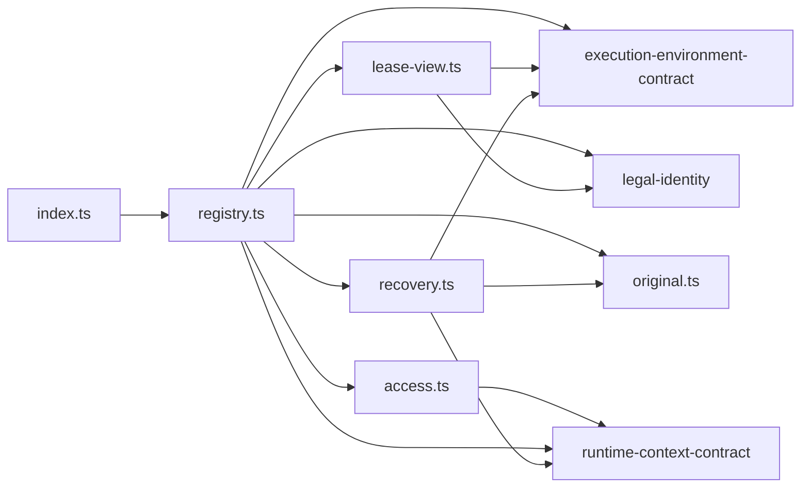

# 执行环境登记表的内部架构

本页说明本成员怎样组织登记表来兑现 [SPEC](../SPEC.md)。它是组内「提供者与设施表、匹配、获取状态、租约视图、恢复编排」这一主题的唯一拥有者（[组架构](../../docs/architecture.md#主题与唯一拥有者)）。公开行为归 [execution-environment-contract SPEC](../../execution-environment-contract/SPEC.md)，Cordis 绑定与撤除归 [execution-environment-host-local](../../execution-environment-host-local/docs/cordis.md)。内部对象的身份与生灭归[对象模型](object-model.md)。

## 模块与依赖

根入口导出工厂 `createEnvironmentRegistry` 与错误类 `RetirementPending`。源码分六个模块：

| 模块 | 源文件 | 持有的状态 | 承担的 SPEC 行为 |
| --- | --- | --- | --- |
| 登记表 | `src/registry.ts` | 提供者表、设施声明表、获取表、已释放作用域、关闭标记 | 落点解析、获取、配额预查、采用与采用失败、采用记录签发、查询、描述、登记与退役、恢复授权核对、关闭 |
| 访问核验 | `src/access.ts` | 没有状态 | 环境授权，再核目标作用域绑定到访问租户；把端口答复收成拒绝、不可用、未知三种失败 |
| 原记录 | `src/original.ts` | 没有状态 | 按配额域选路由，查询与结清原记录，抛出与非法答复按未知 |
| 租约视图 | `src/lease-view.ts` | 每个租约一份：是否仍接纳新操作、是否已失效、释放进行中、是否已释放 | 只暴露要求里的键、逐操作门、失效、释放与重试 |
| 恢复编排 | `src/recovery.ts` | 没有状态，每次调用新建结果列表 | 资源路径逐提供者枚举与停止；获取路径每个配额域列出一次并逐项结清；结果分组 |
| 比较 | `src/compare.ts` | 没有状态 | 输入复制、原获取描述的指纹，绑定层、作用域与键集合的比较；租户只用 `tenantEquals` 与 `tenantCodec` |

包外依赖都在 `package.json` 里：

- `@omne-harness/execution-environment-contract`：全部类型，以及纯函数 `matchProviders` 与 `bindingScope`。
- `@omne-harness/legal-identity`：`tenantEquals` 用于比较租户，`tenantCodec` 用于获取表的键与指纹。
- `@omne-harness/runtime-context-contract`：`ScopeRef`、`ScopeBindingSource` 与 `AuthorityDecision` 类型。只做类型导入。

本成员不导入 `@deepseek-ai/cordis`（[IC-4](../../../../docs/architecture/cordis-integration-conventions.md#ic-4)），也不导入任何上层领域的契约。账本、守卫、恢复授权、环境授权与作用域绑定端口都作为值传入。

## 关键机制与理由

### 落点与获取分开，获取时重新核对

落点解析与获取不是一个原子动作。两次调用之间，提供者可能退役，作用域可能被释放，设施声明可能被撤除。所以 `acquire` 不信任传入的落点，而是重新核对提供者在场、请求方作用域未释放、层在允许清单内、隔离与设施都满足（[契约的获取与租约](../../execution-environment-contract/SPEC.md#获取与租约)）。核对失败就拒绝，不换一个落点。换落点会让集成方以为得到的是它解析出的那一个。

代价：同一组核对写了两次，一次在 `matchProviders`，一次在 `acquire`。

### 访问核验在读获取表之前

普通操作先问环境授权，再核目标作用域绑定到访问租户，然后才读获取表或调用提供者。理由是获取表的键含租户，若先读表再核验，冲突与重复的答复会把别人用过的键暴露给未获授权的调用方。作用域绑定到另一租户与未绑定给同一个拒绝，不泄露另一租户。授权给出的同步 `current()` 在写入的最后一步之前和采用之前再核一次，因为授权在等待提供者期间可能被撤销（[契约的访问核验](../../execution-environment-contract/SPEC.md#访问核验)）。

代价：每次普通操作多两次端口调用。端口不可达时操作答不可用或未知，不放行。

### 先写获取表，再调用提供者

`acquire` 先在（租户，获取键）下写入一条记录，状态为获取中，然后才调用提供者。同一租户同一个键的并发请求在提供者回答之前到达时，看到获取中，得到待定，不会第二次调用提供者。理由是提供者的 `acquire` 可能分配真实资源，重复调用会分配两份。

记录按「键加租户」区分，不按键单独区分。理由是获取键由各集成方给出，不同租户可能用到同一个键。按键单独区分时，另一租户要么被拒绝，要么读到别人的状态，两种答复都会泄露这个键已被用过（[V-EE19](../../execution-environment-contract/SPEC.md#持续验证义务)）。

代价：获取中的状态只在本进程里可见。跨进程的去重归集成方账本。

记录里存请求方作用域，不从绑定层推出作用域。理由是宿主机与租户级沙箱的绑定层不带作用域；按绑定层过滤时，作用域释放不会使宿主租约失效，描述也列不出宿主落点（[契约的获取与租约](../../execution-environment-contract/SPEC.md#获取与租约)）。

### 配额只由提供者判定

写入记录之后、调用提供者之前，本成员问一次提供者的 `quota(租户)`，只判断配额能不能读。读不到时删除记录，答不可用或未知，所以暂时的失败不占用这个键。是否超额只由提供者在 `acquire` 里原子接纳时判定。理由是同一配额域可能有多份登记、多个登记表实例，只有原记录的拥有者能在一步里核对并占用名额；本成员自己计数会与它竞争并给出错误的超额（[契约的配额与安全上界](../../execution-environment-contract/SPEC.md#配额与安全上界)）。

### 分配答复丢失不重发

提供者抛出或答未知时，记录保留为分配未知，同键重复不再调用 `acquire`，而是经原配额域查询原记录。原记录答已分配时才采用，答未分配时为终局拒绝。理由是丢失的答复不证明没有分配；重发会在同一个键下分配第二份（[契约的原获取的查询与结清](../../execution-environment-contract/SPEC.md#原获取的查询与结清)）。查询答复按记录的版本号判断新旧，过期答复不改状态。

### 采用记录由本成员签发

提供者只交回临时回执。本成员核验回执里的绑定层与设施，并再核授权，然后签发采用记录（[INV-EE05](../../execution-environment-contract/SPEC.md#inv-ee05-实际执行捕获原落点与版本)）。一份回执只有一次采用转换，并发调用方共用它。核验失败时，本成员在同一步里封住采用，记为采用失败，再经回执的租约原件清理；第一个调用方最多等 `cleanupWaitMs`，之后清理状态为未知，迟到的结果仍会写回。理由是提供者自签会让它声称的落点与实际落点无法区分；清理不能无限阻塞调用方，也不能被说成已结清（[契约的分配后采用失败与清理](../../execution-environment-contract/SPEC.md#分配后采用失败与清理)）。

### 租约视图是一层代理

租约视图包住提供者的租约原件，按设施声明的操作名单把每个操作换成「先过门，再调用原件」。门依次核对请求形状、租约是否仍接纳新操作、这次获取的账本是否已关闭、此刻的设施声明、租户一致、绑定层一致与守卫。理由：

1. 租户核对、账本关闭的核对与守卫是每次操作都要做的事，放在提供者里会让每个提供者各写一份。门是所有设施操作的唯一入口，所以契约把账本关闭的核对归门（[契约 INV-EE15](../../execution-environment-contract/SPEC.md#inv-ee15-准备持有回收与确认保持一致)）。
2. 本成员只读请求里它自己需要的部分。主体原样交给守卫，本成员不解释主体。
3. 守卫答允许之后再核对一次租约有效、账本未关闭，防止守卫等待期间租约失效或账本关闭、操作仍被放行。

代价：设施声明里没有列出的成员不经过门。设施拥有者必须列全操作，`describeFacility` 要求操作名单完整（[契约的设施协议](../../execution-environment-contract/SPEC.md#设施协议)）。

### 撤除提供者即开始退役

撤除提供者时，本成员先把它标为不在场，再使它交出的租约失效，最后调用它的 `retire()`。先标不在场，新的落点与获取就不会再选中它。退役待处置时，提供者留在表里但不参与匹配，恢复编排仍能对它枚举与停止（[INV-EE18](../../execution-environment-contract/SPEC.md#inv-ee18-提供者换代和-cordis-集成保留原责任)）。撤除函数以抛出 `RetirementPending` 表示待处置，不以正常返回报告完成。

### 恢复走两条路径

资源路径逐个提供者枚举受管资源并停止。获取路径每个配额域只列一次该作用域的原获取，加上维护者带回的已知描述，逐项结清。理由是同一配额域的多份登记看到同一份原记录，逐登记列出会重复结清；列出失败记为不可用而不是空集，保持结清不完整可见（[契约的恢复](../../execution-environment-contract/SPEC.md#恢复)）。

### 恢复授权一次核对

恢复两操作先核对已知列表合形且属于该作用域，再收集登记表已知的、该作用域里待处置释放的受管资源，连同作用域与恢复授权调用一次端口。端口一次回答这次恢复是否获准。理由：恢复授权是集成方维护拥有者的决定，本成员不解释它；一次核对让端口看到获取表里该作用域处于待处置释放的资源。退役待处置的资源不在其中，它们由提供者的恢复枚举给出。

代价：提供者枚举出来的资源不再逐组授权。端口看不到登记表不知道的资源，例如进程重启前留下的资源。

### 关闭不清空表

`close()` 只标记关闭、使租约失效、退役提供者，不删除获取表。理由：直接持有登记表实例的调用方在关闭之后仍可以查询状态、做恢复。经 Cordis 装配时，服务卸载后登记表实例不可达，这个理由不成立；那时待处置经 `ctx.logger` 与集成方账本可见。表随进程结束而消失（[IC-19](../../../../docs/architecture/cordis-integration-conventions.md#ic-19)）。

## SOLID 与扩展边界

| 原则 | 本成员的具体选择 | 必须防止的反例 |
| --- | --- | --- |
| 单一职责 | 登记表管表与状态转移，租约视图管逐操作门，恢复编排管逐提供者停止。三者都不碰机器资源 | 在登记表里打开文件、启动进程或写账本 |
| 开闭 | 新设施只由设施拥有者登记声明，新提供者只登记自己，本成员不改。新的绑定层要改契约的 `EnvironmentBinding`，本成员的穷尽 `switch` 会报类型错误 | 为某种设施、某个提供者或某个上层领域加特例分支 |
| 里氏替换 | 任何 `EnvironmentProvider` 都按同一组核对进入匹配、获取与恢复。缺少恢复操作的提供者记为不支持，不当作失败 | 按提供者名称跳过核验，或把缺少恢复操作当作空集 |
| 接口隔离 | 集成方只看 `ExecutionEnvironment
`，提供者只看 `ProviderRegistrations`，`close()` 只给拥有实例的一方 | 让提供者调用 `close()`，或让集成方直接取租约原件 |
| 依赖倒置 | 本成员依赖契约类型与五个端口（账本、守卫、恢复授权、环境授权、作用域绑定）。端口的实现由集成方给出 | 导入具体账本、守卫或授权的实现，或从调用方推断租户 |

## 验证与维护

| 保证 | 现在的验证 | 后续义务 |
| --- | --- | --- |
| 根入口只有工厂与错误类，不导入 Cordis | [public-entry.spec.ts](../tests/public-entry.spec.ts) | 新增导出时同步测试 |
| 匹配与歧义、同键重复与同键异落点、跨租户、设施声明、守卫、作用域释放、关闭 | [registry.spec.ts](../tests/registry.spec.ts) | 见下一行 |
| 获取的失败与分配未知、采用核验与采用失败的清理、重核落点、指纹比较、租户级沙箱 | [acquisition.spec.ts](../tests/acquisition.spec.ts) | 无 |
| 原获取的两种查询、缓存表、丢失答复后的一次采用、恢复查询、获取组 | [original.spec.ts](../tests/original.spec.ts) | 无 |
| 契约公开执行环境套件：访问核验、配额、原获取、恢复 | [contract-conformance.spec.ts](../tests/contract-conformance.spec.ts) | 套件变化时随之运行 |
| 逐操作门（含账本关闭）、失效、释放发起即拒新操作、释放重试与并发 | [lease-gate.spec.ts](../tests/lease-gate.spec.ts) | 无 |
| 请求方作用域：作用域释放、描述与恢复按它过滤，带作用域的绑定层与它核对 | [scope.spec.ts](../tests/scope.spec.ts) | 无 |
| 登记、退役待处置与重试、关闭待处置、描述过滤、资源恢复三组与不可用 | [lifecycle.spec.ts](../tests/lifecycle.spec.ts) | 无 |
| SPEC [明确缺项](../SPEC.md#明确缺项)列出的各项 | 没有 | 先由契约拥有者确认条款，再补实现与测试 |

维护规则：

1. 契约的获取状态、拒绝原因或设施协议改变时，同步登记表、租约视图、[机制流程](flows.md)与测试。
2. 新增依赖端口时，同步 `RegistryDependencies`、[公开接口页](public-api.md)与 Service 实现 execution-environment-host-local。
3. 工厂签名改变时，同步组内唯一的使用方 execution-environment-host-local。
