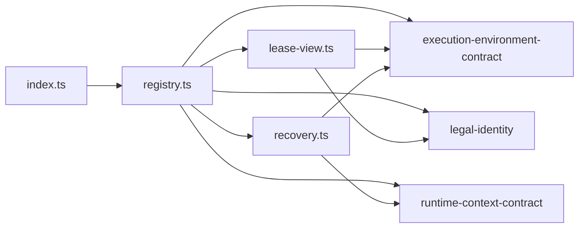

# 执行环境登记表的内部架构

本页说明本成员怎样组织登记表来兑现 [SPEC](../SPEC.md)。它是组内「提供者与设施表、匹配、获取状态、租约视图、恢复编排」这一主题的唯一拥有者（[组架构](../../docs/architecture.md#主题与唯一拥有者)）。公开行为归 [execution-environment-contract SPEC](../../execution-environment-contract/SPEC.md)，Cordis 绑定与撤除归 [execution-environment-host-local](../../execution-environment-host-local/docs/cordis.md)。内部对象的身份与生灭归[对象模型](object-model.md)。

## 模块与依赖

根入口导出工厂 `createEnvironmentRegistry` 与错误类 `RetirementPending`。源码分三个模块：

| 模块 | 源文件 | 持有的状态 | 承担的 SPEC 行为 |
| --- | --- | --- | --- |
| 登记表 | `src/registry.ts` | 提供者表、设施声明表、获取表、已释放作用域、关闭标记 | 落点解析、获取与核验、采用记录签发、描述、登记与退役、恢复授权核对、关闭 |
| 租约视图 | `src/lease-view.ts` | 每个租约一份：是否有效、释放进行中、是否已释放 | 只暴露要求里的键、逐操作门、失效、释放与重试 |
| 恢复编排 | `src/recovery.ts` | 没有状态，每次调用新建结果列表 | 逐提供者枚举与停止，结果分四类 |

包外依赖都在 `package.json` 里：

- `@omne-harness/execution-environment-contract`：全部类型，以及纯函数 `matchProviders` 与 `bindingScope`。
- `@omne-harness/legal-identity`：`tenantEquals`，用于比较获取方租户与请求租户。
- `@omne-harness/runtime-context-contract`：`ScopeRef` 类型。只做类型导入。

本成员不导入 `@deepseek-ai/cordis`（[IC-4](../../../../docs/architecture/cordis-integration-conventions.md#ic-4)），也不导入任何上层领域的契约。账本、守卫与恢复授权端口都作为值传入。

## 关键机制与理由

### 落点与获取分开，获取时重新核对

落点解析与获取不是一个原子动作。两次调用之间，提供者可能退役，作用域可能被释放，设施声明可能被撤除。所以 `acquire` 不信任传入的落点，而是重新核对提供者在场、作用域未释放、层在允许清单内、隔离与设施都满足（[契约的获取与租约](../../execution-environment-contract/SPEC.md#获取与租约)）。核对失败就拒绝，不换一个落点。换落点会让集成方以为得到的是它解析出的那一个。

代价：同一组核对写了两次，一次在 `matchProviders`，一次在 `acquire`。

### 先写获取表，再调用提供者

`acquire` 先在幂等键下为本租户写入一条记录，状态为获取中，然后才调用提供者。同一租户同一个键的并发请求在提供者回答之前到达时，看到获取中，得到待定，不会第二次调用提供者。理由是提供者的 `acquire` 可能分配真实资源，重复调用会分配两份。

记录按「键加租户」区分，不按键单独区分。理由是幂等键由各集成方给出，不同租户可能用到同一个键。按键单独区分时，另一租户要么被拒绝，要么读到别人的状态，两种答复都会泄露这个键已被用过（[V-EE19](../../execution-environment-contract/SPEC.md#持续验证义务)）。

代价：获取中的状态只在本进程里可见。跨进程的去重归集成方账本。

### 采用记录由本成员签发

提供者只交回临时回执。本成员核验回执里的绑定层与设施，再签发采用记录（[INV-EE05](../../execution-environment-contract/SPEC.md#inv-ee05-实际执行捕获原输入和版本)）。核验失败时，本成员自己释放回执里的租约原件，释放待处置就保留资源列表。理由是提供者自签会让它声称的落点与实际落点无法区分。

### 租约视图是一层代理

租约视图包住提供者的租约原件，按设施声明的操作名单把每个操作换成「先过门，再调用原件」。门核对请求形状、租约有效、租户一致与守卫。理由：

1. 租户核对与守卫是每次操作都要做的事，放在提供者里会让每个提供者各写一份。
2. 本成员只读请求里它自己需要的部分。主体原样交给守卫，本成员不解释主体。
3. 守卫答允许之后再核对一次租约有效，防止守卫等待期间租约失效、操作仍被放行。

代价：设施声明里没有列出的成员不经过门。设施拥有者必须列全操作，`describeFacility` 要求操作名单完整（[契约的设施协议](../../execution-environment-contract/SPEC.md#设施协议)）。

### 撤除提供者即开始退役

撤除提供者时，本成员先把它标为不在场，再使它交出的租约失效，最后调用它的 `retire()`。先标不在场，新的落点与获取就不会再选中它。退役待处置时，提供者留在表里但不参与匹配，恢复编排仍能对它枚举与停止（[INV-EE18](../../execution-environment-contract/SPEC.md#inv-ee18-提供者换代和-cordis-集成保留原责任)）。撤除函数以抛出 `RetirementPending` 表示待处置，不以正常返回报告完成。

### 恢复授权一次核对

恢复两操作先收集登记表已知的、该作用域里待处置释放的受管资源，连同作用域与恢复授权调用一次端口。端口一次回答这次恢复是否获准。理由：恢复授权是集成方维护拥有者的决定，本成员不解释它；一次核对让端口看到本成员已知的全部待处置资源。

代价：提供者枚举出来的资源不再逐组授权。端口看不到登记表不知道的资源，例如进程重启前留下的资源。

### 关闭不清空表

`close()` 只标记关闭、使租约失效、退役提供者，不删除获取表。理由是关闭之后集成方与维护者仍要查询状态、做恢复。表随进程结束而消失（[IC-19](../../../../docs/architecture/cordis-integration-conventions.md#ic-19)）。

## SOLID 与扩展边界

| 原则 | 本成员的具体选择 | 必须防止的反例 |
| --- | --- | --- |
| 单一职责 | 登记表管表与状态转移，租约视图管逐操作门，恢复编排管逐提供者停止。三者都不碰机器资源 | 在登记表里打开文件、启动进程或写账本 |
| 开闭 | 新设施只由设施拥有者登记声明，新提供者只登记自己，本成员不改。新的绑定层要改契约的 `EnvironmentBinding`，本成员的穷尽 `switch` 会报类型错误 | 为某种设施、某个提供者或某个上层领域加特例分支 |
| 里氏替换 | 任何 `EnvironmentProvider` 都按同一组核对进入匹配、获取与恢复。缺少恢复操作的提供者记为不支持，不当作失败 | 按提供者名称跳过核验，或把缺少恢复操作当作空集 |
| 接口隔离 | 集成方只看 `ExecutionEnvironment
`，提供者只看 `ProviderRegistrations`，`close()` 只给拥有实例的一方 | 让提供者调用 `close()`，或让集成方直接取租约原件 |
| 依赖倒置 | 本成员依赖契约类型与三个端口。端口的实现由集成方给出 | 导入具体账本、守卫或恢复授权的实现，或从调用方推断租户 |

## 验证与维护

| 保证 | 现在的验证 | 后续义务 |
| --- | --- | --- |
| 根入口只有工厂与错误类，不导入 Cordis | [public-entry.spec.ts](../tests/public-entry.spec.ts) | 新增导出时同步测试 |
| 匹配与歧义、幂等与同键异落点、跨租户、设施声明、守卫、作用域释放、关闭 | [registry.spec.ts](../tests/registry.spec.ts) 的十二个测试 | 见下一行 |
| SPEC [明确缺项](../SPEC.md#明确缺项)列出的四项 | 没有 | 先由契约拥有者确认条款，再补实现与测试 |
| 释放重试、退役待处置、恢复枚举失败 | 没有直接测试 | 补测试：待处置后重试释放，`retire()` 待处置时撤除函数抛出，枚举失败记为不可用 |

维护规则：

1. 契约的获取状态、拒绝原因或设施协议改变时，同步登记表、租约视图、[机制流程](flows.md)与测试。
2. 新增依赖端口时，同步 `RegistryDependencies`、[公开接口页](public-api.md)与 Service 实现 execution-environment-host-local。
3. 工厂签名改变时，同步组内唯一的使用方 execution-environment-host-local。
