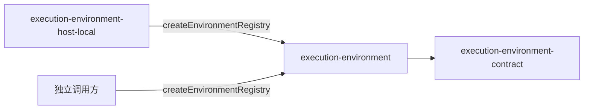

# 执行环境登记表的使用与定位

本页说明谁使用本成员、怎样使用，以及本成员在能力组中的位置。系统关系归[系统页执行环境](../../../../docs/architecture/runtime/execution-environment.md)，组内分解归[组入口](../../README.md)。本页不另立架构。

## 使用方式

### 经 Cordis 使用

装配 Cordis 的系统不直接导入本成员。Service 实现 [execution-environment-host-local](../../execution-environment-host-local/docs/cordis.md) 在构造时调用 `createEnvironmentRegistry`，把八个操作转给登记表，并在服务撤除时调用 `close()`。调用方经服务定义 `executionEnvironment` 使用登记表，见 [execution-environment-cordis-contract 的使用](../../execution-environment-cordis-contract/docs/context.md)。

### 独立使用

不装配 Cordis 的调用方直接调用工厂。调用方自己承担 Service 实现做的三件事：持有实例、在结束时调用 `close()`、处理撤除函数抛出的 `RetirementPending`。

```ts
import { filesFacility } from '@omne-harness/execution-environment-contract'
import { createEnvironmentRegistry } from '@omne-harness/execution-environment'

const registry = createEnvironmentRegistry<MyPrincipal>({ recovery: myRecoveryAuthority })
const removeFiles = registry.registerFacility(filesFacility)
const removeProvider = registry.registerProvider(myProvider)

const placement = await registry.resolvePlacement(access, { scope, requirement })
if (placement.kind === 'placement') {
  const acquired = await registry.acquire(access, {
    acquisition, origin, scope, placement, ledger: myLedger, guard: myGuard,
  })
}

await registry.close()
```

`MyPrincipal`、`myRecoveryAuthority`、`myProvider`、`myLedger`、`myGuard`、`access`、`scope`、`requirement`、`acquisition` 与 `origin` 是调用方自己的值。`scope` 是请求方作用域，落点解析与获取用同一个。形状归 [execution-environment-contract](../../execution-environment-contract/docs/public-api.md)。`removeFiles` 与 `removeProvider` 是撤除函数，调用 `removeProvider()` 即开始这个提供者的退役。

### 调用方要提供的端口

| 端口 | 何时给出 | 本成员怎样用 |
| --- | --- | --- |
| 恢复授权 `RecoveryAuthority` | 调用工厂时 | `recoverOwned` 与 `releaseScope` 先调用一次 `authorizeRecovery` |
| 资源账本 `ResourceLedger` | 每次 `acquire` | 原样交给提供者的 `acquire`；租约视图的门读它的 `closed` 信号，已关闭时设施操作答 `closed`。本成员不调用它的方法 |
| 设施守卫 `FacilityGuard` | 每次 `acquire` | 装进租约视图，每次须授权的操作调用一次 `authorize` |

### 初始化与释放

工厂没有初始化步骤，不读取资源，不访问存储。调用方结束时调用 `close()`。`close()` 退役全部提供者，结果是已排空或待处置。待处置的受管资源在集成方账本里，由维护者凭恢复授权处置。

## 消费者与定位

本成员处在契约与 Service 实现之间。下图投影[组架构](../../docs/architecture.md#成员与依赖)里与本成员相关的边，两者不一致时以组架构为准。



| 使用方 | 怎样使用 | 用什么 |
| --- | --- | --- |
| [execution-environment-host-local](../../execution-environment-host-local/README.md) | Service 子类构造时调用工厂，撤除时调用 `close()` | `createEnvironmentRegistry`、`RetirementPending` |
| 独立调用方 | 直接调用工厂 | 全部导出 |

### 现在的真实消费者

execution-environment-host-local 是唯一在 `package.json` 里依赖本成员的包。独立调用方还没有进入仓库。

### 上层页面

- 系统关系与成员分工：[系统页执行环境](../../../../docs/architecture/runtime/execution-environment.md#环境选择与资源准备)。
- 组内成员与阅读路径：[组入口](../../README.md)、[组协作入口](../../docs/key-flows.md)。
- 领域的事实归属：[领域交接设计](../../../../docs/domains/execution-environments/architecture.md)。
