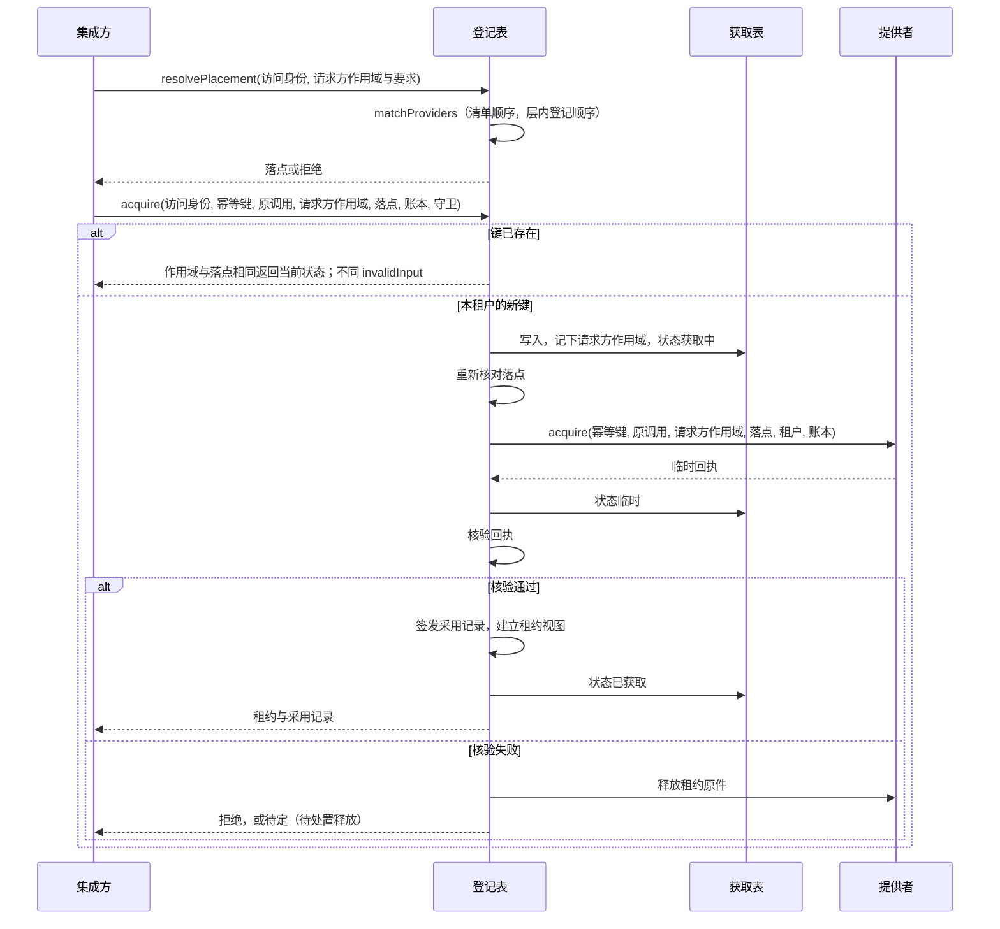
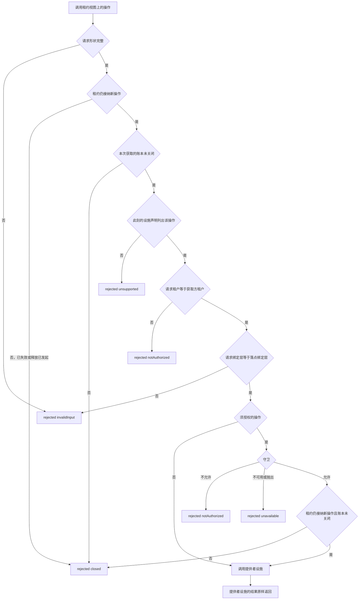
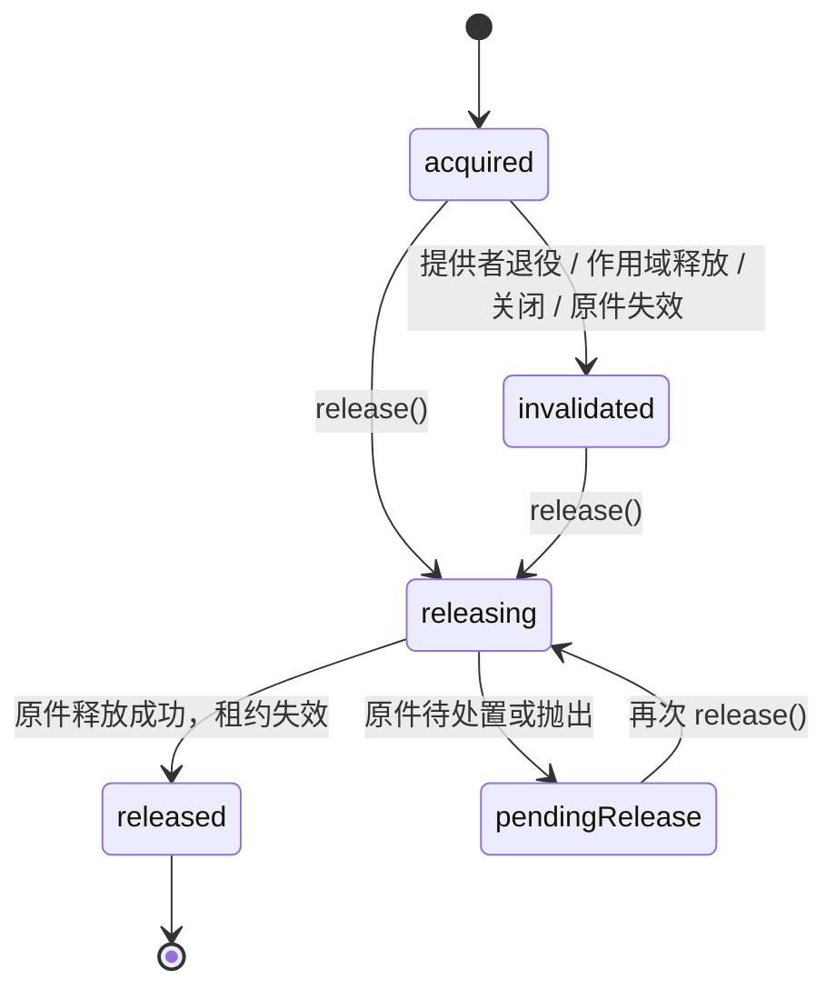
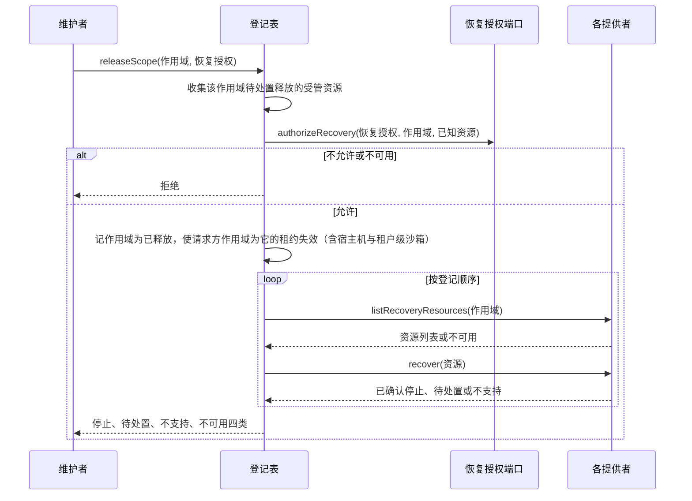
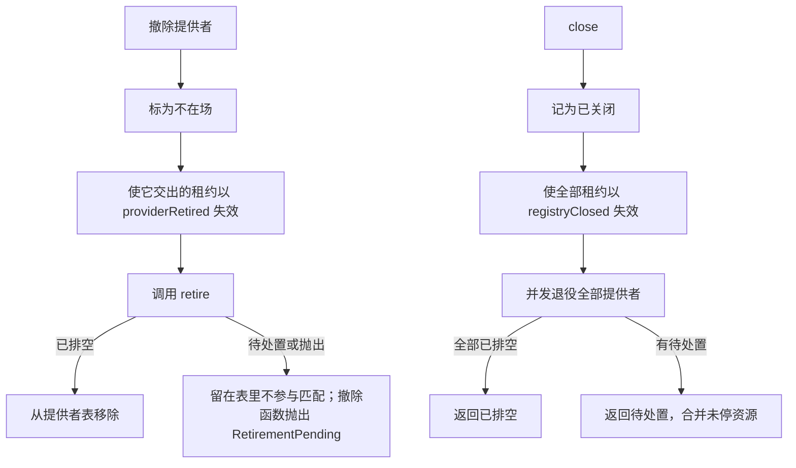

# 执行环境登记表的机制流程

本页给出本成员的五条机制级流程。每条有一张图和一张「失败与责任交接」表。行为以 [SPEC](../SPEC.md) 为准，图只投影它。

协议级流程归 [execution-environment-contract 的流程](../../execution-environment-contract/docs/flows.md)。Cordis 上的登记与撤除归 [execution-environment-cordis-contract 的流程](../../execution-environment-cordis-contract/docs/flows.md)，服务装载与卸载归 [execution-environment-host-local 的流程](../../execution-environment-host-local/docs/flows.md)。

## 流程

### F-EER01 落点解析到交付租约

依据：[SPEC 落点解析](../SPEC.md#落点解析)、[SPEC 获取](../SPEC.md#获取)。

| 环节 | 结果 | 失败与责任交接 |
| --- | --- | --- |
| 落点解析 | 选中清单里第一个恰好有一个提供者满足的层。提供者的设施键只算声明表里已登记的那些 | 同一层两个或更多提供者都满足时返回 `ambiguousEnvironment`，不按登记顺序选。没有匹配返回最接近的原因；所需键的声明没有登记时是 `missingFacility` |
| 访问身份里的租户未铸造 | 落点解析与获取返回 `invalidInput`，不写获取表，不调用提供者 | 集成方用 legal-identity 解析出的租户重新请求 |
| 请求方作用域 | 已释放时落点解析与获取返回 `referenceExpired`；带作用域的绑定层与它不同时返回 `invalidInput`，不写获取表 | 获取记下请求方作用域，描述、作用域释放与恢复都按它过滤 |
| 本租户的键已存在 | 不再调用提供者，记录不变 | 换了请求方作用域、绑定层、提供者身份（名、代与版本）或要求（按集合比较）时返回 `invalidInput` |
| 另一租户用同一个键 | 是它自己的一次独立获取 | 两个租户互相看不见对方的记录 |
| 重新核对 | 任一项不成立即拒绝，原因写入获取表 | 不换落点 |
| 提供者调用 | 提供者抛出按 `providerUnavailable` 拒绝 | 提供者自己的拒绝原因原样返回 |
| 核验失败 | 释放成功则拒绝；释放待处置则状态为待处置释放 | 未停的受管资源留给恢复，见 F-EER04 |
| 交付 | 采用记录由集成方保存 | 本成员只有进程内副本 |

### F-EER02 一次设施操作过门

依据：[SPEC 租约视图与逐操作门](../SPEC.md#租约视图与逐操作门)。

| 环节 | 结果 | 失败与责任交接 |
| --- | --- | --- |
| 门拒绝 | 不调用提供者设施，没有外部效果 | 拒绝带原请求身份 |
| 账本已关闭 | 返回 `closed`，不问守卫，不调用提供者设施 | 门是设施操作的唯一入口，提供者不再为经门的操作重复这项核对 |
| 守卫不可用 | 返回 `unavailable` 拒绝，操作没有发出 | 集成方稍后用新的请求身份重试 |
| 调用提供者设施 | 结果是设施结果四态之一 | 受管资源的计划与许可由提供者经账本承担 |
| 未列入声明的成员 | 不经过门 | 设施拥有者须列全操作 |

### F-EER03 释放与重试

依据：[SPEC 失效与释放](../SPEC.md#失效与释放)。

| 环节 | 结果 | 失败与责任交接 |
| --- | --- | --- |
| 释放发起 | 租约立即不再接纳新操作，新操作返回 `closed` | 释放待处置后仍不接纳 |
| 并发释放 | 共用一次原件调用 | 无 |
| 待处置 | 带未停的受管资源 | 集成方保存释放记录；维护者可走 F-EER04 |
| 已释放后再释放 | 直接返回已释放，不调用原件 | 无 |
| 丢掉引用 | 不是释放，获取表保留记录 | 集成方负责调用释放 |

### F-EER04 作用域释放与恢复

依据：[SPEC 恢复](../SPEC.md#恢复)、[契约的恢复](../../execution-environment-contract/SPEC.md#恢复)。

| 环节 | 结果 | 失败与责任交接 |
| --- | --- | --- |
| 授权 | 一次端口调用决定这次恢复 | 端口抛出按不可用拒绝 |
| 提供者缺恢复操作 | 记为不支持 | 资源处置留给该提供者的拥有者 |
| 枚举失败 | 记为不可用，不当空集 | 维护者稍后重试 |
| 停止失败 | 资源记为待处置 | 资源仍在集成方账本里 |
| `recoverOwned` | 与上图相同，但不记作用域已释放，不使租约失效 | 作用域内仍可获取 |

### F-EER05 提供者退役与关闭

依据：[SPEC 登记与退役](../SPEC.md#登记与退役)、[SPEC 关闭](../SPEC.md#关闭)。

| 环节 | 结果 | 失败与责任交接 |
| --- | --- | --- |
| 退役待处置 | 撤除函数抛出，不以正常返回报告完成 | 再调用同一撤除函数会再次 `retire()` |
| 关闭后 | 新解析、获取、描述返回 `ownerStopped` | 已有键仍按幂等规则返回当前状态；恢复两操作仍可用 |
| 在途获取 | 核验时看到已关闭，以 `ownerStopped` 拒绝并释放回执 | 释放待处置时进入待处置释放 |
| 在途设施操作 | 由原提供者在 `retire()` 中结清 | 本成员不另外等待，也不计时；`retire()` 在提供者自己配置的上界内返回，超界为待处置 |

## 失败与生命周期

| 情形 | 结果 | 责任方 | 依据 |
| --- | --- | --- | --- |
| 进程失败 | 四张表丢失，重启后按键查询答复 `unrecorded` | 集成方据账本处置 | [IC-19](../../../../docs/architecture/cordis-integration-conventions.md#ic-19) |
| 重启后对旧键再 `acquire` | 作为新获取调用提供者 | 集成方先查账本，不对已有记录的键再调用 `acquire` | [SPEC 获取](../SPEC.md#获取) |
| 提供者 `acquire` 抛出 | `providerUnavailable` 拒绝 | 提供者 | [SPEC 获取](../SPEC.md#获取) |
| 提供者 `retire()` 抛出 | 按待处置处理，资源列表为空 | 提供者与维护者 | [SPEC 登记与退役](../SPEC.md#登记与退役) |
| 守卫抛出 | `unavailable` 拒绝 | 集成方 | [SPEC 租约视图与逐操作门](../SPEC.md#租约视图与逐操作门) |
| 恢复授权端口抛出 | 按不可用拒绝 | 集成方的维护拥有者 | [SPEC 恢复](../SPEC.md#恢复) |
