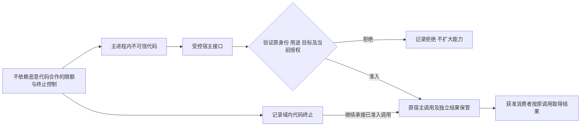
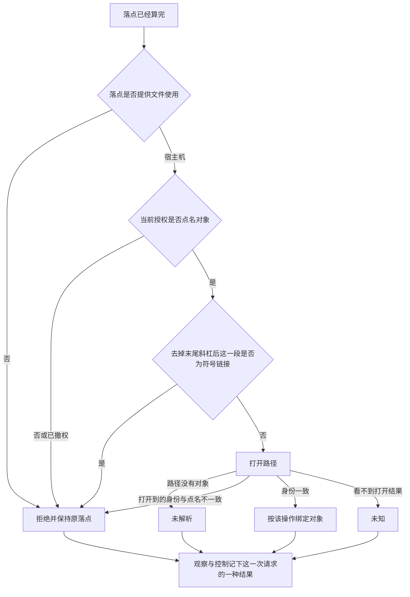

# 执行环境关键流程

状态：技术机制草案。流程没有真实运行证据；跨领域交接另见[领域流程](../../../../docs/domains/execution-environments/key-flows.md)。

## F-EE02 短寿命状态与实际回收

对应 J-EE02；INV-EE06、INV-EE07、INV-EE13、INV-EE17。

有效寿命内复用合法设施，终端会话关联原环境身份。达到声明边界后停止旧资源的新准入，记录到期，执行控制和回收，并把真实状态交 Context。控制失败或探测不可用保留待处置及未知，不能写成已关闭。新实例有自己的身份和状态，旧终端标识失效必须明确失败，不能静默降成一次性执行。

已准入工具和宿主调用沿原身份收场，重要结果不随临时状态回收丢失。恢复查原到期、控制和资源关系，只接续未完责任，不因 Session 还在而复活已丢失状态。

## F-EE05 子进程和设施的有限输入

对应 J-EE05；INV-EE03、INV-EE04、INV-EE09、INV-EE17。

原组件准入和落点条件成立后，按消费者允许的变量名单提取宿主实际具有的变量，凭据另行解析；资源与目标按原主体及用途核验。创建子进程或设施时记录原调用和采用版本，缺少必需条件按声明失败。工作区读取和兼容发现不触发本流程，也不能授予执行权。

取消或超时后分别观察实际子进程、宿主调用及效果；查询失败保留未知，诊断过滤秘密。MCP 与 hook 专有的启停、动作和结果继续由其拥有者解释。

## F-EE06 恶意代码、受控宿主调用与限额

对应 J-EE06；INV-EE04、INV-EE10、INV-EE11、INV-EE12、INV-EE17。

接口不提供任意宿主对象、Context 或容器，返回数据同样核验。达到限额或发生恶意行为时控制器能终止域内代码，原宿主调用仍由独立保管关系承接。图中连线表示责任继续，不能解释成域终止自动终止宿主调用。

机制不能满足必要边界时拒绝承接该运行方式。引擎缺陷或进程崩溃按共同故障域报告，恢复查询原调用及已保存结果，不通过重放制造新效果。

## 宿主文件使用

对应最小调用事实里的文件一行，以及 INV-EE04 与 INV-EE09。本节已由 PanQiWei 接受，见 [技术设计接受](https://github.com/nemori-ai/omne-harness-lite/issues/278#issuecomment-6197369869)。步骤细节在[架构](architecture.md#宿主文件使用)。

符号链接检查发生在打开之前。设备号和 inode 的核对发生在打开之后。核对失败不返回字节。后一次请求重新点名。上一次字节留在上一次结果里。`Shell()` 不经过这张图。
