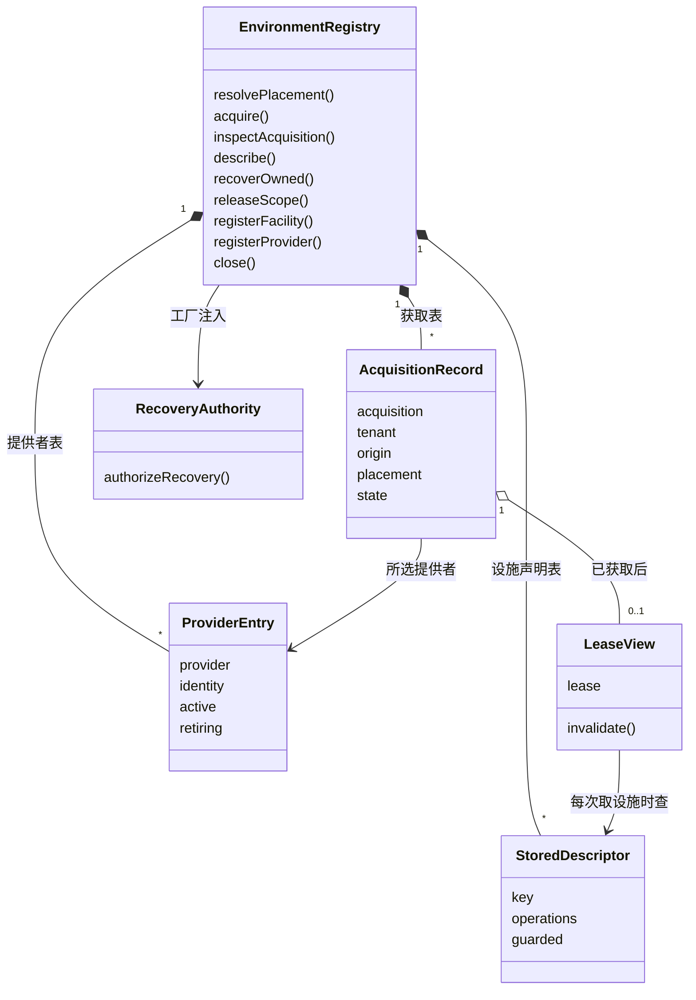

# 执行环境登记表的对象模型

本页说明本成员内部对象的身份、关系与生灭。领域对象（访问身份、落点、获取、采用记录、租约、受管资源、设施声明、恢复授权）的含义归 [execution-environment-contract 的对象模型](../../execution-environment-contract/docs/object-model.md)。本页只写登记表怎样持有和转移它们。行为条款归 [SPEC](../SPEC.md)。

## 对象与关系

| 对象 | 身份 | 拥有者 | 内容 |
| --- | --- | --- | --- |
| 登记表实例 `EnvironmentRegistry
` | 每次调用 `createEnvironmentRegistry` 一个 | 调用工厂的一方 | 四张表、关闭标记、恢复授权端口 |
| 提供者条目 | 提供者名称加代 | 登记表 | 提供者、身份、是否在场、进行中的退役 |
| 设施声明条目 | 设施键 | 登记表 | 操作名单、须授权的操作名单 |
| 获取记录 | 幂等键 `AcquisitionRef` 加获取方租户 | 登记表 | 获取方租户、原调用、落点、所选提供者条目、`AcquisitionState`、租约视图、失效函数 |
| 已释放作用域 | 作用域引用 | 登记表 | 只有引用本身 |
| 租约视图 | 所属获取记录 | 获取记录 | 租约原件、守卫、是否有效、释放进行中、是否已释放 |
| `RetirementPending` | 每次抛出一个 | 抛出它的撤除函数 | 退役主体的描述、未停的受管资源 |

几条关系的含义：

- 获取记录引用提供者条目，不复制它。提供者退役时，登记表按这个引用找到它交出的全部租约。
- 获取记录在核验通过前没有租约视图。核验失败时也没有，租约原件已交还提供者释放。
- 租约视图每次 `facility(键)` 都查设施声明表。撤除声明之后新的查询取不到这个键。已经取到的设施对象保留旧声明，见 [SPEC 明确缺项](../SPEC.md#明确缺项)。
- 采用记录写在获取状态里，与租约视图同属一次获取。它是给集成方保存的值，本成员不持有它的耐久副本。

## 生命周期

### 获取记录

获取记录的状态就是契约的 `AcquisitionState`，图在[契约对象模型的获取](../../execution-environment-contract/docs/object-model.md#获取)。本成员的转移点如下：

| 转移 | 触发 |
| --- | --- |
| 写入，获取中 | 新键通过了租户与关闭的检查 |
| 获取中 → 已拒绝 | 重新核对失败，或提供者抛出、拒绝 |
| 获取中 → 临时 | 提供者交回回执 |
| 临时 → 已获取 | 核验通过，签发采用记录 |
| 临时 → 已拒绝或待处置释放 | 核验失败后释放成功或待处置 |
| 已获取 → 已失效 | 租约视图失效 |
| 已获取或已失效 → 释放中 | `release()` |
| 释放中 → 已释放或待处置释放 | 原件释放的结果 |
| 待处置释放 → 释放中 | 再次 `release()` |

`unrecorded` 不是记录的状态。它是本成员对本租户在这个键下没有记录时的答复，不论另一租户有没有用过这个键。同一个键下每个租户各一条记录，彼此独立。记录从不删除，进程结束时随表消失。

### 提供者条目

登记 → 在场 → 退役中（不在场，租约已失效，`retire()` 进行中）→ 已排空即移除，或待处置即留在表里且不在场。待处置的条目在下一次撤除时再次退役。

### 设施声明条目

登记（同键第二份抛出错误）→ 生效 → 撤除函数删除。撤除函数只删除它自己登记的那一份。

### 租约视图

建立（有效）→ 失效（只一次，带原因）→ 释放中 → 已释放，或待处置后可重试。失效与释放是两件事：失效后仍可释放，释放成功也会使视图失效。

### 登记表实例

开放 → 已关闭（`close()` 之后）。已关闭的实例仍保留四张表，仍答复查询与恢复。实例随调用方丢弃引用和进程结束而消失。
