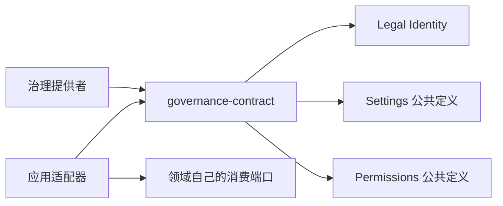

# 模块与依赖

## 模块与依赖

纯入口导出 Schema、值类型、命令口和查询口。它复用 Legal Identity 编码、Settings 定义和目标、Permissions 声明。`./cordis` 导出抽象 Service；根入口不加载 Cordis。

## 关键机制与理由

命令与查询接口分开，注册者、装配者和读者分别使用独立泛型主体。调用方不能在 queryOperation 的 JSON 中填写另一个 principal。可信身份通过 Access 参数进入，wire 数据只含 Legal Identity 的规范文本。

当前采用与执行内容采用分属不同事实。前者提供提交时必须重新核验的依据；后者的冻结执行清单仍由 adoptionCoordinator 拥有。

## 验证与维护

Schema 测试检查身份文本、原操作查询字段、完整集合以及非法运行时材料。持久恢复、同提交及真实 Cordis 生命周期归提供者验证。改变公共形状时同步实际消费者和行为规格。
