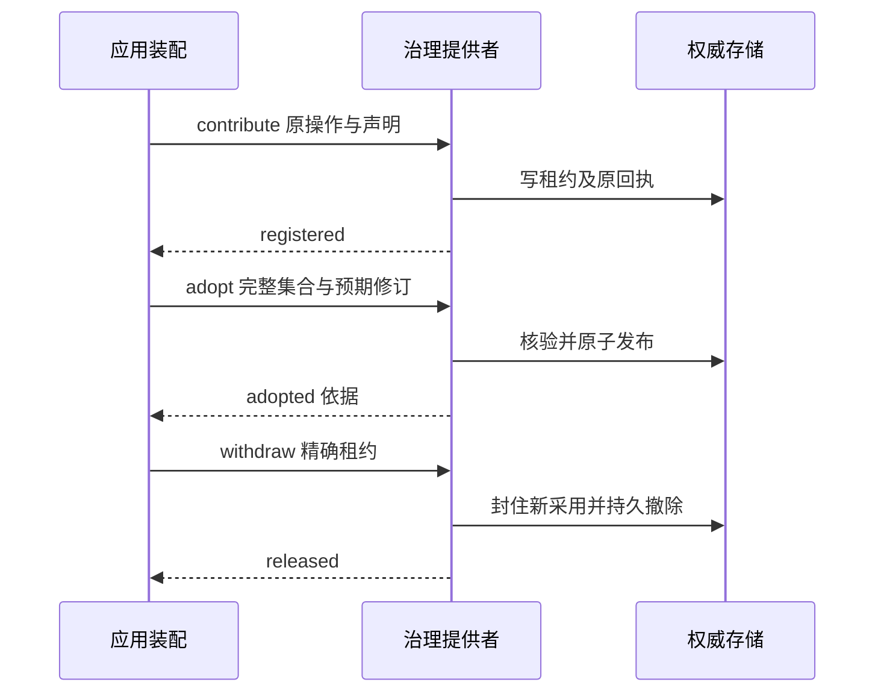

# 操作流程

## 流程

注册者提交不可变声明和具名关口引用。装配者收集完整候选后，提交两项预期修订和完整选择。提供者核验权威集合后整份发布。目录查询读取该事实；业务命令在自己的提交点再验证。

## 失败与生命周期

unknown 沿原 queryOperation 认回，不能换 operationId 重做。完整候选冲突保留旧份。精确撤除已发生时，旧依据不再有效。目录读来源失败标记 partial 或 unavailable，不能把缺来源当空配置。
