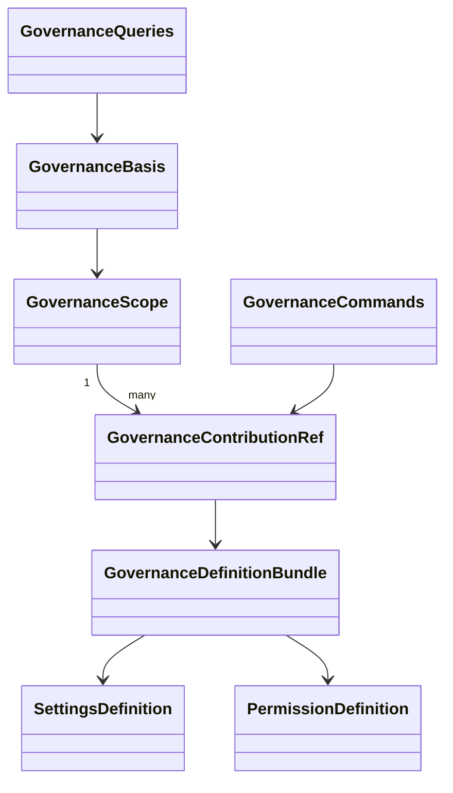

# 对象与关系

## 对象与关系

scope 定位一个租户目的域中的逻辑服务目录。ContributionRef 标识一次精确租约，generation 只表达该租约所属代。DefinitionBundle 是不可变声明，不保存可编辑设置值。GovernanceBasis 是某次当前读的依据，不是可以长期使用的执行授权。

## 生命周期

租约从 active 经 closing 到 released。原操作认回不把 released 变回 active。提供者持有新实例 epoch，旧实例只能完成已有工作的收尾。配值和授权的生灭归原领域，不归这些对象。
