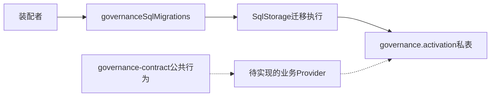
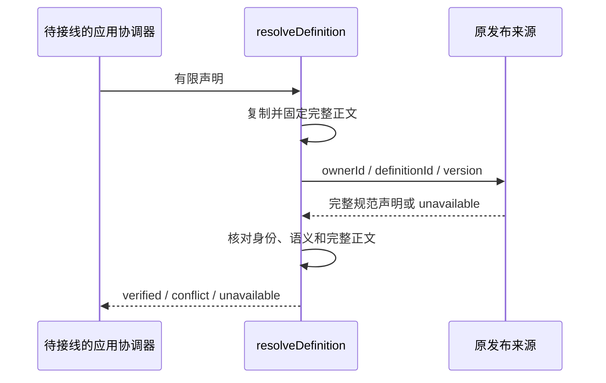
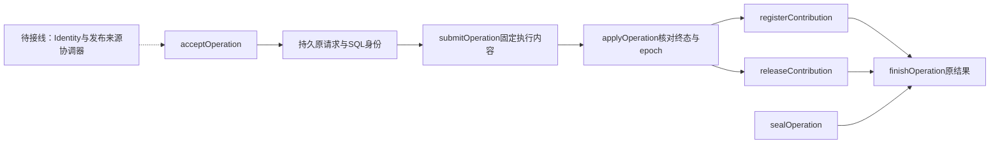
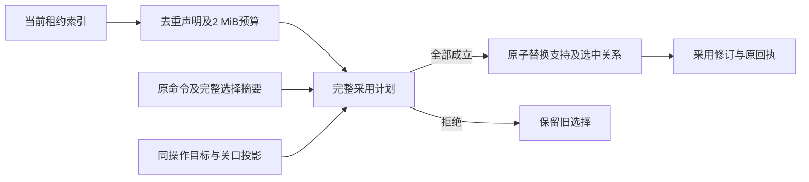
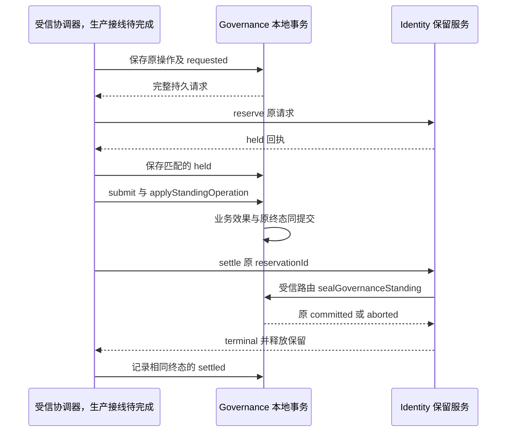
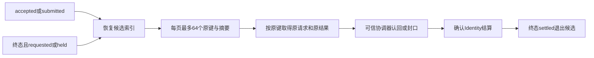
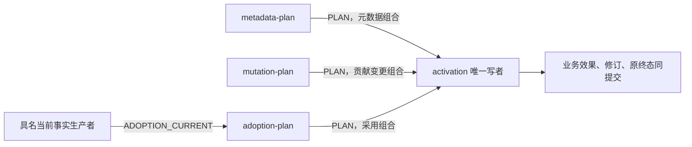
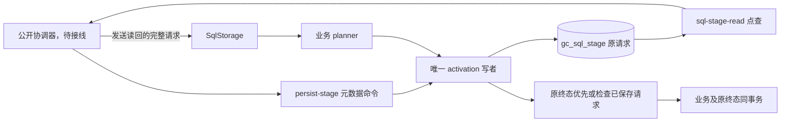
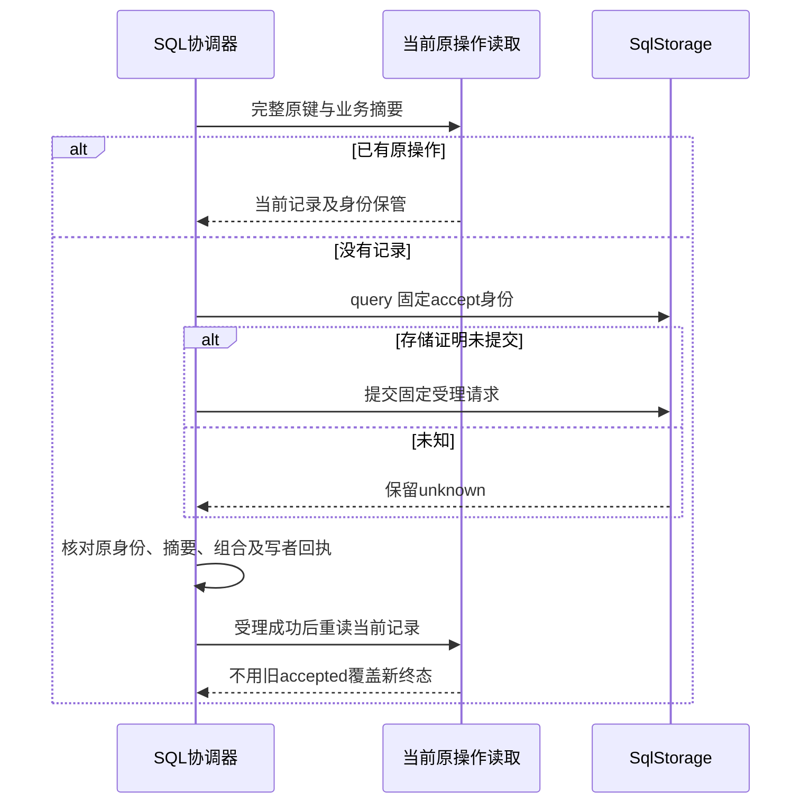

# 内部架构

## 模块与依赖

`migration.ts` 拥有九张私表及索引。`materials.ts` 将实际模块映射成 SqlStorage 的固定迁移材料。根入口只导出该材料工厂。公共业务类型仍归 governance-contract，真实 Provider 尚未实现。

## 关键机制与理由

注册与目标之间是多对多关系。`gc_member_target` 保留哪份注册支撑哪个目标，不能只保存声明下存在几个注册。选中定义和目标是当前采用的物化投影，业务参与者必须与支持边共同提交。

待恢复枚举使用 `INDEXED BY gc_operation_pending` 固定本拥有者的部分索引，并保留完整 keyset 和 LIMIT。仅建立同前缀索引不足以保证 SQLite 不选主键范围。索引更名或删除须同步该查询；索引缺失时拒绝执行，不回退历史扫描。

原操作表保存受理和提交中状态，为未知回执恢复留有持久入口。原身份不随 epoch 改变，旧请求不能通过换代获得新业务身份。epoch 是后续参与者核验的当前性字段，不是外键可证明的全局时序。

来源权威拥有不可变声明，`gc_definition` 是核验后的本地副本。它不是一个新的全局定义发行中心。

`definition-source.ts` 只消费 `GovernanceDefinitionSource`，在异步等待前固定请求，之后比较原发布的完整身份及内容。`definition.ts` 继续拥有纯定义语义检查。来源选择、主体准入、当前采用是不同责任；来源比较不代替 Identity 保留或当前性围栏。

此图表示已实现的比较机制；原发布 producer 与公共协调器尚未接通。不同租户可以消费同一权威，不能各自用当地可编辑的定义副本冒充该权威。

## 验证与维护

Schema 测试运行真实 SQLite；材料测试运行真实 Worker。角色资格、动态生命周期及业务 current 来源尚无生产符合性证据。关系变化须同步 [对象模型](object-model.md)、[规格](../SPEC.md) 和实际迁移，不以更新旧迁移来兼容已发布数据。

## 原操作与业务写者

`operation-schema.ts` 定义本包私有命令、身份和保管记录。`operation.ts` 负责受理、固定执行内容、终态和原结果读取；`scope.ts` 负责精确 scope 绑定和 epoch 切换。`definition.ts` 消费 Settings/Permissions 的公共纯验证，不重复规则算法，也不认证发行来源。`contribution.ts` 负责登记和精确撤除；`apply-operation.ts` 将当前 epoch 判断、业务写入与原结果写入放进同一次事务。

恢复读索引排除历史终态。当前贡献扫描限129行，实际允许128；在线项统计按当前去重声明计算。重复租约共享声明的预算，不把同一声明的每个租约再算一遍项数。权威来源和作用域资格仍是应用协调器的实施缺口，不能用上述私有执行材料绕过。

## 完整采用

`candidates.ts` 只枚举当前epoch的有效租约，并按定义去重读取正文。`adoption-plan.ts` 比较完整选择、定义相容性、目标和实际关口。`adoption.ts` 在计划成立后替换关系并推进修订。`applyOperation` 将该效果与原结果共同提交。

目标投影携带原操作、事务域、epoch、目标来源、完整定义和ownerRevision。它保留目标拥有者的责任，治理写者不读取Settings或Assets私表。当前测试用具名投影夹具执行真实采用事务；生产fact桥接和Identity协调未接通。

## Identity 保留与恢复边界

`standing-schema.ts` 定义请求、回执及保管状态。`standing-custody.ts` 通过完整原操作主键读写 held_json。它不读取 Identity 私表，也不发行资格。`standing-operation.ts` 提供身份保留路径的业务入口和精确封口入口，二者共用原操作终态。

图中业务提交和结算不要求固定先后。若结算先封口，迟到提交只能认回 aborted。若业务先提交，结算认回 committed。目的端不可用时，Identity 保留不释放，撤权仍待恢复。

复用 [StandingCommit 与 SettingsReservationCustody](../../../assets/settings/verification/README.md) 的模型义务。模型 operation 对应完整治理原操作，terminal 对应该行 committed/aborted，保管请求对应 held_json。有限模型验证以真实 Identity 和同事务封口为前提，不证明来源认证、服务可用性或跨进程部署。真实组合测试见 [持续测试](../tests/README.md)。

## 同时恢复业务与未结算保留

`recovery-migration.ts` 增加恢复部分索引，原迁移字节保持不变。`recovery-read.ts` 提供按同一 scope 做 keyset 分页的只读处理器。索引包含业务 pending，以及业务已终结但保管尚未 settled 的行。只扫描业务 pending 会漏掉提交成功后丢失结算回包的记录。

读取材料限定 gc_scope 和 gc_operation 两张表，使用 domain-serial 排序。每次最多读取66行，输出上限256 KiB。失败保持 unavailable，不能变成完整空页。一次分页只覆盖该轮观察到的集合，后续扫描从头发现并发插入。

## 生产参与者的计划依赖

`activation-schema.ts` 定义 control、mutation、adoption、observation 四种计划。`metadata-plan.ts` 只形成元数据计划。`business-plan.ts` 从已保存原操作取得业务绑定，两个业务计划参与者分别限制命令族。`activation.ts` 是治理关系表的唯一写者，消费计划后重新检查原记录。

三条 PLAN 路径互斥，不能把整张图一起登记成一个组合。生产材料工厂允许应用选出各自闭包，SqlStorage 拒绝同组合重复提供 PLAN，也拒绝调用写者时省略所需生产者。

元数据和封口不依赖 ADOPTION_CURRENT，因而不需要当前目标服务在线。采用计划从 requireFact 取得当前证据，不读取外域私表。当前事实的真实生产桥接仍待完成，组合测试中的生产者明确标为夹具。

私有事务的真实 Worker 证据包含登记、撤除、空集合采用、错绑定及元数据封口。公开协调器和 Cordis 接线没有因此变为完成。阶段请求持久材料见下节。后续公开协调器须发送其读回值，不能用当前 manifest 或随机阶段键重建旧操作。

## 恢复时发送原请求

`sql-stage-migration.ts` 增加 gc_sql_stage。该表与既有九张关系表同属 governance.activation，原迁移字节不变。`sql-stage.ts` 承担单赋值保存与读回，`sql-stage-binding.ts` 核对原业务、元数据和 Standing 恢复绑定。`sql-stage-schema.ts` 使用 SqlStorage 的公开请求形状，限定治理域可接受的租户身份、阶段和预算。

只读处理器使用 domain-serial 顺序，访问 gc_operation 和 gc_sql_stage。普通读回读取两行，Standing 阶段最多四行，无历史扫描。最大输出为4 MiB加1 KiB包装空间。主键同时服务唯一性与读取，不增加重复索引。

保存和提交是两个事务，之间允许进程退出。恢复者必须取得原请求再提交。当前真实 Worker 用例验证这一边界，完整公共协调器及跨域真实来源接线仍待完成。参与者不能观察 SqlStorage 外层完整请求，因此写者的保管检查和协调器的原样发送检查都必须存在。

## 原操作受理与结果认回

`operation-read.ts` 点查原操作及 Standing 保管，最多三行，输出上限3 MiB。`sql-coordinator.ts` 注入固定写域和元数据组合，协调这些读取与已有生产参与者。`sql-submission.ts` 识别完整回执绑定及唯一写者回复。

重启后 executeControl 可以认回旧组合下的阶段。send 从持久阶段读回完整请求，提交未知则查询同一身份。不同命令内容不得借新的 metadata 配置替换旧阶段。调用期间用户对象变化也不能改变首次异步等待前已固定的输入。

公共 GovernanceCommands/Queries 的准入、真实来源和 Identity 生命周期尚待接线。图中协调器是提供者内部实现，不是当前已完成的公开治理服务。
