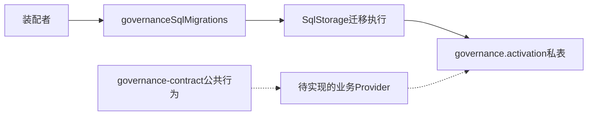
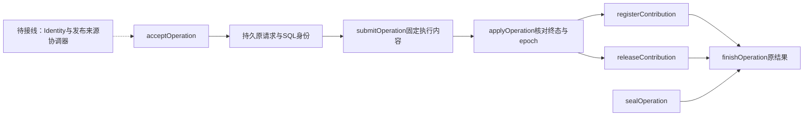

# 内部架构

## 模块与依赖

`migration.ts` 拥有九张私表及索引。`materials.ts` 将实际模块映射成 SqlStorage 的固定迁移材料。根入口只导出该材料工厂。公共业务类型仍归 governance-contract，真实 Provider 尚未实现。

## 关键机制与理由

注册与目标之间是多对多关系。`gc_member_target` 保留哪份注册支撑哪个目标，不能只保存声明下存在几个注册。选中定义和目标是当前采用的物化投影，业务参与者必须与支持边共同提交。

待恢复枚举使用 `INDEXED BY gc_operation_pending` 固定本拥有者的部分索引，并保留完整 keyset 和 LIMIT。仅建立同前缀索引不足以保证 SQLite 不选主键范围。索引更名或删除须同步该查询；索引缺失时拒绝执行，不回退历史扫描。

原操作表保存受理和提交中状态，为未知回执恢复留有持久入口。原身份不随 epoch 改变，旧请求不能通过换代获得新业务身份。epoch 是后续参与者核验的当前性字段，不是外键可证明的全局时序。

来源权威拥有不可变声明，`gc_definition` 是核验后的本地副本。它不是一个新的全局定义发行中心。

## 验证与维护

Schema 测试运行真实 SQLite；材料测试运行真实 Worker。角色资格、动态生命周期及业务 current 来源尚无生产符合性证据。关系变化须同步 [对象模型](object-model.md)、[规格](../SPEC.md) 和实际迁移，不以更新旧迁移来兼容已发布数据。

## 原操作与业务写者

`operation-schema.ts` 定义本包私有命令、身份和保管记录。`operation.ts` 负责受理、固定执行内容、终态和原结果读取；`scope.ts` 负责精确 scope 绑定和 epoch 切换。`definition.ts` 消费 Settings/Permissions 的公共纯验证，不重复规则算法，也不认证发行来源。`contribution.ts` 负责登记和精确撤除；`apply-operation.ts` 将当前 epoch 判断、业务写入与原结果写入放进同一次事务。

恢复读索引排除历史终态。当前贡献扫描限129行，实际允许128；在线项统计按当前去重声明计算。重复租约共享声明的预算，不把同一声明的每个租约再算一遍项数。权威来源和作用域资格仍是应用协调器的实施缺口，不能用上述私有执行材料绕过。
