# 内部架构

## 普通提供者的装配与恢复

工厂把应用服务与生命周期控制分开。只有启动成功才公开服务；共享 SQL 和 Identity 始终由外部装配拥有。创建 Identity 前可以先构造目的解析器，因此治理恢复与 Identity 的协作不需要相互构造服务。

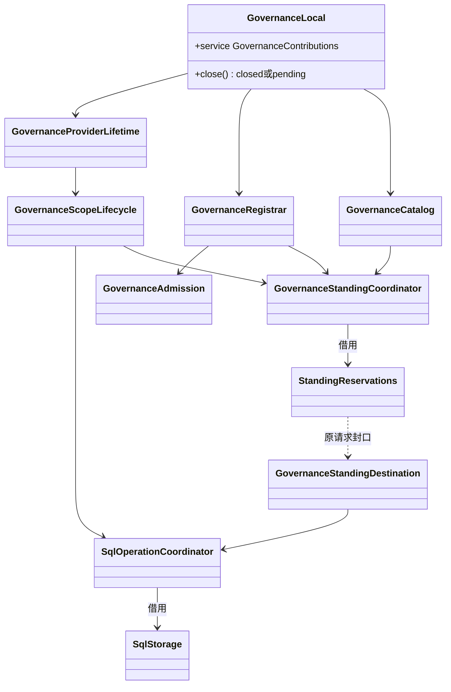

一次新装配相当于给服务换一枚不可复用的代次标识。它先隔离旧代，再处理旧代未完成的责任，最后允许新请求进入。每页恢复同时读取当前代次和候选操作的受理代次。旧页只包含读回时已经存在的操作；后继实例的新操作不会进入旧页。这个结论依赖原操作键和受理代次不可变、代次不复用，以及装配只有一个合法启动者。

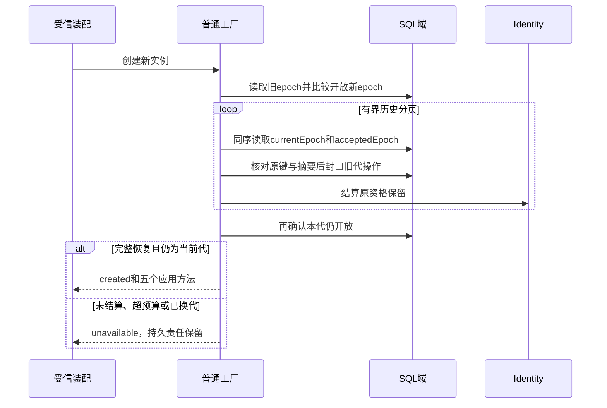

关闭走另一条路径：它只处理自己代次的责任，即使当前 scope 已被新实例接管。入口先登记在途调用，再同步捕获命令。这样既能让关闭看见已经接收的工作，也能防止调用者在异步等待期间改写命令。

## 贡献与退出的应用组合

`createGovernanceLocal` 组合贡献、退出、采用、受保护目录和原操作查询。内部 `GovernanceRegistrar` 承担命令与操作查询，目录捕获由独立组件承担。它们共用身份准入、Standing 保留、原操作及 SQL 请求保管。声明与当前事实测试使用具名 fixture；生产来源适配仍须接入；Cordis caller-fiber关闭见本文装配节。

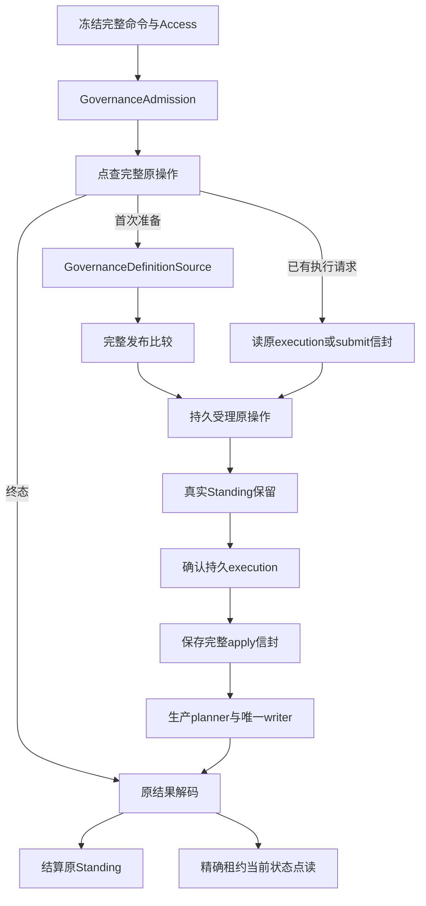

首次准备验证来源，恢复读取原保管内容。执行 authority 由该入口从核验结果构造，绑定主体、scope、资格、原发布引用和完整声明摘要；调用方不能提供它。保存过的 execution 不随当前组合配置改变，原信封的组合及 manifest 必须继续可执行。需要更换这些材料时，仍须满足原恢复前提。

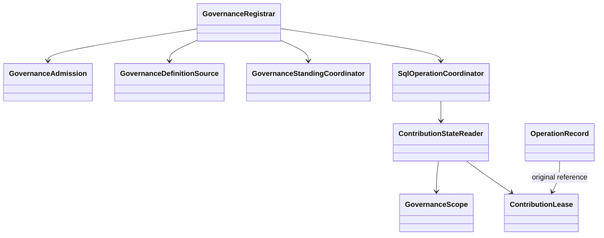

ContributionStateReader 只按 scope_key 和 registration_id 查精确租约，再点查 scope，最多两行。它核 registrar、contributor 和 generation 后才返回状态。旧 epoch 投影 released。原 OperationRecord.result 保留原提交状态，两种读数有不同用途。

stopAccepting 同步拒绝新入口，并让已开始的调用在下一可观察边界封口原待决操作。它不释放共享 SqlStorage/Identity，也不证明租约已全部撤除。工厂的完整关闭通过生命周期协调执行持久 scope 围栏及精确租约清理。业务已经确认成功时，源结算暂不可用只留下持久恢复责任，不能把成功改成失败。

## 身份准入与装配委托

`GovernanceAdmission` 只判断当前调用能否进入一个具名治理动作。Identity 判断主体发行和当前成员资格，可信装配固定委托范围，原发布拥有者证明声明及执行关口真实。三者不能相互代替。该对象为普通工厂的内部组件。真实来源适配仍待接通；Cordis生命周期见本文装配节。

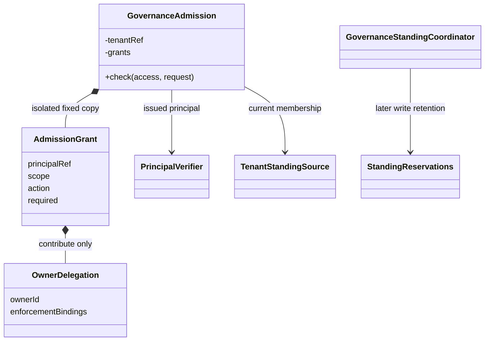

关系键为完整 principalRef、scope 和 action。相同键只能有一项，避免从不同政策拼接资格。contribute 的关口集合保留 owner 对应关系，逐项比较 capabilityId、enforcementKey、implementationRef、action 和 interpretationRef。它允许已授权关口的新发布版本，不要求为每个版本重新构造服务。

方法在首次 await 前复制可序列化请求和编码 Access tenant。主体保持原发行对象，不能用 JSON 副本替换。返回的 request 是该次检查的隔离快照，后续来源核验必须消费它；required 是隔离数组。该读取没有保持资格，写路径仍须消费 StandingCoordinator 及 SQL 当前性围栏。

固定策略在最多 128 条委托中建立 Map；每次按完整键查找。登记关口只检查该 owner 的有界集合，不查询历史治理操作，也不增加 SQL 表。Identity 当前成员读取继续由其公共服务负责。

## 模块与依赖

`migration.ts` 拥有九张私表及索引。`materials.ts` 将实际模块映射成 SqlStorage 的固定迁移材料。根入口导出 SQL 材料、普通应用工厂和 Identity 目的解析器。公共业务类型仍归 governance-contract。

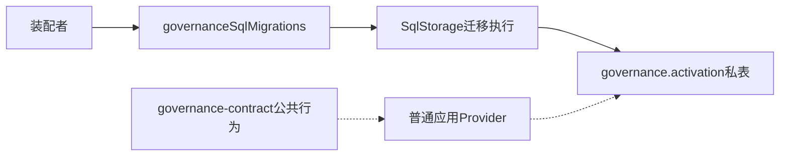

## 关键机制与理由

注册与目标之间是多对多关系。`gc_member_target` 保留哪份注册支撑哪个目标，不能只保存声明下存在几个注册。选中定义和目标是当前采用的物化投影，业务参与者必须与支持边共同提交。

待恢复枚举使用 `INDEXED BY gc_operation_recovery` 固定本拥有者的部分索引，并保留完整 keyset 和 LIMIT。仅建立同前缀索引不足以保证 SQLite 不选主键范围。索引更名或删除须同步该查询；索引缺失时拒绝执行，不回退历史扫描。

原操作表保存受理和提交中状态，为未知回执恢复留有持久入口。原身份不随 epoch 改变，旧请求不能通过换代获得新业务身份。epoch 是后续参与者核验的当前性字段，不是外键可证明的全局时序。

来源权威拥有不可变声明，`gc_definition` 是核验后的本地副本。它不是一个新的全局定义发行中心。

`definition-source.ts` 只消费 `GovernanceDefinitionSource`，在异步等待前固定请求，之后比较原发布的完整身份及内容。`definition.ts` 继续拥有纯定义语义检查。来源选择、主体准入、当前采用是不同责任；来源比较不代替 Identity 保留或当前性围栏。

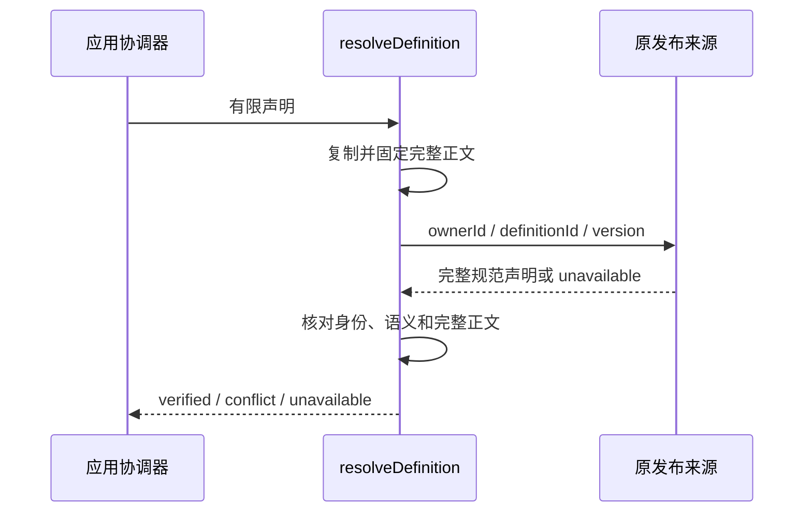

此图表示已实现的比较机制；公共协调器已经消费此机制，原发布 producer 仍待接通。不同租户可以消费同一权威，不能各自用当地可编辑的定义副本冒充该权威。

## 验证与维护

Schema 测试运行真实 SQLite；材料测试运行真实 Worker。真实 Identity 资格与普通工厂已有组合用例，Cordis动态生命周期已有实际fiber组合验证，业务current来源仍无生产符合性证据。关系变化须同步 [对象模型](object-model.md)、[规格](../SPEC.md) 和实际迁移，不以更新旧迁移来兼容已发布数据。

## 原操作与业务写者

`operation-schema.ts` 定义本包私有命令、身份和保管记录。`operation.ts` 负责受理、固定执行内容、终态和原结果读取；`scope.ts` 负责精确 scope 绑定和 epoch 切换。`definition.ts` 消费 Settings/Permissions 的公共纯验证，不重复规则算法，也不认证发行来源。`contribution.ts` 负责登记和精确撤除；`apply-operation.ts` 将当前 epoch 判断、业务写入与原结果写入放进同一次事务。

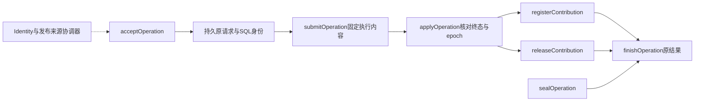

恢复读索引排除历史终态。当前贡献扫描限129行，实际允许128；在线项统计按当前去重声明计算。重复租约共享声明的预算，不把同一声明的每个租约再算一遍项数。权威来源和作用域资格仍是应用协调器的实施缺口，不能用上述私有执行材料绕过。

## 完整采用

`candidates.ts` 只枚举当前epoch的有效租约，并按定义去重读取正文。`adoption-plan.ts` 比较完整选择、定义相容性、目标和实际关口。`adoption.ts` 在计划成立后替换关系并推进修订。`applyOperation` 将该效果与原结果共同提交。

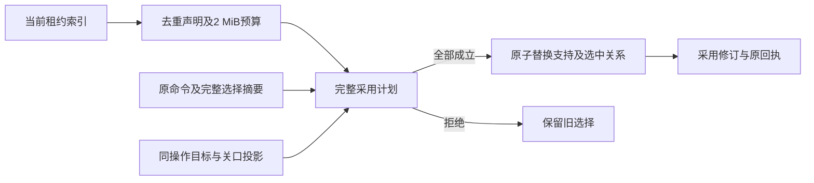

目标投影携带原操作、事务域、epoch、目标来源、完整定义和ownerRevision。它保留目标拥有者的责任，治理写者不读取Settings或Assets私表。当前测试用具名投影夹具执行真实采用事务；Identity 协调已经接通，生产 fact 桥接仍待完成。

## Identity 保留与恢复边界

`standing-schema.ts` 定义请求、回执及保管状态。`standing-custody.ts` 通过完整原操作主键读写 held_json。它不读取 Identity 私表，也不发行资格。`standing-operation.ts` 提供身份保留路径的业务入口和精确封口入口，二者共用原操作终态。

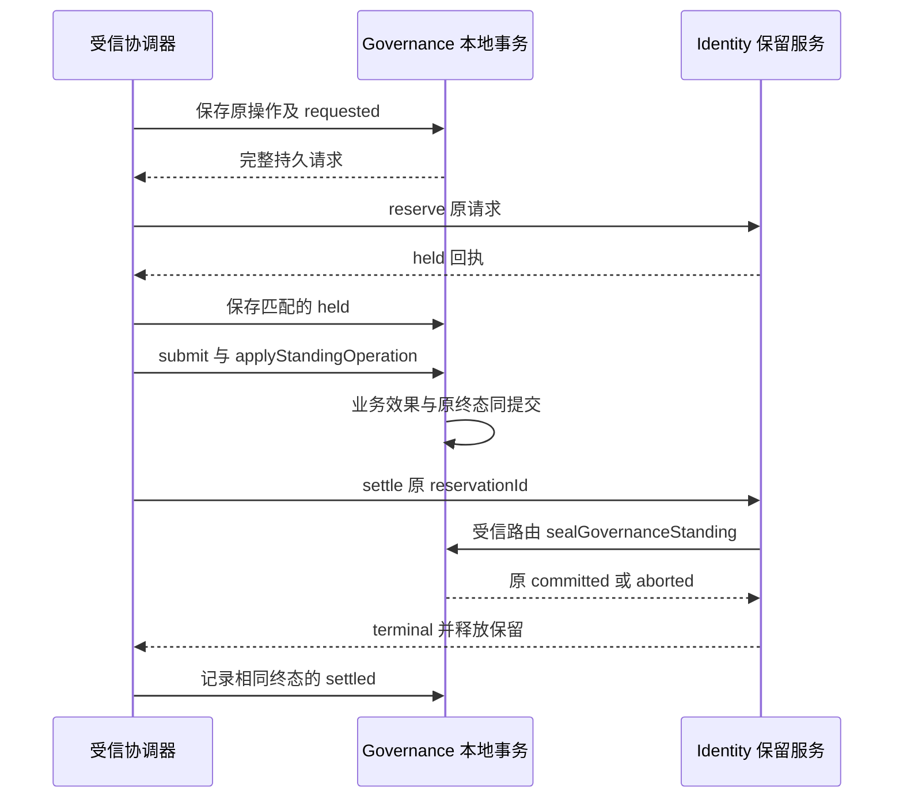

图中业务提交和结算不要求固定先后。若结算先封口，迟到提交只能认回 aborted。若业务先提交，结算认回 committed。目的端不可用时，Identity 保留不释放，撤权仍待恢复。

复用 [StandingCommit 与 SettingsReservationCustody](../../../assets/settings/verification/README.md) 的模型义务。模型 operation 对应完整治理原操作，terminal 对应该行 committed/aborted，保管请求对应 held_json。有限模型验证以真实 Identity 和同事务封口为前提，不证明来源认证、服务可用性或跨进程部署。真实组合测试见 [持续测试](../tests/README.md)。

## 同时恢复业务与未结算保留

`recovery-migration.ts` 增加恢复部分索引，原迁移字节保持不变。`recovery-read.ts` 提供按同一 scope 做 keyset 分页的只读处理器。索引包含业务 pending，以及业务已终结但保管尚未 settled 的行。只扫描业务 pending 会漏掉提交成功后丢失结算回包的记录。

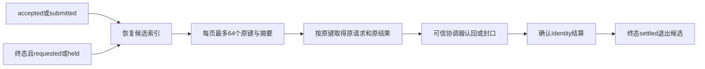

读取材料限定 gc_scope 和 gc_operation 两张表，使用 domain-serial 排序。每次最多读取66行，输出上限256 KiB。失败保持 unavailable，不能变成完整空页。一次分页只覆盖该轮观察到的集合，后续扫描从头发现并发插入。

## 生产参与者的计划依赖

`activation-schema.ts` 定义 control、mutation、adoption、observation 四种计划。`metadata-plan.ts` 只形成元数据计划。`business-plan.ts` 从已保存原操作取得业务绑定，两个业务计划参与者分别限制命令族。`activation.ts` 是治理关系表的唯一写者，消费计划后重新检查原记录。

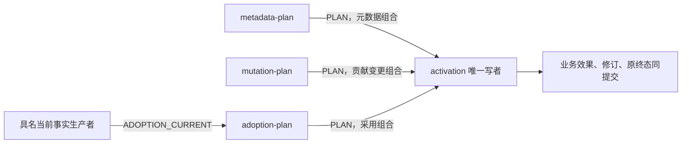

三条 PLAN 路径互斥，不能把整张图一起登记成一个组合。生产材料工厂允许应用选出各自闭包，SqlStorage 拒绝同组合重复提供 PLAN，也拒绝调用写者时省略所需生产者。

元数据和封口不依赖 ADOPTION_CURRENT，因而不需要当前目标服务在线。采用计划从 requireFact 取得当前证据，不读取外域私表。当前事实的真实生产桥接仍待完成，组合测试中的生产者明确标为夹具。

私有事务的真实 Worker 证据包含登记、撤除、空集合采用、错绑定及元数据封口。公开协调器和 Cordis 接线没有因此变为完成。阶段请求持久材料见下节。后续公开协调器须发送其读回值，不能用当前 manifest 或随机阶段键重建旧操作。

## 恢复时发送原请求

`sql-stage-migration.ts` 增加 gc_sql_stage。该表与既有九张关系表同属 governance.activation，原迁移字节不变。`sql-stage.ts` 承担单赋值保存与读回，`sql-stage-binding.ts` 核对原业务、元数据和 Standing 恢复绑定。`sql-stage-schema.ts` 使用 SqlStorage 的公开请求形状，限定治理域可接受的租户身份、阶段和预算。

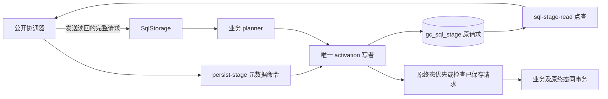

只读处理器使用 domain-serial 顺序，访问 gc_operation 和 gc_sql_stage。普通读回读取两行，Standing 阶段最多四行，无历史扫描。最大输出为4 MiB加1 KiB包装空间。主键同时服务唯一性与读取，不增加重复索引。

保存和提交是两个事务，之间允许进程退出。恢复者必须取得原请求再提交。当前真实 Worker 用例验证这一边界，公共协调器已消费原请求，跨域真实来源接线仍待完成。参与者不能观察 SqlStorage 外层完整请求，因此写者的保管检查和协调器的原样发送检查都必须存在。

## 原操作受理与结果认回

`operation-read.ts` 点查原操作及 Standing 保管，最多三行，输出上限3 MiB。`sql-coordinator.ts` 注入固定写域和元数据组合，协调这些读取与已有生产参与者。`sql-submission.ts` 识别完整回执绑定及唯一写者回复。

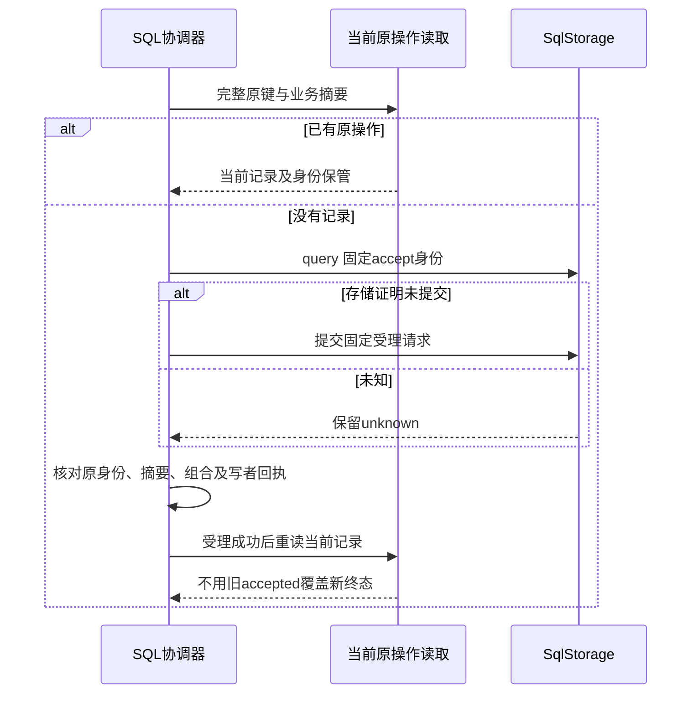

重启后 executeControl 可以认回旧组合下的阶段。send 从持久阶段读回完整请求，提交未知则查询同一身份。不同命令内容不得借新的 metadata 配置替换旧阶段。调用期间用户对象变化也不能改变首次异步等待前已固定的输入。

Identity 预留和结算由下述 Standing 协调器接线，公共应用服务已经消费准入与来源协议。图中 SQL 协调器仍为提供者内部实现。生产来源适配尚未完成；Cordis装配已接入普通运行时。


## 真实 Standing 服务协调

`GovernanceStandingDestination` 只依赖 SQL 协调器和固定路由，负责先读原请求并核对完整绑定与资格，再把已验证请求交给 standing-seal 阶段。固定SQL身份也会被失败回执占用，这项预核对防止错误输入堵住后续合法恢复；事务内最终核对仍存在。`GovernanceStandingCoordinator` 组合 SQL 协调器与 Identity 的公开预留端口。它保管原请求，核对完整回执，并以当前存储观察返回 held 或 settled。两个对象都是提供者内部对象，不是新增领域服务键。

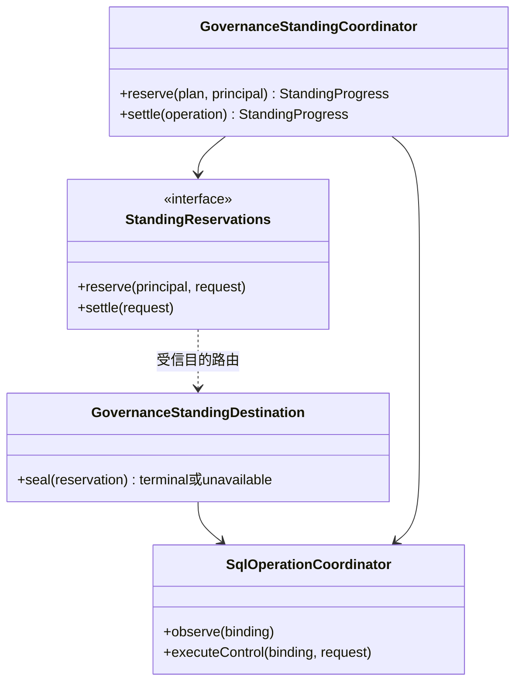

装配先创建 SQL 协调器和目的适配器，再将目的适配器交给 Identity，最后创建 Standing 协调器。恢复调用 settle 时不需要原主体。`standing-routing.ts` 为主线程适配器与事务写者共用规范恢复引用解析，核对租户、主体、摘要与固定目的。

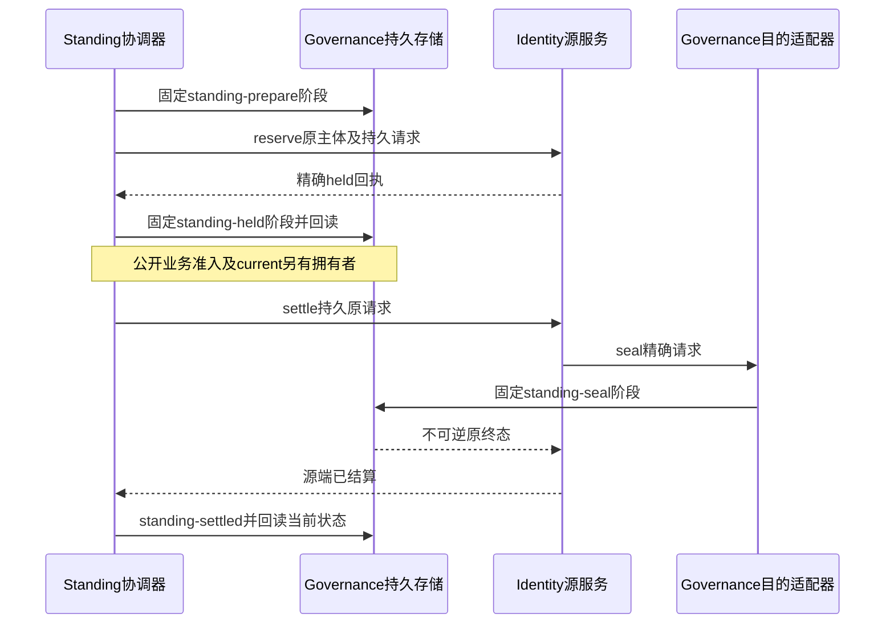

源端请求可能还未发送，或已 held 但回执丢失。两者都从持久请求恢复。业务提交与目的封口由同一原操作事务决定先后；源端随后结算。历史 held 回包不覆盖 settled。Standing 协调器单元组合使用具名准入与来源依据夹具；普通工厂组合使用真实 Identity 和固定委托，定义及当前事实仍用具名夹具。两者均不替代整个提供者的独立验收。

## 单个贡献的精确生命周期撤除

内部清理能力与公开 withdraw 使用不同准入路径。公开命令仍核当前业务资格；可信生命周期清理只处理它持有的原操作，不在用户已经撤权后重新申请许可。两个路径复用同一精确租约撤除函数。

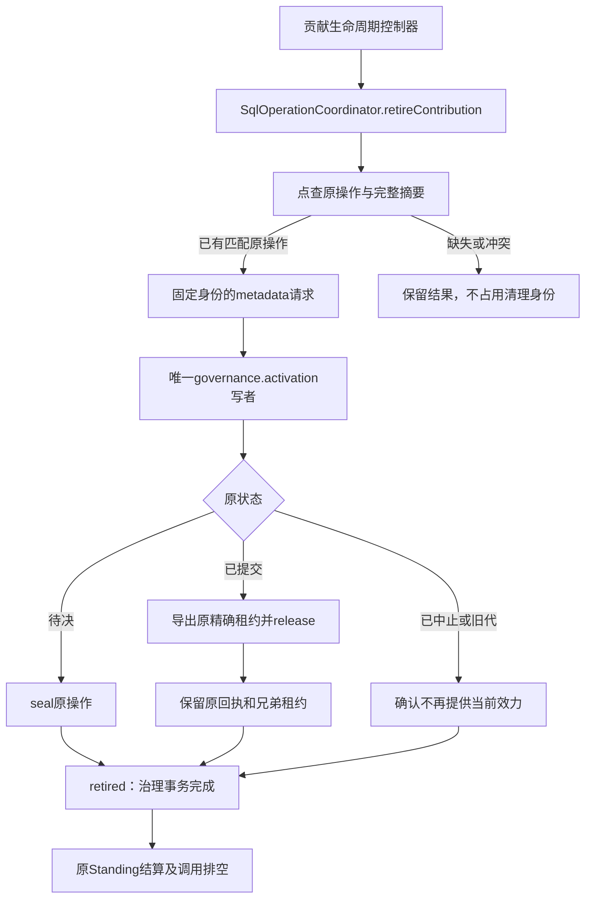

retired 不等于整个生命周期 closed。治理事务只负责原操作封口或精确撤除。外层控制器还要结算原资格保留，并确认不存在可能迟发的调用。

最多128个在线租约各需要一次退出修订，因此新增登记与采用提前保留128步。这样数值边界不会让合法的新租约无法退出，也不需要为退出另建计数表。原状态已越过预留规则时，提供者保留明确的容量失败，不把关闭整个 scope 当成单租约退出。


## 调用方清理的实然控制模型

每个调用方都有自己的入口闸门。相同原操作的调用方共享一份清理责任；其中任意一个退出，都会让这份登记退出。另一个原操作拥有独立租约，不受影响。这个模型不使用引用计数，因此重传请求不会把原登记的生命延长。

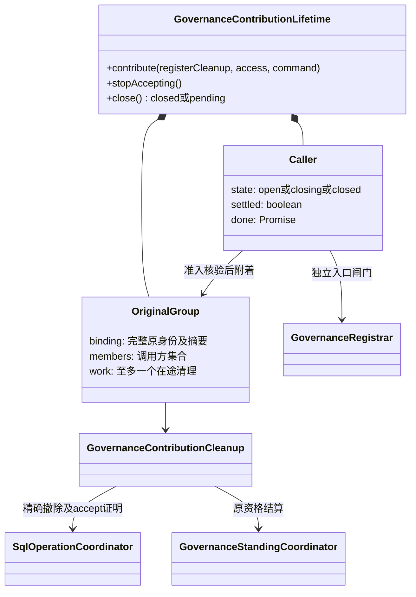

调用方关闭先同步关闸，再由提供者收尾。定义来源卡住时，关闭保持 pending，但其他登记可以继续。数据库暂时不可用时，提供者保留该组并自动重试。每批只启动有限数量的组，每组只允许一个在途清理，避免一个未返回的请求拖住所有组。

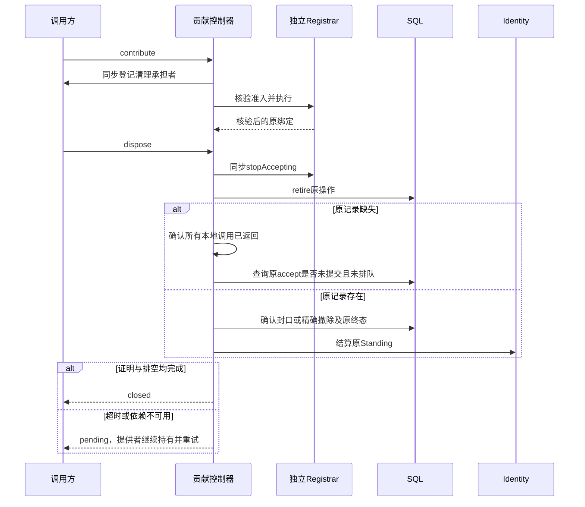

普通工厂对外仍只有五个应用方法与关闭接口。内部运行时把贡献控制器交给Cordis适配器，公共根入口不导出它。实际fiber接线及卸载验证见下节。


## Cordis生命周期的实然装配

调用方fiber相当于登记的使用者，提供者fiber负责保管尚未结束的清理。二者的退出时间可以不同。调用方离开后，即使数据库暂时不可用，提供者仍会重试原操作，不会把这项责任丢给已经离开的调用方。

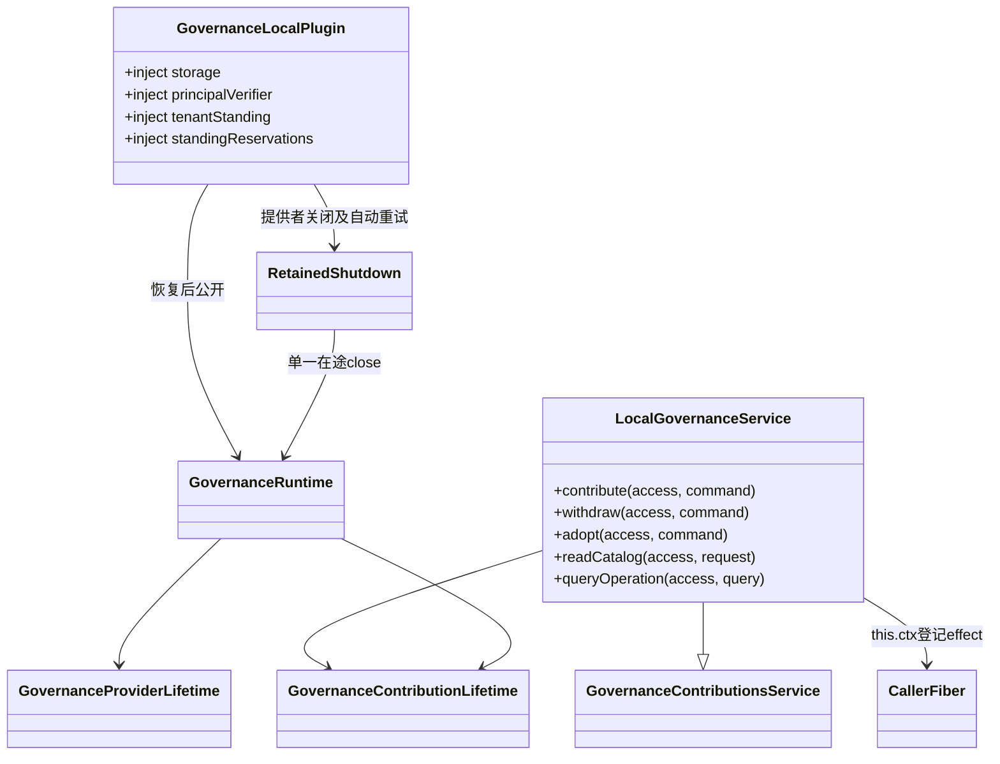

服务继承公共契约已有的唯一Service定义，没有另建服务键。contribute使用普通函数保留Cordis追踪的调用方ctx。其他应用方法沿用普通服务入口，保持各自原有的准入与持久协调。

```mermaid
sequenceDiagram
  participant A as 外部装配
  participant P as 提供者fiber
  participant R as 普通运行时
  participant C as 调用方fiber
  A->>P: 注入SQL及Identity
  P->>P: 登记提供者清理责任
  P->>R: 启动隔离及历史恢复
  R-->>P: created
  P->>P: 构造唯一Service并激活
  C->>P: contribute
  P->>C: 在调用方ctx登记清理
  C->>P: 卸载调用方
  P->>R: 精确贡献清理
  A->>P: 卸载提供者
  P->>R: 关闭入口并执行close
  alt 本次关闭pending
    P-->>A: 首次pending通知
    loop 保留责任，单一在途任务
      P->>R: 重试close
    end
  end
  P-->>A: 确认后发送closed通知
```

Cordis会等待异步启动返回再完成卸载。启动仍悬挂时，没有可供消费者调用的服务，不能声称启动已取消。启动途中显式卸载或依赖失效的实际测试均检查没有晚到服务激活。进程重启仍靠持久恢复，不靠这张图中的JavaScript对象。

此装配已有真实Cordis、SQLite和Identity测试。生产声明发行、当前事实和Settings/ActionAdmission接线仍未完成，不能据此宣称C3b整体验收通过。

## 权限读取的来源责任

权限读取的原动作与读取操作分开。每次读取有新的 capture，原动作仍保存在 PermissionBasisRequest。Governance 保管读取终态，Settings 保管来源快照；权限规则继续由 Permissions 解释。

```mermaid
erDiagram
  gc_operation ||--o| gc_permission_source : "同事务接受，完整原键"
  gc_operation ||--o{ gc_sql_stage : "精确阶段信封"
  gc_operation {
    string request_json "不可变命令及source计划"
    string state "accepted submitted committed aborted"
  }
  gc_permission_source {
    string receipt_json "NULL表示requested，或held/settled"
  }
  gc_sql_stage {
    string stage "含source-held与source-settled"
    string envelope_json "保存后不改写"
  }
```

恢复读取分别扫描业务/Identity部分索引与来源部分索引，每个最多65项，然后按完整键去重归并。终态未结算的来源仍在恢复集合内。所有关系属于 Governance，不查询 Settings 私表。

来源协调器通过 Settings 公共端口取得、保管和结算快照。首次保留要求同一 capture 的 Identity held；清理只使用原持久请求。目的解析器仅消费 Governance SQL，因而可在 Identity 和 Settings 服务装配前构造，不产生运行时构造循环。

```mermaid
classDiagram
  GovernanceScopeLifecycle --> GovernanceStandingCoordinator : 结算身份
  GovernanceScopeLifecycle --> GovernanceSourceCoordinator : 结算来源
  GovernanceSourceCoordinator --> SqlOperationCoordinator : 原请求与回执
  GovernanceSourceCoordinator --> SettingsSourceReservations : reserve及settle
  SettingsSourceReservations --> GovernanceSourceDestination : recognize及seal
  GovernanceSourceDestination --> SqlOperationCoordinator : 精确认回及封口
```

启动恢复完成与关闭完成都要求两类责任已结算。来源依赖缺失时保留待决责任，借用服务的销毁仍归装配拥有者。实际权限 current 事务和旧装配重放仍待交付。旧 SQL 信封保留原字节，不代表它可以在新材料摘要下执行。
