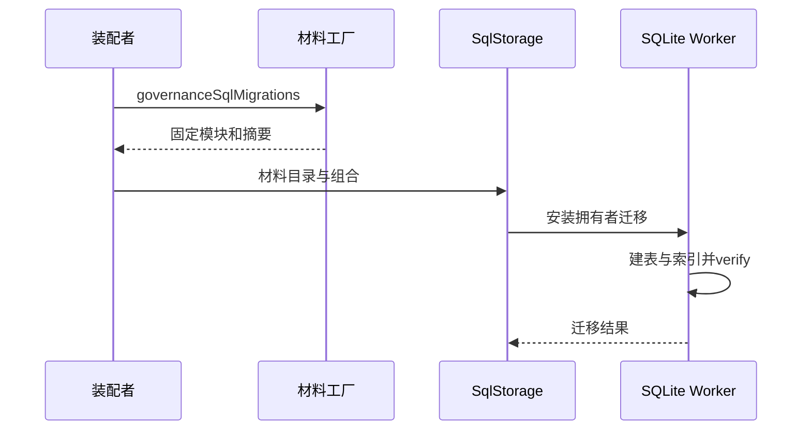
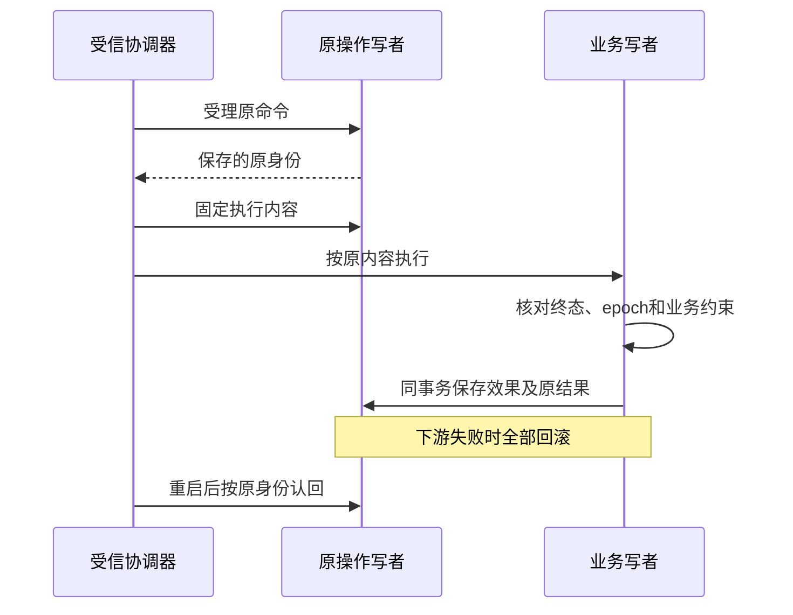

# 关键流程

## 流程

材料安装、普通应用服务和Cordis生命周期已实现。生产声明发行、current事实及跨域消费者仍待组合。

## 失败与生命周期

材料文件缺失不能静默变成空迁移。数据库约束失败使所在事务失败。重开读取同一数据库不重新创建已有关系；迁移的版本与摘要由 SqlStorage 认回。unknown、seal、reserve及fiber卸载由应用协调器与生命周期控制负责，迁移测试不证明这些行为。

## 登记、撤除与恢复事务

生产写者已经由普通应用协调器消费。低层操作测试保留具名夹具；应用与Cordis测试使用真实Identity和SQLite，声明/current仍为具名来源夹具。

封口在业务之前成立时，迟到执行只返回 aborted。业务先成立时，封口认回 committed。换 epoch 隔离新业务，不删除旧操作结果。Identity reserve、settle和可信目的地恢复已接入应用协调器；完整生产来源和跨域消费仍待验收。
