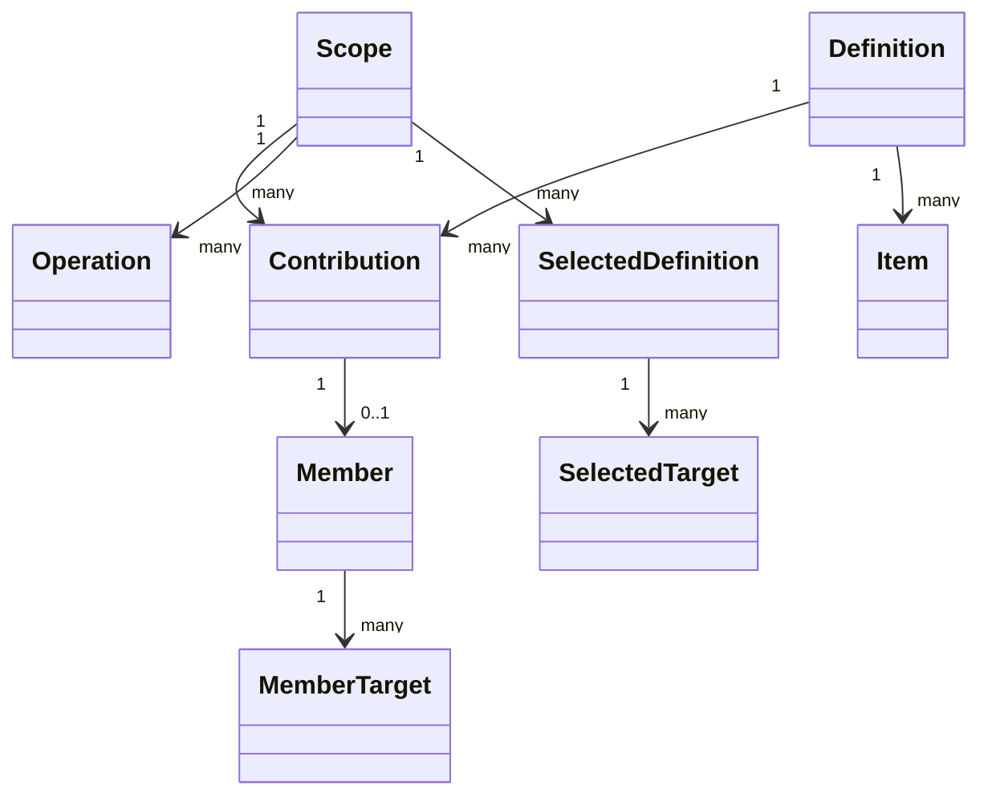

# 对象模型

## 对象与关系

Scope 表示一个租户内某服务可采用的治理范围。Definition 是不可变声明副本。Contribution 是某次装配取得的独立租约。Member 表示租约进入当前采用集合，MemberTarget 记录该租约具体支撑的目标。Operation 保存一个原始命令及其进展。

当前源码用关系记录表达这些有身份的对象，迁移采用 SqlStorage 的 MigrationModule。没有为每张表创建一个无行为 class。业务 Provider 后续通过公开契约消费外域，不继承外域对象或持有其私表。

## 生命周期

租约持久状态为 active/released，关闭受理的内存阶段与持久撤除区分。撤除最终须与采用投影在一个事务完成。Scope 换 epoch 后旧行保留为历史，当前读取必须核对 epoch。

声明与原结果不因租约撤除而删除。资产、设置值、身份和权限值的生灭各归原领域。当前阶段只建立结构，实际生命周期推进仍待实现。
