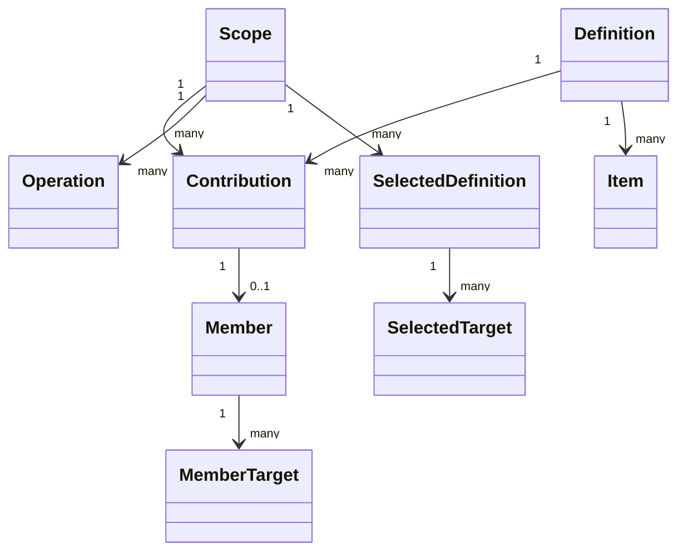
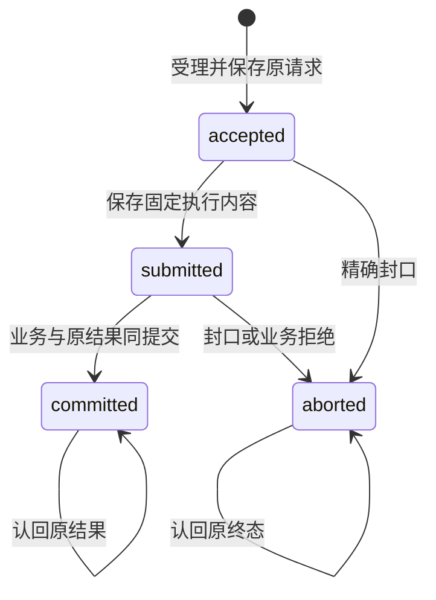
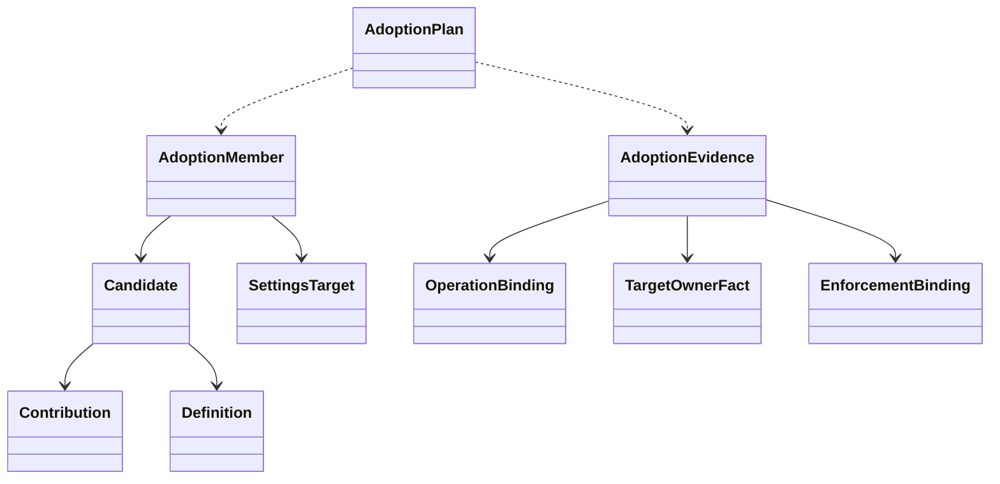
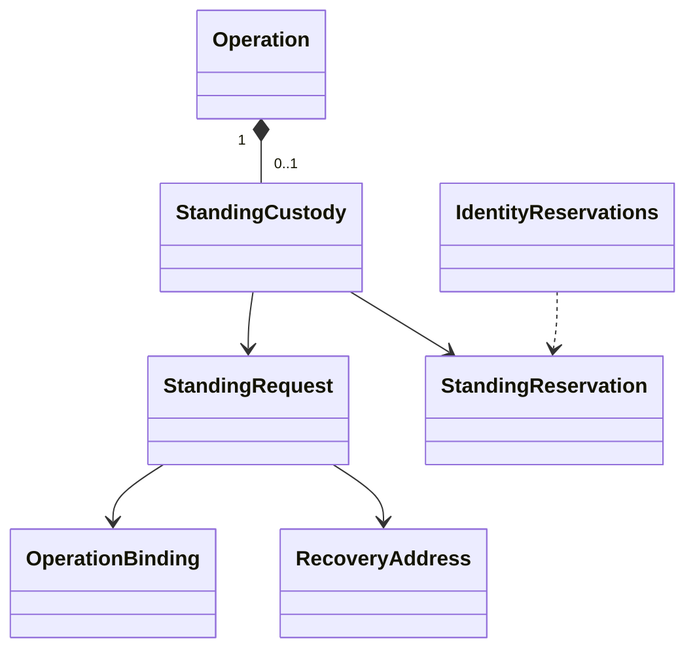
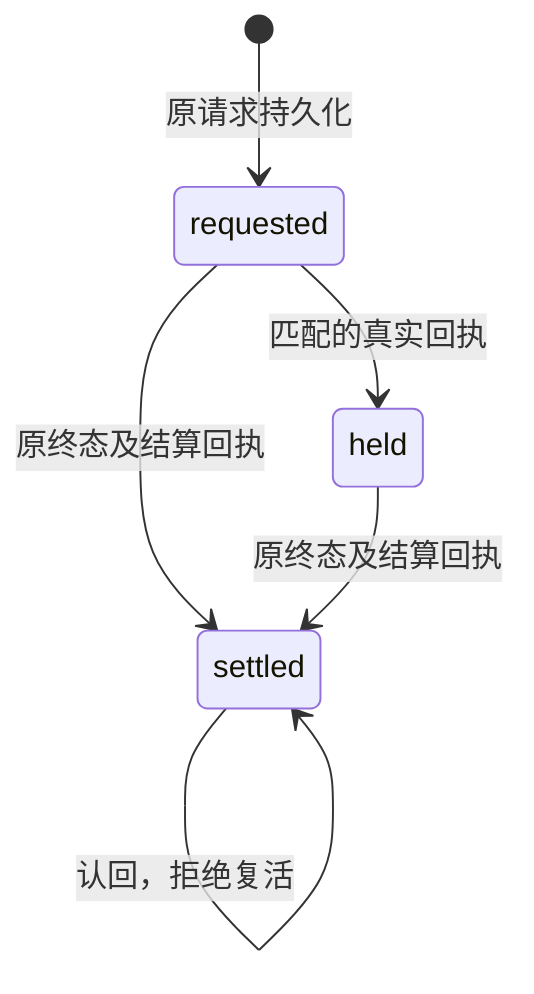

# 对象模型

## 对象与关系

Scope 表示一个租户内某服务可采用的治理范围。Definition 是不可变声明副本。Contribution 是某次装配取得的独立租约。Member 表示租约进入当前采用集合，MemberTarget 记录该租约具体支撑的目标。Operation 保存一个原始命令及其进展。

当前源码用关系记录表达这些有身份的对象，迁移采用 SqlStorage 的 MigrationModule。没有为每张表创建一个无行为 class。业务 Provider 后续通过公开契约消费外域，不继承外域对象或持有其私表。

## 生命周期

租约持久状态为 active/released，关闭受理的内存阶段与持久撤除区分。撤除最终须与采用投影在一个事务完成。Scope 换 epoch 后旧行保留为历史，当前读取必须核对 epoch。

声明与原结果不因租约撤除而删除。资产、设置值、身份和权限值的生灭各归原领域。登记、采用、撤除和epoch围栏已有私有事务写者；公开服务及Cordis关闭流程仍待接线。

Operation 的原请求与执行内容分别固定。前者表达业务意图，后者绑定实际组合和协调材料，不能因重试而用当前版本替换。当前源码用严格 Schema 的记录和事务函数表达这个状态机。

## 采用的值对象

Candidate 是当前租约及其不可变声明的读取结果，不发行新身份。AdoptionMember 把一个 Candidate 与其选择的完整目标集合组合。AdoptionEvidence 是同操作、同事务域、同epoch的消费投影，包含目标拥有者事实与实际关口映射，不授予权限。

纯计划核对这些值，关系写者执行已成立的整份计划。数据关系、业务判断与外部事实生产分开承担责任；不为临时计划增加持久表，也不把目标拥有者的生命周期搬入治理域。

## 原操作持有的身份保留

StandingCustody 是 Operation 内的保管值，不是另一个资格拥有者。它保存向 Identity 发出的完整请求及原回执。身份资格和保留是否释放仍归 Identity。

保管状态与业务状态是不同维度。业务已终止时仍可能收到 held 回执，持有该历史回执不表示业务可以继续。业务入口必须先检查原终态。
