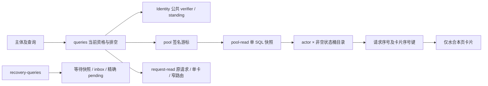

# 内部架构

## 模块与依赖

公共模型来自 human-intervention。单机模块消费 sql-contract/worker，装配者注入 SqlStorage。Node crypto 和 canonicalize 计算稳定身份，Zod 解析边界值。本成员不导入 Session、Agent、Tool 或 Cordis。

请求命令使用 T、W、J、F、H；恢复命令使用 T、W、J、F；封口只使用 T。静态事实依赖检查必需前驱，可信命令构造器保证完整参与集合。静态图不保证所有后继必然参加。任一参与者失败，共同事务中的终态和业务变更全部回滚。

W 只读独立 WaitOwner 的状态，产生增量计划。J 的请求分支读取 HITL 状态，消费原拥有者的等待依据；恢复分支只验证绑定和转交计划，不执行 SQL，也不解释卡片状态。F 校验原计划摘要并写等待状态。H 验证 F 的接纳摘要后写请求增量。计划是事务内事实；操作回执保存绑定、摘要和原业务结果，避免复制整份历史。

## 状态所有权

| 写者 | 当前关系 |
| --- | --- |
| T | 操作终态 hi_terminals_v2 |
| F | 准备、受众、相容实现、接收代次、终局、active、卡片关联、inbox、receipt、pending |
| H | 请求正文、请求修订、题目、卡片状态、决定、读者、非空桶目录、租户池修订 |

每张表只有一个写者。恢复消费在 F 中一起插入 receipt、增加计数、推进 checkpoint、删除 pending。pending 精确等于尚无 receipt 的 inbox，ack 不控制这份集合。H 的 delivery 状态记录披露事实，不替代原消费者的 receipt。

请求及准备的不可变正文与频繁变化的控制状态分表。单卡答复只读取该题和该卡；consume/ack 读取决定身份，不读取历史答复正文。每个决定的完整内容分别由 HITL 和原等待收件箱保管，不随新答复重复写入。

操作身份固定为租户、actor、operationId；method 与规范输入进入摘要。SqlStorage journal 是完整结果权威，terminal 的 committed 位不能代替业务成功。旧 journal 的原参与者结果仍按原形状解释。

## 查询和预算

不可变读者投影由 WaitOwner 登记时提供，绑定租户、完整 WaitRef、preparationRef、登记摘要及排序去重后的读者摘要。HITL 保存该投影，并在一个 SQL 快照内核验读者和读取结果。查询前后仍核验当前 Identity 资格。若将来允许改变受众，须先定义新的修订与失效协议。

池目录每请求至多 A×min(5,K) 行，不按读者复制每张卡片。每桶读取最多 P+2 个请求键、P+1 个卡片键；跨桶合并后只水合 P 张卡片，保持原 `(request sequence, card ordinal)` 顺序。固定快照内的分页推导见[持续验证](../verification/README.md)。

读口返回行预算：pool 1117、request 65、wait 130、delivery 201；输出上限均为8MiB。页面按完整 item 截止，不能截短原话。预算先到返回 partial 与续页；单项无法容纳时返回 limited。返回行预算不代表扫描成本，索引和 VM 工作另行测量。

## 迁移与生命周期

旧四份迁移保留原字节及校验和。新增具名迁移先创建关系结构，各拥有者读取自己的旧记录；WaitOwner 通过版本化临时导出合同交付原登记 OperationRef、readAudience、决定身份及完整摘要。HITL 重建原登记并双向核对决定集合。缺失、重复、不匹配或非法关联使整个迁移回滚，不补默认权限，不跨读业务私表。旧表由各原拥有者退休，导出在采纳核验后删除。旧拥有者仅保留迁移材料，运行组合为 independent-hitl/2。

Identity 协调继续通过 ID-19 保留短 reservation，使用同一目的端封口，不覆盖人工等待时长。application 在调用外部端口前登记受理工作；close 拒绝新调用，排空已受理读写，再关闭内部适配器，不关闭共享存储、不终结业务等待。

[规格](../SPEC.md)拥有行为承诺，[对象模型](object-model.md)说明关系，[持续验证](../verification/README.md)说明证据边界。当前独立范围不执行 Agent/Tool Continue，也不取得运行时执行槽。
