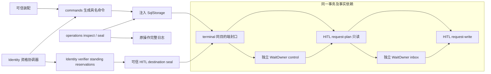
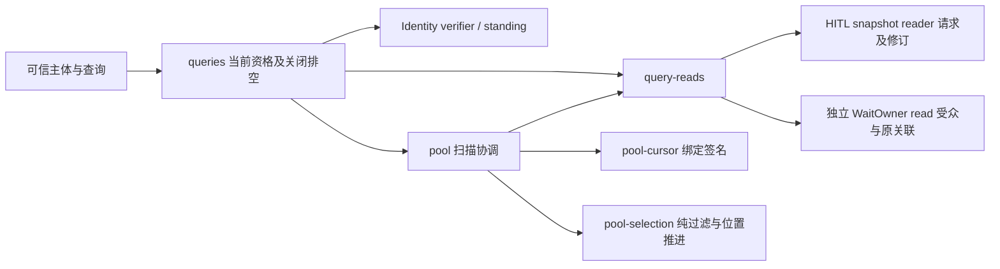

# 内部架构

## 模块与依赖

公共模型来自 human-intervention。单机模块消费 sql-contract/worker，实际装配注入 SqlStorage。Node crypto 和 canonicalize 计算稳定身份，Zod 解析输入与持久记录。本成员不导入 Session、Agent、Tool 或 Cordis。

## 关键机制与理由

terminal-participant 与业务参与者处于同一事务。请求规划者读取本域状态并消费 WaitOwner 提供的事实，原拥有者接纳计划后，请求写者才持久化。这个依赖图没有循环，每张表只有一个写者。组合缺少事实提供者时 SQL 在接受前拒绝，不靠运行时空适配补齐。

control 拥有准备材料、接收代次、业务终局和消费 checkpoint。inbox 拥有 active 关联及决定收件箱。两者是同一独立 WaitOwner 内的状态职责。HITL 只拥有请求、卡片及其披露所需数据。Session/Tool/Agent 原等待将通过同一事实协议接入，不复制独立等待的生命周期。

操作身份包含租户、actor 与 operationId。method 和规范化输入进入摘要，不进入唯一键。SQL 原操作日志保存完整结果，hi_terminals 仅记录提交或封口。operations 在读回时验证方法与结果的对应关系，不能从终态位推断业务成功。

## 验证与维护

[终态测试](../tests/terminals.spec.ts)与[请求恢复测试](../tests/requests.spec.ts)运行真实 SQLite worker。测试覆盖晚失败共同回滚、竞争答复、重启、代次隔离和批次屏障。Identity 成员资格协调已通过真实 IdentitySql 验证。独立等待统一池已实现，完整应用服务仍未完成。该实现不能替代完整 C2 独立验收。行为承诺归[规格](../SPEC.md)。

## 当前资格与关闭

identity.ts 将成员资格判断与目的端事务接在一起，identity-destination.ts 供 Identity 撤权和恢复调用。两个模块只消费 Identity 公共合同，未导入 Settings，也不读取 Identity 私表。授权、原工作、资产及采用的保护仍由各自拥有者负责。

原操作结果查询先核验当前主体。短 reservation 只保留到目的操作取得终态，不覆盖人工等待时长。close 在调用外部端口前记录已受理操作，避免端口回调重入关闭时提前结束。

## 统一池的读取边界

查询协调只消费两个读口，不读取原等待私表。pool-selection 只决定一份请求内哪些卡片进入本页及下次位置，不接触身份或存储。pool-cursor 保管注入密钥的副本，游标中只放快照摘要和扫描位置。它不保存待办或决定。

字段及故障语义归[SPEC](../SPEC.md#独立等待的查询与分页)。资格再次核验不能代替动作执行时的授权保护。池修订只覆盖本提供者的请求数据；后续若增加可变受众，原拥有者须提供相应修订或失效协议。
