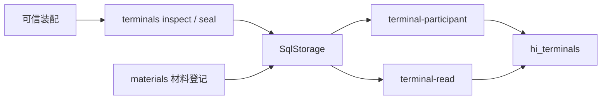

# 内部架构

## 模块与依赖

公开模型来自 human-intervention；本成员消费 sql-contract/worker，由实际装配提供 SqlStorage。Node crypto 和 canonicalize 计算稳定身份，Zod 解析存储数据。本成员不导入 Session、Agent、Tool 或 Cordis。

## 关键机制与理由

terminal-participant 在当前 SQL 事务中检查唯一操作键并写入终态。业务参与者失败使整个事务回滚，因此不能先写终态再启动独立业务事务。seal 与 consume 竞争同一唯一键，先提交者决定后续结果。SQL 的原操作日志保存完整提交回执，hi_terminals 只回答目的操作是否已经提交或封口。

入口绑定固定租户，表键包含服务与完整 OperationRef。摘要绑定输入，不进入操作唯一键，否则变更输入会被错误地视为新操作。材料模块按实际执行文件产生摘要，登记方使用同一材料构建 combination manifest。

## 验证与维护

真实 worker 测试见[终态场景](../tests/terminals.spec.ts)。增加请求或 WaitOwner 参与者时必须补同提交测试，不能把当前终态测试推广成完整 C2 验收。公开规则归[行为规格](../SPEC.md)。
