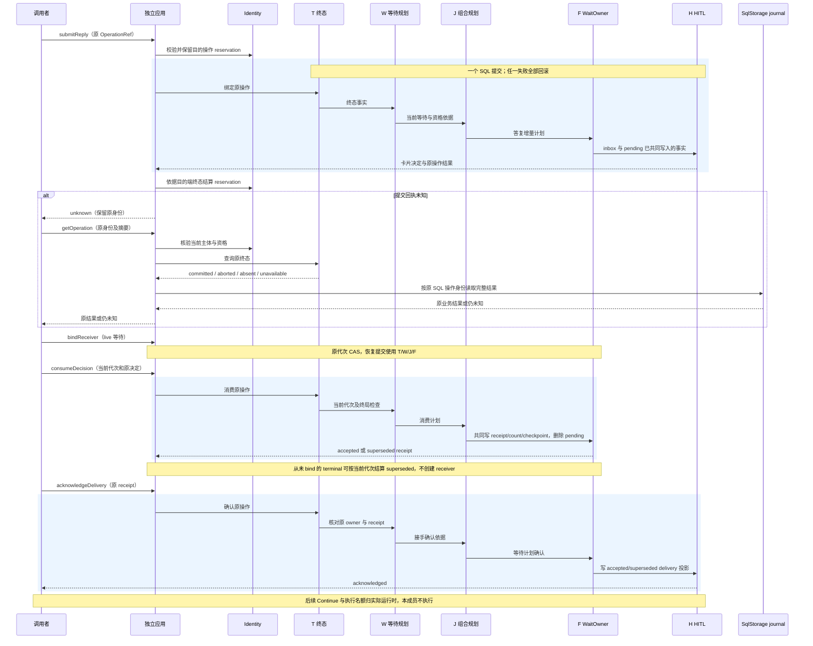

# 关键流程

## 提交与封口

业务提交先以 consume 参与原 SQL 事务，再运行真实业务参与者。事务成功后终态与业务结果一起可见；失败一起回滚。seal 则竞争同一原操作身份，已有提交保留 committed，尚未提交写入 aborted。

## 未知结果

客户端未收到提交回执时，保留 OperationRef 和 inputDigest。inspect 读取当前终态；absent 不能证明未提交。需要证明操作不会再提交时调用 seal，随后按原 SQL 操作日志认回完整业务结果。存储不可用时继续保留未知，不换 operationId 重发。

## 答复与恢复

原等待控制参与者核验来源、答复者与业务终局。请求规划者决定本次答复是否成立。WaitOwner 把成立的决定写入原收件箱，HITL 保存同一决定与完整结果。后续任一参与者失败会撤销整次写入。

live 等待的接收者通过 bindReceiver 取得新代次，再消费原收件箱。重启后读取原操作结果不会再次分配代次。live 等待的最后一张卡完成耐久消费后，批次才变为 resume-ready。实际执行仍须运行时重新取得名额与当前资格。

事务框中的 T/W/J/F/H 箭头表示参与者事实依赖，执行由 SqlStorage 调度。consume 与 acknowledge 是独立的原操作，均沿相同 Identity reservation 和未知结果认回规则。图中后两次提交省略重复的 reservation 箭头。ack 未完成时，F 已生成 receipt 的决定也已退出 pending。读取和确认不替代实际 Continue。
