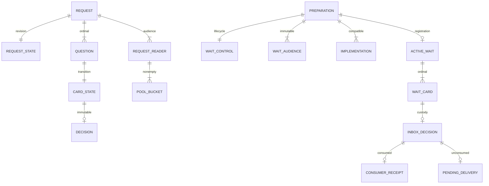

# 对象与关系

## 独立身份及持久对象

关系键均包含租户。请求与 inbox 的顺序是 SQLite int64，边界以十进制字符串传递；revision、receiverGeneration 是任意长度规范非负十进制文本。请求内 cardId 与 ordinal 分别唯一，ordinal 连续且最多64项。每卡最多一个 Decision、inbox 项及 receipt。外键和联合 CHECK 约束非法状态组合；跨行精确集合由唯一写者维护，独立 SQL 守护反向计算。

RequestRecord 是读回的一致快照形状，不是持久聚合 JSON。不可变请求头保管 origin、题序、displayContext 和 actionBasis；单独状态行保管修订。题目 JSON 仅表示不可变题目值；Decision 的 Reply 联合拆为列，原文本逐字保留。

WaitControl 保管接收权和业务终局。receiverGeneration 决定谁可消费，卡片 revision 决定答复竞争，两者不能互换。准备摘要用于认回同一准备；登记摘要用于核验原登记；迁移导出证明只在迁移合同内出现，不扩充运行时受众协议。

## 转换及派生关系

prepared 尚未成为有效人工等待。共同注册建立 active、完整卡片关联与 HITL 请求。答复在同一提交生成卡片决定、原位置 inbox 和 pending。消费在同一提交生成 receipt、删除 pending 并增加 receipt_count。仅全批卡片已消费才成为 resume-ready；终局永久固定 terminal，已有决定仍可按 superseded 接手。

PoolExact 要求每个获准读者、请求与实际非空 bucket 恰好对应一行。五个 bucket 是 pending、invalidated、decided-pending、decided-accepted、decided-superseded。卡片转换时只添加第一个新桶或删除最后一个旧桶，不改写其他卡片和读者。

PendingExact 要求每个无 receipt 的 inbox 恰好对应一行，并保留原 owner、destination、sequence。receipt_count 必须等于 receipt 实数，checkpoint 从该数和终局推导。独立检查见 [relations.ts](../verification/relations.ts)。

## 操作和游标

HitlSqlBinding 是原 OperationRef 与输入摘要，不是权限凭据。StoredOperation 关联原方法、完整结果与提交凭据，由 SqlStorage journal 保管。原结果缺失仍可能在途，不能从 absent 推导 not-committed；只有封口认回的 durable aborted 能排除迟到提交。

PoolCursor 的 after 表示已完整经过的最后请求序号，offset 表示其后第一个请求内的卡片位置；序号可有间隙。它还绑定快照摘要、过滤、actor、租户和位置。目录只改变查找路径，不改变这个顺序含义。游标无业务生命周期，不授予当前读取资格。

工厂关闭不删除持久对象，不关闭注入的 SqlStorage。runtime 卸载不是业务终局，重新装配必须沿原等待、原代次和原操作继续。
