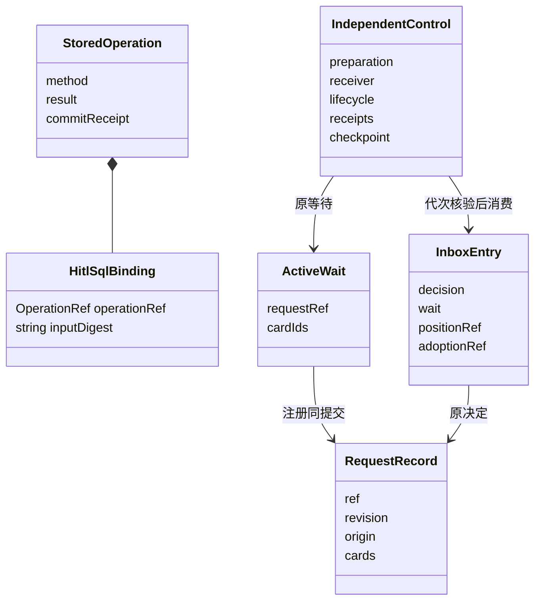
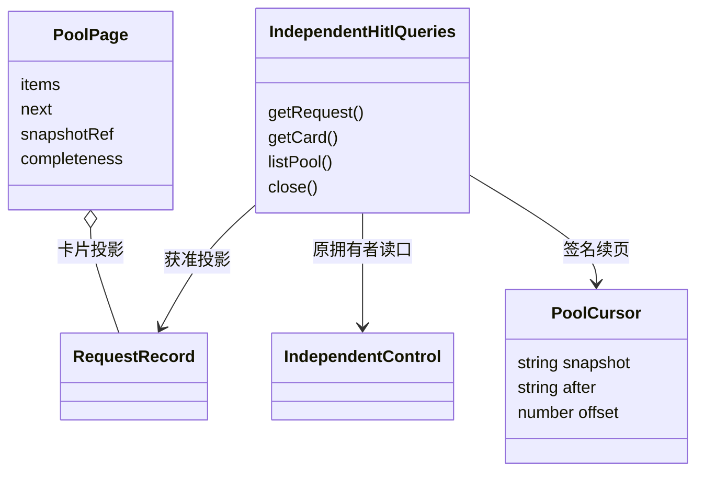

# 对象模型

## 对象与关系

Binding 是原操作值，不是权限凭据。StoredOperation 保存可重放的业务结果，方法与结果以联合类型关联。RequestRecord 的全部卡片属于该请求，卡片身份不能重复。

IndependentControl 保存逻辑等待与接收权。receiverGeneration 表示谁可以继续消费，卡片 revision 表示答复竞争条件，两者不能互换。InboxEntry 保存答复要回到的原位置和采用引用，不能因进程重启改投其他工作。

## 生命周期

prepared 只是耐久调用材料。注册共同建立 active 等待与请求。决定进入收件箱后，当前接收者逐项消费，完整批次才能转成 resume-ready。业务终局把 checkpoint 固定为 terminal，保留决定历史。

工厂丢弃不删除数据，不关闭调用者提供的 SqlStorage。runtime 卸载不构成业务终局。原操作查不到仍可能在途，必须通过封口排除迟到提交才能认定 not-committed。

## 池游标与投影

PoolCursor 的 after 表示已完整扫描的最后请求，offset 表示下一请求内已扫描的卡片数。它不是业务实体，也没有独立持久生命周期。PoolPage 中的卡片仍以 RequestRecord 为权威；读取不会确认决定接手。
