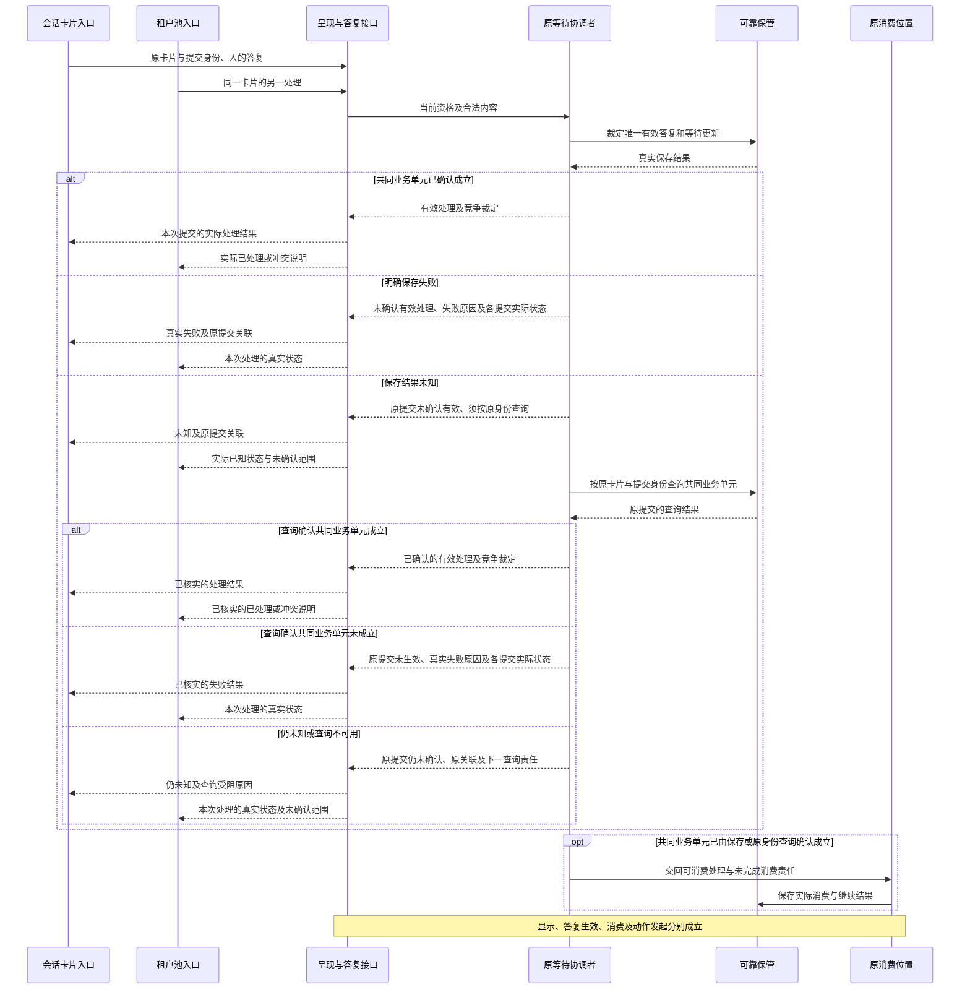

# 人在回路协作设计候选

本页保存尚待技术采用的设计，不表示实现、产品接受或阶段承诺。完整必要行为见[human-intervention/human-intervention SPEC](../SPEC.md)，产品范围见[产品正文](../../../../.meta_harness/design/product/human-intervention/design.md)。

## F-HI03 两个入口竞争同一决定

对应 J-HI05。显示是合法投影，双方提交指向同一卡片与原等待，唯一协调者确认一个有效处理。技术重传查同次提交，另一新处理看到实际结果/冲突；不产生第二份批准或继续。投影落后时查权威并纠正，不靠缓存保护唯一性。

只有共同业务单元确认成立后才交回可消费答复。保存明确失败返回真实失败，结果未知沿原卡片与提交身份查询；查询确认成立才进入消费，仍未知或查询不可用则保管原关联及下一查询责任。竞争入口的已处理或冲突回执同样以权威实际结果为依据，不能在前一提交未知时先确认已处理。答复与终局竞争仍由原协调者裁定，无权入口不能因知道卡片 ID 而查询正文。INV-HI06–HI08、INV-HI11、INV-HI14、INV-HI18。
