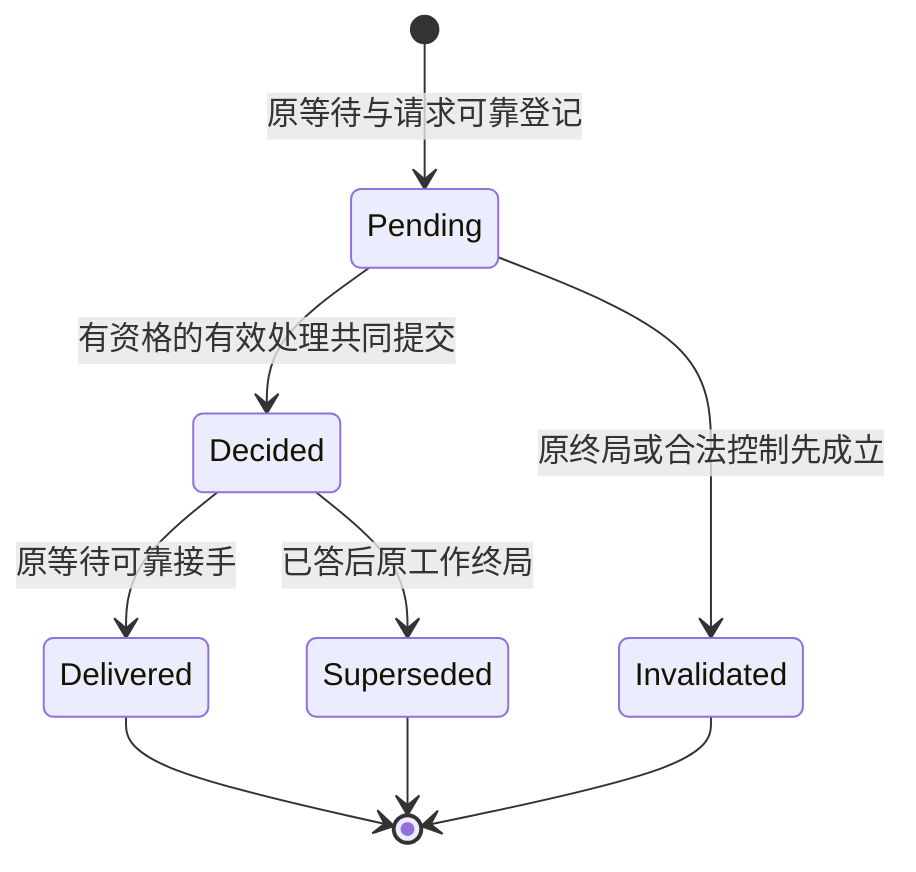

# HITL 公共协议

状态：HJ0 技术采用已于2026-11-06由用户验收。本文定义数据和应用服务的行为。源码已提供公共形状与纯卡片规则，持久服务和运行组合尚未完成。行为来源为[成员契约](../SPEC.md)，数学定义及模型映射见[形式模型](formal-model.md)。协议标识为 `hitl/1`；本波迁移消费者，不保留两套卡片协议。

## 事实、轴与拥有者

| 事实轴 | 拥有者 | 本协议消费方式 |
| --- | --- | --- |
| 请求、卡片、人的有效处理和保管 | HITL | 本域对象及应用服务 |
| 原等待、批次屏障、继续位置、业务终局 | 原 Tool/Agent 协调者；Session管业务控制 | 稳定引用与具名提交参与者，不导入runtime对象 |
| 操作者身份、成员状态、撤权协调 | Identity | PrincipalVerifier、TenantStandingSource、StandingReservations |
| 批准含义、许可及消费 | Authorization | 原决定引用、规范动作指纹、许可回执；人的文字不直接变许可 |
| 租户持久权限设置 | Settings及授权策略拥有者 | 有资格的真实设置命令和原操作回执 |
| 提示受理、送达与重连 | Notification | 独立通知命令与查询；通知成功不解等待 |
| 会话入列与推进 | Session；Agent负责求值 | 稳定输入/工作引用；HITL不维护第二条会话队列 |

SOLID：请求状态的纯函数不执行存储或读外域；应用协调器消费窄端口；提供者实现公开端口，Cordis只注入与管理生命周期。外域适配不进入HITL纯模型。原等待协调者可由独立消费者提供，不强制存在Session、Agent或Tool。

## 值与身份

所有wire对象为严格JSON对象，不含函数、Promise、数据库句柄、Context或进程对象。未知字段拒绝；缺字段与null不同。字符串按UTF-8预算校验，整数用非负安全整数，修订用十进制字符串。标识为不透明非空字符串，不从客户端文本推导租户或资格。

| 值 | 必需字段与含义 |
| --- | --- |
| RequestRef | `tenantRef, requestId`；全域关联还携带提供者位置，不假定跨节点全局池 |
| CardRef | `request:RequestRef, cardId`；一个请求包含一张或多张卡 |
| OperationRef | `tenantRef, actorRef, operationId`；按服务+租户+操作者+操作身份去重，绑定方法与规范输入摘要 |
| WaitRef | `owner, waitId, incarnation, destination`；稳定逻辑等待身份及被采用继续实现的代次，不是进程PID；runtime换代不自动变更 |
| Origin | `kind:tool|agent-extension|admission|independent, originRef, wait:WaitRef, positionRef, adoptionRef`，可选`sessionRef,runRef,toolCallRef`。按kind校验必要字段；会话不是独立请求的必填父对象 |
| ActionBasis | `operation,targetRef,effectiveArgumentsDigest,implementationRef,authorizationBasisRef`；绑定真正待执行参数。原始展示输入可另保留，不替代生效参数 |
| Question | `cardId,title,description,kind:question|approval|admission|extension,options[]`；选项含`id,label,description`。question至少一个文本候选；每种卡都允许独立原话，不能要求先选选项 |
| ChoiceEffect | 仅批准/系统放行卡可引用`effectRef`；由Authorization给出可采用范围及设置影响说明，HITL不解释或扩大范围 |
| Reply | `kind:selection,optionId`或`kind:text,text`或`kind:decline`。一次提交只选一种；没有自动答复或timeout分支。拒绝动作是某个明确选项，区别于decline |
| DecisionRef | `card:CardRef, decisionId, submission:OperationRef`；固定答复者、原话/选择、提交时依据和共同提交回执 |
| ConsumerReceipt | `decision:DecisionRef, wait:WaitRef, consumeOperationId, receiverGeneration, outcome:accepted|superseded, evidenceRef`；accepted表示原等待可靠接手，不表示动作执行完成 |

文本、选项、说明的展示不携带秘密；需要内容引用时仅可使用具有当前读取资格检查的公开内容引用。引用失效返回不可用投影，不能泄漏历史内容。模型不能在工具参数中填写可信actor/tenant/session；宿主将凭证转换为Access，再由服务核验。

## 命令应用服务

每个写命令均接收`Access`和`OperationRef`。Access为公开身份协议的可信调用上下文，远端由认证适配形成，不通过模型参数赋权。拒绝、未知和成功都返回本次操作关联。

| 方法 | 输入 | 成功输出及语义 |
| --- | --- | --- |
| registerRequest | `origin, questions[], displayContext:string, actionBasis?, preparationRef` | `registered {requestRef,revision,cards[]}`；请求、卡片及原等待active关联已共同提交。相同操作及输入返回原结果；同键不同摘要为conflict。出卡确定失败不能留下有效无卡等待 |
| submitReply | `cardRef, expectedRevision, reply` | `decided {decisionRef,revision,delivery:pending|accepted}`；人的处理与原等待可恢复关联在共同业务单元中成立。此输出不证明权限或动作已生效 |
| invalidateWait | `waitRef, terminalEvidenceRef, reason:cancelled|archived|origin-terminal|continuity-lost` | `invalidated {affected,revision}`；仅原拥有者或合法控制可调用。历史决定保留；尚未答的卡失效。runtime退出不是终局依据 |
| acknowledgeDelivery | `consumerReceipt` | `acknowledged {decisionRef,outcome}`；只允许绑定的原等待适配器，幂等记可靠接手；不能凭UI已读或新代际伪造 |

`submitReply`的技术重传复用操作身份；人的新提交使用新身份，即使文本相同。相同卡的另一提交返回`already-decided`，只有具备当前读取资格者可获既有决定投影；否则不披露。先核资格，再查去重回执，避免旧成功回执泄漏。

所有写操作结果的封闭集合为：上述成功、`already-decided`、`invalidated`、`conflict`、`denied`、`invalid-input`、`limited`、`unavailable`、`unknown {operationRef}`。`unknown`只表示提交可能成立；不返回新的操作身份，不当作失败重新写。known failure不能冒充人的拒答。有限预算截止只终止本次等待响应，不终止已登记人工请求。

## 查询应用服务

| 方法 | 输入 | 输出与约束 |
| --- | --- | --- |
| getRequest | `requestRef` | 当前获准投影：来源、卡片、状态、依据及交接阶段；无权不披露存在性 |
| getCard | `cardRef` | 卡片及必要上下文；按当前资格裁剪。原话等私人内容不自动对所有租户成员公开 |
| listPool | `tenantRef,locationRef,filter,cursor?,limit` | `items,next,snapshotRef,completeness`。默认待人处理，显式可查已答未接手/历史；池不另存决定权威 |
| getOperation | `operationRef,inputDigest` | `committed {operationRef,method,inputDigest,result,commitReceipt}|not-committed {operationRef,sealReceipt}|unknown {operationRef}|conflict {operationRef}`；result为原命令完整终态结果，含注册分配的RequestRef及卡片、提交分配的DecisionRef等；commitReceipt绑定原参与者回执，不只返回状态。not-committed仅在原操作已封口且迟到写不能成立时返回，未找到暂存记录不够 |
| listDeliveries | `destination,after?,limit` | 仅获准消费者读取自身未接手决定；按稳定decision身份重试，不因读取便删除 |

查询也全化为成功、denied、invalid-input、limited、unavailable。池游标绑定租户、位置、过滤摘要及快照修订，不跨查询复用。页读取再次核验当前资格，撤权后不以旧快照继续披露。并发增量通过新快照或有序变化流获取，旧页不能自称包含新发生事项。未来跨服务保持这些字段与语义；本波交付local提供者，不声称已有分布式事务实现。

## 提交协调与原等待端口

`DecisionCommitter.register(command, preparationRef, protectionVector)`及`DecisionCommitter.commit(command, protectionVector, waitBinding)`返回`committed(receipt)|rejected(reason)|unknown(operationRef)|invalid-input|limited|denied|unavailable|conflict`。形状、预算、入口资格、必要提供者缺席及原操作摘要冲突分别返回对应公共失败；rejected表示进入协调后由事务参与者明确拒绝共同提交，不伪造人的拒答。`inspect(operationRef,inputDigest)`及`seal(operationRef,inputDigest)`分别查询和封口，二者返回与getOperation相同的封闭联合。已提交则返回原完整result；seal只有在阻止迟到原提交后才返回not-committed及sealReceipt。确定拒绝也作为committed操作终态的result保管，不表示业务成功。commit是提交本业务单元的公开协调能力，不是接收任意回调的数据库接口。独立使用时也有独立WaitOwner参与者，不能用空no-op适配证明可靠交接。

共同业务单元包含：一个卡片有效决定、原等待收到该决定的耐久inbox/关联、原操作终态及待交付责任。原等待协调者拥有一次决定与终局的竞争次序；HITL通过此协调者提交，不在池服务另建第二裁定。读侧由HITL提供统一投影。

本波local装配采用同一登记SQL事务域中的HITL与原等待参与者，原等待的答复提交和终局失效必须经过同一排序边界。Identity reservation仅覆盖其声明的成员资格到目标不可逆终态，目标seal与提交竞争只能一方成立。禁止在等人全程持有reservation、事务或锁。Settings适配不成为依赖，只借鉴其对Identity公开协议的消费方式。

跨后端提供者未来可用耐久阶段协议实现同样业务确认，但不能把普通RPC成功冒充共同提交。没有能履行本承诺的协调提供者时，注册/答复返回unavailable，不能降级成先写答案再尽力通知。远端算法、物理部署和性能验收不在本波local实现范围，数据协议不要求共享内存或可序列化闭包。

接手结果后，原执行者还要检查工作未终局、执行围栏、实现与参数匹配、当前授权和环境。`accepted`不等于已执行；取消先赢时仍可接手历史答复并以superseded结算，不能复活工作。消费者重试按decision+wait+consumeOperationId定位。实际外部效果按原调用契约认回，不声称任意外部副作用exactly-once。

## 状态与并发承诺

卡片业务状态为`pending | decided | invalidated`。交接状态为`none | pending | accepted | superseded`；已答后原工作终局可变更交接后果，不能把decided历史改写成无人回答。操作观察的unknown不是卡片状态。请求批次的remaining由子卡有效处理派生，decline计为已处理，失效使原等待按控制收场，不构造答案。

图中Delivered/Superseded是decided卡的交接投影，不是抹除历史的第二卡片状态。注册/提交响应丢失时按OperationRef查询，不沿图额外建卡。

- 一个Tool call等人只挂起该调用。其他已准入、无显式依赖的Tool call保持可运行；Ask前台等待不等于占有全会话工具锁。
- 一个Session的Agent loop等人不阻塞其他Session。每会话单推进者是局部排序规则，不是进程只有一个推进者。
- 已有显式依赖、同次Ask全题完成和同轮扩展判断屏障保持。它们的作用域必须被记录，不能扩大为共享全局屏障，也不能为并发提前执行未获准动作。
- 等待时保留耐久继续状态并释放可运行执行槽、共享写事务和跨调用锁。唤醒只是可重读信号，不能重新占槽后长期空转等人。
- 有限资源允许短期排队；在调度公平、提供者可用且工作本身终止的条件下，无依赖其他工作最终推进。不承诺资源耗尽时零延迟。
- 等待期间合法普通输入、控制和后台结果继续受理。普通输入排队不等于推进已执行，也不猜成卡片答复。

## 授权、通知与R1消费

权限与Context各自的provider、正交作用域与采用关系见[权限组合](permission-composition.md)。

问询自由文本由原请求拥有者解释；模糊准驳原话可作为指导交回，但不能签发许可。系统授权范围只采用Authorization给出的当前允许选项。持久范围通过Settings真实写入及原操作回执；明确禁止不出卡求放宽。

Schedule的授权适配将DecisionRef送入Authorization，与规范管理命令、目标、owner、purpose及原会话绑定。granular/blanket与session/standing是两个独立轴。单次许可消费与可重复范围许可分别声明，不能把所有blanket许可第一次消费后耗尽。撤回先于目的端提交时拒绝，提交先于撤回时保留合法历史，后续操作重核。Schedule只记录采用依据，不签发同意。

请求确认后才生成合法提示。通知按原通知身份可靠提交和查询；通知已读、失败或重传都不更改卡片答复。完整本波至少交付一种正式本地通知收件箱与在线提示路径，并验证离线回查，不以客户端临时toast替代持久通知。订阅管理和多外部渠道留后续波段。

## 注册、终局与资格的精确提交边界

registerRequest的preparationRef只固定原协调者已耐久保管的调用材料，不等于有效人工等待。`DecisionCommitter.register`在同一local业务提交中建立请求/卡片、原等待active记录和原操作终态；只有该提交确认后返回registered并向人展示。部分失败不产生有效无卡等待；回执未知按原OperationRef同时认回请求与等待，不新建身份。原调用进入registration-unknown时拒绝拟动作并保管对账责任，不伪造人的拒答。封口与原提交互斥，not-committed表示迟到原提交已被阻止。

原等待记录中的live不是Session终局的异步缓存。Session-backed等待的登记、答复提交及继续提交必须在事务内检查Session/Run的权威生命周期与代次；archive/cancel与这些检查位于同一登记SQL事务域，或由Session提供等价的耐久reserve/seal协议。本波local选前者。invalidateWait用于显式控制及投影更新，不能靠“稍后通知卡片失效”填补归档先成立而旧live尚真的窗口。归档后的历史决定保留；读取投影同步检查当前原工作状态，缺来源则标不可确认而不宣称仍可作答。

Identity ID-19 reservation只保护acting-for-tenant的成员关系及已采用具名资格，不能保护全部卡片/工作/规则资格。答复和动作提交的保护向量还包括：原主体/登录有效性（Identity接入边界）、原工作/会话资格与终局（Session/原工作）、资产持有及采用代次（Assets）、权限上界/主动禁止/配值修订（Permissions与Settings）、卡片决定资格与revision（HITL）、许可当前性与消费（Authorization）。各行由其拥有者提供事务内guard或具名reserve/seal；缺任何必需guard返回unavailable，不用静态快照代替。

本波C1/C2/C3/C6必须实现上述必要参与者；这些不是当前已存在的统一接口。JointCommit清单逐项登记guard的拥有者、读取权威、操作绑定、失效写者及共同提交点。仅同一数据库文件、一个函数调用或一次Context读取均不构成保证。模型中qualified是这些保护共同成立的抽象，Identity现有模型只能支持其中成员关系一项。

## 各阶段的保护依据

guard 清单按实际阶段登记，不能把许可消费的运行在线条件带到人的答复保存。

| 阶段 | 必要保护 | 不应误加的条件 |
| --- | --- | --- |
| 保存人的答复与原等待 inbox | 当前身份/读答资格、卡片状态、原等待未终局、问题与决定合法性，以及这些资格实际依赖的外域事实 | 原 Agent/Tool runtime 在线、日程执行贡献在线、已取得执行许可 |
| 将答复解释成许可或写租户持久规则 | 上一阶段决定的真实关联、当前批准资格、声明及 scope、合法管理目标、规则上界、Authorization/Settings 提交参与者 | 以已保存答复代替当前许可。管理定义在线不要求运行实例在线 |
| 恢复继续或执行具体动作 | 原动作绑定、当前业务资格、执行采用围栏、规则和许可消费、终局/代际及执行容量 | 以旧卡片、旧Context或管理目录可见替代运行采用 |

各阶段仍可因自身资格失效而拒绝，离线答复不保证后续动作必获准。许可撤回、历史查询由治理服务处理，不依赖原执行插件上线。

## 重启、重装配与稳定路由

WaitRef.waitId、原RequestRef/CardRef/DecisionRef和逻辑incarnation持久保存。另有`receiverGeneration`标识当前接收者实例，只用来fence旧实例，不进入请求去重身份。AgentDefinition/扩展/Tool采用依据与可兼容恢复实现由原执行拥有者保管，不能用最新不兼容实现偷换原位置。

恢复过程必须先重建原等待状态，再按稳定destination+waitId注册新接收者代次。pending恢复为pending；decided且未接手恢复为待交接；已接手按原consumeOperationId认回。运行时退出不触发invalidateWait。新代次就绪后从耐久inbox拉取未接手决定，不能只依赖停机期间可能丢失的事件订阅。

人的答复可在runtime离线时经HITL与耐久原等待参与者提交。接收者重新装配后继续交接。重复答复/重传/旧代际回调都不能改变原关联或二次推进；旧接收者不能以原登记句柄覆盖新路由。接收确认必须携带receiverGeneration并在原消费者提交点核验当前代次。

相容版本、所需数据及依赖恢复可用且调度公平时，已答事项最终被原位置接手。无人作答时没有该进展承诺，pending保持可发现可作答。不兼容实现或缺失采用材料显式受阻，原材料和inbox继续保管；本波验收必须验证正常相容重装配可恢复，不能以永远受阻作为通过。

### 提交保护清单

下表是本波local采用决定。每个适用guard必须在原目的端业务提交内读取权威状态，或持有其拥有者已经定义的reservation到该提交终态。并非每张普通问询卡都需要资产或许可；准备阶段按origin/actionBasis冻结必需清单，缺失必需项不能被解释为“不适用”。guard是原拥有者提供的窄事务参与者，不让HITL直接读写外域私表。

| guard | 权威及失效写者 | 操作绑定与线性化 | 交付者 |
| --- | --- | --- | --- |
| identity | Identity成员关系；撤销成员及具名资格写者 | 既有ID-19 reservation绑定tenant/principal/目的操作；settle或seal认回。登录凭证入口规则保持，不扩大ID-19范围 | C2消费，Identity仍拥有协议 |
| holding | Assets持有/启用与采用代次；撤销、禁用、替换写者 | local事务参与者检查当前持有及固定采用代次；写者与目的提交同域排序 | C3及目的集成 |
| permissions | Permissions声明上界、主动禁止与外部约束；发布/替换/禁止写者 | 事务内采用完整revisionVector并重新求值；任何来源无法同域保护则unavailable | C3 |
| adoption | 装配协调者的当前贡献、完整采用集及 ActivationFence；登记、撤除、重装配与声明替换写者 | 目的提交内核验逻辑服务、来源及采用代际。撤除先成立则旧准备不得提交，提交先成立则保留回执。精确协议归[治理贡献合同](../../../assets/docs/governance-contributions.md) | C3/C6 |
| settings | Settings组织/租户/会话适用配值；改值、撤销及动态注册写者 | 权威配值及定义修订在目的提交时有效；不以Context缓存替代。嵌套写采用具名参与者，不开启第二独立事务 | C3/C6 |
| session | Session/Run权威控制记录；archive/cancel/终局写者 | 绑定tenant/session/run/逻辑代次。登记、答复、继续与权威控制同域排序；缓存失效可滞后，提交检查不可滞后 | C1及C4/C5 |
| card | HITL原卡revision/状态、答卡资格、合法选项；其他答复、失效及资格改变写者 | 原提交检查pending及当前答卡资格；资格所依赖外域继续展开为对应guard | C2 |
| permit | Authorization许可、匹配和消费账目；撤回/消费写者 | 绑定原动作及参数/实现/原操作，与目的端采用共同提交；普通问询无许可时明确不适用 | C6 |

AuthorityComposition模型中的七个来源代表原七类保护轴，adoption由GovernanceLifecycle另行守护。模型只证明漏任一轴可形成“准备后失效仍提交”的反例，不证明表中提供者已经实现。Session控制属于session轴，不能用HITL等待记录的旧live值替代。实际接口/事务点和全部失效写者的参与证据是后续闭包准入条件。

### 恢复接收端口

原等待拥有者提供以下RecoveryCommands/Queries。HITL只消费其稳定目的地和回执，不拥有运行实例注册表。公开定义见 [recovery.ts](../src/recovery.ts) 与 [recovery-services.ts](../src/recovery-services.ts)。端口使用可信Access与OperationRef，数据仍为JSON；Cordis提供适配，不把Context或闭包放入契约。

| 方法 | 输入 | 结果与竞争规则 |
| --- | --- | --- |
| getWait | waitRef | found {waitRef,state,adoptionRef,receiverGeneration,deliveryCursor}；状态区分waiting/replied/accepted/terminal及原接手操作引用。未注册为not-found，无权不披露 |
| bindReceiver | waitRef, expectedGeneration, instanceId, implementationRef | bound {waitRef,receiverGeneration}。原拥有者验证相容实现与接收资格，原子CAS分配严格递增代次并保管原操作结果；同op重传认回，竞争失败conflict，业务终局terminal。不以客户端自报代次取得所有权 |
| readInbox | waitRef, receiverGeneration, cursor?, limit | page {decisions,next}。当前代才可读，decision携带原DecisionRef、Reply及固定原位置/采用依据。读取不确认接手，不只订阅在线事件 |
| consumeDecision | waitRef, receiverGeneration, decisionRef, consumeOperationId | accepted或superseded及ConsumerReceipt。当前代检查、原位置接手记账与推进位置同提交；同decision的原接手结果可认回。外部动作后续另受自己的幂等契约约束 |
| getRecoveryOperation | operationRef, inputDigest | 与getOperation相同的操作终态结果代数，含bindReceiver分配的代次或consumeDecision原回执 |

上述服务按各自操作类别另返回denied/invalid-input/limited/unavailable/conflict。unknown仅用于写提交可能成立及查询原写操作结果尚不可确认；getWait/readInbox等纯读遇故障返回unavailable，不制造提交unknown。readInbox/consumeDecision携带的接收代次过期返回stale-generation；bindReceiver的expectedGeneration是CAS条件，不是持有者凭证，条件不匹配统一返回conflict，不返回stale-generation。未兼容返回incompatible，不能当作成功接手。HITL acknowledgeDelivery验证同一原拥有者的耐久ConsumerReceipt及当次受保护接手，不凭当前网络连接证明。若旧代已在换代前合法接手，新的代际查询认回该历史结果，不抹掉已成立的消费。

稳定destination是具名原等待服务的逻辑地址，由可信装配解析为当前提供者；不是PID、临时端口或Promise。服务发现暂时缺席返回unavailable并保管原关联。绑定恢复的instanceId仅标识部署实例，不进入卡片和原动作幂等身份。

## 等待结束后的执行名额

原等待、答复交接和可运行调度是三条状态轴。原执行者可靠保存检查点并进入业务等待后释放active执行名额；未完成调用仍计入独立的有界outstanding/parked保管额度。仅返回Promise或后台化不构成可靠park，也不自动释放仍在运行的物理资源名额。

答复可靠接手后，原调用进入resume-ready并保留原答复和继续位置。resume-ready不持active名额；当前执行容量不足时排队，不能重新出卡、恢复成pending-human或提前运行。原调度拥有者按已采用队列公平策略原子取得名额后才能继续。取得名额与实际继续前重核原终局、接收代际、当前权限和批次屏障；不满足时按原控制结算并释放本次持有。每个物理资源池的真实持有独立核算，不能用逻辑park声称无法停止的外部执行已经释放。

ExecutionSlots模型以三调用、一个active名额验证park释放、答复就绪、重新取得、继续与释放。在弱公平、每段实际运行有限且提供者持续可用的前提下，独立兄弟最终推进，已答调用最终重新取得名额并完成该段；不假设人一定会答。用户界面分别显示“等人”和“等待执行名额”。

这是本波目标采用。现行Tool产品及SPEC关于内部等待占同一执行名额的旧条款须在C4采用此设计时同步迁移，不能仅改Agent的toolConcurrency数值。未完成调用总量、执行容量、物理资源容量及前后台交付关系不得重新合并为一个计数。

对工具作者的可观察规则：存活协程的wait Promise只有在答复已可靠保管、原继续资格有效且重新取得active名额后才resolve，避免工具代码在名额之外自动执行下一行。等待名额时答复已确认，人不需重答。重建的可恢复executor同样只在取得名额后调用恢复入口。HITL的delivery accepted只表示原拥有者耐久接手，不能等同于该Promise已resolve或工具已经运行。

工具等待的通用性属于Tool原契约。ask/resource及具名provider可以消费人的答复或其他外部输入；HITL的人工卡片不因此允许系统代答。普通I/O沿既有异步机制，不登记HITL请求；事件订阅/数据传输需要耐久业务接续时由原服务适配到Tool的具名等待协议，HITL不成为事件或传输平台。

恢复命令沿用 hitl/1 信封与 UTF-8 预算。consumeOperationId 必须等于本次 OperationRef.operationId，决定与提交租户必须一致；原操作重传认回同一消费。receiverGeneration 使用独立于卡片 revision 的名义类型和规范十进制字符串，不经 JavaScript number 舍入。读取等待和收件箱时，租户由可信 Access 确定，WaitRef 本身不是跨租户访问资格。
