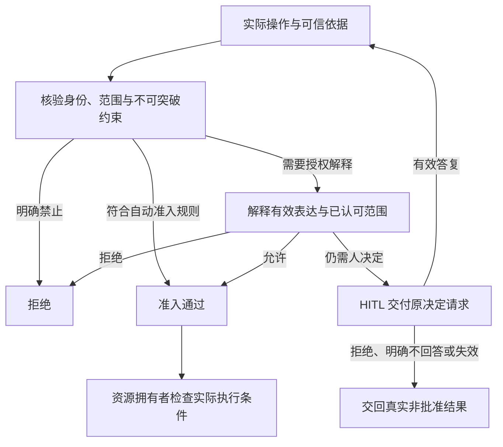
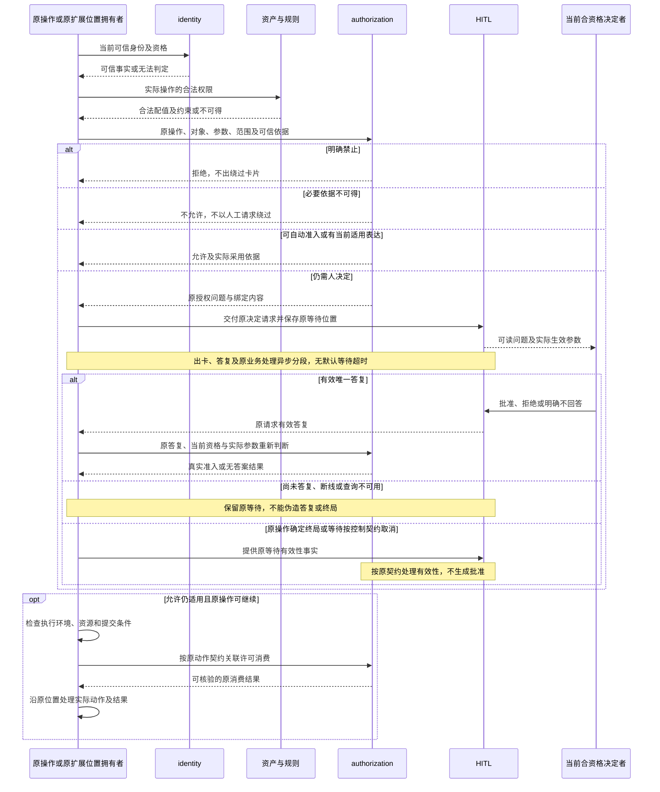
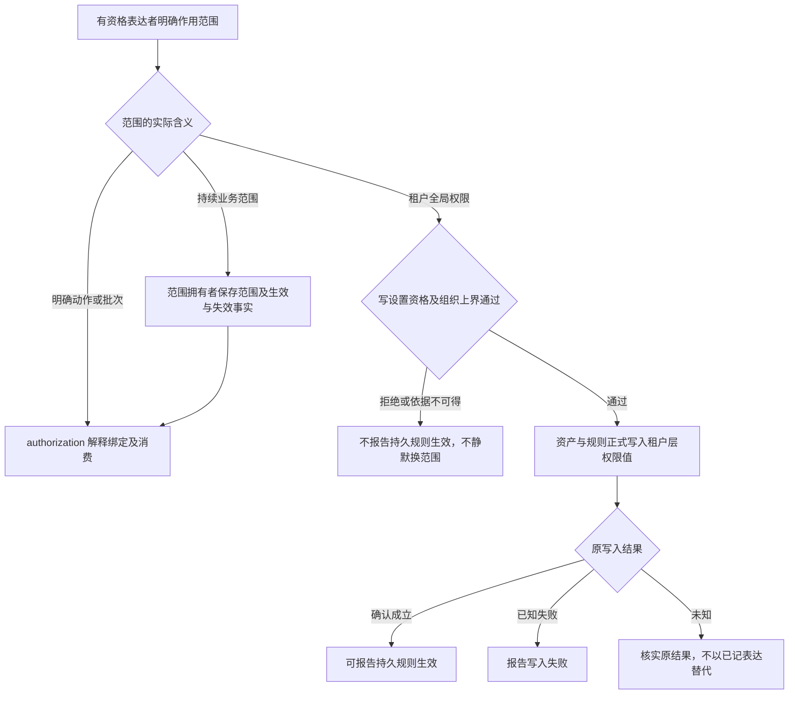

# authorization 内部设计

状态为待审技术设计。正式维护位置不授予技术接受、实施或支持；精确公开形状仍待定义。

## 授权与系统集成

authorization 接受明确的动作、对象、生效参数、可信身份、合法权限及适用范围，区分允许、拒绝、需要决定和依据不可得。身份已认证、成员有效、动作获准及执行成功是不同事实。

必要依据不可得时不走允许分支。人工批准绑定原操作及生效参数，答复后按当前资格重新判断。没有答复不能成为批准，依赖服务超时不能伪造人的选择。

单次批准覆盖明确批准的动作，明确批准整批时才覆盖该批。许可消费、撤回及有效范围由授权契约维护。范围的业务终点由原操作拥有者定义，authorization 不定义 Run、Session 或其他业务对象的生灭。

系统内的会话表达沿会话授权流水维护；租户持久权限变化由资产与规则写入；HITL 保存原决定请求和交付事实。这些集成引用各自唯一源，不在 authorization 建第二份设置或人工工作流。权限模式和具体求值顺序沿[已接受准入架构](../../../../docs/architecture/runtime/loop-extensions.md#准入与-hitl)。

## F-ID07 实际动作准入、人工等待与消费

对应 [J-ID07](../../../../.meta_harness/design/product/identity-and-authorization/design.md#j-id07)。原操作拥有者明确实际对象、动作、批次及生效参数，并取得身份与合法权限。authorization 区分允许、拒绝、需要决定和依据不可得。系统内准入顺序沿[已接受准入与 HITL](../../../../docs/architecture/runtime/loop-extensions.md#准入与-hitl)，原扩展位置、批次判断齐备及等待接续沿该页，不在这里复建 Loop。

许可消费与实际提交必须满足原操作要求的一致性，图中的逻辑顺序不表示可以先消耗后盲目执行，也不承诺外部效果与授权同库事务。具体消费、失败、结果未知及认回协议归 T03。动作与范围身份、语义结果归 T01、T04；等待交付和恢复由 HITL、原操作细化，不只写“协调者处理”。

单次只覆盖明确原动作，整批只覆盖原明确批次，各动作分别满足当前准入。同一批在系统内判断齐备后才执行获准动作，不能因某一动作早已获准越过其他待答判断。参数或实现及授权相关依据改变后不沿用旧批准，人看到、重新判断与实际执行采用的参数一致。拒绝、明确不回答、尚未作答及失效是不同真实结果；明确不回答交回无答案，不自动重问，缺批准也不被本领域改为 Run 失败。

持续或全局范围分别走其已有拥有者，不用一笔临时表达代替配置写入。

会话范围流水由 Session 保管，归档不自动清除，单次许可消费或所属 Run 终局清理不扩为整个 Run 后续动作许可。Run 的唯一终态、归档取消、撤销归档与实例接续继续归工作拥有者；不通过恢复旧授权复活旧工作。authorization 提供撤回和消费含义，HITL 保存决定，结果保管和 ACK 沿原结果拥有者，图中答复到达不代表业务处理完成。原结果协议允许在可靠保管内容及处理位置后确认，也允许在完成处理并保存必要结果及完成事实后确认；两条路径都不由授权消费或答复到达代替，依据见[可靠交接与消费确认](../../../../docs/architecture/data-and-state.md#可靠交接与消费确认)。

普通恢复认回原问题、答复、范围、消费和写入结果，重新核当前资格，从原消费或扩展位置接续。查询失败不证明卡片作废，通知丢失不使决定消失。规格为 AU-01 至 AU-07，验证见 [V-AU-J07](../SPEC.md#v-au-j07)。

## T04 表达与操作关联

authorization 与 HITL、原操作拥有者须明确语义化表达识别、操作与批次关联、参数改写的可信记录。含义未定不能扩宽决定，系统实际执行采用人与重新判断所见参数。
