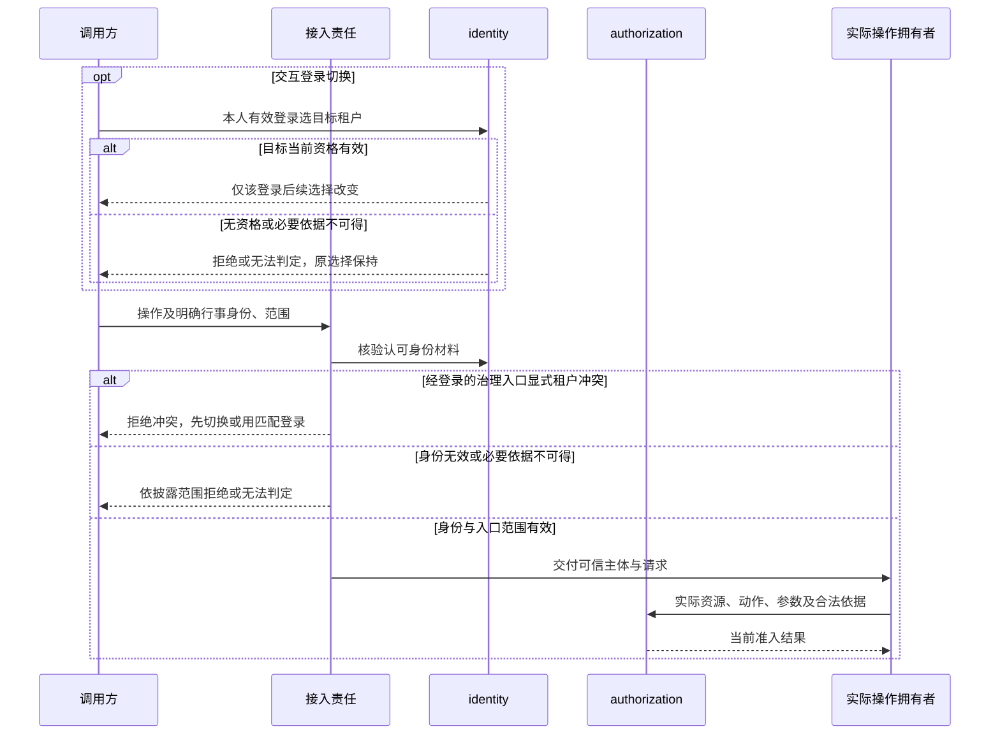

# 身份组关键协作

状态为待审技术设计。正式维护位置不授予技术接受、实施或支持。首批公开形状见 identity SPEC ID-16 与 authorization SPEC AU-11；登录与成员关系操作的公开形状仍待定义。

## F-ID06 当前租户与独立身份入口

对应 [J-ID06](../../../.meta_harness/design/product/identity-and-authorization/design.md#j-id06)。每份登录拥有独立的当前租户选择。identity 核验切换和可信资格，接入拥有者验证协议及范围，资源拥有者再定义动作并请求 authorization。

选择与显式行事身份一致的守卫适用于经登录的治理入口。独立调用提供其认证契约认可的主体，不能要求它伪造交互登录。目标组织不是行事租户，跨组织目标另按对应动作授权，不能因为目标不同就误报身份冲突。聚合视图不授予跨租户操作权。

切换中断核实该登录当前选择，旧对象归属不改；恢复调用核当前资格，不以旧选择或缓存代替准入。传输、身份形状及缓存有效性归 T01、T05，选择提交关联归 T03。规格为 ID-01、ID-08、AU-01、AU-02、AU-07，验证见 [V-ID-J06](../identity/SPEC.md#v-id-j06)及 [V-AU-J06](../authorization/SPEC.md#v-au-j06)。
