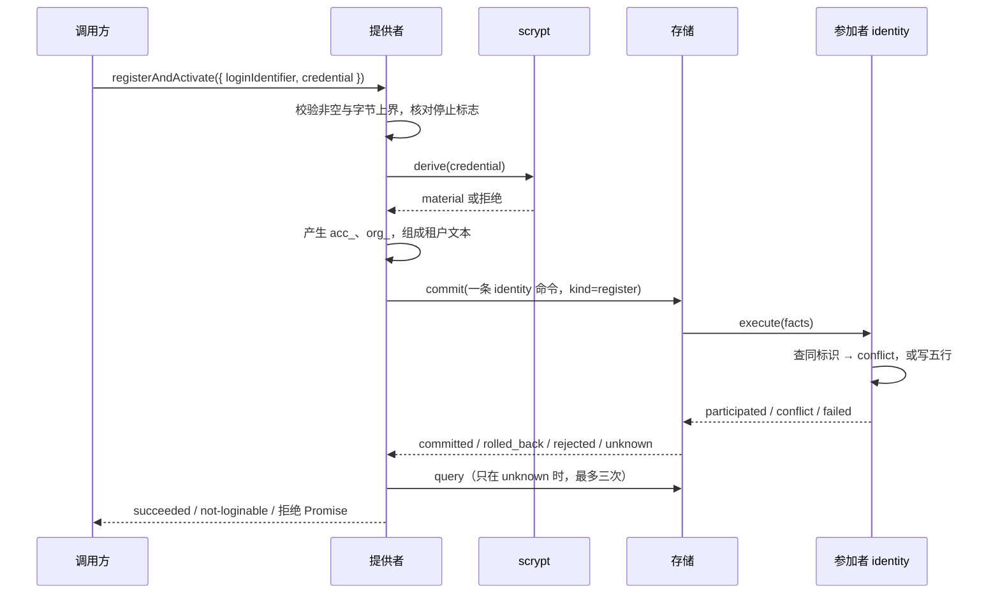
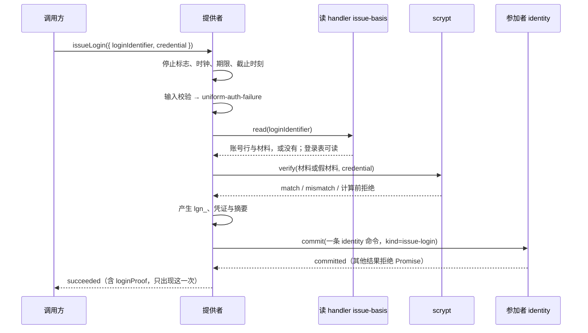

# 关键流程

本文件描述本包的四个流程：注册激活、签发登录、识别登录、资格读口，以及插件的启动与撤除。参与者是调用方、提供者（主线程）、scrypt 模块、存储提供者（控制侧）、写 Worker 里的参加者、读 Worker 里的读 handler。规则归 [SPEC.md](../SPEC.md)，本文只写时序。

## 流程

### 注册激活（SPEC IS-02）

### 签发登录（SPEC IS-04）

### 识别登录（SPEC IS-05）

1. 调用方给 `loginProof`。不是非空文本答 `invalid`。
2. 提供者算 SHA-256，读 handler `identity.login-by-proof` 查登录行。读不到答 `basis-unavailable`。没有行答 `invalid`。
3. 提供者解析标识、租户文本与三个时刻。解析失败答 `basis-unavailable`。
4. 提供者读时钟。下界是最晚读数与 `issued_at` 中较晚者。
5. 到达任一截止时刻答 `invalid`，否则答 `recognized`。

识别不写任何东西。

### 资格读口（SPEC IS-06）

1. 调用方给 `tenant`。提供者编码租户文本，算证据的 `record`。
2. 不能编码时直接答 `not-member`，不读行。
3. 读 handler `identity.standing` 查成员行。读不到答 `unavailable`。
4. 没有行或 `state` 不是 `active` 答 `not-member`，证据修订号 `'0'`。
5. 有行时按 `DEFAULT_TEAM_ROLE_MAPPING` 解析资格。映射失败答 `unavailable`。成功答 `member`，证据修订号取自行。

### 插件启动与撤除（docs/cordis.md）

启动：校验配置 → 打开 scrypt → 派生假材料 → `registerCombination` → 构造提供者 → 提供两个键 → 登记 effect。任一步失败时关闭已打开的 scrypt 并抛错。

撤除：`stop()` → `await close()`。之后旧引用按 IS-07 作答。

## 失败与生命周期

| 失败点                                     | 结果                                                 | 谁收场                                 |
| ------------------------------------------ | ---------------------------------------------------- | -------------------------------------- |
| scrypt 计算前拒绝、`done` 为 `unavailable` | 注册 `not-loginable`，签发 `basis-unavailable`       | 提供者，没有写入                       |
| 读 handler `unavailable`、输出畸形         | 签发与识别 `basis-unavailable`，读口 `unavailable`   | 提供者，没有写入                       |
| 参加者 `conflict`、SQL 约束错误            | 存储明确回滚，注册 `not-loginable`。签发拒绝 Promise | 存储提供者回滚，提供者映射             |
| 提交 `unknown`                             | 用同一身份 `query` 认回。认不回时拒绝 Promise        | 调用方按 ID-17 认回                    |
| 时钟倒退、不可得                           | `basis-unavailable`                                  | 提供者，不采用读数                     |
| `stop()` 之后的新调用                      | IS-07 的答复                                         | 提供者                                 |
| `stop()` 之前已受理的调用                  | 跑完，按以上映射作答                                 | 提供者与 scrypt `close` 等已开始的计算 |
| 进程崩溃                                   | 已 `committed` 的事实保留。重启后 DO-1 恢复域        | 存储提供者                             |

提供者没有定时器、连接或 Worker。丢弃它不需要清理动作。scrypt 模块由插件体关闭，存储由装配关闭。
