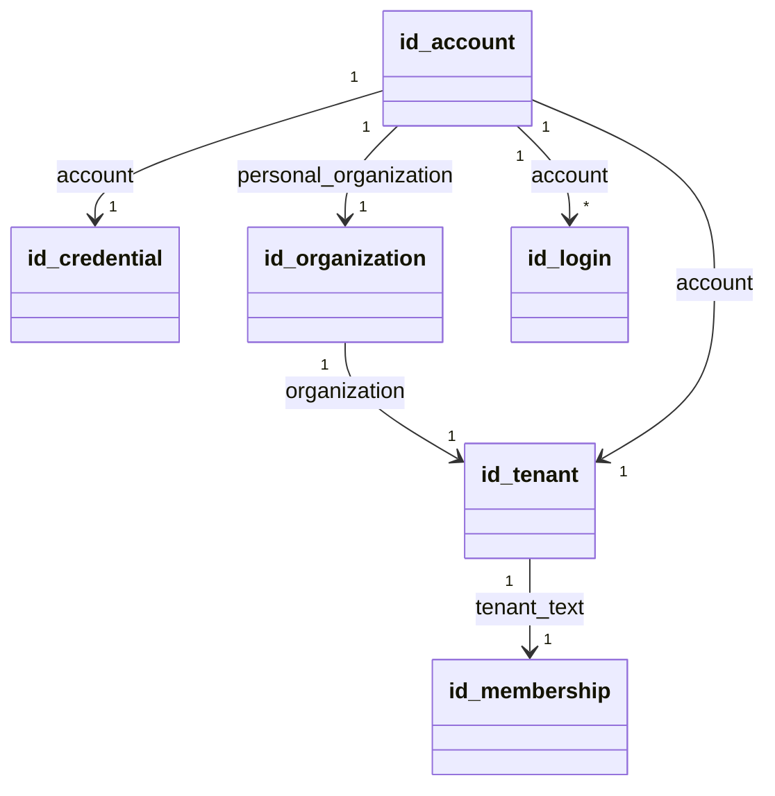

# 对象模型

本文件描述本包的表、行与主线程对象：职责、身份、状态、关联与生命周期。实现是纯函数与闭包，不是 class。规则归 [SPEC.md](../SPEC.md)。

## 对象与关系

### 表

六张表都是 STRICT 表，都归参加者 `identity`，都在事务域 `system.identity`。时刻与时长列是 utc-instant 的编码文本，整数列读出为 `bigint`。

| 表                | 主键                                | 其他列与约束                                                                                                                                 |
| ----------------- | ----------------------------------- | -------------------------------------------------------------------------------------------------------------------------------------------- |
| `id_account`      | `account`（`acc_` 文本）            | `login_identifier` 唯一非空，`personal_organization`                                                                                         |
| `id_credential`   | `account`                           | `material`（scrypt 材料串），`revision` 整数，初值 1                                                                                         |
| `id_organization` | `organization`（`org_` 文本）       | `kind`，M2 只有 `personal`                                                                                                                   |
| `id_tenant`       | `tenant_text`（`tenantCodec` 文本） | `organization`、`account`                                                                                                                    |
| `id_membership`   | `(organization, account)`           | `tenant_text` 唯一，`state`（M2 只有 `active`），`role_model`、`role_model_revision`、`role`，`revision` 整数，初值 1                        |
| `id_login`        | `login`（`lgn_` 文本）              | `proof_digest` 唯一（凭证的 SHA-256），`account`、`tenant_text`、`issued_at`、`max_deadline`、`idle_deadline`、`max_lifetime`、`idle_period` |

表之间没有外键声明。关联由同一次注册的五行写入保证，M2 没有删除或更换操作。租户与成员关系分表：成员关系无效不等于租户不存在（identity ID-01）。凭据单独成表并带修订号，以后更换凭据只改这张表。

### 事实与读输出

| 对象                 | 方向                | 形状                                                                           |
| -------------------- | ------------------- | ------------------------------------------------------------------------------ |
| `RegisterFacts`      | 提供者 → 参加者     | `kind: 'register'`，登录标识、账号、组织、租户文本、材料、角色模型与修订、角色 |
| `IssueLoginFacts`    | 提供者 → 参加者     | `kind: 'issue-login'`，登录、账号、租户文本、凭证摘要、三个时刻、两个时长      |
| `IssueBasisOutput`   | 读 handler → 提供者 | `account`：账号、组织、材料，或 `null`                                         |
| `LoginByProofOutput` | 读 handler → 提供者 | `login`：登录、账号、租户文本、三个时刻，或 `null`                             |
| `StandingOutput`     | 读 handler → 提供者 | `membership`：状态、角色模型与修订、角色、修订号，或 `null`                    |

类型在 `src/worker/schema.ts`。全部值是文本，提供者在主线程解析一次。

### 主线程对象

| 对象                                                         | 职责                            | 身份与状态                                       |
| ------------------------------------------------------------ | ------------------------------- | ------------------------------------------------ |
| `IdentitySql`（`createIdentitySql` 的返回值）                | 三项操作、资格读口、`stop()`    | 一个实例持有停止标志与最晚时钟读数。实例不跨重启 |
| `IdentitySqlMaterials`                                       | 参加者、迁移、读 handler 的描述 | 每个进程算一次，摘要来自模块文件字节             |
| `IdentitySqlCombination`                                     | 参加者列表、组合版本、清单摘要  | 每个进程算一次，同一构建同一值                   |
| `IdentitySqlConfig` 与 `LoginTerms`                          | 两个时长的文本与解析值          | 插件装载时校验一次                               |
| `IdentifierSource`                                           | 产生 `acc_`、`org_`、`lgn_`     | 默认随机。测试可注入                             |
| `IdentitySqlOperationsService`、`IdentitySqlStandingService` | 服务键的子类实例                | 归 fiber，撤除后取不到                           |

## 生命周期

- 表与迁移：域第一次被登记时由存储提供者建表。迁移发布后不改字节，新形状写新迁移。
- 行：注册写五行，签发写一行。M2 没有更新或删除。
- `IdentitySql` 实例：插件体或测试创建。`stop()` 之后只答停止答复。丢弃实例不需要清理。
- scrypt 模块与假材料：插件体创建，effect 撤除时关闭。
- 服务子类实例：随 fiber 创建与撤除。
- 组合登记：第一次登记时写入，持久保存，不随 fiber 撤除。
