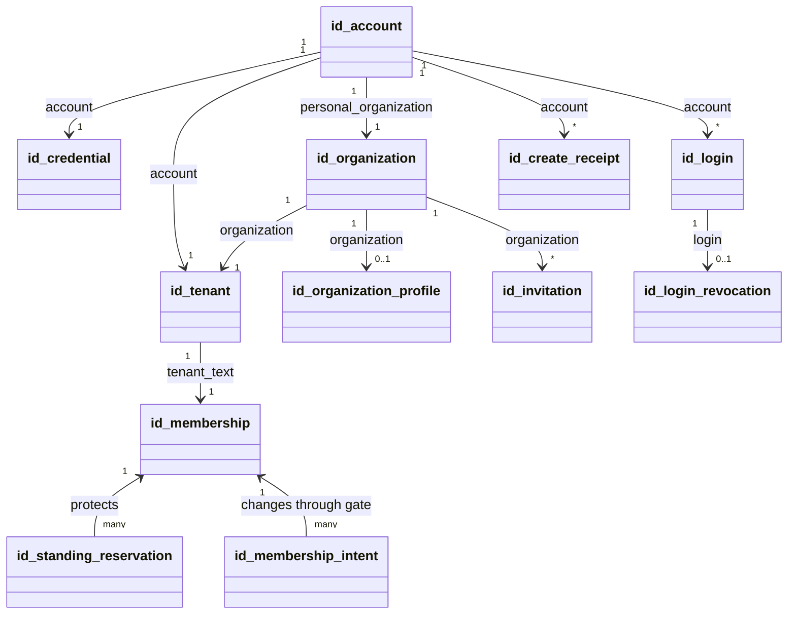

# 对象模型

本文件描述本包的表、行与主线程对象：职责、身份、状态、关联与生命周期。实现是纯函数与闭包，不是 class。规则归 [SPEC.md](../SPEC.md)。

## 对象与关系

### 表

十二张表都是 STRICT 表，都归参加者 `identity`，都在事务域 `system.identity`。迁移 001 建六张，002 建四张，003 建两张协调表。时刻与时长列是 utc-instant 的编码文本，整数列读出为 `bigint`。

| 表                        | 主键                                | 其他列与约束                                                                                                                                                                       |
| ------------------------- | ----------------------------------- | ---------------------------------------------------------------------------------------------------------------------------------------------------------------------------------- |
| `id_account`              | `account`（`acc_` 文本）            | `login_identifier` 唯一非空，`personal_organization`                                                                                                                               |
| `id_credential`           | `account`                           | `material`（scrypt 材料串），`revision` 整数，初值 1                                                                                                                               |
| `id_organization`         | `organization`（`org_` 文本）       | `kind`：`personal` 或 `team`                                                                                                                                                       |
| `id_tenant`               | `tenant_text`（`tenantCodec` 文本） | `organization`、`account`                                                                                                                                                          |
| `id_membership`           | `(organization, account)`           | `tenant_text` 唯一，`state`（`active` 或 `removed`），`role_model`、`role_model_revision`、`role`，`revision` 整数，初值 1，每次变化加一                                           |
| `id_login`                | `login`（`lgn_` 文本）              | `proof_digest` 唯一（凭证的 SHA-256），`account`、`tenant_text`（当前选择，切换时改写）、`issued_at`、`max_deadline`、`idle_deadline`（刷新时改写）、`max_lifetime`、`idle_period` |
| `id_organization_profile` | `organization`                      | `name`、`model`、`model_revision`。只有团队组织有这一行                                                                                                                            |
| `id_invitation`           | `invitation`（`inv_` 文本）         | `organization`、`invited_account`、`tenant_text`（被邀请者在该组织的租户）、`expires_at`、`state`（`open` 或一个终结）、`revision` 整数                                            |
| `id_create_receipt`       | `(account, create_call_id)`         | `name`、`governance_model_id`、`outcome`（`succeeded` 或 `denied`），可空的 `organization` 与 `tenant_text`                                                                        |
| `id_login_revocation`     | `login`                             | `revoked_at`。有这一行就是已撤销                                                                                                                                                   |

| `id_standing_reservation` | `reservation_id` | 持久资格预留、原操作绑定、held/settled 及不可变终态 |
| `id_membership_intent` | `sequence`；`operation_id` 唯一 | 原治理命令、发起登录、目标成员、待决门、SQL 尝试及结果 |

表之间没有外键声明。关联由同一次注册的五行写入、同一次创建团队的五行写入，以及同一条治理命令里的核对保证。没有删除操作：成员解除改 `state`，撤销加一行，邀请终结改 `state`。租户与成员关系分表：成员关系无效不等于租户不存在（identity ID-01）。凭据单独成表并带修订号，以后更换凭据只改这张表。

### 事实与读输出

| 对象                                          | 方向                | 形状                                                                                                |
| --------------------------------------------- | ------------------- | --------------------------------------------------------------------------------------------------- |
| `RegisterFacts`                               | 提供者 → 参加者     | `kind: 'register'`，登录标识、账号、组织、租户文本、材料、角色模型与修订、角色                      |
| `IssueLoginFacts`                             | 提供者 → 参加者     | `kind: 'issue-login'`，登录、账号、租户文本、凭证摘要、三个时刻、两个时长                           |
| `IssueBasisOutput`                            | 读 handler → 提供者 | `account`：账号、组织、材料，或 `null`                                                              |
| `LoginByProofOutput`                          | 读 handler → 提供者 | `login`：登录、账号、租户文本、三个时刻、是否已撤销，或 `null`                                      |
| `GovernanceFacts`                             | 提供者 → 参加者     | 八种 `kind`。都带发起登录与本次读数的排序键，行事命令带行事租户的文本与两半，角色名来自默认团队方案 |
| `GovernanceReply`                             | 参加者 → 提供者     | `outcome` 与随它的文本字段                                                                          |
| `GovernanceReadInput`、`GovernanceReadOutput` | 提供者 ↔ 读 handler | 十种 `query`；输出 `outcome` 为 `denied`、`not-visible` 或 `read`                                   |
| `StandingOutput`                              | 读 handler → 提供者 | `membership`：状态、角色模型与修订、角色、修订号，或 `null`                                         |

类型在 `src/worker/schema.ts`。全部值是文本，提供者在主线程解析一次。

### 主线程对象

| 对象                                                                                         | 职责                                   | 身份与状态                                                         |
| -------------------------------------------------------------------------------------------- | -------------------------------------- | ------------------------------------------------------------------ |
| `IdentitySql`（`createIdentitySql` 的返回值）                                                | 三项操作、资格读口、治理端口、`stop()` | 一个实例持有停止标志与最晚时钟读数，治理端口共用它们。实例不跨重启 |
| `IdentitySqlMaterials`                                                                       | 参加者、迁移、读 handler 的描述        | 每个进程算一次，摘要来自模块文件字节                               |
| `IdentitySqlCombination`                                                                     | 参加者列表、组合版本、清单摘要         | 每个进程算一次，同一构建同一值                                     |
| `IdentitySqlConfig`、`LoginTerms` 与 `InvitationTerms`                                       | 四个时长的文本与解析值                 | 插件装载时校验一次                                                 |
| `IdentifierSource`                                                                           | 产生 `acc_`、`org_`、`lgn_`            | 默认随机。测试可注入                                               |
| `IdentitySqlOperationsService`、`IdentitySqlStandingService`、`IdentitySqlGovernanceService` | 服务键的子类实例                       | 归 fiber，撤除后取不到                                             |

## 生命周期

- 表与迁移：域第一次被登记时由存储提供者建表。001 构建创建的域在新版本登记时执行 002。迁移发布后不改字节，新形状写新迁移。
- 行：注册写五行，签发写一行，创建团队写五行。切换改写登录的 `tenant_text`，刷新改写 `idle_deadline`，撤销加一行，成员变化与邀请处置改写 `state` 与 `revision`。没有删除。
- `IdentitySql` 实例：插件体或测试创建。`stop()` 之后只答停止答复。丢弃实例不需要清理。
- scrypt 模块与假材料：插件体创建，effect 撤除时关闭。
- 服务子类实例：随 fiber 创建与撤除。
- 组合登记：第一次登记时写入，持久保存，不随 fiber 撤除。

## 资格预留与变更意图

迁移 003 的 `id_standing_reservation` 保存完整绑定、资格集合、目标成员及 held/settled 状态，`id_membership_intent` 保存原逻辑命令、入库顺序、当前 SQL 尝试与最终响应。记录均由 Identity 拥有，没有外域配值。状态与恢复规则归 [IS-16](../SPEC.md#is-16)。
