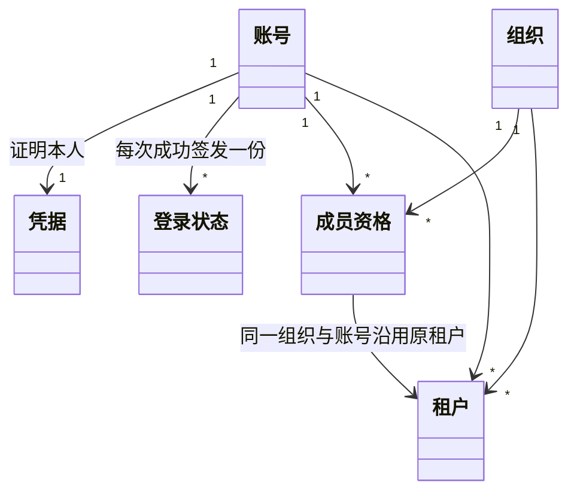
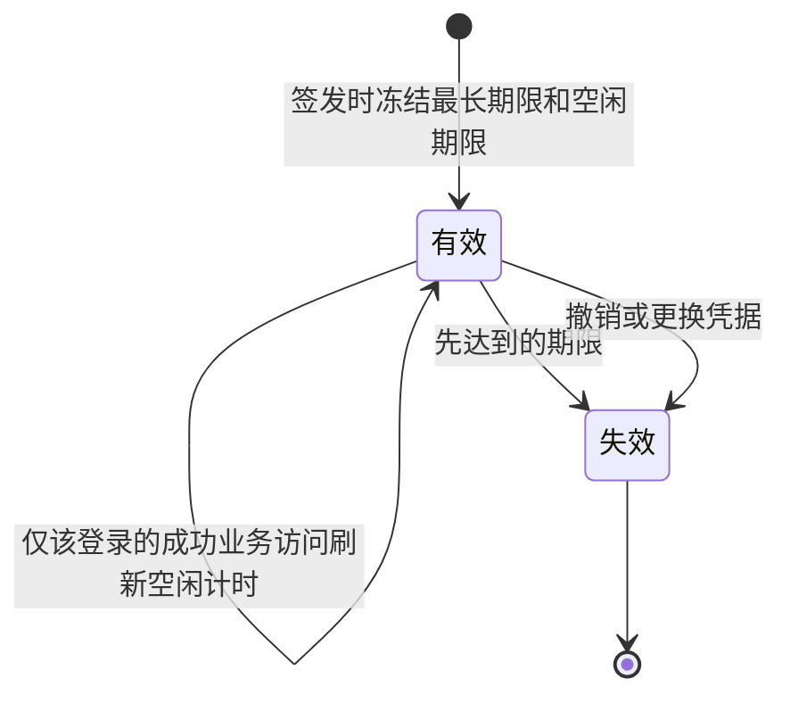

# identity：长期行为规格

状态：依据身份产品及 0.0.0 -> 0.1.0 承诺更新的长期规格候选，待项目负责人确认。目标拥有者为 `packages/identity/identity`，此目录维护目标成员文档，没有创建实际实现包。公开类型和提供者机制尚需设计，本文不作为实现或验证完成的证明。

产品规则归[身份与授权产品](../../../.meta_harness/design/product/identity-and-authorization/design.md)，协作与依赖归[领域架构](../../../docs/domains/identity-and-authorization/architecture.md)。本文拥有主体、组织关系、成员、认证、登录及可信资格事实。资源权限配值、人工交互和实际业务执行由其他拥有者负责。

## 已采用的纯值边界

[Issue 221 技术设计采用](https://github.com/nemori-ai/omne-harness-lite/issues/221#issuecomment-6161958178) 固定合法身份与时间点的纯值。精确形状归[共同纯表示](../../common/README.md)。本文不拥有那些解析函数。本节只固定本成员怎样消费它们。其余 ID 条款仍是长期规格候选。

调用方先解析合法身份。本成员再查找对象是否存在，并读取成员关系。授权函数只接收成员关系。它不接收原始文本，也不读取时钟。解析成功不是存在、成员有效或授权允许。

本成员不铸造账号、组织或登录状态的正文。创建该对象的拥有者发出符合词法的文本。调用方再解析。`tenant()` 只组合已经解析的组织与账号。角色变化不产生新租户。

登录期限和业务到期仍由本成员及相应业务拥有者判断。判断使用已解析的时间点。时间点不可用时，本成员返回无法判定。它不改用墙钟补上一个时间。序号由序号拥有者递增。观察时间缺失时，本成员不把序号改成上一个加一。

交接凭证的解析结果和签发结果是两种类型。核对凭证不代替授权。

旧类型、迁移责任、反例和时钟失败的条款归[共同纯表示](../../common/README.md)。租约拥有者在重启时读取持久的开租约业务瞬间和宽度，再按该页建立本进程的单调下界。本成员不保存上一进程的单调读数。

## ID-01 主体与持久身份

账号、组织和租户标识分别稳定。租户由组织与账号共同确定；成员退出后重新加入同一组织沿用原租户身份。角色、当前登录选择和运行实例变化都不能重命名已有归属。

账号是部署内使用身份，不是现实自然人的实名证明。登录标识在注册时固定，在部署内唯一，此后不可修改；认证接入或凭据更新不能重命名该标识。显示名称不能用于身份相等判断，同名组织可以共存。不同账号不能因显示名称相同而合并。

账号、组织、租户、成员资格和登录状态分别记录。成员资格无效不等于租户身份或历史事实不存在，访问资格由相应操作按当前可信事实判断。资源所有者、作者和执行者不能被界面选择或连接覆盖。

受租户约束的操作显式提供可核验的行事租户。系统归属的操作沿其独立身份和授权契约处理，不因没有个人租户而获得无限权限。

## ID-02 注册与激活

所采用的注册方式须核验登录标识可用及凭据合法。未激活注册只有满足开通条件后才能作为可登录账号使用。系统自带的开通方案在激活成功时，账号、唯一个人组织和个人租户须共同齐备。

未激活留存期由有效部署配置提供。在留存期内，同标识及同凭据可接续原注册，不同凭据不能认领它。已判定到期的记录不能因配置变化复活。到期释放未完成注册占用的标识，不因此删除已激活账号或正式资源；未使用空间的清理由资源拥有者完成。

激活已经成立但回执丢失时，结果保持未知，调用方按原操作契约核实。正常登录可以验证账号能否使用，不能把重复注册失败当作此前激活未发生的证明。

其他认证或开通方案须先明确身份就绪条件及支持范围，不能以认证成功代替全部开通后果。认证接入见 ID-12，主体生命周期的阶段限制见 ID-14。

## ID-03 登录、退出与登录状态维护

### 签发与可信判断

登录按所采用认证契约验证主体及凭据。系统自带的注册认证方案要求账号已激活且凭据正确，账号不存在、未激活及凭据错误的外部失败表现一致，不能据此枚举账号状态。

每次成功登录签发独立状态，保留签发时间、所用期限依据及当前租户选择。两个登录不因来自同一设备而自动合并。默认个人方案初始选择个人租户，其他方案按其明确的选择规则处理。

每份登录在签发时确定最长有效期和空闲期限，先达到的失效条件生效。最长有效期自签发时计算，初始空闲计时同时建立，之后只有该登录的成功业务访问刷新空闲计时。失败请求、健康检查和仅完成认证不刷新，也不刷新同账号其他登录。成功业务访问由调用方按公开契约报告，不以任意入站流量代替。

具体时长由有效部署配置提供。配置变更仅作用于新签发登录，已有登录保留签发时的期限。需要立即收回访问时使用撤销操作，不通过修改期限声称已有登录已撤销。

已失效登录不能恢复。重启、升级和网络变化不改写签发时间，停机计入期限。权威时间判断不可倒退，客户端时间不能授予有效性。时间依据不可取时按无法判定处理，不改用未经认可的时间源延长有效性。

### 查询、退出与撤销

本人有效登录可查询本账号全部当前有效登录及签发时间，不能取到可冒用的登录材料。该查询不承诺历史登录列表，历史读面须有独立的访问规则。

自助退出和逐份撤销须由本人当前有效登录发起，指定目标须属于同一账号。仅持有目标标识不能取得处置资格，也不能仅凭组织管理角色取得其他账号登录的处置资格。发起登录无效时拒绝；有效性所需依据不可得时保留无法判定，不执行撤销。

目标不存在或属于其他账号时，返回相同的不可见反馈，不泄露目标是否存在或所属账号。发起资格及同账号目标核验通过后，退出和逐份撤销使指定登录失效，其他登录不变。返回退出成功时，指定登录已在权威判断中失效，不能只清除客户端展示。

重复处置不产生新登录或额外权限。通过上述核验的已撤销目标返回无变更；重复自助退出时，已经失效的发起登录不能继续取得资格，客户端清除展示不改变该判断。具体响应形状沿公开契约细化，不能以不同外部反馈泄露不可见登录。

退出不注销账号、不解除成员关系，也不终结组织或租户。更换凭据对全部旧登录的影响沿 ID-04。存储记录和展示条目不是可直接使用的登录凭证。

### 不同失败事实

没有认可的身份材料可拒绝。权威服务或可信时间不可取得时，返回无法判定，不报告认证成功，也不伪造确定无效。入口的公开错误须遵守其存在性披露范围，内部诊断可以保留更精确的受控依据。

## ID-04 更换凭据

按凭据管理契约，发起者须有本人有效登录并通过当前凭据验证。组织管理员、主机运维或仅持有登录状态均不能代替当前凭据。其他认证方式沿 ID-12 明确自己的凭据管理条件，不能以扩展为由取消主体及资格核验。

更换完成须共同形成新凭据和本账号全部旧登录失效，包括发起操作所用登录。不能先报告换密完成，再异步补撤销部分旧登录。该操作不隐式签发新登录，也不修改角色、成员、租户和历史归属。

回执丢失保留未知，调用方按原操作契约核实，不盲目重做。普通故障恢复不能复活旧凭据或旧登录。凭据不以可读形式保存或提供给查询者，派生及秘密保管机制归提供者设计。

## ID-05 组织创建与默认治理方案

组织创建按所采用治理模型核验发起资格、输入及初始治理条件。失败不得报告组织可用。模型中的组织和成员事实须与声明的创建结果共同成立，不能留下被宣称创建成功但尚不具备初始治理条件的组织。

系统自带方案为每个账号开通唯一个人组织及个人租户。个人组织只有本人为成员和超级管理员，不邀请他人，也不参与组织隶属。这项开通保证不因框架允许其他治理模型而自动退出。

默认团队方案中，已激活账号可创建团队组织，名称不能空白。组织、创建者租户和首位超级管理员共同成立。每个有效成员恰有超级管理员或普通成员中的一个角色，成员变更须始终保留至少一位有效超级管理员。

默认团队方案中，有效成员可读本组织有效成员及角色，超级管理员可读已解除成员、组织发出的邀约及收到的隶属请求。被邀请账号可读本人收到的邀请。不返回其他组织成员事实或未经授予的私有内容。

其他治理模型通过 ID-12 接入，不把默认团队的角色集合、单角色或管理流程推广为框架唯一模型。成员、角色和组织关系操作的资格由模型明确；资产、设置、成本等业务操作资格由对应领域定义。

## ID-06 邀请、退出与重新加入

成员邀请指向明确账号，由该账号本人接受。发起和处置资格按已采用治理模型核验，默认团队方案由本组织当前有效超级管理员发起，个人组织不接受该操作。

对没有有效成员资格的账号，接受须确认邀请仍可接受、期限有效及组织仍可加入。默认团队方案首次加入及重新加入都取得普通成员角色，沿用组织与账号对应的稳定租户身份，不恢复旧管理员权。授予管理员资格须另行执行角色调整。

已有有效成员接受另一份邀请时，仍核验本人身份、资格及邀约有效性。检查通过后返回无成员变更，说明已经是成员、成员资格和角色未改变。不新建租户、不重设或降级角色、不恢复旧管理员权。无变更结果不能掩盖其他失败条件，也不豁免 ID-07 的邀约终结规则。

默认团队方案中，本人可退出，有当前资格的超级管理员可移除成员及调整角色。检查与提交共同守住最后管理员保护，两位管理员并发移除或降级对方不能都成功。角色变更不通过重复邀请完成。

成员变化只改变身份领域的资格事实，不改写历史归属。其他业务根据这些可信变化维护资源可达性、工作及结果。身份不承诺仅靠撤权通知停止实际执行或撤销外部效果。

## ID-07 组织隶属与邀约终结

### 隶属关系

建立关系须明确上级、下级及双方确认资格。每组织至多一个上级，不能自隶属或形成环。同一人管理双方时，两方确认仍分别成立。默认方案仅允许团队组织参与，双方各由其当前有效超级管理员确认。

提交建立时核验双方资格和关系条件，并发接受不能形成环或两个上级。不能只依赖发起时的检查。建立隶属不创建成员或租户，也不自动授予权限、资产及设置继承。

已生效关系仅由上级组织有当前处置资格的人解除。默认团队方案要求该上级的当前有效超级管理员。下级资格不能满足解除条件，同一人管理双方也须以上级组织身份行事。不同模型可以定义上级处置资格，不能将解除权转给下级。

### 邀约期限与唯一终结

成员邀请与隶属请求分别维护对象和操作后果。每份邀约在发出时固定到期时刻，采用授权范围内指定的时长或当时有效默认时长。后续默认配置变化不回改已发邀约，过期邀约不能接受。

待处理邀约只形成接受、拒绝、撤回或过期中的一个终结结果。接受事实与对应关系后果一致；已有有效成员时，对应后果是无成员变更。并发或重复处置返回可确认的既有结果，不覆盖终结事实，也不重新建立关系。

撤回由有资格的发出方执行，拒绝由有资格的接收方执行。账号不能拒绝他人邀请，组织隶属请求须由该接收组织有资格的人处置。接受后不再通过拒绝邀约结束关系，成员沿退出或移除处理，隶属沿上级解除处理。

成员邀请所属组织或隶属请求目标组织不存在时，对应邀约过期。发起组织不存在时，接收方处理隶属请求之前，该请求失效。失效是这份请求的一个终结结果。它不能建立关系，之后也不能被接受、拒绝或撤回覆盖。

## ID-08 当前租户与接入核验

每份交互登录独立维护当前租户，切换须有本人有效登录及目标有效租户资格。成功只改变该登录后续请求的行事选择，失败保留原选择，不改写既有对象归属。

经登录状态进入治理服务时，请求显式行事租户须与该登录当前选择一致。冲突时拒绝，不按任一候选租户继续业务操作。调用方先切换或使用匹配登录，目标组织与行事租户不是同一字段含义。

协议入口核验认可的身份材料、可信来源和业务范围，成员有效及登录匹配不代替具体动作授权。独立调用使用自己的显式身份契约，不凭裸 ID、地址、连接或 Cordis Context 认定资格。

消费者拥有检查时机、操作关联及缓存条件。identity 提供可信当前事实，不定义 Session、Run、工具或模型的生命周期，也不把某种 CLI 离线模式变成所有消费者的协议。

## ID-09 并发、持久事实与恢复

公开结果区分拒绝、依据不可得、已完成、无变更及完成结果未知，外部披露沿对应入口规则。检查失败不得报告成功，提交已成立但回执丢失不能报告未发生，提交与查询关联由公开契约细化。

已确认持久的身份、成员及角色变化、登录撤销、凭据换代和关系终结按系统耐久保证保留。普通进程或操作系统崩溃、断电后，恢复不得复活失效资格。通知不是唯一事实来源，身份服务不可用不能以无限沿用旧允许兜底。

身份判断及治理变更保留主体、范围、采用规则、结果和必要关联。记录读取仍有自己的资格，不因管理角色而开放全部私有内容。诊断及遥测不能输出凭据或可复用登录材料。

介质或整机物理损毁后，0.0.0 到 0.1.0 不提供重新打开。本阶段没有系统内的另一份副本。旧备份中的管理员角色不授予访问。普通崩溃、重启和断电后，已确认事实仍按耐久保证保留，不因此统一要求人工批准。

## ID-10 持久验证义务

下表是实现及集成须兑现的验证义务，不是已经建立或运行验证的记录。

| 反例 | 应检验的行为 |
| --- | --- |
| 默认账号激活时个人租户创建失败 | 不报告激活成功，不留下可登录的不完整开通 |
| 同标识不同凭据接续注册 | 不认领或覆盖原注册 |
| 保留账号ID但试图修改既有登录标识 | 拒绝重命名；修改显示名称、凭据或接入方式不改变固定登录标识 |
| 固定的组织类型、角色集合阻挡合法自定义模型 | 通过共同扩展契约采用模型，不静默退回默认方案 |
| 治理扩展试图放宽跨租户访问或明确禁止 | 不授予额外资格，说明违反的共同边界 |
| 认证扩展只返回裸账号 ID 或依赖不可用 | 不报告可信认证成功，不绕过身份就绪条件 |
| 期限配置非法或签发时缺少可信依据 | 不签发被宣称有效的登录 |
| 修改期限后查询旧有效登录与新登录 | 旧登录沿签发期限，新登录沿新配置；失效登录不复活 |
| 健康检查、失败请求及另一登录持续访问 | 不刷新本登录空闲计时，停机也不延长期限 |
| 退出仅清除客户端信息 | 不报告权威登录已经撤销 |
| 发起登录无效或账号 A 指定账号 B 的登录撤销 | 不执行撤销；无法判定不伪装无效，其他账号目标与不存在目标的反馈一致 |
| 有效本人登录重复撤销同账号目标，或用已退出登录再发起 | 前者对已撤销目标无变更，后者不取得资格；均不新增权限或影响其他登录 |
| 旧登录在退出或换密后经恢复重现 | 仍无效，新凭据与全部旧登录失效共同成立 |
| 默认团队两位管理员并发移除对方 | 最后管理员保护成立，不能两次都成功 |
| 旧管理员重新加入或有效成员接受另一邀请 | 前者普通成员；后者检查通过后无成员变更，稳定租户及原角色保持 |
| 重复、并发或已失效邀请试图隐式改角色 | 不增加资格，不掩盖原失败条件 |
| 邀约接受、拒绝、撤回和到期竞争 | 一个终结后果，后续不能覆盖 |
| 并发隶属建立看似各自无环 | 最终无环且每组织至多一个上级 |
| 下级或同人管理双方却以下级身份解除关系 | 拒绝，下级不能满足上级处置资格 |
| 解除前上级资格或关系已经变化 | 按实际关系及当前上级资格核验 |
| 当前选择与显式租户冲突，或必要事实不可得 | 不进入冲突身份业务；不可得不伪装冲突或允许 |
| 管理员查询成员私有记录 | 管理角色不自动授予该读取资格 |
| 提供者替换或重启期间仍有提交结果未知 | 原操作可认回，通知或实例退出不制造未发生事实 |

验证分别覆盖公开能力、真实组合、秘密存储、协议防护、并发、配置变化和耐久恢复。纯类型及 mock 不能证明全部范围，规模和性能验收归 T06 明确观察范围及尺度。

## ID-11 公开形状与机制细化

公开接口仍须定义身份材料、结果及语义错误、配置、治理和认证接入、操作与查询关联、成功业务访问报告及采用版本的精确形状。类型表达形状，本规格保留类型无法表达的条件和行为。

存储、可信时间、提交与并发、凭据派生、缓存及跨进程协议由提供者设计。回收及替换须说明调用如何认回、谁保管已提交事实和通知如何收口，不从 Cordis 装配或同机存储推断这些保证。

## ID-12 治理模型与认证接入

组织治理模型可通过配置或扩展定义成员准入、角色及操作资格。公共查询引用明确的模型依据及适用组织，消费者获取可解释的资格事实，不需要调用模型的私有实现。多个不同模型不能共用含义不明的角色字符串后推断等价。

模型的注册、校验、采用及变更须有操作资格，明确生效时点、既有成员与授权的影响，并遵守共同身份和隔离契约。无效模型不进入有效采用，扩展不可用时相关资格保持无法判定，不能静默套回默认方案取得允许。

认证方式按公开契约说明它能证明的主体、凭据失效依据、身份就绪条件及支持范围。具体接入不得伪造认证已通过，也不能以提供者验证成功取代成员资格或动作授权。扩展替换不自动复活旧登录。

这些共同接入能力属于 0.0.0 -> 0.1.0 承诺。具体治理模型和认证方式的供应范围以对应产品采用与支持记录为准，不把扩展机制等同于任意第三方方案已提供。

## ID-13 配置与生效

部署认证配置与组织治理配置分别核验对应维护资格，不能从主机运维或组织管理身份推导另一个范围的写权限。配置须声明合法范围、实际采用依据和生效点。

最长登录有效期和空闲期限在签发时确定。配置变更只影响新签发登录，已有登录保留原期限；立即收回访问走 ID-03 撤销，换密沿 ID-04。邀约期限在发出时确定，默认配置变更不回改旧邀约。

必要配置缺失或非法时不报告依赖该配置的成功，不自行填入放宽资格的值。已成立的撤销、到期及消费事实不能被配置变化覆盖。未激活留存与其他治理配置的精确生效细则在其公开契约中明确，不能把登录的签发规则推广为所有配置的统一机制。

## ID-14 主体生命周期与阶段范围

账号、组织和租户的完整生命周期是长期产品要求。停用、恢复或终结的资格、状态转换和关联处置须由对应产品政策及精确契约确定，未定义的操作不由成员根据 CRUD 形式补出默认行为。

0.0.0 -> 0.1.0 仅承诺 CAP-ID13 至 CAP-ID15 的创建部分：账号按采用方案完成激活及开通，组织建立初始治理条件，租户关联明确的组织与账号并建立或识别稳定身份。成员退出、重新加入、角色调整、登录退出和隶属解除仍按 CAP-ID01 至 CAP-ID12 完整提供。

上述创建限制不把长期生命周期能力删除，也不授予其其他操作已经支持的结论。资源保留、转移、删除和实际工作控制分别由其业务拥有者负责。

产品能力的逐项落点见[架构映射](../docs/architecture.md#阶段覆盖与后续细化)，产品及技术缺项见[问题登记](../../../.meta_harness/design/product/identity-and-authorization/design.md#未决问题与待定事项)。长期行为变化须沿有效产品或架构依据同步公开类型、消费者及验证，一次交付的任务规格不取代本规格。

## ID-15 旅程定位与持续验证场景

本节连接完整旅程与既有行为，不新建操作或缩减 ID-01 至 ID-14。场景是持续验证义务，须由未来实现及真实装配取得证据，不表示已运行或已通过。原 ID-10 的反例继续完整适用。

| 产品及能力 | 架构流程 | 完整行为定位 |
| --- | --- | --- |
| J-ID01；CAP-ID01、CAP-ID03、CAP-ID06、CAP-ID13、CAP-ID14、CAP-ID15 | [F-ID01](docs/internals.md#f-id01) | ID-01、ID-02、ID-05、ID-14 |
| J-ID02；CAP-ID06、CAP-ID07、CAP-ID12 | [F-ID02](docs/internals.md#f-id02) | ID-03、ID-04、ID-09、ID-13 |
| J-ID03；CAP-ID01、CAP-ID02、CAP-ID03、CAP-ID14、CAP-ID15 | [F-ID03](docs/internals.md#f-id03) | ID-05、ID-12、ID-13、ID-14 |
| J-ID04；CAP-ID01、CAP-ID02、CAP-ID03、CAP-ID05、CAP-ID12、CAP-ID15 | [F-ID04](docs/internals.md#f-id04) | ID-01、ID-05、ID-06、ID-07、ID-09 |
| J-ID05；CAP-ID02、CAP-ID04、CAP-ID05、CAP-ID12 | [F-ID05](docs/internals.md#f-id05) | ID-07、ID-09、ID-12 |
| J-ID06；CAP-ID01、CAP-ID07、CAP-ID08、CAP-ID09 | [F-ID06](../docs/key-flows.md#f-id06) | ID-01、ID-03、ID-08、ID-09，动作准入交 authorization |
| J-ID08；CAP-ID07、CAP-ID09、CAP-ID10、CAP-ID11、CAP-ID12 | [F-ID08](../../../docs/domains/identity-and-authorization/key-flows.md#f-id08) | ID-03、ID-09；表达、消费与授权读面交 authorization |

完整产品入口见[关键用户旅程](../../../.meta_harness/design/product/identity-and-authorization/design.md#关键用户旅程)。下列场景每项同时检查正常结果、拒绝、依据不可得、控制与恢复后果；提交响应与持久事实分别取证。

### V-ID-J01 开通接续和创建齐备

使用系统自带方案，在留存期内以同标识同凭据接续并完成激活，确认账号、唯一个人组织及个人租户齐备。用不同凭据不得认领原注册。注入个人租户创建失败，不能报告可用账号。停止办理并经过期限后核实标识释放和未使用空间责任，不将已激活账号清除。丢失激活回执或恢复提供者后认回原结果，不以重复注册失败判断未发生。认证扩展成功但开通条件不足时不得跳过身份就绪。

### V-ID-J02 独立登录、期限与收回

签发两份登录，分别验证当前选择、最长与空闲期限。只对登录 A 报告成功业务访问，登录 B、失败请求及健康检查不得刷新。变更期限后签发 C，A、B 保留签发期限，C 使用新值，非法配置或时间不可得不得签发有效登录。本人有效登录查询及逐份撤销只影响同账号目标，异账号与不存在目标反馈一致。重复已核验撤销无变更，已退出发起登录无资格。换密核验本人登录及当前凭据，成功时新凭据与全部旧登录失效共同成立，且无自动新登录。注入断电、停机及回执丢失，旧登录不复活，签发重试不能被假定只产生一份登录。

### V-ID-J03 创建及治理模型采用

默认团队创建成功后核实组织、创建者稳定租户及首位超级管理员。使用合法自定义角色模型时，封闭默认角色集合不得阻止其接入；无效或不可用模型不得静默回退到更宽资格。核验治理变更者权限、实际生效依据及既有成员影响，重复查询不执行变更。默认读面分别覆盖有效成员和超级管理员，均不得直接读取其他成员私有内容。创建或模型变更回执丢失后按原操作认回，实例替换不覆盖旧采用事实。ID-14 未定停用、恢复和终结操作不得凭创建接口补出。

### V-ID-J04 邀请、重入与最后管理员

邀请接受成功后，首次和旧管理员重入都为普通成员，重入沿用原租户。当前管理员接受另一份有效邀请时，先完整核验，再形成唯一接受结果及无成员变更反馈，原角色保持。换成错误主体、过期邀请或不可得依据，不能返回伪装成功的无变更。并发接受、拒绝、撤回及过期只有一个终结结果。两位管理员并发移除或降级对方不能同时成功，成员退出不删除租户或资源。注入关系提交后回执丢失与恢复，不重复建租户，不恢复旧管理员权，不把通知当作实际工作已停止。

### V-ID-J05 隶属确认与上级解除

两方确认成功后仅建立隶属，不新建租户或授予权限。分别测试双方当前资格、非自隶属、唯一上级及并发无环；同人管理双方仍必须分别确认。待处理请求接受、拒绝、撤回及过期竞争不能覆盖终结。有效上级按当前资格解除成功，下级或同人以下级身份请求解除被拒绝。目标组织不存在导致过期。发起组织不存在时，请求在接收方处理前失效，测试不得再把它接受为隶属。回执丢失与普通恢复认回原请求及关系，查询不可用不伪造未建立或已解除。

### V-ID-J06 选择、冲突与独立入口

两份登录选择不同租户，切换仅影响对应登录之后发起的请求，既有对象归属保持。目标无资格或必要依据不可得时原选择不变。登录治理入口显式身份冲突时拒绝，目标组织不同不能单独作为冲突。独立、后台及恢复调用使用其认证契约认可的主体，裸 ID 或连接无证明资格。切换回执丢失后核实原选择，恢复时旧选择不能代替当前成员或动作准入。具体动作的授权结果继续由 authorization 的 V-AU-J06 验证。

### V-ID-J08 资格变更、读面与恢复

解除成员或撤销登录后，后续可信查询识别变化。通知丢失仍能回查权威事实，读取不可用不能伪造变更或无效。获准审计读者可定位主体、范围、规则及原操作结果，管理员身份不开放全部私有记录。普通崩溃或断电后已确认变更保持，回执丢失保留未知直至原结果可核实。只恢复旧备份中的管理员角色不能打开访问。0.0.0 到 0.1.0 不提供介质或整机损毁后的重新打开。实际停止及结果保管按原业务契约验证，identity 不报告零副作用。

这些场景的精确输入、接口、故障点和尺度分别依赖 T01 至 T06，不能以文件中出现断电或并发字样代替真实证据。

## 本阶段范围

项目负责人接受本节之前，它不把本文件其余待确认条款提升为已采用，也不改写「已采用的纯值边界」。

账号是自然人在本部署中的全局使用身份，不是实名证明。组织是协作范围。租户由组织与账号共同确定，是该账号在该组织中的稳定身份。成员资格说明此人是否仍属于组织。角色说明能做什么，不写进租户。凭据证明本人，不以可读形式保存。登录状态是一次成功登录签发的独立状态，归该账号。退出登录不注销账号，不解除成员，也不终结组织或租户。

角色附在成员资格上。它不是租户的一个字段。

0.0.0 到 0.1.0 交付单机系统。已确认的身份、成员、登录撤销和关系终结，在进程崩溃、操作系统崩溃或断电后按系统耐久保证保留。介质或整机损毁后，本阶段没有系统内的另一份副本，也不提供从旧备份重新打开的路径。旧备份中的角色不授予开放权。

业务期限是部署配置中的最长有效期和空闲期限。比较使用已采用的 UTC 时间点。本成员不提供时钟。墙钟、单调钟和业务时钟分别由各自的读取端口拥有。时间依据不可得时不签发登录，也不延长已有登录。只有该登录的成功业务访问刷新它的空闲计时。失败请求、健康检查和其他登录不刷新。配置变更不延长已签发的登录。立即收回用撤销。

失效的登录不能回到有效。配置变更不画出延长已签发登录的路径。

账号、组织和租户的停用、恢复与终结不是本阶段操作。调用这些操作不能按创建、读取、更新或删除补出结果。本阶段提供创建、登录退出、成员变更和隶属解除。

接收方处理隶属请求之前，系统检查发起组织仍然存在。发起组织不存在时，该请求失效。失效是这份请求的一个终结结果。它不能建立关系，之后也不能被接受、拒绝或撤回覆盖。检查发生在处理当时。目标组织不存在时，邀约仍按既有规则过期。成员邀请所属组织不存在时，邀请仍按既有规则过期。
