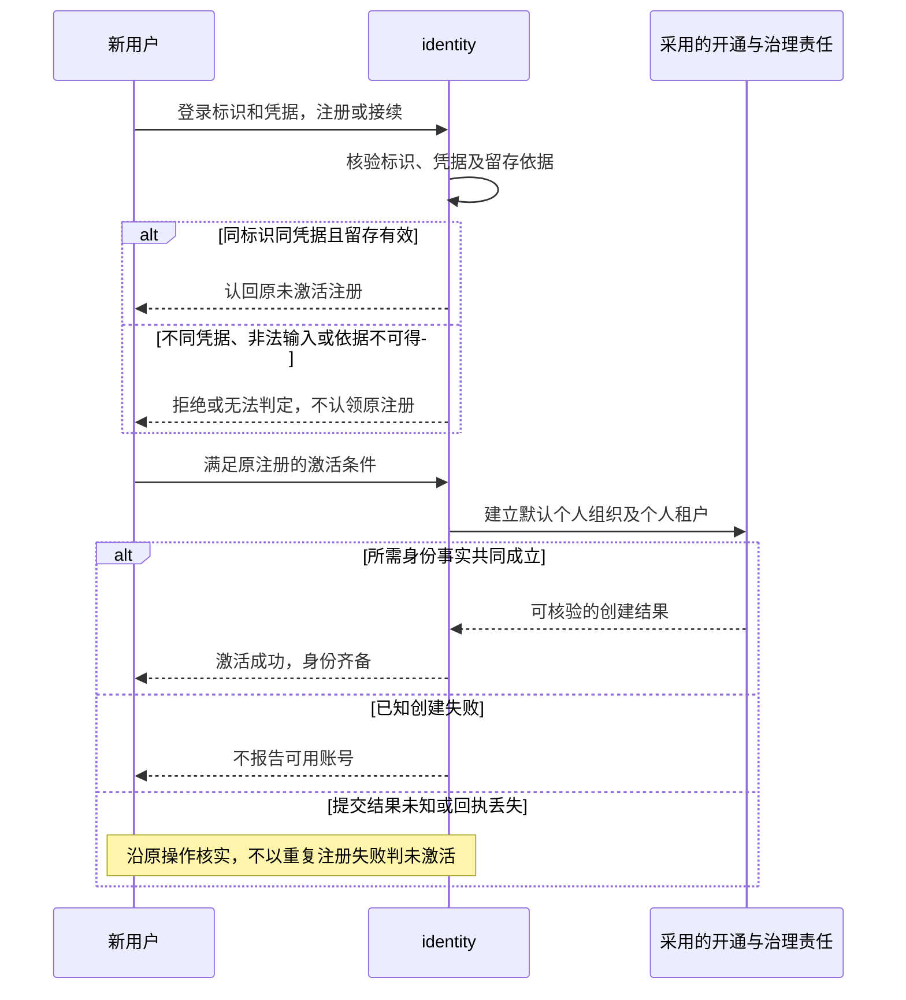
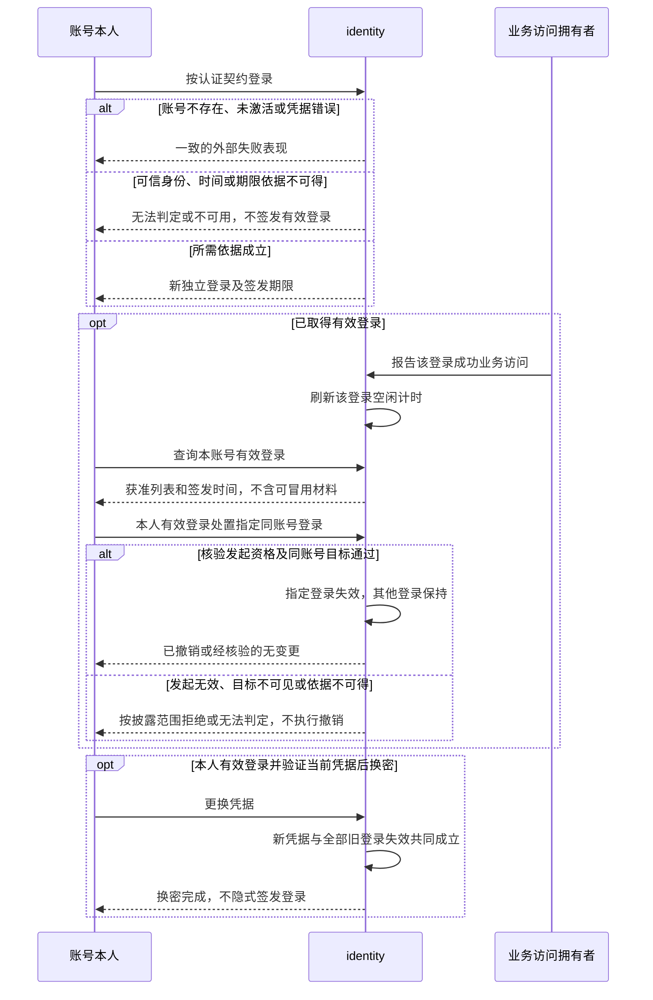
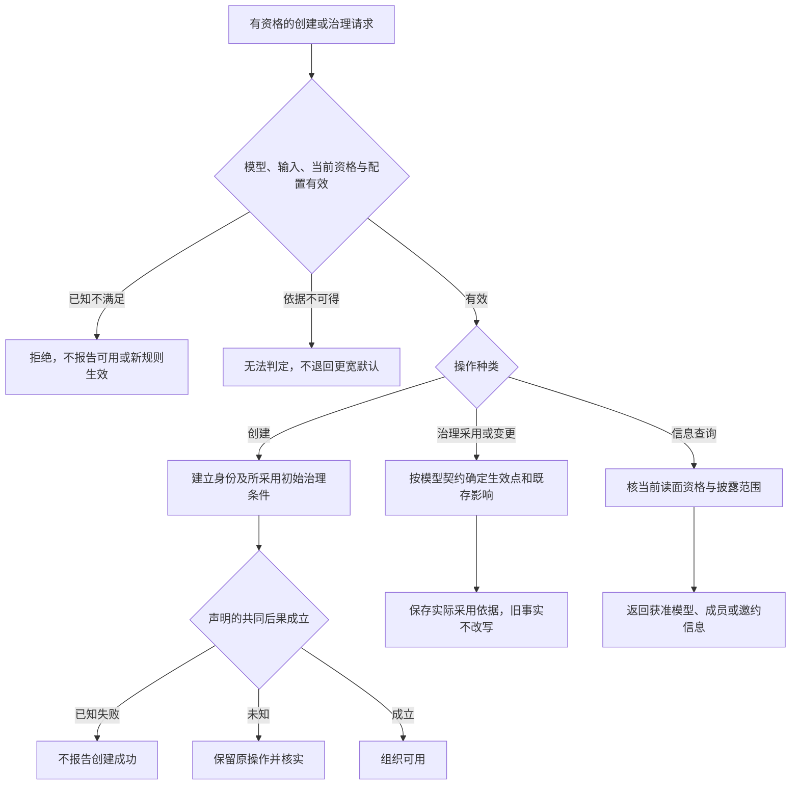
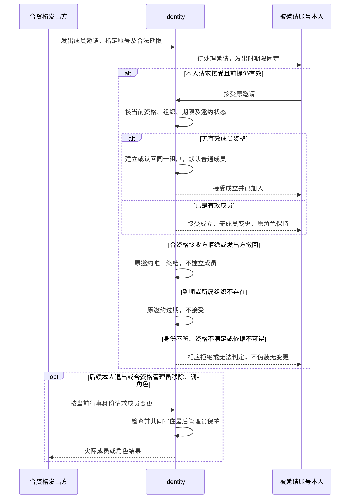
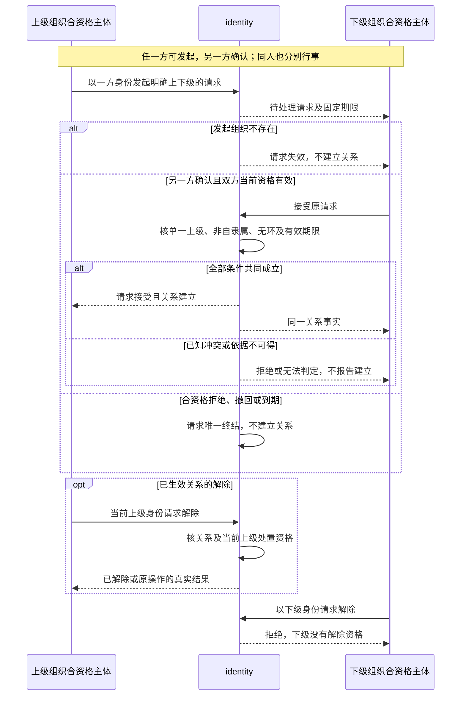

# identity 内部设计

状态：F-ID05 的业务协作已随[具名采用](https://github.com/nemori-ai/omne-harness-lite/issues/266#issuecomment-6190010029)采用；其余内部机制仍为待审技术设计。设计采用不表示实施或支持。合法身份与时间点的纯值已经采用，形状归[共同纯表示](../../../common/README.md)。首批公开形状在 `src/index.ts`，条款见 [SPEC ID-16](../SPEC.md#id-16-首批公开形状主体资格事实与访问报告)；登录、账号与成员关系操作的公开形状仍待定义。

本成员的查找、成员读取和授权是三次独立调用。授权只接收成员关系。本成员不在纯值包里铸造新的账号正文。时间点不可用时，本成员返回无法判定，不改用墙钟。

## 首批公开形状的机制

`inProcessPrincipalAuthority()` 返回一个签发者和一个核验器。两者共用一个 `WeakSet`：签发者冻结并登记它签发的每个主体，核验器只对登记过的对象答 `verified`。登记不延长对象生命。一个权威只认自己签发的对象，另一个权威的主体与手写副本都答 `rejected`。这就是「签发归 identity，装配只安装」在进程内的实现：装配创建权威，把核验器交给授权与消费方，把签发者只交给它声明的具名持有者：identity 的登录与会话建立流程，以及用系统主体的系统部件。核验是判定：`verified` 带回的就是传入的那个对象，不是解码出的副本。

代租户行事主体不复制原主体，它持有租户。租户已含账号，所以消费方再核时读 `tenant.account` 在 `tenant.organization` 的当前事实。撤权后主体对象不变，读到的事实变了，裁定随之变为拒绝。

当前资格读口与成功业务访问报告只定义了端口类型。实现它们的提供者按 ID-03、ID-09、ID-12、ID-13 持有登录、成员与角色事实，并在收到报告时读自己的可信时钟。

## 共同契约、可定制模型与默认方案

框架的共同约束包括稳定身份、可信来源、明确范围、租户隔离、明确禁止不可突破和未知不能解释为允许。治理或认证扩展不能关闭这些约束。

组织治理模型定义成员准入、角色、操作资格及资格变更影响。identity 提供注册、校验、采用和查询这些规则的能力。模型可以由配置或扩展提供，不能只接受封闭的组织类型与角色枚举。模型的公开标识、版本表达和接入形状归成员公开契约细化，不以内部类或 Cordis 服务键代替。

个人与团队是系统提供的默认方案。唯一个人组织的开通、个人组织不邀请或参与隶属、团队单角色、创建者首位超级管理员及最后管理员保护只按产品规定的适用方案兑现。其他治理模型须说明自己的治理资格及变化规则，不能仅因模型可接入就声称其业务规则已经被接受。

组织隶属已有独立约束：双方确认才建立关系，已生效关系只由上级解除。不同模型可以定义上级处置资格，但不能把解除权转给下级，也不能从组织关系推导权限、资产或设置继承。

认证方式按共同契约提供主体证明、适用范围和凭据失效依据。identity 统一解释其可信结果；具体认证方式须有独立支持及验证记录，不把存在扩展口称为全部认证方式已经提供。

## 配置、采用与变化

配置契约须区分部署维护者与组织治理者的操作资格，说明允许范围、校验、生效时点及对既存事实的影响。产品定义配置能力，具体默认值归采用版本的部署或提供者说明。

登录最长有效期、空闲期限和未激活留存期由有效部署配置提供，邀约在发出时确定期限。具体数值不进入领域长期规格。配置缺失、非法或规则提供者不可用不能转化为更宽松的授权；没有可信依据的操作返回不可用或无法判定。

治理变更、配置计算和新规则实际采用是不同事实。资格判断保留实际采用的规则依据，已经发生的身份和授权事实不被后来配置重写。登录期限配置变更仅影响新签发登录，已有有效登录保留签发时期限；立即收回访问使用撤销，不由提供者自行选择延长或缩短旧登录。

扩展替换须保留在途调用的责任及实际采用依据。不得因旧实例撤除而声称原判断没有发生，也不得借新实例恢复已经失效的登录或已消费许可。用户何时需要重新批准由原操作和授权契约判断。

## F-ID01 注册、激活与创建齐备

对应 [J-ID01](../../../../.meta_harness/design/product/identity-and-authorization/design.md#j-id01)。用户和 identity 按已采用开通契约形成未激活注册，再满足激活条件。默认方案的账号、唯一个人组织和个人租户齐备后才能确认成功。认证扩展证明主体的结果不替代这项完成条件。

图中激活步骤仅在前置注册或接续有效时进入。留存到期由 identity 释放未完成注册标识，未使用空间清理由原资源拥有者承接。用户停止办理不等于已完成清理，不形成已激活账号终结事实。普通恢复认回原创建结果，其他开通方式按其明确的就绪条件处理。

完成关联和共同成立机制归 T01、T03，留存配置与时间归 T02，凭据及来源归 T05。账号其他生命周期操作沿 ID-14 限制；本流程不补停用或注销默认。规格为 ID-01、ID-02、ID-05、ID-14，验证见 [V-ID-J01](../SPEC.md#v-id-j01)。

## F-ID02 签发、使用、撤销与换密

对应 [J-ID02](../../../../.meta_harness/design/product/identity-and-authorization/design.md#j-id02)。认证结果先经身份就绪及可信依据核验，成功登录逐次签发独立状态。签发时采用最长有效期与空闲期限；调用方只报告该登录的成功业务访问，不以健康检查、失败流量或其他登录活动刷新。

换密核验失败不进入完成步骤。指定目标不存在或属他人时外部表现一致；已退出的发起登录不能因重复提交重新取得资格。期限配置变更仅影响新签发登录，旧登录保留签发依据，立即收回用撤销。最长及空闲期限先到者使登录失效，停机计入期限，失效不能复活。

取消等待或丢失回执须核实原签发、撤销或换密结果；重新尝试登录不能套用保证只签发一次的去重规则。期限依据和成功业务访问报告归 T01、T02，共同换密与撤销提交归 T03，秘密及时间来源保护归 T05。规格为 ID-03、ID-04、ID-09、ID-13，验证见 [V-ID-J02](../SPEC.md#v-id-j02)。

## F-ID03 组织创建、治理采用与获准查询

对应 [J-ID03](../../../../.meta_harness/design/product/identity-and-authorization/design.md#j-id03)。identity 按已采用治理模型核验创建资格、输入与初始条件。默认团队创建时组织、稳定创建者租户和首位超级管理员共同成立；不同模型的角色、组合与准入规则沿其契约，不被默认角色枚举封闭。

默认个人组织的创建仍沿 F-ID01，不将其邀请或隶属禁止改为可配置。默认团队有效成员、超级管理员读面按 ID-05 分别判断，管理资格不开放私有内容。中断创建或模型变更先认回实际结果；模型替换保留在途责任及原采用依据，实例退出不是规则未生效的证据。

配置主体、允许范围、生效点、既有影响及非法后果须进入模型及配置公开契约，精确形状归 T01、T02；共同创建归 T03，可运行扩展与组合验证归 T06。组织与租户的其他生命周期操作只保留 ID-14 的长期目标及依赖政策，0.0.0 -> 0.1.0 不据创建自动开放。规格为 ID-05、ID-12、ID-13、ID-14，验证见 [V-ID-J03](../SPEC.md#v-id-j03)。

## F-ID04 成员邀请、唯一终结与成员管理

对应 [J-ID04](../../../../.meta_harness/design/product/identity-and-authorization/design.md#j-id04)。identity 持有邀约及成员事实，治理模型提供当前资格，其他业务只消费资格变化。接受事实与建立、认回成员或无成员变更的后果共同成立。

图中后续变更的发起角色依操作确定，本人退出由本人发起，不能借发出邀请资格直接移除任意成员。默认团队角色变更另行请求，不通过再邀请。有效成员接受时也使邀请按原契约形成唯一终结，无成员变更不豁免身份、期限或其他失败条件。

并发接受、拒绝、撤回、过期不可覆盖一个终结事实，并发管理员移除或降级不可消除最后有效超级管理员。通知资格变化不证明资源删除或实际执行停止。回执丢失、取消等待或恢复时查询原邀约及成员结果，不再建租户、不复活管理员权。共同结果和竞争协议归 T03，稳定查询关联归 T01，期限及来源归 T02、T05。规格为 ID-01、ID-05、ID-06、ID-07、ID-09，验证见 [V-ID-J04](../SPEC.md#v-id-j04)。

## F-ID05 隶属双方确认、终结与上级解除

对应 [J-ID05](../../../../.meta_harness/design/product/identity-and-authorization/design.md#j-id05)。两个组织分别提供当前确认资格，identity 在接受提交时核验关系约束，发起时曾无环不足以替代提交核验。建立不产生租户或权限继承。

图示选上级发起，下级发起的路径交换发起和接收角色，不改变双方确认要求。默认团队双方确认及上级解除要求相应当前超级管理员。已生效关系不能借拒绝原请求解除。请求目标不存在时过期。发起组织不存在时，接收方处理之前该请求失效。失效是唯一终结，之后不能被接受、拒绝或撤回覆盖。不另做后台自动收尾。

两个接受并发时，最终仍无环且每组织至多一个上级。断线、取消查询或恢复不使请求与关系各自生成第二结果，原结果未知时查询、对账，不盲目重建。关系共同完成和并发归 T03，期限归 T02，查询形状归 T01。发起组织不存在时的终结沿 ID-07。规格为 ID-07、ID-09、ID-12，验证见 [V-ID-J05](../SPEC.md#v-id-j05)。

## T02 时间、期限与配置细化

identity 与实际提供者须明确成功业务访问与提交点的精确对应、可信时间、签发期限依据及邀约配置读取；其他配置分别写生效细则。登录期限仅影响新签发登录，已有有效登录保留签发期限，立即撤回须撤销；不得重新选择旧登录延长或缩短。
