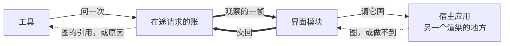

# interface

## 总体架构

本组回答一个问题：某一个客户端的某一页，在某种模式下长什么样。问的一方是 agent 的工具，答的一方是一个连着的客户端。本组把一次「问」送到客户端，把客户端交回的一张图交给问的一方。

| 成员 | 做什么 |
| --- | --- |
| `interface-protocol` | 两棵树共用的纯契约：一次检视的请求与模式、做不到的原因、协议契约 `interface/v1`。不依赖 Cordis、存储与浏览器 |
| `interface-access` | 接入插件与在途请求的账：把请求发给一个连着的客户端，把交回的结果交给等着的一方。哪些客户端连着，账自己知道 |
| `interface-tools` | 给 agent 的只读工具：点名哪一页与模式，拿回一张图。只认识工具契约与本组的契约，要的东西写成端口：问一次检视、存一张图 |
| `interface-ui` | 界面模块：开着请求的那条观察；收到一次请求就请宿主应用画，再把结果交回。不认识任何一页 |

## 领域边界

- 本组拥有：一次检视的请求与模式的形状；请求从发出到有结局的每一步；做不到的那一组原因；请求发给哪一个客户端。
- 本组不拥有：有哪些页、一页画什么（外壳契约与各界面模块）；明暗、字号档与皮肤的含义（共用界面件与 plugin）；怎样画出一张不打扰人的图（宿主应用，桌面应用见[它的规格](../../apps/desktop/SPEC.md#看界面的窗口)）；图怎样存、怎样进模型的输入（Tool 的结果与媒体）；许不许看（放行判断）。
- 它不替代执行环境的 `screen`：那个设施截的是服务端那台机器的屏幕，本组问的是一个客户端的界面，哪怕它此刻没有画在任何屏幕上。
- 它不回答人此刻正在看什么。问的是「点名的这一页」，不是「前面的这一页」。

本组声明、由别人实现的端口：

| 端口 | 对方 | 本组需要它做什么 |
| --- | --- | --- |
| 画一页 `draw(模式)` | 宿主应用，经界面模块的装配交进来 | 照模式画出点名的那一页，交回图的字节，或答做不到的原因 |
| 存一张图 | 应用装配（Tool 的产出与图像预算），由工具声明 | 字节过图像预算并存成一份产出，答它的引用 |

## 心智模型

- **问的是一页，不是屏幕。** 页由它的标识点名，加一个可选的对象文本，含义归那一页。
- **看不改变任何东西。** 一次检视没有效果：人正在看的页面、本机记着的选择、服务端的事实都不变。所以结果不知道时再问一次是安全的。
- **答的是一个客户端。** 界面在客户端上，服务端没有它的样子。没有客户端连着时，答案是「客户端不在」，不是一张空图。
- **图是产出，不是协议里的一段文字留在账上。** 账只记这次请求有没有结局。

拿它量一个设计：为了截图切换了人面前的页，错了；没有客户端连着时返回一张旧图，错了；检视的结果被写进任何一方的事实，错了。

## 应然设计

### 请求与模式

- 一次请求点名：页的标识；可选的对象文本；明暗（`light` 或 `dark`）；字号档；皮肤的名字，或写明用自带的样子；内容区的宽与高。没写的模式取这个客户端的缺省：亮、标准档、自带的样子、1280 乘 800。
- 宽 320 到 2560，高 240 到 2560，都是整数。越界的请求在发出之前就被拒，不发给客户端。
- 模式不含「人此刻的选择」：请求不能说「照人现在的样子」。要它就由问的一方先读出来再写明。

### 协议 `interface/v1`

两样都要登录，正文写明目标租户；接入插件再确认这份登录能为这个租户行事，同已有的租户协议。

| 名字 | 种类 | 正文 | 成功时 | 别的答复 |
| --- | --- | --- | --- | --- |
| `observe-requests` | 观察 | `{ tenant, client }`：`client` 是客户端实例自己起的标识 | 帧 `{ request, page, subject, mode }`：一次请求的标识、点名的页、可选的对象文本与模式 | 以 `denied` 或 `unavailable` 结束 |
| `deliver` | 提交，重发安全；正文走大的那一档 | `{ tenant, client, request, result }`：`result` 是图的字节，或做不到的原因 | `{}` | 共同契约的那一组；`not-found`（没有这次请求，或它已经有了结局） |

- 做不到的原因是封闭的一组：`no-page`、`no-skin`、`bad-mode`、`not-settled`、`unsupported`。
- 一个客户端「在」的意思是它开着 `observe-requests`。
- 同一个请求交回两次，第二次答 `not-found`，第一次的结果不变。

### 一次请求的结局

| 状态 \ 事件 | 工具发问 | 客户端交回图 | 客户端说做不到 | 到期 | 这个客户端走了 | 调用被取消 |
| --- | --- | --- | --- | --- | --- | --- |
| 没有 | 没有客户端连着：当场答客户端不在。有：发给最近报到的那一个，到「等着」 | 答 `not-found` | 答 `not-found` | 不可达 | 不变 | 不可达 |
| 等着 | 不可达：一次调用只有一个请求 | 存成产出，答图的引用，到「完了」 | 答这个原因，到「完了」 | 答不可用，到「完了」 | 答不可用，到「完了」 | 到「完了」，不答 |
| 完了 | 不可达 | 答 `not-found` | 答 `not-found` | 不变 | 不变 | 不变 |

- 期限是可配的策略，初值 30 秒，从发给客户端起算，读时间源。
- 账在内存里：进程重启后在途的请求都没了，问的一方照工具调用失联的规则得到不知道，再问一次。
- 每个租户同一刻在途的请求有上限（初值 4），到了上限的新请求答不可用。
- 存不成图（超出图像预算、存产出失败）时答不可用，并写明是哪一种。

### 工具

- 一个工具 `AppView`，一个命令 `look`，只读，不设关口之外的任何许可：关口缺省自动。名字由盲测定下：没有被读成截服务端屏幕的 `Screen`。
- 结果是一行说明（哪一页、什么模式、图的宽高）加图的引用，和 `Files` 打开一张图的结果同形。
- 它不许程序调用，不许转后台。
- 页的标识此刻有哪些，从拓展树上读（客户端回报的 `shell.pages` 上的项），本工具不另给一个列表。

### 界面模块

- 它只注入外壳与协议 `interface/v1`，要宿主应用交一个「画一页」的口，口收到请求与它属于的租户：看的那一页照这个租户画，不靠宿主自己猜。应用没有交这个口时，它对每个请求答 `unsupported`。
- 同一刻它只让宿主画一张；别的请求排着，照到达的先后。
- 它自己处在被检视的那个渲染的地方时不启动：检视不套检视。

## 原则与约束

- `interface-protocol` 的根入口是纯数据与纯函数。
- 本组的成员不认识任何一页、任何一套皮肤、任何一个领域。
- 请求里没有任何可执行的东西：模式是封闭的几样数据。
- 图的字节不进日志，不进诊断。

## 不变式

| 编号 | 永远成立的性质 | 违反的后果 | 由什么守 |
| --- | --- | --- | --- |
| IV-1 | 一次请求恰有一个结局：图、做不到的原因、不可用、被取消之一；有了结局之后不改 | 一次调用悬着，或一张迟到的图顶掉了已经答出的原因 | 账的全化表用例（状态三种乘事件六种） |
| IV-2 | 没有客户端连着时当场答客户端不在；不交出任何图 | agent 照一张不存在的图判断界面 | 账的用例；接入插件的用例 |
| IV-3 | 一次检视不改变任何一方的事实；同一次请求再问一遍，得到的是同一页同一模式的图或同一类原因 | 看一眼界面改掉了人记着的选择 | 宿主应用的用例（桌面应用见 DT-65）；界面模块的用例 |
| IV-4 | 请求只发给发问的租户自己连着的客户端；交回的一方必须是收到这次请求的那个客户端 | 一个租户看到另一个租户的界面；别的客户端冒名交回一张图 | 接入插件的用例：两个租户、两个客户端 |
| IV-5 | 模式越界的请求不发给客户端 | 客户端开出一个大到画不动的窗口 | 契约的用例 |
