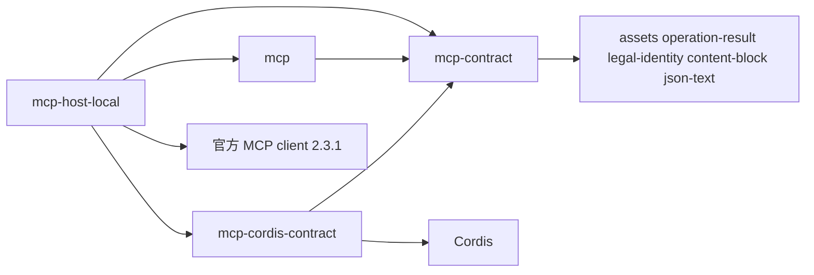

# MCP能力组

状态：工程设计草案。本组只有组文档，没有 workspace 成员、源码或运行支持。下文的成员、模型和决定都是候选，落位不授予技术接受。

## 责任与范围

本组承接 MCP 专有的工程责任：接入点正文、MCP 连接、MCP 动作清单的发现与采用、动作到工具条目的投影，以及按原调用发出协议请求。领域边界沿[已接受领域责任](../../docs/domains/mcp/README.md)，跨领域交接与端口的实现方见[领域交接设计](../../docs/domains/mcp/architecture.md)。产品规则、阶段及政策沿[产品第四章](../../.meta_harness/design/product/mcp/design.md#未决问题与待定事项)。

资格、凭据保管、本机进程落点、原调用、等待、结果和恢复由相邻拥有者承担。本组不因组合在这里集中而改写它们。

## 成员与依赖

本组当前没有 workspace 成员。下面四个是具名文档目标，都尚非 workspace 成员。模型、端口和服务见[工程设计](docs/architecture.md#模型)，依据见 [Q-MC02](docs/architecture.md#q-mc02-成员与公开身份操作形状的技术归属)。

| 文档目标 | 职责 | 允许依赖 | 状态 |
| --- | --- | --- | --- |
| mcp-contract | 纯契约：值对象、类别端口、纯函数、端口与应用服务接口；测试入口导出 stdio 与 Streamable HTTP 共用的传输契约测试。不依赖 Cordis 与任何实现 | assets（类别端口）、operation-result、legal-identity、content-block、json-text | 候选，尚非 workspace 成员 |
| mcp | 通用实现：`Connection`、`ActionCatalog` 两个聚合与五个应用服务。不含 Cordis，不含官方 SDK | 只依赖 mcp-contract 及其公共值包 | 候选，尚非 workspace 成员 |
| mcp-cordis-contract | Cordis 服务定义与服务键，不含实现。建立后暂不进应用插件树 | mcp-contract、Cordis | 候选，尚非 workspace 成员 |
| mcp-host-local | 本地宿主：stdio 与 Streamable HTTP 两种 `McpTransport` 实现，使用官方 SDK | mcp、mcp-contract、mcp-cordis-contract、官方 `@modelcontextprotocol/client` 2.3.1。测试用的本地真实服务端另用官方 `@modelcontextprotocol/server` 2.3.1 | 候选，尚非 workspace 成员 |

依赖方向是 mcp-host-local → {mcp, mcp-cordis-contract} → mcp-contract。mcp 与 mcp-cordis-contract 互不依赖。这一方向沿 [Tool 组](../tool/README.md#包与依赖)的先例。SDK 版本与协议线沿架构[技术基础](../../docs/architecture/technical-foundations.md#共同技术选择)「MCP连接与动作桥接」一行，精确锁定以 lockfile 为准，见[协议基线与兼容](docs/architecture.md#协议基线与兼容)。

候选决定：mcp-cordis-contract 建立后暂不进应用插件树。它只给出服务定义与服务键。进入插件树排在后续交付，等相邻领域的实现方就绪。

预期的消费方式（候选，同沿 Tool 组先例）：其他领域只依赖 mcp-contract；独立程序再加 mcp；应用装配使用 mcp-host-local。凭据保管、本机进程落点、采用视图和使用资格由组外实现方经端口交给本组，本组成员不导入它们的实现。

旧任务的完整行为候选仍未分配。每份候选由哪个成员承接，见[承接表](docs/architecture.md#完整行为候选的正式承接缺口)。本组不在组根建立统一 SPEC。

## 关键协作

[组内流程](docs/key-flows.md)写组内的采用、发现与调用路径。[领域流程](../../docs/domains/mcp/key-flows.md)写跨领域的准入、控制、失联与独立消费交接。[工程设计](docs/architecture.md)维护模型、失败种类和技术处置。

## 组合验证

组合验证须覆盖：MCP 连接不跨租户与对端账号；清单采用的竞争与迟到；断流后效果未知且不重发；归档后迟到结果的归属；资源释放只报告实际确认的范围；断电后原调用关联仍可读取。

- 两种传输共用一份传输契约测试，由 mcp-contract 导出，见 [Q-MC06](docs/architecture.md#q-mc06-持续验证与真实部署前提)。
- 传输与连接用本地起的真实 MCP 服务端验证。替身通过不说成真实组合通过。
- 证据须绑定成员、提供者及消费者的精确版本与故障前提。

当前没有任何行为、攻击、资源或耐久证据。文档结构检查不代替真实组合验证。

## 维护

具名组维护者尚待指定。建立成员时，沿[成员文档规范](../../docs/member-documentation.md)及[开发入口](../../docs/development.md#创建和整改产品包)建包，写成员 SPEC，取得技术接受，再把该成员在本表中的状态改为实际状态，并同步[承接表](docs/architecture.md#完整行为候选的正式承接缺口)、产品技术导航与真实消费者。

增加一种传输或协议修订时，加一个 `McpTransport` 实现，并让它通过同一份传输契约测试。增加成员须说明实际消费者、安装闭包差异和验证收益。不以搬迁薄化条件，也不把候选写成已采用。
