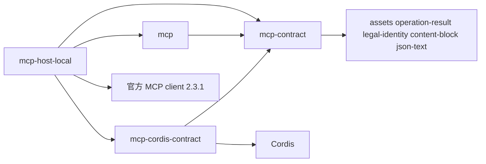

# MCP能力组

状态：工程设计草案。本组有三个 workspace 成员。mcp-contract 已有实现（候选，第一波，尚未取得技术接受）。mcp 与 mcp-host-local 仍是模板草稿，没有公开导出、实现或运行支持。mcp-cordis-contract 尚未建立。下文的成员、模型和决定都是候选，落位不授予技术接受。

## 责任与范围

本组承接 MCP 专有的工程责任：接入点正文、MCP 连接、MCP 动作清单的发现与采用、授权发现，以及按调用方的请求发出协议请求。本组只设计并交付 MCP 的内部，以及用 MCP 自己的词表达的对外接口与数据；调用方怎样接入自己的体系，是调用方一侧的适配。知道谁、不知道谁、需求端口与对外提供见[工程设计的边界](docs/architecture.md#边界)。领域边界沿[已接受领域责任](../../docs/domains/mcp/README.md)，跨领域交接见[领域交接设计](../../docs/domains/mcp/architecture.md)。产品规则、阶段及政策沿[产品第四章](../../.meta_harness/design/product/mcp/design.md#未决问题与待定事项)。

资格、凭据保管、本机进程落点和采用由组外经需求端口交来结论。MCP 动作清单经本组声明的需求端口 `CatalogStore` 保存，第一波由 mcp 的内存实现提供。原调用的保存、等待与恢复在调用方一侧。本组不因组合在这里集中而改写它们。

## 成员与依赖

下表列出本组的三个成员与一个具名文档目标。mcp-contract、mcp 与 mcp-host-local 是第一波的 workspace 成员。mcp-contract 已有公开导出、实现、测试与候选 [SPEC](mcp-contract/SPEC.md)，尚未取得技术接受。mcp 与 mcp-host-local 只是模板草稿：它们只有 `typescript-package@3.0.0` 的 `module` 骨架，没有公开导出、实现、成员 SPEC 或采用标识，也不声明生产依赖。mcp-host-local 的 Cordis 插件部分在 Cordis 服务键波补 `src/cordis.ts`。mcp-cordis-contract 仍是具名文档目标，尚非 workspace 成员，在 Cordis 服务键波建立。模型、端口和服务见[工程设计](docs/architecture.md#模型)，依据见 [Q-MC02](docs/architecture.md#q-mc02-成员与公开身份操作形状的技术归属)。

| 成员或文档目标 | 职责 | 允许依赖 | 状态 |
| --- | --- | --- | --- |
| [mcp-contract](mcp-contract/README.md) | 纯契约：值对象、类别端口、纯函数、端口与应用服务接口。三个入口：公开根 `.` 给调用方与实现方，导出值、结局、失败、五个服务接口、纯函数与类别端口；`./provider` 给端口的实现方，只导出五个需求端口、`McpTransport` 与 `McpTransportFactory` 的类型；`./testing` 给端口的实现方在测试里自测，导出五个需求端口的符合性套件、各自的内存替身，以及 `classifyOutcome` 与 `mergeListing` 的穷举用例。见[三个入口](mcp-contract/SPEC.md#entries)。传输契约测试与本地真实服务端夹具还不在本成员。不依赖 Cordis 与任何实现 | assets（类别端口）、operation-result、legal-identity、content-block、json-text | 已实现（候选），尚未取得技术接受 |
| [mcp](mcp/README.md) | 通用实现：`Connection`、`ActionCatalog` 两个聚合与五个应用服务，以及 `CatalogStore` 的内存实现。内存实现不耐久。不含 Cordis，不含官方 SDK | 只依赖 mcp-contract 及其公共值包 | 候选，workspace 模板草稿成员 |
| mcp-cordis-contract | Cordis 服务定义与服务键，不含实现。建立后暂不进应用插件树 | mcp-contract、Cordis | 候选，尚非 workspace 成员 |
| [mcp-host-local](mcp-host-local/README.md) | 本地宿主：stdio 与 Streamable HTTP 两种 `McpTransport` 实现与授权发现，使用官方 SDK | mcp、mcp-contract、mcp-cordis-contract、官方 `@modelcontextprotocol/client` 2.3.1。测试用的本地真实服务端另用官方 `@modelcontextprotocol/server` 2.3.1 | 候选，workspace 模板草稿成员 |

依赖方向是 mcp-host-local → {mcp, mcp-cordis-contract} → mcp-contract。mcp 与 mcp-cordis-contract 互不依赖。这一方向沿 [Tool 组](../tool/README.md#包与依赖)的先例。SDK 版本与协议线沿架构[技术基础](../../docs/architecture/technical-foundations.md#共同技术选择)「MCP连接与动作桥接」一行，精确锁定以 lockfile 为准，见[协议基线与兼容](docs/architecture.md#协议基线与兼容)。

候选决定：mcp-cordis-contract 建立后暂不进应用插件树。它只给出服务定义与服务键。进入插件树排在后续交付，等四个由组外提供的需求端口都有提供者。

使用方式（候选，同沿 Tool 组先例）：只用契约的调用方依赖 mcp-contract；需要通用实现时再加 mcp；本地宿主使用 mcp-host-local。四个需求端口 `AdoptionView`、`UseEligibility`、`CredentialUse`、`ProcessLanding` 由组外提供，本组成员不导入提供者的包。第五个需求端口 `CatalogStore` 第一波用 mcp 的内存实现。它的耐久实现接存储契约 [sql-contract](../storage/sql-contract/README.md)，是剩余义务，承载成员在建立时决定，见 [Q-MC03](docs/architecture.md#q-mc03-客户端认证清单一致采用及配置机制)。

旧任务的完整行为候选仍未分配。每份候选由哪个成员承接，见[承接表](docs/architecture.md#完整行为候选的正式承接缺口)。本组不在组根建立统一 SPEC。

## 关键协作

[组内流程](docs/key-flows.md)写组内的采用、发现与调用路径。[领域流程](../../docs/domains/mcp/key-flows.md)写跨领域的交接。[工程设计](docs/architecture.md)维护边界、模型、对外接口、失败种类和技术处置。

## 组合验证

组合验证须覆盖：MCP 连接不跨租户与对端账号；在途调用按租户、主体与关联键分开；清单采用的竞争与迟到；断流后效果未知且不重发；换代后迟到响应不改变新状态；撤采用或禁用后连接与进程在下一次使用边界之前关闭；资源释放只报告实际确认的范围。

- 两种传输共用一份传输契约测试，五个需求端口各有一份符合性套件，都由 mcp-contract 导出，见 [Q-MC06](docs/architecture.md#q-mc06-持续验证与真实部署前提)。
- 传输与连接用本地起的真实 MCP 服务端夹具验证，覆盖现代与旧对端、断流、清单变化通知、需要输入与任务。替身通过不说成真实组合通过。
- 证据须绑定成员、需求端口提供者及调用方的精确版本与故障前提。
- `CatalogStore` 的内存实现只覆盖一次运行。MCP 已知动作跨进程重启保留，须等耐久实现交付后另行验证。

mcp-contract 的纯函数，以及五个符合性套件对内存替身的运行有测试，范围与未覆盖项见它的 [SPEC](mcp-contract/SPEC.md)。组合行为、攻击、资源与耐久都没有证据。替身通过与文档结构检查都不代替真实组合验证。

## 维护

具名组维护者尚待指定。建立成员时，沿[成员文档规范](../../docs/member-documentation.md)及[开发入口](../../docs/development.md#创建和整改产品包)建包，写成员 SPEC，取得技术接受，再把该成员在本表中的状态改为实际状态，并同步[承接表](docs/architecture.md#完整行为候选的正式承接缺口)、产品技术导航与真实消费者。

增加一种传输或协议修订时，加一个 `McpTransport` 实现，并让它通过同一份传输契约测试。增加成员须说明实际消费者、安装闭包差异和验证收益。不以搬迁薄化条件，也不把候选写成已采用。
