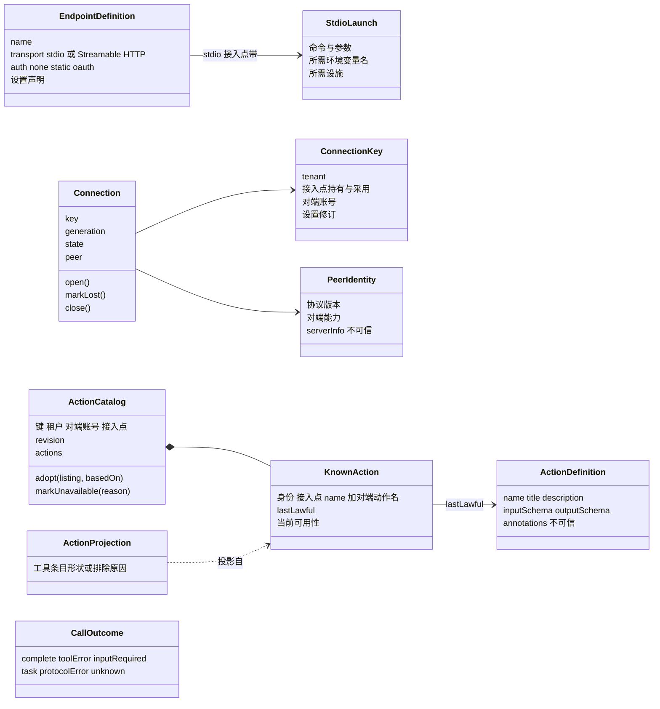
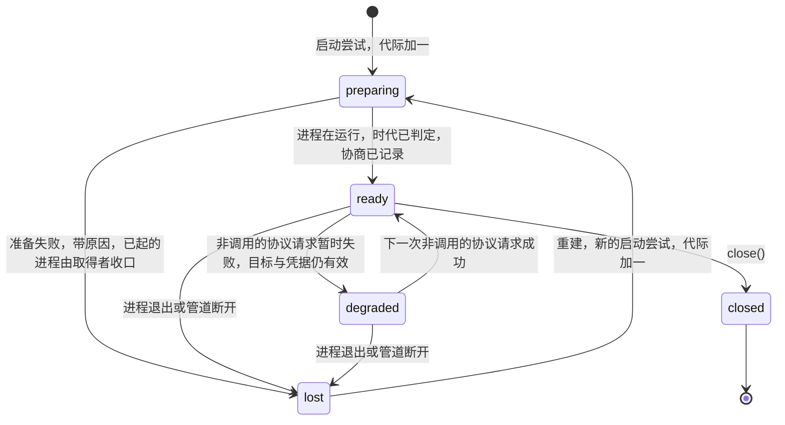
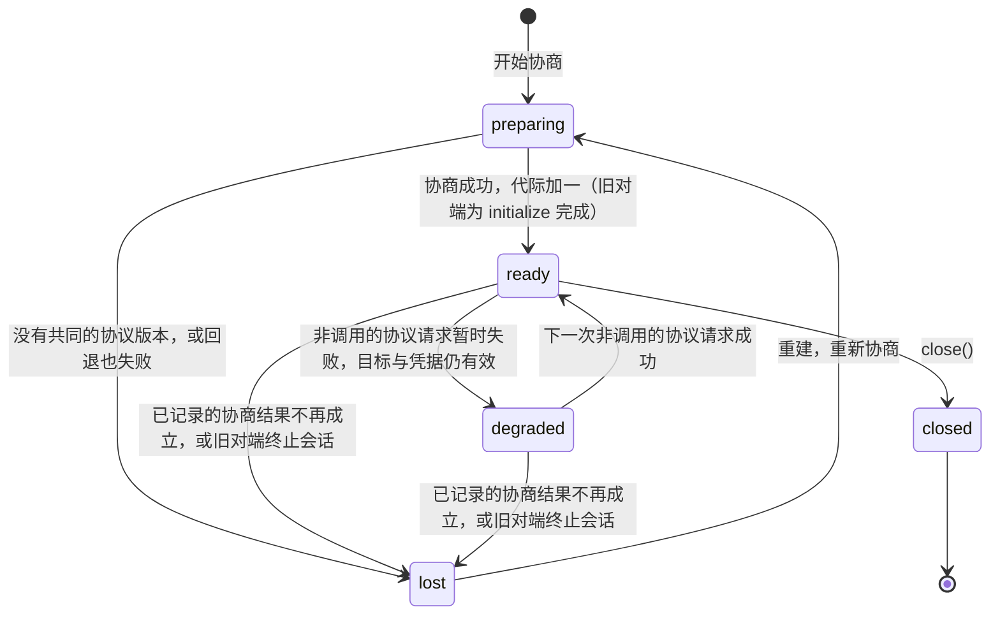

# MCP能力组工程设计

状态：工程设计草案。本页的模型、端口、服务、成员和决定都是候选。成员尚未建立，公开形状没有取得技术接受，没有实现，也没有验证。本页不授予技术采用或运行支持，不能据此建立包、进程或数据库。

本页拥有组内的成员分解、模型、端口操作、应用服务、失败种类和技术处置。跨领域交接与端口的实现方归[领域交接设计](../../../docs/domains/mcp/architecture.md)，本页只链接，不重写。组内流程见[组内流程](key-flows.md)。

用词沿统一语言：[MCP 连接](../../../.meta_harness/design/ubiquitous_language/terms/reach-and-availability.md#ul-mcp-connection--mcp-连接--mcp-connection)、[MCP 动作清单](../../../.meta_harness/design/ubiquitous_language/terms/reach-and-availability.md#ul-mcp-action-catalog--mcp-动作清单--mcp-action-catalog)、[MCP 已知动作](../../../.meta_harness/design/ubiquitous_language/terms/reach-and-availability.md#ul-mcp-known-action--mcp-已知动作--mcp-known-action)、[MCP 凭据](../../../.meta_harness/design/ubiquitous_language/terms/capabilities-and-composition.md#ul-mcp-credential--mcp-凭据--mcp-credential)、[连接目标](../../../.meta_harness/design/ubiquitous_language/terms/capabilities-and-composition.md#ul-connection-target--连接目标--connection-target)。接入点指 [MCP](../../../.meta_harness/design/ubiquitous_language/terms/capabilities-and-composition.md#ul-mcp--mcp--mcp) 资产。代码样式里的英文名是候选标识，成员 SPEC 建立时才成为公开名。

MCP 动作投影成 Tool Definition 时须保留可核验的 [可编程调用许可](../../tool/tool-contract/SPEC.md#可编程调用的定义与准入)。连接、认证、发现成功或对端支持工具调用都不推出 programmable=true。缺少声明沿 Tool 缺省拒绝，不能发明标准 MCP 字段或根据工具名猜许可。

候选决定：首版没有可编程调用许可的声明来源，所以 `projectAction` 给出的 `programmable` 恒为 false。上一段的规则留给将来的声明来源：将来增加声明来源时，具体提供者须说明声明来源与映射；脚本经 MCP 桥接调用时保留编排来源，仍逐目标准入。

## 设计守则

下面七条约束本页每个决定。每条只写 MCP 上的用法，依据是右列的项目规则。

| 守则 | 在 MCP 上的用法 | 依据层 |
| --- | --- | --- |
| G1 一个事实一个拥有者 | MCP 不求值，不保存采用，不判资格，不保管凭据，不保存原调用，不判调用终局。别人的结论只经端口读取 | 领域：[模块角色与事实归属](../../../docs/domains/mcp/README.md#模块角色与事实归属) |
| G2 只用自己的词 | 契约里不出现 Session、Agent、Run。MCP 不知道调用方是 Tool 还是独立程序 | 架构：[外域概念的进入方式](../../../docs/architecture/layers-and-dependencies.md#外域概念的进入方式) |
| G3 消费者驱动的窄接口 | 五个应用服务按消费者分开，每类消费者只拿自己用的那个 | 研发品味：[维度分解与正交](../../../.meta_harness/agents/roles/engineering-taste.md#维度分解与正交) |
| G4 形态与含义分开 | stdio 与 Streamable HTTP 的差异只在 `McpTransport` 的实现里。协议含义在通用实现里 | 同上 |
| G5 不变式先于机制 | 不自动重发；未知不压成失败；秘密不进入清单、日志和上下文；清单整份发布；MCP 已知动作不静默消失 | 领域：[主路径与交接](../../../docs/domains/mcp/README.md#主路径与交接)；产品：[J-MC02](../../../.meta_harness/design/product/mcp/design.md#j-mc02-发现合法动作并理解不可用) |
| G6 概念最少 | 复用公共值 `Outcome`、`Access
`、`ContentBlock`、`JsonValue`，不另包一层。没有不可替代理由的部件不建 | 架构：[隔离语义，不隐藏责任](../../../docs/architecture/layers-and-dependencies.md#隔离语义不隐藏责任) |
| G7 沿用仓库风格 | 接口、纯函数和判别联合。类只用于有状态的聚合，以及 Cordis Service 必需的抽象类 | 成员规格：现有 [tool-contract](../../tool/tool-contract/SPEC.md) 的写法 |

## 协议基线与兼容

候选决定：

1. 协议基线是 MCP 修订 2026-07-28。依据层：官方规格 [2026-07-28 Key Changes](https://modelcontextprotocol.io/specification/2026-07-28/changelog)。
2. 兼容更早修订。对端时代按传输分别判定，依据层：官方规格 [Versioning「Backward Compatibility with Initialization-Based Versions」](https://modelcontextprotocol.io/specification/2026-07-28/basic/versioning#backward-compatibility-with-initialization-based-versions)。
   - stdio：先发 `server/discover` 探测。收到的错误不是可识别的现代错误时，回退到 `initialize`，按协商出的旧修订继续。
   - Streamable HTTP：先发现代请求。`400` 的响应体不是可识别的现代错误时，回退到 `initialize`，按 2025-03-26 至 2025-11-25 的 Streamable HTTP 继续，包括对端分配的会话。依据层：官方规格 [Streamable HTTP「Backward Compatibility」](https://modelcontextprotocol.io/specification/2026-07-28/basic/transports/streamable-http#backward-compatibility)。
3. 不支持 2024-11-05 的 HTTP+SSE 传输。HTTP 回退到 `initialize` 仍失败时，报告不支持，不再尝试 HTTP+SSE。依据层：官方规格 Key Changes「Deprecated」第 2 项。
4. 旧对端的结果没有 `resultType` 时，按 `complete` 处理。依据层：官方规格 Key Changes「Major changes」第 8 项。

剩余义务：官方 SDK 对 2026-07-28 与两个时代的实际支持须先核实，见 [Q-MC03](#q-mc03-客户端认证清单一致采用及配置机制)。

## 模型

下图是本组模型的候选标识与关系。两个聚合是 `Connection` 与 `ActionCatalog`，其余是值对象与实体。

### 值对象

| 候选标识 | 含义 | 规则 |
| --- | --- | --- |
| `EndpointDefinition` | 接入点正文的解析结果：name、传输种类（stdio 或 Streamable HTTP）、认证方式声明（none、static、oauth）、设置声明 | 由 `parseEndpointBody` 得出。传输种类写在正文里，加载期就能判定「这个接入点可能启动本机命令」 |
| `StdioLaunch` | stdio 接入点的启动声明：命令、参数、所需环境变量名、所需设施 | 写在接入点正文里。只写变量名，不写值。变量的值经 `ProcessLanding.start` 的 `env` 交给执行环境，见[MCP 声明的端口](#mcp-声明的端口) |
| `ConnectionKey` | 租户、接入点（持有与采用）、对端账号、设置修订 | 对端账号由 `CredentialUse.acquire` 随凭据句柄交回，所以 `ConnectionKey` 在取得句柄之后才组成。认证方式为 `none` 时，对端账号取固定值 `anonymous`。见下文 MCP 连接 |
| `PeerIdentity` | 协商结果：协议版本、对端能力、对端自报的 `serverInfo` | `serverInfo` 是对端自报，不可信，不作为身份或授权依据 |
| `ActionDefinition` | 一个对端动作的定义：name、title、description、inputSchema、outputSchema、annotations | annotations 不可信 |
| `ActionProjection` | 一个 MCP 已知动作投影成的工具条目形状，或它被排除的原因 | 由 `projectAction` 得出 |
| `CallOutcome` | 一次已发出调用的结果种类 | 见[调用结果](#调用结果) |

远端地址与覆盖值是连接目标设置，不写进接入点正文。决定与依据见 [Q-MC03](#q-mc03-客户端认证清单一致采用及配置机制)。

### MCP 连接

MCP 连接的候选聚合是 `Connection`。它带 `key: ConnectionKey`、`generation`（连接代际）、`state` 和 `peer: PeerIdentity`。操作是 `open()`、`markLost()` 和 `close()`。状态候选为 `preparing`、`ready`、`degraded`（带原因）、`lost`（带原因）和 `closed`。`degraded` 的原因集合由 mcp-contract 的 SPEC 封闭。

候选决定：`degraded` 的进入与离开条件如下，两种传输相同。

- 进入：最近一次非调用的协议请求（`server/discover` 或 `tools/list`）暂时失败，同时连接目标与凭据仍有效。
- 离开：下一次非调用的协议请求成功时，回到 `ready`。
- 调用失败本身不改变状态。调用失败按[调用结果](#调用结果)分类。

不变式：

1. 键里有租户和对端账号。不同租户、不同对端账号永不共用一条 MCP 连接。依据层：领域 [模块角色与事实归属](../../../docs/domains/mcp/README.md#模块角色与事实归属)。
2. 每次重建，`generation` 加一。各传输在哪一步加一见下表。迟到响应按代际识别：旧代际的迟到响应不改变新状态，也不发布新清单。依据层：领域 [事实与责任](../../../docs/domains/mcp/architecture.md#事实与责任)「名称复用不使旧清理或响应命中新实例」；产品 J-MC03「迟到刷新不能覆盖较新选择」。
3. stdio 的 `preparing` 失败时，由取得者收口已经起来的进程。确认丢失时查原准备，不再起一个进程来制造成功。依据层：产品 [J-MC01](../../../.meta_harness/design/product/mcp/design.md#j-mc01-采用端点并取得合法连接条件)。
4. 已关闭的 MCP 连接不证明远端调用已停。`close()` 只报告实际确认的范围。准备失败与关闭失败保留真实资源和下一处置者。依据层：产品 [J-MC05](../../../.meta_harness/design/product/mcp/design.md#j-mc05-控制原调用并完成会话归档)。
5. 连接时限与调用时限分开。依据层：领域 [协作与依赖](../../../docs/domains/mcp/README.md#协作与依赖)。

2026-07-28 取消了协议级会话和 `initialize` 握手，依据层：官方规格 Key Changes「Major changes」第 1、2 项。因此连接代际与状态按传输分别定义：

| 传输与对端时代 | 一条 MCP 连接包含什么 | 代际何时加一 | `ready` 表示 | `lost` 表示 |
| --- | --- | --- | --- | --- |
| stdio，任一时代 | 一个本机进程（经 `ProcessLanding` 取得），以及在这个进程上判定的时代和协商结果 | 每次启动尝试，包括准备失败的尝试（候选决定） | 进程在运行，时代已判定，协商结果已记录 | 进程退出或管道断开。在途调用的效果未知 |
| Streamable HTTP，现代对端（2026-07-28 起） | 没有进程，也没有协议会话。只有一组协商结果：协议版本、对端能力、对端自报身份，以及本次凭据可用 | 每次重新协商成功 | 最近一次协商成功，连接目标与凭据可用。它不表示有一条一直打开的通道 | 已记录的协商结果不再成立，例如对端拒绝所选版本，或凭据被拒 |
| Streamable HTTP，旧对端（2025-03-26 至 2025-11-25） | 协商结果，加上对端用 `Mcp-Session-Id` 分配的会话（如有） | 每次重新 `initialize`，包括对端终止旧会话之后 | `initialize` 已完成，会话（如有）有效 | 对端终止了会话，或协商结果不再成立 |

在 Streamable HTTP 上，一次调用失败本身不使 MCP 连接变成 `lost`。调用失败按[调用结果](#调用结果)分类。对端时代的判定结果按对端进程（stdio）或来源（HTTP）缓存；缓存的假设失败时重新探测。依据层：官方规格 Versioning 同一节。

stdio 的代际在启动尝试时就加一，不等准备成功。所以一次失败的准备尝试留下的迟到响应，也能按代际识别为旧代际。

下面两张图是 MCP 连接的状态转移，每种传输一张。`close()` 从任一状态进入 `closed`，图中只画一次。

stdio：

Streamable HTTP（现代对端与旧对端）：

`lost` 之后，连接提供者在当前条件成立后重建，见[领域流程 F-MC06](../../../docs/domains/mcp/key-flows.md#f-mc06-失联重连与原工作接续)。重建不重发任何调用。图中「准备失败进入 `lost`」沿[失败种类](#失败种类)的「连接不可用并给出原因」。

### MCP 动作清单与 MCP 已知动作

MCP 动作清单的候选聚合是 `ActionCatalog`。它带键（租户、对端账号、接入点）、`revision` 和以 MCP 已知动作身份为键的 `actions`。操作是 `adopt(listing, basedOn)` 和 `markUnavailable(reason)`。`KnownAction` 是聚合内的实体，带身份（接入点 name 加对端动作名）、`lastLawful: ActionDefinition` 和当前可用性。

候选决定：清单的键不含协议版本。每次采用的协议版本记进这次采用的依据。依据层：统一语言 MCP 动作清单「按租户、对端账号与接入点分开保存」，以及 MCP 已知动作「不离开清单」。键里有协议版本时，换版本会让 MCP 已知动作离开清单。

不变式：

1. 只有合法取得的清单能加入新动作。不伪造从未发现过的动作。依据层：产品 [J-MC02](../../../.meta_harness/design/product/mcp/design.md#j-mc02-发现合法动作并理解不可用)。
2. MCP 已知动作不静默消失。对端不再提供时标为不可用，保留最近合法形状和安全原因。依据层：统一语言 MCP 已知动作。
3. `adopt` 带上它所基于的连接代际和清单修订。迟到的、较旧的结果被拒绝，不覆盖较新的采用，也不重新开启已撤的接入点。依据层：产品 [J-MC03](../../../.meta_harness/design/product/mcp/design.md#j-mc03-刷新后续采用且保护原调用)。
4. 清单整份发布，不出现一半新一半旧的清单。依据层：统一语言 MCP 动作清单。
5. 最近合法定义与当前授权分开保存。旧清单不恢复撤权。依据层：产品 J-MC02「不能继续读取撤权后的新定义」。

清单记录三件事：尚未合法取得；已取得及其版本与范围；当前可用性。刷新开始时不删除已知身份。一次成功采用同时确认清单内容、来源依据、可用判断和发布修订。

采用由 `ActionDiscovery` 协调。它按下面的次序工作：

1. 经 `AdoptionView` 取得已采用的接入点及其正文。
2. 经 `UseEligibility.check` 取得本次使用的资格。只有 `granted` 才继续。
3. 读取完整合法候选（`McpTransport.listActions`）。
4. 核对定义、实现与对端关联。
5. 在受保护的发布边界，核对本次选择、连接代际、取消、较新的刷新和当前授权仍然有效。
6. 条件成立时调用 `mergeListing` 并整份发布。条件不成立时保留原采用事实，并给出原因。

失败时不发布部分清单或过期成功。装配、采用点、执行挂接建立、必需提供者变化以及合法显式刷新触发的求值，都不改变已经发出的调用。同一注册入口内部的数据变化不要求重建 runtime。结构变化沿装配安全交接，Session 的 Agent Definition 标识由原拥有者固定。

候选决定：对端的 `tools/list` 结果中的 `ttlMs` 和清单变化通知只更新新鲜度说明，不自行改变采用。采用时点只沿装配与合法刷新。依据层：架构 [重装与不重装的情形](../../../docs/architecture/runtime/assembly-and-change.md#重装与不重装的情形) N4；产品 J-MC03。

### MCP 声明的端口

跨领域端口的实现方与交接以[领域交接设计](../../../docs/domains/mcp/architecture.md#mcp-声明的端口与实现方)为准。本表只写操作与规则。

| 候选标识 | 操作 | 实现方 | 规则 |
| --- | --- | --- | --- |
| `McpTransport` | `discover()`、`listActions(cursor?)`、`call(request, signal)`、`getTask(taskId)`、`close()` | 本组 mcp-host-local，stdio 与 Streamable HTTP 各一个实现 | 官方 SDK 只出现在实现里。失败区分「未发出」和「已发出但无应答」，后者表示效果未知。`discover` 在旧对端上回退到 `initialize` |
| `CredentialUse` | `acquire(access, endpointHolding, purpose)` | 凭据保管方 | 交回凭据句柄与对端账号。句柄是本租户这份持有上的 MCP 凭据的一次受限使用能力，不是秘密值。不退回组织、官方或其他租户的凭据。认证方式为 `none` 时，对端账号不由本端口给出，MCP 取固定值 `anonymous`。句柄和秘密值不进入 MCP 动作清单、工具条目、日志或错误文本 |
| `ProcessLanding` | `start(access, launch, env)` | 执行环境 | 只用于 stdio 接入点。MCP 调用前必须已从 `UseEligibility` 得到 `granted`。`env` 的组成与秘密注入见下文。MCP 不选落点。落点或设施不成立时返回失败，不静默落到宿主。本机命令型接入点是否开启不归本端口 |
| `AdoptionView` | `endpoints(access, scope)` | 资产求值与装配 | 只交已采用的接入点及其正文，连同设置求值得出的非秘密配值与采用依据。它不判使用资格。MCP 不求值，也不保存采用 |
| `UseEligibility` | `check(access, endpoint)` | 身份与授权 | 答复 `granted`、`refused`（带原因）或 `unknown`。本机命令型接入点未由使用租户开启时，答 `refused`，原因是 `local-command-not-enabled`。每次使用都现场判定，不缓存。撤权在下一次使用时生效 |

候选决定：`AdoptionView` 与 `UseEligibility` 各管一件事。`AdoptionView` 回答「哪些接入点已采用、正文是什么」。`UseEligibility` 回答「这个主体此刻能不能使用这个接入点」，本机命令型接入点的开启检查也由它回答。MCP 先读采用，再核资格，两个结论不合并成一次判定。逐动作的准入不归 `UseEligibility`，归 Tool 的准入，依据层：产品 [J-MC04](../../../.meta_harness/design/product/mcp/design.md#j-mc04-发起一个-mcp-动作)「经端点使用和逐动作准入」与 [J-MC07](../../../.meta_harness/design/product/mcp/design.md#j-mc07-独立程序消费-mcp-接入能力)「实际动作仍经 Tool 责任」。

候选决定：`ProcessLanding.start` 的 `env` 由两部分组成。

- 非秘密配值。它们来自设置求值，经 `AdoptionView` 交来。
- 凭据句柄。它们是 `CredentialUse.acquire` 交回的受限使用能力，不是秘密值。

执行环境起进程时，用句柄把秘密值注入进程环境。秘密值不经过 MCP 的内存表示，也不进日志。

stdio 传输在 `ProcessLanding` 交回的进程上讲协议，它自己不启动进程。

### 应用服务

| 候选标识 | 预期消费者 | 操作 | 关键保证 |
| --- | --- | --- | --- |
| `EndpointInspection` | 资产候选校验、装配 | 类别端口 `judge`；`inspect(body)` 得出 `EndpointDefinition` 或拒绝原因 | 按 assets 的[已接受公开类型](../../assets/assets/SPEC.md#accepted-public-types)实现 `BodyContract`。加载期就能判定「可能启动本机命令」。存在但非法的来源不当作空来源 |
| `Connections` | 本组内部、状态读面 | `ensure(access, endpoint)`、`release(access, key)` | 先取凭据句柄与对端账号，再组成 `ConnectionKey` 取连接，不跨租户、不跨对端账号共用。连接时限独立于调用时限。释放只报告实际确认的范围 |
| `ActionDiscovery` | 将来的工具目录桥接来源、独立程序 | `refresh(access, endpoint)`、`current(access, endpoint)` | 失败时保留原采用并给出原因，不伪装成空清单 |
| `ActionInvoker` | 将来的工具实现提供者、独立程序 | `invoke`、`continueWithInput`、`queryTask`、`cancel`，每个操作都带 `access` | 发起前再核当前使用资格和 MCP 已知动作的可用性。不自动重发。已发出但无应答时报 `unknown`。`requestState` 与 `taskId` 交给原调用保存，MCP 不保存原调用。换代后的在途操作见下文 |
| `EndpointStatus` | 管理与查询读面 | `inspect(access, endpoint)` | 读面暂不可用（`unknown`）与对无权主体的答复（`not-available-to-you`）分开。凭据只给有无与归属。不重做连接或动作 |

纯函数，没有端口，可以穷举测试：

- `parseEndpointBody`：接入点正文到 `EndpointDefinition`。
- `projectAction`：MCP 已知动作到工具条目形状。名字加接入点前缀并清洗；schema 规范化；`programmable` 恒为 false，因为首版没有声明来源；annotations 不可信。
- `toContentBlocks`：对端内容到公共 `ContentBlock`。
- `classifyOutcome`：对端应答到 `CallOutcome`。
- `mergeListing`：采用算法本体。

候选决定：读与控制操作都带 `access`，每次都经 `UseEligibility.check` 核资格。这包括 `Connections.release`、`ActionDiscovery.current`、`EndpointStatus.inspect` 与 `ActionInvoker` 的四个操作。

- `UseEligibility` 答 `refused` 时，读面返回 `not-available-to-you`。接入点不存在时，读面也返回 `not-available-to-you`。所以对无权主体，「无权」与「不存在」不可区分。为此，对无权主体，`UseEligibility` 的答复不得随接入点是否存在而变。这是对实现方的要求。
- `UseEligibility` 答 `unknown` 时，读面返回 `unknown`。
- 控制操作在资格不是 `granted` 时不执行。它的失败码由 mcp-contract 的 SPEC 封闭。

依据层：领域[事实与责任](../../../docs/domains/mcp/architecture.md#事实与责任)读面一行「不以缓存授权」；产品 [J-MC08](../../../.meta_harness/design/product/mcp/design.md#j-mc08-查询状态而不泄露秘密)。

候选决定：MCP 连接换代后的在途操作按传输处理。

| 操作 | Streamable HTTP 现代对端 | stdio |
| --- | --- | --- |
| `continueWithInput`、`queryTask` | 没有协议会话。`requestState` 与 `taskId` 不依赖 MCP 连接，可以在新代际上继续 | 旧进程的在途状态无法证明，返回 `unknown` |
| `cancel` | 按原调用身份到请求号的在途表定位请求。代际已换时返回 `unknown` | 同左 |

为了判断「代际已换」，`inputRequired` 与 `task` 交给原调用的内容带上发出时的连接代际，原调用与 `requestState`、`taskId` 一起保存。Streamable HTTP 旧对端在会话换代后的处置，见 [Q-MC04](#q-mc04-原调用dummy可靠结果和恢复的组合协议) 的剩余义务。

### 调用结果

`CallOutcome` 只描述已经发出的调用。请求没有发出时，`ActionInvoker` 返回失败，原因是资格、凭据、落点、连接或 MCP 已知动作不可用。这类失败没有对端效果。

| 种类 | 对端事实 | 交给原调用的内容 |
| --- | --- | --- |
| `complete` | 正常结果，`resultType` 为 `complete`，`isError` 不为 true | 经 `toContentBlocks` 转换的内容和结构化内容 |
| `toolError` | 结果的 `isError` 为 true | 对端给出的错误内容。它是动作自己的失败，不是协议失败 |
| `inputRequired` | `InputRequiredResult`（多轮请求） | `inputRequests` 与 `requestState`。原调用保存它们，再经 `continueWithInput` 带回答复 |
| `task` | 对端交回任务句柄（tasks 扩展） | `taskId`。原调用保存它，再经 `queryTask` 查询 |
| `protocolError` | JSON-RPC 错误 | 错误码与原因。协议错误不证明没有效果 |
| `unknown` | 请求已发出，但没有应答：响应流断开、进程退出或等待超时 | 效果未知。不压成失败，不重发 |

依据层：官方规格 Key Changes「Major changes」第 6、7、8 项；产品 [J-MC04](../../../.meta_harness/design/product/mcp/design.md#j-mc04-发起一个-mcp-动作)「成功、失败、不可用、中断或效果未知各给出真实含义」。

### 失败种类

| 阶段 | 失败 | 处置 | 依据层 |
| --- | --- | --- | --- |
| 正文与来源 | 正文格式错误，来源非法 | `EndpointInspection` 给出拒绝原因，不当成空来源 | 产品 J-MC01 |
| 资格 | `UseEligibility` 答 `refused`，包括原因 `local-command-not-enabled`（本机命令型接入点未由使用租户开启）；或答 `unknown` | 不连接，不发起。读面按上文返回 `not-available-to-you` 或 `unknown` | 产品 J-MC04；产品 [产品需求描述](../../../.meta_harness/design/product/mcp/design.md#产品需求描述)「本机命令型 MCP 默认禁用」 |
| 凭据 | 缺凭据、凭据被拒、凭据保管方不可读 | 按缺凭据或不可用失败，不退回其他凭据 | 领域 [模块角色与事实归属](../../../docs/domains/mcp/README.md#模块角色与事实归属) |
| 落点 | 落点或设施不成立 | 不建立 MCP 连接，不静默落到宿主 | 产品 [产品需求描述](../../../.meta_harness/design/product/mcp/design.md#产品需求描述)「不能失败后静默降到宿主」 |
| 协商 | 没有共同的协议版本；回退也失败 | 连接不可用并给出原因 | 官方规格 Versioning |
| 发现 | 刷新失败 | 保留原采用与原因，不伪装成空清单 | 产品 J-MC02 |
| 调用 | 未发出或已发出 | 见[调用结果](#调用结果) | 产品 J-MC04 |
| 查询 | 读面暂不可用；主体无权；对象不存在 | 读面暂不可用报 `unknown`。主体无权与对象不存在都报 `not-available-to-you`，两者不可区分 | 产品 [J-MC08](../../../.meta_harness/design/product/mcp/design.md#j-mc08-查询状态而不泄露秘密) |
| 释放 | 关闭失败；进程未确认停止 | 保留真实资源与下一处置者 | 产品 J-MC01 |

精确的失败码由 mcp-contract 的 SPEC 封闭，本页不定。

### SOLID 落点

| 原则 | 在 MCP 上 |
| --- | --- |
| S 单一职责 | 传输只讲协议。`Connection` 只管连接生命周期。`ActionCatalog` 只管清单采用。投影和内容转换是纯函数 |
| O 开闭 | 加一种传输或一个协议修订，就加一个 `McpTransport` 实现 |
| L 里氏替换 | stdio 与 Streamable HTTP 共用一份契约测试：同一套 `CallOutcome`，同一种「未发出」与「效果未知」的划分 |
| I 接口隔离 | `EndpointInspection`、`Connections`、`ActionDiscovery`、`ActionInvoker`、`EndpointStatus` 分开 |
| D 依赖倒置 | 领域逻辑只依赖端口。官方 SDK 和 HTTP 客户端只在 mcp-host-local；本机进程经 `ProcessLanding` 取得 |

## 同提交与可靠交接

系统确认接入点采用时，完整材料或可靠引用、采用依据和生效事实须在同一拥有者的保护范围内一致。合法清单发布也须保证内容、来源、范围与可用性对应同一次可成立的观察，避免混拼。具体存储及提交形状由 Q-MC03 负责，不从一次内存赋值推导全链原子。

原调用、固定输入关联、效果与结果消费位置的不可重建事实由 Tool 或原工作拥有者保管。系统确认可靠承接前，在明确的介质与部署前提下，达到覆盖普通进程、操作系统崩溃及断电后可读取和解释的耐久边界。原始远端请求和本地登记无法同提交时，分开保存已确认、未确认、未知阶段及恢复责任；前方在后方可靠承接前保管，后方确认后从其保存位置继续。远端效果完成而本地登记或回复失败，是需要核查的未知窗口，不由 MCP 自建中央事务消除。

结果沿原消费位置保存后，才解除相应交付责任。过程帧、命令摘要、诊断及通知不代替结果或确认，通知失败不将已提交事实改成未发生。当前无披露资格时限制交付，不丢掉原效果与必要事实。

## 失败、控制及演化

连接时限、发现操作时限和调用时限按实际操作分别解释。参数经合法配置与校验，未定值不补默认。连接失败影响新的发现和发起条件，原调用按真实影响范围收束。协议返回不能伪造可信主体、准入或执行成功；解析、不支持、鉴权拒绝、传输失败及效果未知保留可用原因，不将远端内容当作系统授权。

取消可以阻止未发出的动作，也可以向已发出的调用提出实际支持的停止请求。会话归档经调用方（Agent）的公开操作控制原 Tool 调用，按架构[取消与归档](../../../docs/architecture/runtime/control-and-recovery.md#取消与归档)解除业务等待，不以远端物理停止为前提（产品 [J-MC05](../../../.meta_harness/design/product/mcp/design.md#j-mc05-控制原调用并完成会话归档)）。结果接收方按原调用身份承接效果、费用和必要历史，原调用拥有者接续资源，迟到响应不得恢复 Session 或归到新调用。成员资格失效不销毁事实，也不冻结全部业务，当前读取与披露仍核验资格（产品 [J-MC06](../../../.meta_harness/design/product/mcp/design.md#j-mc06-断线后恢复连接和原工作)）。客户端断开、Agent runtime 实例换代（同一 Session 的 Agent Definition 标识不变）、重连或句柄释放都不自动取消或重发。

部分初始化、依赖消失和提供者换代只撤自身登记、监听及资源使用权，不恢复旧全局快照，也不误关其他租户的 MCP 连接。资源共享必须有可验证的同一授权、同一账号隔离和引用责任；不承诺默认共用连接。已接纳调用和结果先保留或可靠交接，不能仅撤注册就宣布退出完成。

## 集成与验证分工

领域公开操作独立于 Cordis 和完整 Harness。系统采用沿 IC-1–19：唯一服务定义、纯根入口、定义与提供者消费隔离、必需与可选依赖和显式租户。服务键在 mcp-cordis-contract 建立时才定，不根据本目录造服务或包。mcp-cordis-contract 是否进应用插件树，见[组入口](../README.md#成员与依赖)。Cordis 重跑、effect/disposer、作用域可见性不提供业务授权、耐久、实际停止或进展保证。

接入点与凭据保管方验证配值与隔离；连接提供者验证真实准备、身份、超时和释放；发现协调者验证竞争与一致采用；桥接、Tool、原工作及结果消费者共同验证准入、原输入、控制、未知与可靠交接。自定义并发发布、资源换代或恢复协议须有相应的行为模型和关键性质检查；不能声明可交换或可逆来省略控制。协议、提供者的实际组合以及断电边界的证据尚未提供，本候选只分配义务。

## 产品技术义务的处置

下面五个小节承接产品第四章的 Q-MC02 至 Q-MC06。小节标题保持不变，供产品页链接。每节写技术处置：候选决定、依据层、剩余义务与拥有者。各节的决定都是候选决定，尚未取得技术接受。

### Q-MC02 成员与公开身份/操作形状的技术归属

处置：成员与身份有候选决定；公开形状待成员 SPEC。

| 候选决定 | 依据层 |
| --- | --- |
| 本组分成四个具名文档目标：mcp-contract、mcp、mcp-cordis-contract、mcp-host-local。职责与允许依赖见[组入口](../README.md#成员与依赖) | 成员规格：Tool、Model、Agent 组的四成员先例，见[产品包组织](../../../docs/package-organization.md) |
| 公开身份分开：租户；接入点 name 与持有；采用修订；`ConnectionKey` 与连接代际；MCP 已知动作身份（接入点 name 加对端动作名）；原调用归 Tool | 产品 Q-MC02 场景「两个端点可能提供同名动作」；领域 [事实与责任](../../../docs/domains/mcp/architecture.md#事实与责任) |
| 公开操作是五个应用服务，见[应用服务](#应用服务) | 本页设计守则 G3 |
| 纯入口与 Cordis 集成分在不同成员 | 架构：[产品包组织](../../../docs/package-organization.md)「`src/index.ts` 不导入 `@deepseek-ai/cordis`」 |

剩余义务：

- 各成员 SPEC 封闭公开类型、失败码和行为条款。拥有者：各成员的维护者，随建包写。
- 工具条目名字的投影规则（前缀、清洗、长度）须与 Tool 的名字规则一起定。拥有者：MCP 与 Tool 的技术拥有者，经 [Q-MC04](#q-mc04-原调用dummy可靠结果和恢复的组合协议) 的新 RFC。
- 技术接受。拥有者：负责人。

### Q-MC03 客户端、认证、清单一致采用及配置机制

处置：协议基线、凭据端口、清单采用规则和配置位置有候选决定；SDK 与认证流程待核实。

| 候选决定 | 依据层 |
| --- | --- |
| 协议基线 2026-07-28，兼容更早修订，不支持 HTTP+SSE。见[协议基线与兼容](#协议基线与兼容) | 官方规格 |
| MCP 凭据走专用端口 `CredentialUse`，不复用 Tool 的 `ToolCredentials`。理由与交接见[领域交接设计](../../../docs/domains/mcp/architecture.md#与-tool-接入的两项差异) | 领域；成员规格 tool-contract |
| 清单采用带连接代际和修订，整份发布，迟到较旧的结果被拒绝。见 [MCP 动作清单](#mcp-动作清单与-mcp-已知动作) | 统一语言；产品 J-MC03 |
| 传输种类与 stdio 启动声明写进接入点正文。远端地址与覆盖值是连接目标设置。stdio 进程环境里的非秘密配值经 `AdoptionView` 交来，秘密值由执行环境用凭据句柄注入，见[MCP 声明的端口](#mcp-声明的端口) | 产品 [产品需求描述](../../../.meta_harness/design/product/mcp/design.md#产品需求描述)「身份和落点设置不从工作区取得」「本机命令型 MCP 默认禁用」；统一语言连接目标 |
| 连接、发现、调用三种时限分开，值来自合法配置，不补默认 | 产品 [阶段与版本支持承诺](../../../.meta_harness/design/product/mcp/design.md#阶段与版本支持承诺) |

剩余义务：

- 核实官方 SDK 对 2026-07-28 与两个时代的实际支持，记下精确版本。拥有者：mcp-host-local 的维护者，建包前完成。
- OAuth 取得与续期流程。官方规格要求核对授权响应里的 `iss`，按签发者保存客户端凭据，并以 Client ID Metadata Documents 代替已弃用的动态注册。拥有者：凭据保管方与获准的认证适配。依据层：官方规格 Key Changes「Minor changes」第 7、9 项与「Deprecated」第 4 项。
- 续期写回同一份持有。拥有者：凭据保管方。依据层：统一语言 MCP 凭据「续期不算换值」。
- 部分准备与配置错误的报告形状。拥有者：mcp-contract 的 SPEC。

### Q-MC04 原调用、dummy、可靠结果和恢复的组合协议

处置：MCP 一侧的规则有候选决定；接入 Tool 需要新 RFC。

| 候选决定 | 依据层 |
| --- | --- |
| 不自动重发。见下文偏离记录 | 领域 [主路径与交接](../../../docs/domains/mcp/README.md#主路径与交接)；架构 [独立调用](../../../docs/architecture/runtime/tool-runtime.md#独立调用) |
| 已发出但无应答时报 `unknown`，不压成失败 | 架构 [中断与失联](../../../docs/architecture/runtime/tool-runtime.md#中断与失联) |
| MCP 不保存原调用。`requestState` 与 `taskId` 交给原调用保存 | 本页设计守则 G1；领域 [模块角色与事实归属](../../../docs/domains/mcp/README.md#模块角色与事实归属)「实际调用」一行 |
| `inputRequired` 交给 Tool 的工具等待态；`task` 交给后台执行。交接见[领域流程 F-MC04](../../../docs/domains/mcp/key-flows.md#f-mc04-动作准入至可靠结果) | 成员规格：tool-contract [内部等待与有效答复](../../tool/tool-contract/SPEC.md#内部等待与有效答复)、[前后台的关系边界](../../tool/tool-contract/SPEC.md#前后台的关系边界) |
| 调用已知不可用的动作属于 Tool 的 dummy。MCP 只报告 MCP 已知动作不可用及原因，不发起远端动作 | 成员规格：tool-contract [dummy 的调用语义](../../tool/tool-contract/SPEC.md#dummy-的调用语义) |

偏离记录：2026-07-28 删除了 Streamable HTTP 的流续传。官方规格写明，响应流断开会丢失在途请求，客户端必须把它作为新请求、用新请求号重新发出（Key Changes「Major changes」第 9 项）。本项目对 `tools/call` 不执行这一条：

- 响应流断开或进程退出后，`ActionInvoker` 报 `unknown`，不重新发出。
- 是否核查、补偿或另起一次调用，由原调用的合法调用方决定。依据层：架构 [中断与失联](../../../docs/architecture/runtime/tool-runtime.md#中断与失联)。
- 理由：断流时对端可能已经产生外部效果。自动重发会让一次动作产生两次效果。
- `server/discover`、`tools/list` 与 `tasks/get` 不改变对端状态，仍按协议重新发出。
- 带 `inputResponses` 再发原请求是协议的多轮请求，不是重发。它只在原调用经 `continueWithInput` 明确要求时发生。

剩余义务：

- MCP 动作接入 Tool 需要工具目录的「桥接来源」，并走新 RFC。理由见[领域交接设计](../../../docs/domains/mcp/architecture.md#与-tool-接入的两项差异)。拥有者：Tool 契约的维护者与 MCP 技术拥有者。
- 原调用、结果与恢复的耐久协议，以及 dummy 记录形状。拥有者：Tool 与原工作拥有者。
- Streamable HTTP 旧对端在会话换代后，`continueWithInput`、`queryTask` 与 `cancel` 的处置。本页只定了现代对端与 stdio，见[应用服务](#应用服务)。拥有者：mcp-contract 的 SPEC。
- 原桥设计中名字、Schema 形状、编译上限、execution 方式的校验顺序，并入同一 RFC。拥有者：同上。

### Q-MC05 非动作桥接的客户端采用范围

处置：首版范围有候选决定。

| 候选决定 | 依据层 |
| --- | --- |
| resources 与 prompts 先不桥接。消费者问到时明确报告不支持，不当作空集合 | 产品 [产品需求描述](../../../.meta_harness/design/product/mcp/design.md#产品需求描述)「非动作桥接保留相应技术缺项」；领域 [范围与边界](../../../docs/domains/mcp/README.md#范围与边界) |
| 客户端只声明已经支持的能力 | 官方规格 Versioning「Extension Negotiation」 |
| 对端的输入请求不由 MCP 代答，只经 `inputRequired` 交给原调用 | 产品 J-MC04「不假造超时默认答复」 |

剩余义务：每扩大一项非动作支持，先明确真实消费者、契约与验证，再改本节。拥有者：具体客户端与非动作桥接的拥有者。动作链的候选决定不因此暂停。

### Q-MC06 持续验证与真实部署前提

处置：验证分工有候选决定；证据都没有。

| 候选决定 | 依据层 |
| --- | --- |
| stdio 与 Streamable HTTP 共用一份传输契约测试，由 mcp-contract 的测试入口导出 | 本页 SOLID「L」；成员规格先例：[产品包组织](../../../docs/package-organization.md) 中 sql-contract 与 adoption-contract 的符合性套件 |
| 传输与连接的验证用本地起的真实 MCP 服务端，覆盖连接、发现、调用、断流和清单变化。替身通过不说成真实组合通过 | 工程：[验证说明](../../../docs/verification.md) |

剩余义务：

- V-MC01–23 按成员分配，各成员 SPEC 写明验证入口。拥有者：各成员维护者。
- 并发发布与连接换代的行为模型和关键性质检查。拥有者：mcp 的维护者。
- 断电与耐久边界，绑定介质与部署前提。拥有者：Tool、原工作与部署拥有者。
- 真实凭据保管方、执行环境与 Tool 桥接的组合验证。拥有者：组合验证拥有者。

## 完整行为候选的正式承接缺口

原任务的完整行为候选仍未分配、未采用。下表写明每份候选由哪个成员候选承接，以及组外参与方。成员都尚未建立；承接在成员 SPEC 写成并取得技术接受后才成立，成立后同步唯一源与导航。本组不复制或薄化契约，也不在组根建立统一 SPEC。

| 原候选范围 | 承接成员（候选） | 组外参与方 | 状态 |
| --- | --- | --- | --- |
| `discovery-and-adoption.md` | mcp-contract：`ActionCatalog` 的类型、`mergeListing`、`AdoptionView` 与 `UseEligibility` 端口。mcp：`ActionDiscovery` 与 `ActionCatalog` 聚合 | 资产求值与装配；身份与授权；Tool 的工具目录（桥接来源，待新 RFC） | 未承接 |
| `endpoint-and-connection.md` | mcp-contract：`EndpointDefinition`、`parseEndpointBody`、类别端口、`McpTransport`、`CredentialUse`、`ProcessLanding` 端口。mcp：`EndpointInspection`、`Connections`、`EndpointStatus` 与 `Connection` 聚合。mcp-host-local：两种传输。mcp-cordis-contract：服务定义 | 凭据保管方；执行环境 | 未承接 |
| `action-bridge-and-recovery.md` | mcp-contract：`projectAction`、`toContentBlocks`、`classifyOutcome`、`CallOutcome`。mcp：`ActionInvoker` | Tool：原调用、等待、结果、dummy、恢复；名字、Schema、编译上限与 execution 方式的校验顺序 | 未承接；接入 Tool 待新 RFC |
| 总览、完整不变式及持续验证范围 | 组合部分归本组 README「组合验证」；各成员的不变式归各自 SPEC；传输契约测试归 mcp-contract | 组合验证拥有者 | 未承接 |
