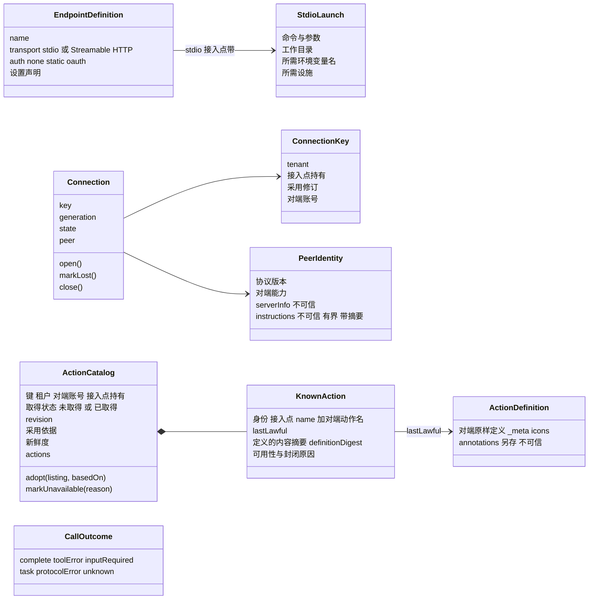
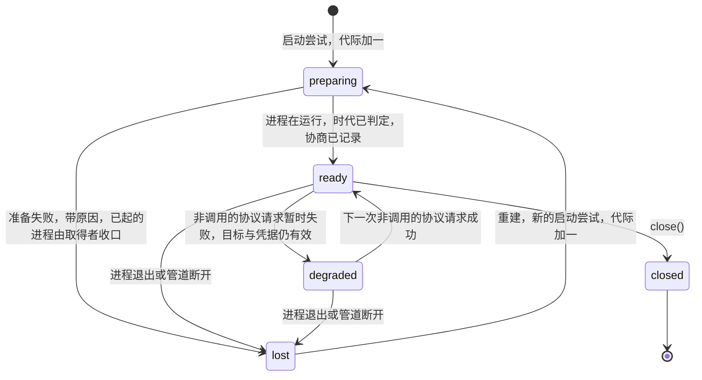
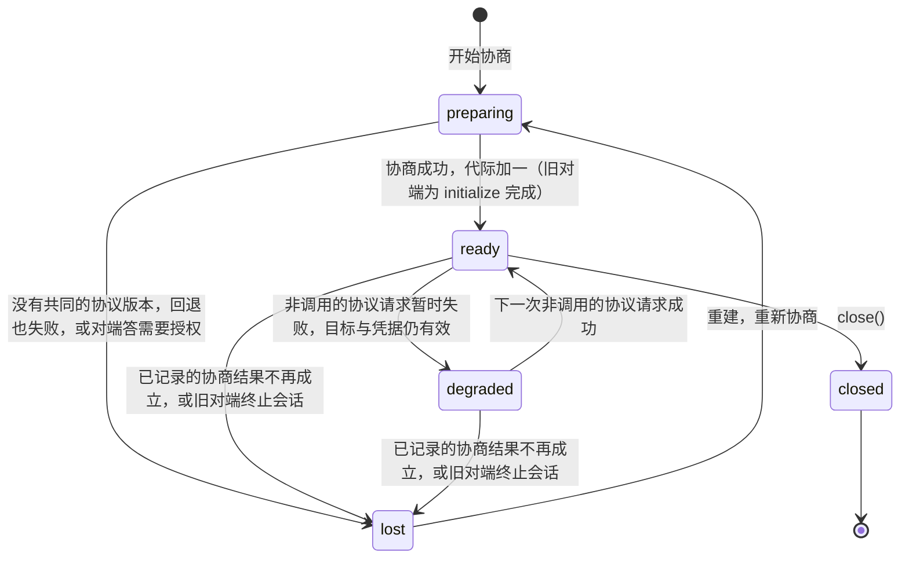

# MCP能力组工程设计

状态：工程设计草案。本页的模型、端口、服务、成员和决定都是候选。mcp-contract 已有实现（候选，尚未取得技术接受），行为正文是它的 [SPEC](../mcp-contract/SPEC.md)。mcp 已实现（候选，尚未取得技术接受）：`createMcp` 交出五个应用服务（`inspection`、`discovery`、`invoker`、`status`、`connections`），另有 `CatalogStore` 的内存实现，行为正文是它的 [SPEC](../mcp/SPEC.md)。mcp-host-local 已实现（候选，尚未取得技术接受）：stdio 与 Streamable HTTP 两种传输，含旧 HTTP+SSE 的回退，行为正文是它的 [SPEC](../mcp-host-local/SPEC.md)。mcp-cordis-contract 尚未建立。公开形状都没有取得技术接受。mcp 只在替身与脚本化传输上测试，mcp-host-local 只在脚本化对端、官方 SDK 对端与参考服务端上测试，二者的真实组合没有验证。本页不授予技术采用或运行支持，不能据此建立包、进程或数据库。

本页拥有组内的边界、成员分解、模型、端口操作、对外接口、失败种类和技术处置。跨领域交接与端口的实现方归[领域交接设计](../../../docs/domains/mcp/architecture.md)，本页只链接，不重写。组内流程见[组内流程](key-flows.md)。

用词沿统一语言：[MCP 连接](../../../.meta_harness/design/ubiquitous_language/terms/reach-and-availability.md#ul-mcp-connection--mcp-连接--mcp-connection)、[MCP 动作清单](../../../.meta_harness/design/ubiquitous_language/terms/reach-and-availability.md#ul-mcp-action-catalog--mcp-动作清单--mcp-action-catalog)、[MCP 已知动作](../../../.meta_harness/design/ubiquitous_language/terms/reach-and-availability.md#ul-mcp-known-action--mcp-已知动作--mcp-known-action)、[MCP 凭据](../../../.meta_harness/design/ubiquitous_language/terms/capabilities-and-composition.md#ul-mcp-credential--mcp-凭据--mcp-credential)、[连接目标](../../../.meta_harness/design/ubiquitous_language/terms/capabilities-and-composition.md#ul-connection-target--连接目标--connection-target)。接入点指 [MCP](../../../.meta_harness/design/ubiquitous_language/terms/capabilities-and-composition.md#ul-mcp--mcp--mcp) 资产。代码样式里的英文名是候选标识，成员 SPEC 建立时才成为公开名。

## 边界

候选决定：本组只设计并交付 MCP 的内部，以及用 MCP 自己的词表达的对外接口与数据。调用方怎样把这些接口接入自己的体系，是调用方一侧的适配，不写进本组正文。依据层：架构[外域概念的进入方式](../../../docs/architecture/layers-and-dependencies.md#外域概念的进入方式)；领域[模块角色与事实归属](../../../docs/domains/mcp/README.md#模块角色与事实归属)。

### 知道谁

本组成员只导入下面这些公开契约：

- `@omne-harness/assets` 的类别端口 `BodyContract`。本组实现它，见[对外接口](#应用服务)的类别端口。
- 公共值包：`operation-result`（`Outcome`）、`legal-identity`（`Access
`）、`content-block`（`ContentBlock`）、`json-text`（`JsonValue`）。
- 官方 MCP SDK `@modelcontextprotocol/client`。协议层优先复用它。复用会违反三条硬承诺（结局如实分类、进程归落点、不代调用方重发），或契约根已有同一条规则时，不复用，逐块决定见 [mcp-host-local 的 SPEC](../mcp-host-local/SPEC.md#sdk-reuse)。现行实现的产品源码不导入它，它只作对照与测试对端。见[协议基线与兼容](#协议基线与兼容)。
- Cordis。只出现在 mcp-cordis-contract 与 mcp-host-local 里。

### 不知道谁

本组不知道调用方是谁，也不知道调用方体系的内部。具体地说，下面这些事都不在本组，本组的契约里也没有它们的词：

- 动作在调用方体系里叫什么名字、以什么条目形状登记、怎样呈现给模型。
- 逐动作的权限怎样判定、准入怎样执行。本组只声明权限项，见[设置声明与逐动作权限](#设置声明与逐动作权限)。
- 原调用怎样保存、等待、恢复，以及结果交给谁。本组只交回结局。
- 采用怎样求值、资格怎样判定、凭据怎样保管与续期、本机进程落在哪里。本组只经下面的需求端口读结论。

### 需求端口

本组声明五个需求端口，每个只写问题、答复与失败。前四个由组外提供。`CatalogStore` 保存本组自己的 MCP 动作清单，由本组的内存实现提供。操作形状见 [MCP 声明的端口](#mcp-声明的端口)。

| 端口             | 问题                                                                 | 答复                                                                                                                                                   | 失败                                 |
| ---------------- | -------------------------------------------------------------------- | ------------------------------------------------------------------------------------------------------------------------------------------------------ | ------------------------------------ |
| `AdoptionView`   | 在这个作用域里，哪些接入点已采用？正文与配值是什么？                 | 每项：持有身份、采用修订、正文、三项固定设置的配值、stdio 进程环境所需的非秘密配值。配值缺失或不合法时如实交出。正文或任一配值变化时，采用修订随之变化 | 不可读（`unknown`）                  |
| `UseEligibility` | 这个主体此刻能不能使用这个接入点？                                   | `granted`；`refused` 带原因；`unknown`                                                                                                                 | 只有 `unknown`。拒绝是答复，不是失败 |
| `CredentialUse`  | 为这份持有取得一次凭据的受限使用。Streamable HTTP 时另限这个连接目标 | 按用途分型的凭据句柄。HTTP 句柄能为出站请求授权、回报对端的拒绝、释放。进程凭据句柄只交给 `ProcessLanding`，能释放。对端账号不由本端口答复             | 缺凭据；凭据被拒；不可读             |
| `ProcessLanding` | 按这份启动声明与环境，起一个本机进程                                 | 进程句柄。句柄给出标准输入输出，能停止整棵进程树并报告实际确认的停止范围                                                                               | 落点不成立；设施不成立；`unknown`    |
| `CatalogStore`   | 按键读取一份 MCP 动作清单；按修订条件写入一份 MCP 动作清单           | 读取：这份清单，或不存在。写入：已写入                                                                                                                 | 不可用；修订冲突                     |

### 对外提供

本组用自己的词对外提供下面这些接口与数据。各操作的形状见[对外接口](#应用服务)。

- 读口：MCP 动作清单视图、刷新结论、对端视图。
- 调用口：发出调用、带回输入答复、取消在途调用。结局是 `CallOutcome` 或「未发出」。
- 状态口：服务 `ActionInvoker` 的四个任务操作，即任务的查询、取结果、交回输入答复与取消（契约 [R7](../mcp-contract/SPEC.md#refusals) 称它们为任务操作）；服务 `EndpointStatus` 的接入点状态的查询与列举；服务 `Connections` 的释放与全部关闭。
- 类别端口：接入点正文的判定、设置与权限项的声明、本机命令判定。
- 可作稳定键的数据：MCP 已知动作身份与定义的内容摘要。调用方可以用它们作自己体系里的键。
- 符合性设施：五个需求端口与传输各一个符合性套件（传输的是 `mcpTransportConformance`）、本地真实服务端夹具（在 mcp-host-local）、`classifyOutcome` 与 `mergeListing` 的穷举测试入口，见 [Q-MC06](#q-mc06-持续验证与真实部署前提)。

## 设计守则

下面七条约束本页每个决定。每条只写 MCP 上的用法，依据是右列的项目规则。

| 守则                  | 在 MCP 上的用法                                                                                        | 依据层                                                                                                                                                                      |
| --------------------- | ------------------------------------------------------------------------------------------------------ | --------------------------------------------------------------------------------------------------------------------------------------------------------------------------- |
| G1 一个事实一个拥有者 | MCP 不求值，不保存采用，不判资格，不保管凭据，不保存原调用，不判调用终局。别人的结论只经端口读取       | 领域：[模块角色与事实归属](../../../docs/domains/mcp/README.md#模块角色与事实归属)                                                                                          |
| G2 只用自己的词       | 契约只用 MCP 的词。MCP 不知道调用方是谁                                                                | 架构：[外域概念的进入方式](../../../docs/architecture/layers-and-dependencies.md#外域概念的进入方式)                                                                        |
| G3 按用途分开的窄接口 | 读口、调用口、状态口与类别端口分开，每个调用方只拿自己用的那个                                         | 研发品味：[维度分解与正交](../../../.meta_harness/agents/roles/engineering-taste.md#维度分解与正交)                                                                         |
| G4 形态与含义分开     | stdio 与 Streamable HTTP 的差异只在 `McpTransport` 的实现里。协议含义在通用实现里                      | 同上                                                                                                                                                                        |
| G5 不变式先于机制     | 不自动重发；未知不压成失败；秘密不进入清单、日志和交出的数据；清单整份发布；MCP 已知动作不静默消失     | 领域：[主路径与交接](../../../docs/domains/mcp/README.md#主路径与交接)；产品：[J-MC02](../../../.meta_harness/design/product/mcp/design.md#j-mc02-发现合法动作并理解不可用) |
| G6 概念最少           | 复用公共值 `Outcome`、`Access
`、`ContentBlock`、`JsonValue`，不另包一层。没有不可替代理由的部件不建 | 架构：[隔离语义，不隐藏责任](../../../docs/architecture/layers-and-dependencies.md#隔离语义不隐藏责任)                                                                      |
| G7 沿用仓库风格       | 接口、纯函数和判别联合。类只用于有状态的聚合，以及 Cordis Service 必需的抽象类                         | 成员规格：现有 [tool-contract](../../tool/tool-contract/SPEC.md) 的写法                                                                                                     |

## 协议基线与兼容

依据层：架构[技术基础](../../../docs/architecture/technical-foundations.md#共同技术选择)「MCP连接与动作桥接」一行，即已接受的 [RFC-0001 revision 4](../../../docs/rfcs/RFC-0001-technical-foundations.md#决定范围)。该行规定下面的 SDK 与协议线：

- 客户端用官方 `@modelcontextprotocol/client` 2.3.1，服务端用官方 `@modelcontextprotocol/server` 2.3.1。这是 RFC 该行的版本。仓库实际采用 2.4.0，见 [mcp-host-local 的 SPEC](../mcp-host-local/SPEC.md)。该行的同步归 [RFC-0001](../../../docs/rfcs/RFC-0001-technical-foundations.md) 的拥有者。
- 协议线固定为 2026-07-28。客户端显式钉住这条协议线。
- 现代 stdio 服务用官方 `serveStdio`。只有实际接入服务端时才需要 node 适配 2.1.1。
- 旧的 `sdk` 1.32.1 属于 v1 维护线，不作为新设计的默认。
- 不能假定传统 stdio 接缝进入现代协议。

精确版本以 lockfile 为准，由建包任务锁定发布物及传递依赖，见技术基础的[采用范围与边界](../../../docs/architecture/technical-foundations.md#采用范围与边界)。

本组的候选决定：

1. 协议基线是 MCP 修订 2026-07-28。依据层：上述技术基础一行。官方规格 [2026-07-28 Key Changes](https://modelcontextprotocol.io/specification/2026-07-28/changelog) 是协议事实的出处。
2. 协议层优先复用官方 SDK。复用会违反三条硬承诺（结局如实分类、进程归落点、不代调用方重发），或契约根已有同一条规则时，不复用。复用与自写的逐块决定见 [mcp-host-local 的 SPEC](../mcp-host-local/SPEC.md#sdk-reuse)。现行实现的产品源码不导入 SDK，SDK 只作对照，并作测试里的对端。两个传输实现都显式钉住协议线。不能假定 SDK 默认的传统 stdio 接缝会进入现代协议，所以 stdio 实现不依赖这个默认，对端时代按下一项判定。
3. 兼容更早修订。对端时代按传输分别判定，依据层：官方规格 [Versioning「Backward Compatibility with Initialization-Based Versions」](https://modelcontextprotocol.io/specification/2026-07-28/basic/versioning#backward-compatibility-with-initialization-based-versions)。
   - stdio：先发 `server/discover` 探测。收到的错误不是可识别的现代错误时，回退到 `initialize`，按协商出的旧修订继续。
   - Streamable HTTP：先发现代请求。`400` 的响应体不是可识别的现代错误时，回退到 `initialize`，按 2025-03-26 至 2025-11-25 的 Streamable HTTP 继续，包括对端分配的会话。依据层：官方规格 [Streamable HTTP「Backward Compatibility」](https://modelcontextprotocol.io/specification/2026-07-28/basic/transports/streamable-http#backward-compatibility)。
4. 旧 HTTP+SSE 传输（2025-03-26 之前的 HTTP 传输）：Streamable HTTP 传输对只会旧 HTTP+SSE 的对端回退一次，回退之后是 SSE 模式，`WireContext.mode` 是 `sse`。回退的条件与之后的归类见契约 [T3](../mcp-contract/SPEC.md#port-transport) 与 [T8](../mcp-contract/SPEC.md#t8)。回退不成立时，报告连接不可用。依据层：契约 [T3](../mcp-contract/SPEC.md#port-transport) 与裁定[真实传输兑现时的裁定](../mcp-contract/SPEC.md#decisions-host)第 6 条。官方规格已弃用该传输，所以只回退一次，不另建传输。
5. 旧对端的结果没有 `resultType` 时，按 `complete` 处理。依据层：官方规格 Key Changes「Major changes」第 8 项。
6. 现代修订的客户端能力声明任务扩展与 elicitation 的 form 形式。不声明 elicitation 的 url 形式、sampling 与 roots，因为官方已弃用 sampling 与 roots。旧修订的客户端能力是空对象。所以对端的输入请求只有 elicitation 一种，见[调用结果](#调用结果)。精确声明见契约 [T3](../mcp-contract/SPEC.md#port-transport)。

剩余义务：技术基础该行要求 MCP 接缝验证协商、旧协议兼容与认证。验证分工见 [Q-MC06](#q-mc06-持续验证与真实部署前提)。

## 模型

下图是本组模型的候选标识与关系。两个聚合是 `Connection` 与 `ActionCatalog`，其余是值对象与实体。

### 值对象

| 候选标识             | 含义                                                                                                                                        | 规则                                                                                                                                                                                                                                                                                                                                                                                                                              |
| -------------------- | ------------------------------------------------------------------------------------------------------------------------------------------- | --------------------------------------------------------------------------------------------------------------------------------------------------------------------------------------------------------------------------------------------------------------------------------------------------------------------------------------------------------------------------------------------------------------------------------- |
| `EndpointDefinition` | 接入点正文的解析结果：name、传输种类（stdio 或 Streamable HTTP）、认证方式声明（none、static、oauth）、设置声明                             | 由 `parseEndpointBody` 得出。传输种类写在正文里，加载期就能判定「这个接入点可能启动本机命令」                                                                                                                                                                                                                                                                                                                                     |
| `StdioLaunch`        | stdio 接入点的启动声明：命令、参数、工作目录、所需环境变量名、所需设施                                                                      | 写在接入点正文里。只写变量名，不写值。变量的值经 `ProcessLanding.start` 的 `env` 交出，见 [MCP 声明的端口](#mcp-声明的端口)。命令是一个程序，不经 shell 解释。参数原样传递，不插值，不展开。正文没有列出的变量不隐式补入（参考旧材料，按现行架构筛选）。每个变量写来源 `setting` 或 `credential`，正文不写值，见 [E3](../mcp-contract/SPEC.md#endpoint)。工作目录的写法与缺省见 [E4](../mcp-contract/SPEC.md#endpoint)            |
| `ConnectionKey`      | 租户、接入点持有、采用修订、对端账号                                                                                                        | 采用修订由 `AdoptionView` 交出。设置的变化体现在采用修订上，所以键里只用采用修订。采用修订一变，键就变，`Connections` 为新键建立新的 MCP 连接。对端账号只由纯函数 `peerAccountOf(认证方式, 凭据配值)` 得出，`CredentialUse.acquire` 只答句柄，见 [K1](../mcp-contract/SPEC.md#keys)。所以 `ConnectionKey` 在取得句柄之前就能组成。认证方式为 `none` 时，对端账号取固定值 `anonymous`。它是组内的键，不交给调用方。见下文 MCP 连接 |
| `EndpointRef`        | 接入点引用：接入点 name 与持有                                                                                                              | 调用方用它指定接入点。它不含租户与对端账号，这两项由 `access` 与凭据得出                                                                                                                                                                                                                                                                                                                                                          |
| `PeerIdentity`       | 协商结果：协议版本、对端能力、对端自报的 `serverInfo` 与 `instructions`                                                                     | `serverInfo` 与 `instructions` 是对端自报，不可信，不作为身份或授权依据。`instructions` 按合法配置的字节上界截断，带内容摘要与取得时的连接代际                                                                                                                                                                                                                                                                                    |
| `ActionDefinition`   | 一个对端动作的最近合法定义：对端对象去掉 annotations 后的原样内容，例如 name、title、description、inputSchema、outputSchema、`_meta`、icons | 本组不改写定义。annotations 另存为不可信值。定义的内容摘要按含 annotations 的对端原对象计算，见 [C3](../mcp-contract/SPEC.md#catalog)。是否建任务由对端对每个请求决定，本组不从定义推断                                                                                                                                                                                                                                           |
| `CallOutcome`        | 一次已发出调用的结局种类                                                                                                                    | 见[调用结果](#调用结果)                                                                                                                                                                                                                                                                                                                                                                                                           |

远端地址与覆盖值是连接目标设置，不写进接入点正文。决定与依据见 [Q-MC03](#q-mc03-客户端认证清单一致采用及配置机制)。

### MCP 连接

MCP 连接的候选聚合是 `Connection`。它带 `key: ConnectionKey`、`generation`（连接代际）、`state` 和 `peer: PeerIdentity`。操作是 `open()`、`markLost()` 和 `close()`。状态候选为 `preparing`、`ready`、`degraded`（带原因）、`lost`（带原因）和 `closed`。`degraded` 与 `lost` 的原因集合见 [S7](../mcp-contract/SPEC.md#services)。

候选决定：`degraded` 的进入与离开条件如下，两种传输相同。

- 进入：最近一次非调用的协议请求（`server/discover` 或 `tools/list`）暂时失败，同时连接目标与凭据仍有效。
- 离开：下一次非调用的协议请求成功时，回到 `ready`。
- 调用失败本身不改变状态。调用失败按[调用结果](#调用结果)分类。

不变式：

1. 键里有租户和对端账号。不同租户、不同对端账号永不共用一条 MCP 连接。依据层：领域 [模块角色与事实归属](../../../docs/domains/mcp/README.md#模块角色与事实归属)。
2. 每次重建，`generation` 加一。各传输在哪一步加一见下表。迟到响应按代际识别：旧代际的迟到响应不改变新状态，也不发布新清单。依据层：领域 [事实与责任](../../../docs/domains/mcp/architecture.md#事实与责任)「名称复用不使旧清理或响应命中新实例」；产品 J-MC03「迟到刷新不能覆盖较新选择」。
3. stdio 的 `preparing` 失败时，由取得者收口已经起来的进程。确认丢失时查原准备，不再起一个进程来制造成功。依据层：产品 [J-MC01](../../../.meta_harness/design/product/mcp/design.md#j-mc01-采用端点并取得合法连接条件)。
4. 已关闭的 MCP 连接不证明远端调用已停。`close()` 只报告实际确认的范围。准备失败与关闭失败保留真实资源和下一处置者。依据层：产品 [J-MC05](../../../.meta_harness/design/product/mcp/design.md#j-mc05-控制原调用并完成会话归档)。
5. 连接时限与调用时限分开。依据层：领域 [协作与依赖](../../../docs/domains/mcp/README.md#协作与依赖)。连接时限是本组的设置。建连的时限从这次建连开始（连接进入 `preparing`）起计时，覆盖其后对这个键上一条连接遗留进程的再停、取凭据、本机进程启动、打开传输、时代判定与协商，以及建连失败之后的收场。每次 `ensure` 另有一个临界区时限，从入口起计时。加入在途建连的调用另有一个时限，从加入起计时。协商成功后 MCP 连接进入 `ready`，`ready` 不等 MCP 动作清单。刷新取分页的阶段另起一个时限，上界与连接时限相同。端口不理会中止信号时，连接表自己停止等待，并收口迟到交来的结果。精确范围见 mcp SPEC 的 [MC-5](../mcp/SPEC.md#mc-5) 与 [MC-7](../mcp/SPEC.md#mc-7)。调用时限不是本组的设置。调用方经 `signal` 给出调用的截止，本组不自设调用时限。
6. 接入点被撤采用或被禁用后，`Connections` 在下一次使用边界之前关闭对应的 MCP 连接，stdio 时一并停止进程。采用修订变化后，旧采用修订上的 MCP 连接不再接新请求，同样按本条关闭。关闭以接入点为单位：撤采用与被设置挡下（`disabled`、`local-command-not-enabled`）是接入点的事实，关闭该接入点的连接。主体无使用资格（`not-eligible`）只是这个主体的事实，接入点对租户仍然成立，所以不关闭。资格或采用答 `unknown` 时也不关闭。`ensure` 在建连之前再读一次采用，不信任令牌里的采用修订：未采用时答 `not-available-to-you`，不可读或修订与令牌不同时答 `unknown`，三种都不建连，也不关闭其他连接。依据层：本页 `UseEligibility` 一行「撤权在下一次使用时生效」。粒度见 mcp SPEC 的 [MC-11](../mcp/SPEC.md#mc-11)，重读见 [MC-5](../mcp/SPEC.md#mc-5)。

候选决定：MCP 连接的并发按下面处理。精确次序见 mcp SPEC 的[所有权、失败与生命周期](../mcp/SPEC.md#所有权失败与生命周期)「并发」一项。

- 同一个键只建一条 MCP 连接。并发的建连共享同一次建立。
- 同一个键同时只有一次关闭，拆除也只有一次。拆除的次序是关闭传输、停止进程、释放凭据句柄。失去连接、准备失败、重建与关闭共用这一次拆除。建连等它完成后再开始。
- 同一租户、同一持有的 `ensure` 依次决定哪个采用修订的连接存在。重读采用、关闭其他修订的连接与建立连接条目在一个临界区内完成，建连本身在临界区之外。
- 迟到的结果按产出它的代际识别并收口，不改变新连接。

这样处理的代价：采用口交来旧答复时，旧修订的令牌仍可能短暂建起旧连接，随后这条连接被关闭。

2026-07-28 取消了协议级会话和 `initialize` 握手，依据层：官方规格 Key Changes「Major changes」第 1、2 项。因此连接代际与状态按传输分别定义：

| 传输与对端时代                                      | 一条 MCP 连接包含什么                                                                          | 代际何时加一                                  | `ready` 表示                                                       | `lost` 表示                                                |
| --------------------------------------------------- | ---------------------------------------------------------------------------------------------- | --------------------------------------------- | ------------------------------------------------------------------ | ---------------------------------------------------------- |
| stdio，任一时代                                     | 一个本机进程（经 `ProcessLanding` 取得），以及在这个进程上判定的时代和协商结果                 | 每次启动尝试，包括准备失败的尝试（候选决定）  | 进程在运行，时代已判定，协商结果已记录                             | 进程退出或管道断开。在途调用的效果未知                     |
| Streamable HTTP，现代对端（2026-07-28 起）          | 没有进程，也没有协议会话。只有一组协商结果：协议版本、对端能力、对端自报身份，以及本次凭据可用 | 每次重新协商成功                              | 最近一次协商成功，连接目标与凭据可用。它不表示有一条一直打开的通道 | 已记录的协商结果不再成立，例如对端拒绝所选版本，或凭据被拒 |
| Streamable HTTP，旧对端（2025-03-26 至 2025-11-25） | 协商结果，加上对端用 `Mcp-Session-Id` 分配的会话（如有）                                       | 每次重新 `initialize`，包括对端终止旧会话之后 | `initialize` 已完成，会话（如有）有效                              | 对端终止了会话，或协商结果不再成立                         |

在 Streamable HTTP 上，一次调用失败本身不使 MCP 连接变成 `lost`。调用失败按[调用结果](#调用结果)分类。对端时代的判定结果按对端进程（stdio）或来源（HTTP）缓存；缓存的假设失败时重新探测。依据层：官方规格 Versioning 同一节。

stdio 的代际在启动尝试时就加一，不等准备成功。所以一次失败的准备尝试留下的迟到响应，也能按代际识别为旧代际。

下面两张图是 MCP 连接的状态转移，每种传输一张。`close()` 从任一状态进入 `closed`，图中只画一次。

stdio：

Streamable HTTP（现代对端与旧对端）：

`lost` 之后，连接提供者在当前条件成立后重建，见[领域流程 F-MC06](../../../docs/domains/mcp/key-flows.md#f-mc06-失联重连与原工作接续)。重建不重发任何调用。图中「准备失败进入 `lost`」沿[失败种类](#失败种类)的「连接不可用并给出原因」。

候选决定：`close()` 按下面的次序收场（参考旧材料，按现行架构筛选）。

1. 拒绝这条 MCP 连接上的新请求。
2. 关闭传输。
3. stdio：经 `ProcessLanding` 交回的进程句柄，请求停止该进程及其全部后代。宽限期过后仍在运行的，强制终止。
4. stdio：在有界的期限内排空 stderr。进程运行期间，stderr 一直持续排空。
5. 释放这条连接取得的凭据句柄：进程凭据句柄在 `stop()` 返回之后，HTTP 凭据句柄随传输关闭。

`close()` 只报告实际确认的范围。关闭传输或调用了关闭操作，不证明进程及其后代已经停止。这个次序沿架构[有序退出与清理失败](../../../docs/architecture/deployment/cordis-and-lifecycle.md#有序退出与清理失败)的关闭次序：先停相关新准入，再结束或交接在途责任，随后关闭网络、MCP 与执行环境。宽限期的值来自合法配置。

### MCP 动作清单与 MCP 已知动作

MCP 动作清单的候选聚合是 `ActionCatalog`。它带键（租户、对端账号、接入点持有）、取得状态、`revision`、采用依据、新鲜度和以 MCP 已知动作身份为键的 `actions`。操作是 `adopt(listing, basedOn)` 和 `markUnavailable(reason)`。`KnownAction` 是聚合内的实体，带身份（接入点 name 加对端动作名）、`lastLawful: ActionDefinition`、定义的内容摘要（`definitionDigest`）和当前可用性。

候选决定：清单按租户、对端账号与接入点持有分开保存。接入点持有本身带层与作用域，所以同一接入点在不同层或不同作用域上的持有各有一份清单。依据层：统一语言 MCP 动作清单「按租户、对端账号与接入点分开保存」，持有一词沿统一语言[资产持有](../../../.meta_harness/design/ubiquitous_language/terms/circulation-and-entitlement.md#ul-asset-holding--资产持有--asset-holding)。旧材料的动作快照按（租户、接入点、作用域）隔离，与此一致（参考旧材料，按现行架构筛选）。

候选决定：确定清单的键不需要连接。凭据配值唯一确定对端账号（产品「换账号属于配值变更」），所以 `current` 用 `AdoptionView` 交来的凭据配值引用组成键里的对端账号；认证方式为 `none` 时对端账号为 `anonymous`。依据层：产品 [J-MC01](../../../.meta_harness/design/product/mcp/design.md#j-mc01-采用端点并取得合法连接条件) 与产品需求描述「续期只维持同一对端账号，换账号属于配值变更」。

候选决定：清单的取得状态分两种，两者不混同。

- 未取得：从来没有合法取得过完整清单。读面报告「尚未取得」，不报告零个动作。
- 已取得：至少一次合法取得了完整清单。`actions` 为空时，表示已知对端提供零个动作。

候选决定：首次发现由调用方经 `refresh` 触发。建立 MCP 连接只做协商，不取清单，所以 MCP 连接进入 `ready` 不等清单。首次 `refresh` 之前，`current` 交出的视图取得状态是「未取得」，读面报告「尚未取得」。

只有全部分页都已取完、每一项都合法、对端动作名没有重复时，这次取得才算完整。任何一页失败时，前面已取得的各页也不采用（参考旧材料，按现行架构筛选）。

候选决定：清单的键不含协议版本。每次采用的连接代际、协议版本与对端能力记进这次采用的依据。依据层：统一语言 MCP 已知动作「不离开清单」。键里有协议版本时，换版本会让 MCP 已知动作离开清单。架构[连接复用与流式缓冲](../../../docs/architecture/deployment/execution-and-communication.md#连接复用与流式缓冲)要求「发现结果按端点/协议/能力版本缓存」。本组这样兑现：每份清单内容都能按接入点持有、协议版本与对端能力识别。当前连接的协议版本或对端能力与依据不符时，读面标明这份内容的依据已不符。采用仍只沿装配与合法刷新改变，见下文 `ttlMs` 一段。

候选决定：每个 MCP 已知动作带定义的内容摘要（`definitionDigest`），即 `lastLawful` 的内容摘要。定义一变，这个内容摘要就变。MCP 已知动作身份与定义的内容摘要可以作稳定键：调用方用身份认出同一个动作，用定义的内容摘要认出同一份定义。

不变式：

1. 只有合法取得的清单能加入新动作。不伪造从未发现过的动作。依据层：产品 [J-MC02](../../../.meta_harness/design/product/mcp/design.md#j-mc02-发现合法动作并理解不可用)。
2. MCP 已知动作不静默消失。对端不再提供时标为不可用，保留最近合法定义和安全原因。依据层：统一语言 MCP 已知动作。
3. `adopt` 带上它所基于的清单修订，经 `CatalogStore` 按这个修订条件写入。迟到的、较旧的结果被拒绝，不覆盖较新的采用，也不重新开启已撤的接入点。连接代际只属于一条 MCP 连接。采用修订一变就换新的 MCP 连接，代际重新计数，所以 `mergeListing` 不跨连接比较代际。产出清单的那一代连接是否仍是当前连接，在受保护的发布边界核对，见下文 `refresh` 第 6 步。依据层：产品 [J-MC03](../../../.meta_harness/design/product/mcp/design.md#j-mc03-刷新后续采用且保护原调用)。
4. 清单整份发布，不出现一半新一半旧的清单。依据层：统一语言 MCP 动作清单。
5. 最近合法定义与当前授权分开保存。旧清单不恢复撤权。依据层：产品 J-MC02「不能继续读取撤权后的新定义」。

清单记录三件事：取得状态；已取得时的版本与范围；当前可用性。刷新开始时不删除已知身份。一次成功采用同时确认清单内容、来源依据、可用判断和发布修订。

候选决定：MCP 动作清单经需求端口 `CatalogStore` 保存，键是（租户、对端账号、接入点持有）。规则如下。

- 读取答「不存在」时，清单处于「未取得」。读取答不可用时，`current` 答 `unknown`，不当作「未取得」。
- 发布是一次按修订条件的写入：只有存储里的修订仍是本次采用所基于的修订时，写入才成立。答修订冲突时，表示已有较新的采用，本次结果不覆盖它，`refresh` 交回「保留原采用」与原因。
- 写入答不可用时，`refresh` 不报告新修订，答 `unknown`。清单的实际修订以下一次读取为准。
- 由 mcp 提供内存实现。它只在一次运行内保存清单。进程重启后清单回到「未取得」，MCP 已知动作不跨重启保留。这是已知限制。
- 耐久实现接存储契约（[sql-contract](../../storage/sql-contract/README.md)），是剩余义务，见 [Q-MC03](#q-mc03-客户端认证清单一致采用及配置机制)。

依据层：统一语言 MCP 动作清单「按租户、对端账号与接入点持有分开保存」「整份更新」；产品 [J-MC03](../../../.meta_harness/design/product/mcp/design.md#j-mc03-刷新后续采用且保护原调用)「迟到刷新不能覆盖较新选择」。

采用由 `ActionDiscovery` 协调。调用方每次调用 `refresh`，它按下面的次序工作：

1. 经 `AdoptionView` 取得已采用的接入点及其正文。接入点不在其中时，答 `not-available-to-you`。
2. 经 `UseEligibility.check` 取得本次使用的资格。只有 `granted` 才继续。
3. 经 `CatalogStore` 读取当前清单及其修订。
4. 读取完整合法候选（`McpTransport.listActions`）。
5. 核对定义、实现与对端关联。
6. 在受保护的发布边界，核对本次选择、连接代际、取消、较新的刷新和当前授权仍然有效。
7. 条件成立时调用 `mergeListing`，再经 `CatalogStore` 按第 3 步读到的修订条件写入，整份发布。条件不成立或修订冲突时保留原采用事实，并给出原因。

失败时不发布部分清单或过期成功。装配、采用点、必需提供者变化以及合法显式刷新触发的求值，都不改变已经发出的调用。同一注册入口内部的数据变化不要求重建 runtime。结构变化沿装配安全交接。

候选决定：对端的 `tools/list` 结果中的 `ttlMs` 只更新新鲜度，不自行改变采用。本组不订阅清单变化通知（`subscriptions/listen`），所以新鲜度里的 `changedNotified` 保持为假，见契约 [C2](../mcp-contract/SPEC.md#catalog)。采用时点只沿装配与合法刷新。依据层：架构 [重装与不重装的情形](../../../docs/architecture/runtime/assembly-and-change.md#重装与不重装的情形) N4；产品 J-MC03。

### 设置声明与逐动作权限

候选决定：本组声明两组项。第一组是设置，由 `EndpointInspection` 实现类别端口时的 `deriveDeclarations` 产出：三项固定设置，加上 stdio 进程环境的每个 `setting` 来源变量一项。产出次序与值域见 [E5](../mcp-contract/SPEC.md#endpoint)。

| 项           | 种类与类别         | 规则                                                                                                                                                                                                                                                                                                                                                                                                                                                                                                                                              |
| ------------ | ------------------ | ------------------------------------------------------------------------------------------------------------------------------------------------------------------------------------------------------------------------------------------------------------------------------------------------------------------------------------------------------------------------------------------------------------------------------------------------------------------------------------------------------------------------------------------------- |
| 连接目标     | 设置，落点与身份类 | 这个接入点连到对端的哪里。只对 Streamable HTTP 适用。stdio 接入点用正文里的启动声明（`StdioLaunch`），不读这一项。Streamable HTTP 的地址只做句法检查：小写的 `https`，或者主机是回环主机时的小写 `http`；绝对地址，主机合法，没有 fragment，没有 userinfo，整串没有空白、控制字符或反斜杠。不合法时拒绝，不修补后接收（参考旧材料，按现行架构筛选）。句法检查不判定对端可信，也不阻止秘密出现在地址里。明文 `http` 只用于回环主机（`localhost`、`127.0.0.1`、`::1`），其他明文 `http` 地址不合法。精确规则见 [V3](../mcp-contract/SPEC.md#values) |
| 凭据         | 设置，落点与身份类 | 用本租户哪一份 MCP 凭据。没有缺省值。认证方式不是 `none` 时，缺值不退回其他凭据：要连接的操作答 `credential-unavailable`（`missing`），不连接的 `current` 与 `peer` 答 `config-missing`（`credential`），见 [K1](../mcp-contract/SPEC.md#keys)。配值不合法时答 `config-invalid`（`credential`）。认证方式是 `none` 时不读这一项，缺值不是失败                                                                                                                                                                                                     |
| 进程环境变量 | 设置，落点与身份类 | 只对 stdio。正文 `launch.env` 里来源为 `setting` 的每个变量一项，项名是 `setting:placement-identity:env.<NAME>`。值是文本，没有缺省值。缺值时答 `config-missing`（`env.<NAME>`）。变量值只有缺失一种配置失败。来源为 `credential` 的变量不产出设置项，由进程凭据句柄注入                                                                                                                                                                                                                                                                          |
| 连接超时     | 设置，偏好类       | 正的时长。覆盖范围见上文 MCP 连接的不变式 5。这个时长也是 `refresh` 取页阶段的上界。没有缺省值。缺值时用请求或任务引用里的可选上界 `connectBound`，`refresh` 的请求也可以带它。两者都没有时答 `config-missing`（`connect-timeout`）。配值不合法时答 `config-invalid`（`connect-timeout`），不改用 `connectBound`。见 [S4](../mcp-contract/SPEC.md#services)                                                                                                                                                                                       |

候选决定：设置项都不补缺省值。`AdoptionView` 交来的每项配值是三种状态之一：缺失、不合法（带原文）、有值。缺失答 `config-missing`，存在但守卫拒绝答 `config-invalid`，两者都带配置项。各操作需要哪些配值、按什么次序检查，见 [S4](../mcp-contract/SPEC.md#services)。

候选决定：调用超时不是本组的设置。调用的截止只由调用方经 `signal` 给出，见上文 MCP 连接的不变式 5。

第二组是逐动作权限。每个 MCP 已知动作一项，项名是 `execute:<对端动作名>`，取值是禁止、自动、询问（`forbid`、`auto`、`ask`）。这一组不经类别端口产出，由纯函数 `actionPermissionItems` 产出，见 [C8](../mcp-contract/SPEC.md#catalog)。规则如下：

- 只在 MCP 动作清单处于「已取得」时派生。清单「未取得」时不派生，也不据此推断动作有零个。
- 项名只由对端动作名决定，不随动作定义的内容变化。MCP 已知动作不离开清单，所以动作变为不可用时，它的权限项仍在，各层的配值也仍在。动作重新可用时，沿用原配值（参考旧材料，按现行架构筛选）。
- MCP 只声明权限项，不判定权限。

依据层：统一语言[设置项类别](../../../.meta_harness/design/ubiquitous_language/terms/capabilities-and-composition.md#ul-setting-category--设置项类别--setting-category)、[权限](../../../.meta_harness/design/ubiquitous_language/terms/capabilities-and-composition.md#ul-permission--权限--permission)注意 ④「权限项有哪几项由资产的类别定，作者不能自加」；产品 [J-MC04](../../../.meta_harness/design/product/mcp/design.md#j-mc04-发起一个-mcp-动作)「经端点使用和逐动作准入」。各层能否给某一项配值，沿设置项类别与权限的来源规则，本页不另定。各项值域见 [E5](../mcp-contract/SPEC.md#endpoint) 与 [C8](../mcp-contract/SPEC.md#catalog)。设置项不补缺省值，见上文。

剩余义务：现行资产 SPEC 的[已接受公开类型](../../assets/assets/SPEC.md#accepted-public-types)中，`deriveDeclarations(body, context)` 不接收 MCP 动作清单，所以逐动作权限现在无法经类别端口派生。须扩展它的上下文，或另立一个接缝。拥有者：资产 SPEC。mcp-contract 的[未封闭项](../mcp-contract/SPEC.md#open-items)记录同一项。

### MCP 声明的端口

跨领域端口的实现方与交接以[领域交接设计](../../../docs/domains/mcp/architecture.md#mcp-声明的端口与实现方)为准。本表只写操作、答复与规则。`McpTransport` 与 `McpTransportFactory` 是组内端口，由 mcp-host-local 实现。`CatalogStore` 保存本组自己的 MCP 动作清单，现由 mcp 的内存实现提供。

| 候选标识              | 操作                                                                                                                                                                                                                   | 答复与规则                                                                                                                                                                                                                                                                                                                                                                                                                                                                                                                                                                                                                                                                                                                                                                                                                                                                                                                                                                                                      |
| --------------------- | ---------------------------------------------------------------------------------------------------------------------------------------------------------------------------------------------------------------------- | --------------------------------------------------------------------------------------------------------------------------------------------------------------------------------------------------------------------------------------------------------------------------------------------------------------------------------------------------------------------------------------------------------------------------------------------------------------------------------------------------------------------------------------------------------------------------------------------------------------------------------------------------------------------------------------------------------------------------------------------------------------------------------------------------------------------------------------------------------------------------------------------------------------------------------------------------------------------------------------------------------------- |
| `McpTransport`        | `discover()`、`listActions(cursor?)`、`call(request, signal, observe?)`、`cancelRequest(requestId)`、`getTask(taskId)`、`updateTask(taskId, inputResponses)`、`getTaskResult(taskId)`、`cancelTask(taskId)`、`close()` | 产品源码不导入官方 SDK，传输按协议实现。通用实现不认识 SDK，SDK 只在 mcp-host-local 的测试与探针里作对照与对端，见[协议基线与兼容](#协议基线与兼容)。失败按对端效果分四种：未发出、已发出但无应答（效果未知）、对端答 JSON-RPC 错误、应答读不懂，见 [T1](../mcp-contract/SPEC.md#port-transport)。`discover` 在旧对端上回退到 `initialize`。对端答需要授权时，请求没有对端效果，交出授权发现的结果，见下文。任务操作与协议的对应见 [T6](../mcp-contract/SPEC.md#port-transport)                                                                                                                                                                                                                                                                                                                                                                                                                                                                                                                                 |
| `McpTransportFactory` | `open(material, signal)`                                                                                                                                                                                               | 按准备好的材料打开一条传输。stdio 的材料是 `ProcessLanding` 交来的进程句柄，Streamable HTTP 的材料是连接目标与凭据句柄（认证方式为 `none` 时没有句柄）。两种材料都带本次的连接代际与 `instructions` 的字节上界 `instructionsByteLimit`，传输在 `discover` 时按它截断 `instructions`，见 [S3](../mcp-contract/SPEC.md#services)。答复是一个 `McpTransport`，失败与 `McpTransport` 相同。`Connections` 经它创建传输，所以本组的通用实现不认识官方 SDK                                                                                                                                                                                                                                                                                                                                                                                                                                                                                                                                                             |
| `CredentialUse`       | `acquire(access, endpointHolding, purpose, binding)`                                                                                                                                                                   | `binding` 是凭据配值。Streamable HTTP 时另带连接目标，stdio 时没有连接目标。`purpose` 是用途：为 stdio 进程环境注入（`process-env`），或为 HTTP 出站请求授权（`http-authorization`）。答复是按用途分型的凭据句柄，见 [CU1](../mcp-contract/SPEC.md#port-credentials)：进程凭据句柄由 MCP 原样交给 `ProcessLanding`，MCP 不读它，用完释放；它怎样变成变量值，由 `CredentialUse` 与 `ProcessLanding` 两个实现方约定。HTTP 凭据句柄能为一个出站 HTTP 请求授权，能回报对端拒绝了它，能释放。对端账号不由本端口答复：凭据配值唯一确定对端账号，本组用纯函数 `peerAccountOf` 从认证方式与凭据配值得出它，`current` 与 `Connections` 用同一个来源。句柄只对这份持有有效，HTTP 凭据句柄只对这个连接目标有效。句柄是本租户这份持有上的 MCP 凭据的一次受限使用能力，不是秘密值。答复不退回组织、官方或其他租户的凭据。认证方式为 `none` 时不调用本端口，对端账号取固定值 `anonymous`。失败：缺凭据（`missing`）、凭据被拒（`rejected`）、不可读（`unknown`）。句柄和秘密值不进入 MCP 动作清单、日志、错误文本或交出的数据 |
| `ProcessLanding`      | `start(access, launch, env)`                                                                                                                                                                                           | 只用于 stdio 接入点。MCP 调用前必须已从 `UseEligibility` 得到 `granted`。`launch` 带命令、参数、工作目录与所需设施。`env` 的组成与秘密注入见下文。MCP 不选落点。答复是进程句柄：句柄给出标准输入输出与 stderr，能停止该进程及其全部后代，并报告实际确认的停止范围，供 `close()` 使用。本端口须在交出 stderr 之前遮盖其中的秘密值，因为秘密值不经过 MCP，MCP 无法按值遮盖。失败：落点不成立、设施不成立、`unknown`。失败时不静默落到宿主。本机命令型接入点是否开启不归本端口。句柄的形状与停止范围见 [PL](../mcp-contract/SPEC.md#port-landing)                                                                                                                                                                                                                                                                                                                                                                                                                                                                  |
| `AdoptionView`        | `endpoints(access, scope)`、`endpoint(access, endpointRef)`                                                                                                                                                            | `endpoints` 答复已采用接入点的列表。`endpoint` 按接入点引用答复一项，接入点未采用时答 `not-adopted`。读口、调用口与状态口只收接入点引用，不收作用域，所以它们用 `endpoint` 核采用。持有本身带层与作用域，由端口实现方解析。每项是持有身份、采用修订、正文、三项固定设置的配值，以及 stdio 进程环境所需的非秘密配值。每项配值是三种状态之一：缺失、不合法（带原文）、有值，不补缺省值，见 [AV1](../mcp-contract/SPEC.md#port-adoption)。正文或任一配值变化时，采用修订随之变化，MCP 据此换用新的 MCP 连接，见 `ConnectionKey`。它不判使用资格。MCP 不求值，也不保存采用。失败：不可读（`unknown`）                                                                                                                                                                                                                                                                                                                                                                                                               |
| `UseEligibility`      | `check(access, endpoint)`                                                                                                                                                                                              | 答复 `granted`、`refused`（带原因）或 `unknown`。`refused` 的原因分两类，见下文。本机命令型接入点未由使用租户开启时，答 `refused`，原因是 `local-command-not-enabled`。每次使用都现场判定，不缓存。撤权在下一次使用时生效                                                                                                                                                                                                                                                                                                                                                                                                                                                                                                                                                                                                                                                                                                                                                                                       |
| `CatalogStore`        | `read(key)`、`write(key, catalog, expectedRevision)`                                                                                                                                                                   | `key` 是（租户、对端账号、接入点持有）。`read` 答这份 MCP 动作清单，或不存在。`write` 只在存储里的修订等于 `expectedRevision` 时写入整份清单；从未写入过的键，以「不存在」作为期望修订。答复是已写入。失败：不可用；修订冲突。写入不留下半份清单。清单里没有秘密值。由 mcp 提供内存实现，耐久实现是剩余义务，见 [MCP 动作清单](#mcp-动作清单与-mcp-已知动作)                                                                                                                                                                                                                                                                                                                                                                                                                                                                                                                                                                                                                                                    |

候选决定：`AdoptionView` 与 `UseEligibility` 各管一件事。`AdoptionView` 回答「哪些接入点已采用、正文是什么」。`UseEligibility` 回答「这个主体此刻能不能使用这个接入点」，本机命令型接入点的开启检查也由它回答。MCP 先读采用，再核资格，两个结论不合并成一次判定。

候选决定：`UseEligibility` 答 `refused` 时，原因分两类。

- 无使用资格：原因是 `not-eligible`。接入点不存在时也答这个原因。对无权主体，答复不随接入点是否存在而变。这是对本端口答复的要求。
- 有使用资格，但被设置挡下：原因是 `local-command-not-enabled`（本机命令型接入点未由使用租户开启），或 `disabled`（接入点被禁用）。只有主体对这个接入点有使用资格时，才答这一类原因。

依据层：产品 [J-MC02](../../../.meta_harness/design/product/mcp/design.md#j-mc02-发现合法动作并理解不可用)「理解不可用」、[J-MC08](../../../.meta_harness/design/product/mcp/design.md#j-mc08-查询状态而不泄露秘密)。原因的完整集合见 [UE](../mcp-contract/SPEC.md#port-eligibility)。

`UseEligibility` 只回答接入点这一级。逐动作的权限项由 MCP 声明，判定不在 MCP，见[设置声明与逐动作权限](#设置声明与逐动作权限)。

候选决定：`ProcessLanding.start` 的 `env` 只含正文 `launch.env` 列出的变量。每个变量按来源分两种。

- `setting` 来源：非秘密配值。它们来自设置求值，经 `AdoptionView` 交来。类别端口为每个这样的变量声明设置项 `setting:placement-identity:env.<NAME>`，见[设置声明与逐动作权限](#设置声明与逐动作权限)。
- `credential` 来源：进程凭据句柄。它是 `CredentialUse.acquire` 交回的受限使用能力，不是秘密值。每条连接按凭据配值取得一次句柄，所有 `credential` 来源变量共用它，见 [S9](../mcp-contract/SPEC.md#services)。

起进程时，`ProcessLanding` 用句柄把秘密值注入进程环境。秘密值不经过 MCP 的内存表示，也不进日志。

stdio 传输在 `ProcessLanding` 交回的进程上讲协议，它自己不启动进程。

候选决定：MCP 只做授权发现，不做授权流程。规则如下。

- 适用于 Streamable HTTP。对端答需要授权（HTTP `401`，或权限不足的 `403`）时，MCP 按 MCP 授权规范读取受保护资源元数据，取得其中列出的授权服务器签发者，以及对端要求的 scope。
- MCP 把这次授权发现作为一种结局 `authorization-required` 报给调用方。这个请求没有对端效果。凭据句柄在用时，MCP 先经句柄回报对端的拒绝。
- 交互流程、令牌的取得、保管与续期都不归 MCP。它们归凭据设置入口与凭据保管方。本组不写它们的步骤。

依据层：官方规格 [Authorization](https://modelcontextprotocol.io/specification/2026-07-28/basic/authorization)；领域[模块角色与事实归属](../../../docs/domains/mcp/README.md#模块角色与事实归属)「凭据属于获准租户持有和秘密使用边界」。授权发现的四个字段与取值来源见 [R4](../mcp-contract/SPEC.md#refusals)。

### 应用服务

本节是本组的对外接口。五个应用服务按用途分成读口、调用口、状态口与类别端口。读口、调用口与状态口的每个操作都带 `access`，`Connections.closeAll()` 除外。类别端口的操作只读正文，不带 `access`。

| 口       | 候选标识             | 操作                                                                                                                                                            | 关键保证                                                                                                                                                                                                                                                                                                                                                       |
| -------- | -------------------- | --------------------------------------------------------------------------------------------------------------------------------------------------------------- | -------------------------------------------------------------------------------------------------------------------------------------------------------------------------------------------------------------------------------------------------------------------------------------------------------------------------------------------------------------- |
| 类别端口 | `EndpointInspection` | 类别端口 `judge` 与 `deriveDeclarations`；`inspect(body)` 得出 `EndpointDefinition` 或拒绝原因；`launchesLocalCommand(body)` 回答这个接入点是否可能启动本机命令 | 按 assets 的[已接受公开类型](../../assets/assets/SPEC.md#accepted-public-types)实现 `BodyContract`。加载期就能判定「可能启动本机命令」。存在但非法的来源不当作空来源。声明见[设置声明与逐动作权限](#设置声明与逐动作权限)                                                                                                                                      |
| 读口     | `ActionDiscovery`    | `current(access, endpointRef)`、`refresh(access, { ref, connectBound?, signal? })`、`peer(access, endpointRef)`                                                 | 见下文读口。失败时保留原采用并给出原因，不伪装成空清单                                                                                                                                                                                                                                                                                                         |
| 调用口   | `ActionInvoker`      | `invoke`、`continueWithInput`、`cancel`                                                                                                                         | 见下文调用口。不自动重发。已发出但无应答时报 `unknown`。MCP 不保存原调用                                                                                                                                                                                                                                                                                       |
| 状态口   | `ActionInvoker`      | `queryTask`、`taskResult`、`provideTaskInput`、`cancelTask`                                                                                                     | 见下文状态口                                                                                                                                                                                                                                                                                                                                                   |
| 状态口   | `EndpointStatus`     | `inspect(access, endpointRef)`、`list(access, scope)`                                                                                                           | 读面暂不可用（`unknown`）与对无权主体的答复（`not-available-to-you`）分开。接入点未采用时，`inspect` 也答 `not-available-to-you`。有使用资格但被设置挡下时，给出该原因。凭据只报告四态之一：不需要、缺失、不合法、存在（[S7](../mcp-contract/SPEC.md#services)），不给值。不重做连接或动作。`list` 只列出主体有使用资格的接入点                                |
| 状态口   | `Connections`        | `release(access, endpointRef)`、`closeAll()`；组内另有 `ensure(access, endpointRef)`                                                                            | 先用 `peerAccountOf` 得出对端账号，组成 `ConnectionKey` 取连接。需要新建连接时，再取凭据句柄，并经 `McpTransportFactory` 创建传输。连接不跨租户、不跨对端账号共用。连接时限独立于调用的截止。`release` 与 `closeAll` 只报告实际确认的范围。`closeAll` 只供持有本组实例的宿主在退出时调用，调用之后本实例不再建立连接（[S8](../mcp-contract/SPEC.md#services)） |

候选决定：`Connections` 也收口连接时限之后才交来的结果。迟到交来的进程同样被停止。停止范围不是 `tree-confirmed` 时，状态视图把它报告为未确认停止的进程。进程凭据句柄在该进程的 `stop()` 返回之后释放，迟到的进程也是如此。见 mcp SPEC 的 [MC-5](../mcp/SPEC.md#mc-5) 与 [MC-10](../mcp/SPEC.md#mc-10)。端口以 reject 失败是违反契约，按固定规则处置，见契约的[所有权、失败与生命周期](../mcp-contract/SPEC.md#ownership-rejects)。

本版本的已知限制见 mcp SPEC 的[所有权、失败与生命周期](../mcp/SPEC.md#所有权失败与生命周期)。

#### 读口

`current(access, endpointRef)` 交回 MCP 动作清单视图，或 `not-available-to-you`、`unknown`、被设置挡下的原因。接入点未采用时答 `not-available-to-you`。首次 `refresh` 之前，视图的取得状态是「未取得」。视图包含：

| 项                | 内容                                                                                                            |
| ----------------- | --------------------------------------------------------------------------------------------------------------- |
| 取得状态          | 未取得或已取得                                                                                                  |
| 清单修订          | `revision`                                                                                                      |
| 采用依据          | 连接代际、协议版本、对端能力                                                                                    |
| 新鲜度            | 取得时刻；对端给出的 `ttlMs`（如有）；清单变化通知标记（本组不订阅，保持为假）；依据是否与当前连接不符          |
| 每个 MCP 已知动作 | 身份；原样的最近合法定义，含 `_meta` 与 icons；annotations 另交，标为不可信；定义的内容摘要；可用性与不可用原因 |

不可用原因是封闭集合：对端不再提供、连接不可用、需要授权、凭据不可用、落点不可用。各项的给出条件见 [R3](../mcp-contract/SPEC.md#refusals)。`current` 不连接，也不发现。

`refresh(access, { ref, connectBound?, signal? })` 交回新的清单修订，或「保留原采用」及原因，或 `unknown`（`CatalogStore` 读取或写入不可用，见 [MCP 动作清单](#mcp-动作清单与-mcp-已知动作)）。`signal` 是调用方的中止信号，只属于这一次刷新，见契约 [S5](../mcp-contract/SPEC.md#services)。首次发现也经 `refresh` 触发。

候选决定：`refresh` 的发布边界紧挨 `CatalogStore` 写入，核对四项：

1. 资格仍是 `granted`。不成立时答对应的拒绝，不发布。
2. 清单所在连接的采用修订仍等于当前采用修订。不成立时保留原采用（`superseded`）。
3. 产出清单的连接代际仍是当前代际。不成立时保留原采用（`superseded`）。
4. 本次刷新没有被调用方中止。不成立时保留原采用（`cancelled`）。

第 3、4 项在写入之前同步核对，与写入之间没有等待。取页阶段另起一个时限，上界与连接时限相同。某页超时按该页没有应答处理：保留原采用（`listing-incomplete`），MCP 连接转为 `degraded`（`list-failed`）。`refresh` 的请求带调用方的中止 `signal`（契约 [S5](../mcp-contract/SPEC.md#services)）。这个 `signal` 不进入共享的建连，建连只受连接时限约束。调用方中止时，`refresh` 只答保留原采用（`cancelled`），不标记清单，也不改变连接。精确次序见 mcp SPEC 的 [MC-7](../mcp/SPEC.md#mc-7)。

`peer(access, endpointRef)` 交回对端视图：协商出的协议版本、对端能力、`serverInfo`（不可信）、`instructions`（不可信，有界，带内容摘要与连接代际）。

#### 调用口

| 操作                | 参数                                                                                                                                                                     | 答复                                    |
| ------------------- | ------------------------------------------------------------------------------------------------------------------------------------------------------------------------ | --------------------------------------- |
| `invoke`            | `access`、`endpointRef`、`action`、`args`、定义的内容摘要、`correlationKey`、`signal`、可选的 `connectBound`                                                             | 「未发出」带原因，或 `CallOutcome`      |
| `continueWithInput` | `access`、`endpointRef`、`action`、`args`、`requestState`（如有）、`inputResponses`（如有；两项至少有一项）、发出代际、`correlationKey`、`signal`、可选的 `connectBound` | 同 `invoke`                             |
| `cancel`            | `access`、`correlationKey`                                                                                                                                               | 已发出取消信号；没有在途调用；`unknown` |

参数的含义：

- `endpointRef` 是接入点引用（接入点 name 与持有），`action` 是对端动作名。两者合起来定位一个 MCP 已知动作，也定位它所在的 MCP 动作清单。
- `args` 是调用参数。`continueWithInput` 带回原参数。
- 定义的内容摘要是调用方预期的那份定义的内容摘要。
- 发出代际是 `inputRequired` 结局交出的连接代际。
- `correlationKey` 是调用方给出的关联键，`signal` 是调用方给出的截止。
- `connectBound` 是连接超时缺值时使用的上界，见[设置声明与逐动作权限](#设置声明与逐动作权限)的连接超时一行。

规则：

- 关联键由调用方给出。它不是本组的身份。本组在在途表里用它定位请求号。
- 在途表的键是（租户、主体、关联键）。租户与主体取自 `access`。`invoke` 与 `continueWithInput` 在核对之前先用这个键在在途表里占位，查重与占位是一步。同一个键已在途时，返回「未发出」，原因是关联键重复。之后任一核对返回「未发出」时，撤销这个占位。关联键已标为已结束时，不算重复。
- 结局是否为 `task` 只由对端应答决定，见 [O2](../mcp-contract/SPEC.md#outcomes)。
- 调用的截止由调用方经 `signal` 给出。本组不自设调用时限。`signal` 在请求发出后触发时，本组发出取消信号，结局是 `unknown`，子因是本地放弃。
- 发起前，本组再核当前使用资格、MCP 已知动作的可用性，以及调用方预期的定义的内容摘要。它与当前定义的内容摘要不符时，返回「未发出」，原因是定义已变。
- 「未发出」的原因：无权（`not-available-to-you`，接入点未采用时也答这个原因）、被设置挡下、`unknown`、配值缺失或不合法、关联键重复、已取消、定义已变、MCP 已知动作不可用、凭据不可用、需要授权（带授权发现）、落点不可用、连接不可用。封闭集合与给出条件见 [R2](../mcp-contract/SPEC.md#refusals)。「未发出」没有对端效果。
- 连接换代之后，`continueWithInput` 在旧代际上的在途状态无法证明时，答「未发出」，原因是 `unknown`。本组不在新代际上重发，见 [S2](../mcp-contract/SPEC.md#services)。
- `invoke` 另可带一个可选的观察者，接收对端的进度与日志通知。通知是不可信的过程信息，不代替结局。
- `cancel` 只在本次运行的在途表里，按（租户、主体、关联键）定位。所以只有发出这次调用的同一租户与同一主体能取消它。`cancel` 不要求当前使用资格，因为取消只减少效果，不产生新的效果。
- 在途表在本次运行内保留关联键，调用交回结局后标为已结束。关联键标为已结束时，`cancel` 答没有在途调用。关联键不在表里时答 `unknown`，因为本组无法区分「从未发出」与「重启前发出」。
- 关联键已占位、请求尚未发出时收到 `cancel`，本组不再发出请求。`cancel` 答已发出取消信号，原 `invoke` 或 `continueWithInput` 返回「未发出」，原因是已取消，没有对端效果。调用方的 `signal` 在占位之后、发出之前触发时同样如此，不论那一步本来会以什么原因拒绝，见契约 [R2](../mcp-contract/SPEC.md#refusals)。
- `cancel` 发出取消信号之后，原 `invoke` 或 `continueWithInput` 的结局是 `unknown`，子因是本地放弃。取消信号不证明对端已停止。

#### 状态口

本小节写状态口里服务 `ActionInvoker` 的四个任务操作，契约 [R7](../mcp-contract/SPEC.md#refusals) 称它们为任务操作。`EndpointStatus` 的 `inspect` 与 `list`、`Connections` 的 `release` 与 `closeAll` 也在状态口，它们的规则在上文[应用服务](#应用服务)的表里。

| 操作               | 参数                                                               | 答复                                                                                                                                 |
| ------------------ | ------------------------------------------------------------------ | ------------------------------------------------------------------------------------------------------------------------------------ |
| `queryTask`        | `access`、`endpointRef`、`taskId`、发出代际、可选的 `connectBound` | 任务状态：`working`、`input_required`（带不可信的输入请求）、`completed`、`failed`、`cancelled`；或已过期；或失败                    |
| `taskResult`       | 同 `queryTask`                                                     | 任务终态的 `CallOutcome`；或尚未结束；或已取消、没有结果（`cancelled`）；或已过期；或失败                                            |
| `provideTaskInput` | 同 `queryTask`，另带 `inputResponses`                              | 对端确认收到答复（`accepted`）；或失败                                                                                               |
| `cancelTask`       | 同 `queryTask`                                                     | 对端确认收到取消请求（`requested`）；或失败。任务是否已到终态，经 `queryTask` 得知。建连规则与其他三个任务操作相同，见「资格与换代」 |

规则：

- 四个任务操作只对发起者开放。服务在本次运行内保存已发出的任务表，键是（租户、主体、持有、任务号）。非发起者、重启之后和表里没有的任务一律答 `unknown`，不随任务是否存在而变。任务表不跨重启，这是已知限制。
- 任务操作要发协议请求，所以需要现有连接或可以重建连接的采用材料，四个操作的建连规则相同，`cancelTask` 也一样。复用现有连接时不核采用与资格。要新建连接时，先核采用并取得建连材料，`UseEligibility` 必须答 `granted`，否则不建连接，答 `effect-unknown`（`no-connection`）。采用不可读时答 `unknown`。两者都没有时同样答 `effect-unknown`（`no-connection`），例如接入点已撤采用。见契约 [S2](../mcp-contract/SPEC.md#services)。
- 请求已发出而没有应答时，答 `effect-unknown`，带子因。对端答 JSON-RPC 错误或应答读不懂时，原样交出。
- 任务处于 `input_required` 时，调用方从 `queryTask` 取得输入请求，再经 `provideTaskInput` 交回答复。
- 对端按任务的保留时长删除任务后，查询报已过期，不当作失败或完成。已过期的任务结果不再可得。

各操作的答复与失败见 [S2](../mcp-contract/SPEC.md#services)，与协议请求的对应见 [T6](../mcp-contract/SPEC.md#port-transport)。

#### 纯函数

纯函数没有端口，可以穷举测试：

- `parseEndpointBody`：接入点正文到 `EndpointDefinition`。
- `digestDefinition`：动作定义到定义的内容摘要。
- `toContentBlocks`：对端内容到带类型的协议内容。规则见[内容交付](#内容交付)。
- `classifyOutcome`：对端应答到 `CallOutcome`。
- `mergeListing`：采用算法本体。

#### 资格与换代

候选决定：读与控制操作都带 `access`。除 `ActionInvoker.cancel` 与 `Connections.closeAll` 以外，每次都先经 `AdoptionView` 核接入点已采用，再经 `UseEligibility.check` 核资格。这包括 `Connections.release`、`ActionDiscovery` 的三个操作、`EndpointStatus` 的两个操作，以及 `ActionInvoker` 的 `invoke` 与 `continueWithInput`。见 [S1](../mcp-contract/SPEC.md#services)。四个任务操作例外：它们按 S2 的建连规则核，复用现有连接时不核采用与资格，要新建连接时才核，见[状态口](#状态口)。

- 接入点不在 `AdoptionView` 的答复里（未采用）时，读口与调用口一律返回 `not-available-to-you`，不再问 `UseEligibility`。所以对任一主体，「未采用」与「无权」「不存在」不可区分。`AdoptionView` 不可读时返回 `unknown`。下一条的关停与中止两种情形除外。
- `Connections.closeAll` 之后，要连接的操作先判关停、不问端口，先于采用核对：`refresh` 答 `connection-unavailable`，`invoke` 与 `continueWithInput` 答「未发出」（`connection-unavailable`），任务操作先判发起者，再答 `effect-unknown`（`no-connection`）。`refresh` 没有发布清单时，调用方的 `signal` 已中止就答保留原采用（`cancelled`），不论哪一步本来会以什么原因拒绝，其次才是关停的答复。见契约 [S5](../mcp-contract/SPEC.md#services) 与 [S8](../mcp-contract/SPEC.md#services)。
- `UseEligibility` 答 `refused`、原因是 `not-eligible` 时，读面返回 `not-available-to-you`。接入点不存在时，读面也返回 `not-available-to-you`。所以对无权主体，「无权」与「不存在」不可区分。
- `UseEligibility` 答 `refused`、原因是被设置挡下（`local-command-not-enabled` 或 `disabled`）时，读面给出这个原因。读面不因此连接或发现。
- 接入点未采用或被设置挡下时，读口、`Connections.release` 与 `EndpointStatus.inspect` 先关闭该接入点的连接，见[不变式 6](#mcp-连接)。`EndpointStatus.list` 不关闭连接。
- `UseEligibility` 答 `unknown` 时，读面返回 `unknown`。
- 控制操作在资格不是 `granted` 时不执行，只答拒绝，见 [R1](../mcp-contract/SPEC.md#refusals)。
- `ActionInvoker.cancel` 例外。它不核采用，也不核当前使用资格，只按（租户、主体、关联键）在在途表里定位，所以只能取消同一租户与同一主体发出的调用。取消只减少效果，主体失去资格之后仍能取消自己发出的调用。取消在途调用不需要连接。
- `ActionInvoker.cancelTask` 与 `cancel` 不同，它要发协议请求，所以需要现有连接或可以重建连接的采用材料。只有发起该任务的同一租户与同一主体能取消它。它的建连规则与其他三个任务操作相同：复用现有连接时不核采用与资格，要新建连接时才核。接入点撤采用后两者都没有时，答 `effect-unknown`（`no-connection`），见[状态口](#状态口)。

依据层：领域[事实与责任](../../../docs/domains/mcp/architecture.md#事实与责任)读面一行「不以缓存授权」；产品 [J-MC02](../../../.meta_harness/design/product/mcp/design.md#j-mc02-发现合法动作并理解不可用)「理解不可用」、[J-MC08](../../../.meta_harness/design/product/mcp/design.md#j-mc08-查询状态而不泄露秘密)。

候选决定：MCP 连接换代后的在途操作按传输处理。

| 操作                                                                             | Streamable HTTP 现代对端                                                     | Streamable HTTP 旧对端                                 | stdio                                    |
| -------------------------------------------------------------------------------- | ---------------------------------------------------------------------------- | ------------------------------------------------------ | ---------------------------------------- |
| `continueWithInput`、`queryTask`、`taskResult`、`provideTaskInput`、`cancelTask` | 没有协议会话。`requestState` 与 `taskId` 不依赖 MCP 连接，可以在新代际上继续 | 在途状态属于旧会话；会话换代后无法证明，返回 `unknown` | 旧进程的在途状态无法证明，返回 `unknown` |
| `cancel`                                                                         | 按关联键到请求号的在途表定位请求。代际已换时返回 `unknown`                   | 同左                                                   | 同左                                     |

`continueWithInput` 的 `unknown` 是「未发出」的原因，本组不在新代际上重发。为了判断「代际已换」，`inputRequired` 与 `task` 结局带上发出时的连接代际。调用方与 `requestState`、`taskId` 一起保存它，后续操作再带回。旧对端一列的依据与 stdio 相同：在途状态依附一个已经结束的会话或进程，无法证明时不当作仍然有效。

### 调用结果

`CallOutcome` 只描述已经发出的调用。请求没有发出时，`ActionInvoker` 返回「未发出」，原因见上文调用口。「未发出」没有对端效果。

| 种类            | 对端事实                                                       | 交出的内容                                                                                                                                                |
| --------------- | -------------------------------------------------------------- | --------------------------------------------------------------------------------------------------------------------------------------------------------- |
| `complete`      | 正常结果，`resultType` 为 `complete`，`isError` 不为 true      | 经 `toContentBlocks` 交出的内容、原样的结构化内容，以及 outputSchema 的校验结论：符合、不符（带原因）或对端没有声明 outputSchema                          |
| `toolError`     | 结果的 `isError` 为 true                                       | 对端给出的错误内容。它是动作自己的失败，不是协议失败                                                                                                      |
| `inputRequired` | `InputRequiredResult`（多轮请求）                              | `inputRequests`（不可信值，只有 elicitation 一种）与 `requestState` 各自可选，至少有一项；另带发出代际。调用方保存它们，再经 `continueWithInput` 带回答复 |
| `task`          | 对端交回任务句柄（tasks 扩展）。是否建任务由对端对每个请求决定 | `taskId` 与发出代际。调用方保存它们，再经状态口查询                                                                                                       |
| `protocolError` | JSON-RPC 错误；或读不懂的应答，例如未知的 `resultType`         | 错误码与原因，或读不懂的种类。不猜测成功。协议错误不证明没有效果                                                                                          |
| `unknown`       | 请求已发出，但没有应答                                         | 效果未知，带子因：断流、进程退出、本地放弃。不压成失败，不重发                                                                                            |

各种类的给出条件见 [O2–O6](../mcp-contract/SPEC.md#outcomes)。依据层：官方规格 Key Changes「Major changes」第 6、7、8 项；产品 [J-MC04](../../../.meta_harness/design/product/mcp/design.md#j-mc04-发起一个-mcp-动作)「成功、失败、不可用、中断或效果未知各给出真实含义」。

### 内容交付

本节规则参考旧材料，按现行架构筛选。都是候选决定。本组只交付带类型、不丢信息的协议内容。内容怎样呈现，由调用方决定。

`toContentBlocks` 的规则：

1. 按对端次序逐项转换。文本转成文本块，图片转成图块，音频转成语音块。公共 `ContentBlock` 表达不了的协议内容（例如资源链接、内嵌资源），原样带协议类型交出，不改写成文本。
2. 某一项不合法时，转成 `invalid` 项，带原因与一个说明文本块；原因的封闭集合与条件见 [D4](../mcp-contract/SPEC.md#content)。不替对端改写媒体类型，也不因一项不合法丢掉整份内容。

结构化内容原样交出，不并入内容块。

### 失败种类

| 阶段       | 失败                                                                                                                                                                             | 处置                                                                                                                                                                                                                                                                                                           | 依据层                                                                                                                                        |
| ---------- | -------------------------------------------------------------------------------------------------------------------------------------------------------------------------------- | -------------------------------------------------------------------------------------------------------------------------------------------------------------------------------------------------------------------------------------------------------------------------------------------------------------- | --------------------------------------------------------------------------------------------------------------------------------------------- |
| 正文与来源 | 正文格式错误，来源非法                                                                                                                                                           | `EndpointInspection` 给出拒绝原因，不当成空来源                                                                                                                                                                                                                                                                | 产品 J-MC01                                                                                                                                   |
| 采用       | 接入点不在 `AdoptionView` 的答复里；`AdoptionView` 不可读                                                                                                                        | 不连接，不发起。读口与调用口答 `not-available-to-you`，与无权、不存在不可区分。不可读时答 `unknown`                                                                                                                                                                                                            | 产品 J-MC08                                                                                                                                   |
| 资格       | `UseEligibility` 答 `refused`：原因 `not-eligible`（无使用资格），或被设置挡下的原因 `local-command-not-enabled`（本机命令型接入点未由使用租户开启）、`disabled`；或答 `unknown` | 不连接，不发起。读面按上文返回：无使用资格时 `not-available-to-you`；被设置挡下时给出该原因；`unknown` 时 `unknown`                                                                                                                                                                                            | 产品 J-MC02、J-MC04、J-MC08；产品 [产品需求描述](../../../.meta_harness/design/product/mcp/design.md#产品需求描述)「本机命令型 MCP 默认禁用」 |
| 凭据       | 认证方式不是 `none` 时：缺凭据、凭据配值不合法、凭据被拒、凭据端口不可读                                                                                                         | 不退回其他凭据。缺凭据时，要连接的操作答 `credential-unavailable`（`missing`），`current` 与 `peer` 答 `config-missing`（`credential`）。配值不合法时答 `config-invalid`（`credential`）。被拒与不可读时答 `credential-unavailable`（`rejected` 或 `unknown`）。认证方式是 `none` 时不取凭据，凭据缺值不是失败 | 领域 [模块角色与事实归属](../../../docs/domains/mcp/README.md#模块角色与事实归属)                                                             |
| 授权       | 对端答需要授权                                                                                                                                                                   | 结局 `authorization-required`，带授权发现。不发起授权流程                                                                                                                                                                                                                                                      | 官方规格 Authorization                                                                                                                        |
| 落点       | 落点或设施不成立                                                                                                                                                                 | 不建立 MCP 连接，不静默落到宿主                                                                                                                                                                                                                                                                                | 产品 [产品需求描述](../../../.meta_harness/design/product/mcp/design.md#产品需求描述)「不能失败后静默降到宿主」                               |
| 协商       | 没有共同的协议版本；回退也失败                                                                                                                                                   | 连接不可用并给出原因                                                                                                                                                                                                                                                                                           | 官方规格 Versioning                                                                                                                           |
| 设置       | 操作需要的配值缺失或不合法                                                                                                                                                       | 答 `config-missing` 或 `config-invalid`，带配置项，不补缺省值                                                                                                                                                                                                                                                  | 本页[设置声明与逐动作权限](#设置声明与逐动作权限)                                                                                             |
| 发现       | 刷新失败；分页未取完                                                                                                                                                             | 保留原采用与原因，不伪装成空清单。已取的部分分页不采用。清单从未取得时报告「尚未取得」                                                                                                                                                                                                                         | 产品 J-MC02                                                                                                                                   |
| 清单保存   | `CatalogStore` 读取不可用；写入修订冲突；写入不可用                                                                                                                              | 读取不可用时 `current` 报 `unknown`。修订冲突时保留较新的采用，`refresh` 报「保留原采用」与原因。写入不可用时 `refresh` 报 `unknown`，不报新修订                                                                                                                                                               | 本页 [MCP 动作清单](#mcp-动作清单与-mcp-已知动作)                                                                                             |
| 调用       | 未发出（含定义已变、关联键重复）或已发出                                                                                                                                         | 见[调用结果](#调用结果)                                                                                                                                                                                                                                                                                        | 产品 J-MC04                                                                                                                                   |
| 任务       | 任务已过期；代际已换；不是发起者；没有连接材料；已发出无应答                                                                                                                     | 报已过期、`unknown` 或 `effect-unknown`，不当作失败或完成                                                                                                                                                                                                                                                      | 本页状态口                                                                                                                                    |
| 查询       | 读面暂不可用；主体无权；对象不存在                                                                                                                                               | 读面暂不可用报 `unknown`。主体无权与对象不存在都报 `not-available-to-you`，两者不可区分                                                                                                                                                                                                                        | 产品 [J-MC08](../../../.meta_harness/design/product/mcp/design.md#j-mc08-查询状态而不泄露秘密)                                                |
| 释放       | 关闭失败；进程未确认停止                                                                                                                                                         | 保留真实资源与下一处置者                                                                                                                                                                                                                                                                                       | 产品 J-MC01                                                                                                                                   |

精确的失败码以 mcp-contract 的类型为准。各类型与给出条件的条款见 SPEC 的[失败码索引](../mcp-contract/SPEC.md#failure-codes)。

### SOLID 落点

| 原则       | 在 MCP 上                                                                                                                          |
| ---------- | ---------------------------------------------------------------------------------------------------------------------------------- |
| S 单一职责 | 传输只讲协议。`Connection` 只管连接生命周期。`ActionCatalog` 只管清单采用。摘要、内容交付和结局分类是纯函数                        |
| O 开闭     | 加一种传输或一个协议修订，就加一个 `McpTransport` 实现                                                                             |
| L 里氏替换 | stdio 与 Streamable HTTP 共用一份契约测试：同一套 `CallOutcome`，同一种「未发出」与「效果未知」的划分                              |
| I 接口隔离 | 读口、调用口、状态口与类别端口分开                                                                                                 |
| D 依赖倒置 | 领域逻辑只依赖端口。传输实现（含 HTTP 客户端）只在 mcp-host-local，官方 SDK 只在它的测试与探针里；本机进程经 `ProcessLanding` 取得 |

## 同提交与可靠交接

系统确认接入点采用时，完整材料或可靠引用、采用依据和生效事实须在同一拥有者的保护范围内一致。合法清单发布也须保证内容、来源、范围与可用性对应同一次可成立的观察，避免混拼。MCP 动作清单经需求端口 `CatalogStore` 按修订条件整份写入，见 [MCP 声明的端口](#mcp-声明的端口)。当前的内存实现不耐久，不从一次内存赋值推导全链原子。耐久实现接存储契约，是剩余义务。

本组不保存原调用。结局交回调用方之后，怎样保存与交接归调用方。

## 失败、控制及演化

连接时限与调用的截止按实际操作分别解释，发现受连接时限约束，见 MCP 连接的不变式 5。参数经合法配置与校验，未定值不补默认。连接失败影响新的发现和发起条件，原调用按真实影响范围收束。协议返回不能伪造可信主体、准入或执行成功；解析、不支持、鉴权拒绝、传输失败及效果未知保留可用原因，不将远端内容当作系统授权。

取消可以阻止未发出的动作，也可以向已发出的调用提出实际支持的停止请求。取消信号不证明对端已停止。连接断开、重连或句柄释放都不自动取消或重发。成员资格失效不销毁事实，当前读取与披露仍核验资格（产品 [J-MC06](../../../.meta_harness/design/product/mcp/design.md#j-mc06-断线后恢复连接和原工作)）。

部分初始化、依赖消失和提供者换代只撤自身登记、监听及资源使用权，不恢复旧全局快照，也不误关其他租户的 MCP 连接。资源共享必须有可验证的同一授权、同一账号隔离和引用责任；不承诺默认共用连接。已接纳调用和结果先保留或可靠交接，不能仅撤注册就宣布退出完成。

## 集成与验证分工

领域公开操作独立于 Cordis 和完整 Harness。系统采用沿 IC-1–19：唯一服务定义、纯根入口、定义与提供者消费隔离、必需与可选依赖和显式租户。服务键在 mcp-cordis-contract 建立时才定，不根据本目录造服务或包。mcp-cordis-contract 是否进应用插件树，见[组入口](../README.md#成员与依赖)。Cordis 重跑、effect/disposer、作用域可见性不提供业务授权、耐久、实际停止或进展保证。

需求端口各自用 mcp-contract 导出的符合性套件验证答复与失败；连接提供者验证真实准备、身份、超时和释放；发现协调者验证竞争与一致采用；调用口验证原输入、控制、未知与授权发现。自定义并发发布、资源换代或恢复协议须有相应的行为模型和关键性质检查；不能声明可交换或可逆来省略控制。协议、提供者的实际组合以及断电边界的证据尚未提供，本候选只分配义务。

## 产品技术义务的处置

下面五个小节承接产品第四章的 Q-MC02 至 Q-MC06。小节标题保持不变，供产品页链接。每节写技术处置：候选决定、依据层、剩余义务与拥有者。各节的决定都是候选决定，尚未取得技术接受。

### Q-MC02 成员与公开身份/操作形状的技术归属

处置：成员与身份有候选决定。mcp-contract 的公开形状由它的候选 [SPEC](../mcp-contract/SPEC.md) 与公开类型给出，尚未取得技术接受。其余成员的公开形状待成员 SPEC。

| 候选决定                                                                                                                                                                                                                                                               | 依据层                                                                                                                |
| ---------------------------------------------------------------------------------------------------------------------------------------------------------------------------------------------------------------------------------------------------------------------- | --------------------------------------------------------------------------------------------------------------------- |
| 本组分成四个成员：mcp-contract、mcp、mcp-cordis-contract、mcp-host-local。mcp-contract、mcp 与 mcp-host-local 已有候选实现，mcp-cordis-contract 仍是具名文档目标。职责、允许依赖与状态见[组入口](../README.md#成员与依赖)                                              | 成员规格：Tool、Model、Agent 组的四成员先例，见[产品包组织](../../../docs/package-organization.md)                    |
| 公开身份分开：租户；接入点 name 与持有（`EndpointRef`）；采用修订；连接代际；MCP 已知动作身份（接入点 name 加对端动作名）与定义的内容摘要；调用方给出的关联键。`ConnectionKey` 是组内的键，不公开                                                                      | 产品 Q-MC02 场景「两个端点可能提供同名动作」；领域 [事实与责任](../../../docs/domains/mcp/architecture.md#事实与责任) |
| MCP 交出可作稳定键的身份与定义的内容摘要。动作在调用方体系里的名字与条目形状不归本组                                                                                                                                                                                   | 本页[边界](#边界)                                                                                                     |
| 公开操作是五个应用服务，按读口、调用口、状态口与类别端口分开，见[应用服务](#应用服务)                                                                                                                                                                                  | 本页设计守则 G3                                                                                                       |
| 契约成员分三个入口：公开根给调用方与实现方；`./provider` 给端口的实现方，导出五个需求端口、`McpTransport` 与 `McpTransportFactory`；`./testing` 导出符合性设施。这沿 `tool-contract` 的先例。各入口的内容见 mcp-contract 的[三个入口](../mcp-contract/SPEC.md#entries) | 本页 SOLID「I」                                                                                                       |
| 纯入口与 Cordis 集成分在不同成员                                                                                                                                                                                                                                       | 架构：[产品包组织](../../../docs/package-organization.md)「`src/index.ts` 不导入 `@deepseek-ai/cordis`」              |

剩余义务：

- 各成员 SPEC 封闭公开类型、失败码和行为条款。mcp-contract 已有候选 SPEC。其余拥有者：各成员的维护者，随建包写。
- 技术接受。拥有者：负责人。

### Q-MC03 客户端、认证、清单一致采用及配置机制

处置：SDK 与协议线沿已接受的技术基础。凭据端口、授权发现、清单采用规则、设置声明和配置位置有候选决定。

| 候选决定                                                                                                                                                                                                                                       | 依据层                                                                                                                                                                                                                                                                                                                                                                                     |
| ---------------------------------------------------------------------------------------------------------------------------------------------------------------------------------------------------------------------------------------------- | ------------------------------------------------------------------------------------------------------------------------------------------------------------------------------------------------------------------------------------------------------------------------------------------------------------------------------------------------------------------------------------------ |
| 协议层优先复用官方 `@modelcontextprotocol/client`（RFC 该行写 2.3.1，仓库实际采用 2.4.0，见[协议基线与兼容](#协议基线与兼容)），显式钉住协议线 2026-07-28；兼容更早修订，对只会旧 HTTP+SSE 的对端回退一次。见[协议基线与兼容](#协议基线与兼容) | 协议线与 SDK 版本：架构[技术基础](../../../docs/architecture/technical-foundations.md#共同技术选择)「MCP连接与动作桥接」（RFC-0001 revision 4 已接受）。复用策略：[mcp-host-local 的 SPEC](../mcp-host-local/SPEC.md#sdk-reuse)。回退一次：契约 [T3](../mcp-contract/SPEC.md#port-transport) 与[真实传输兑现时的裁定](../mcp-contract/SPEC.md#decisions-host)第 6 条。协议事实出自官方规格 |
| MCP 凭据走本组声明的专用端口 `CredentialUse`，只用本租户这份持有上的凭据，不退回组织、官方或其他租户                                                                                                                                           | 领域 [模块角色与事实归属](../../../docs/domains/mcp/README.md#模块角色与事实归属)；统一语言 MCP 凭据                                                                                                                                                                                                                                                                                       |
| MCP 只做授权发现：对端答需要授权时，交出受保护资源元数据、签发者与 scope，作为结局 `authorization-required`。授权流程、令牌保管与续期不归本组。见 [MCP 声明的端口](#mcp-声明的端口)                                                            | 官方规格 Authorization；领域 [模块角色与事实归属](../../../docs/domains/mcp/README.md#模块角色与事实归属)                                                                                                                                                                                                                                                                                  |
| 清单采用只按清单修订做条件判断，整份发布，迟到较旧的结果被拒绝。产出清单的那一代连接是否仍是当前连接，在发布边界核对。见 [MCP 动作清单](#mcp-动作清单与-mcp-已知动作)                                                                          | 统一语言；产品 J-MC03                                                                                                                                                                                                                                                                                                                                                                      |
| MCP 动作清单经需求端口 `CatalogStore` 保存：按（租户、对端账号、接入点持有）读取，按修订条件整份写入。由 mcp 提供内存实现，mcp-contract 导出它的符合性套件                                                                                     | 统一语言 MCP 动作清单「分开保存」「整份更新」；产品 J-MC03                                                                                                                                                                                                                                                                                                                                 |
| 首次发现由调用方经 `refresh` 触发。MCP 连接在协商成功时进入 `ready`，不等清单                                                                                                                                                                  | 本页 [MCP 动作清单](#mcp-动作清单与-mcp-已知动作)                                                                                                                                                                                                                                                                                                                                          |
| 传输种类与 stdio 启动声明写进接入点正文。远端地址与覆盖值是连接目标设置。stdio 进程环境里的非秘密配值经 `AdoptionView` 交来，秘密值由 `ProcessLanding` 用凭据句柄注入，见 [MCP 声明的端口](#mcp-声明的端口)                                    | 产品 [产品需求描述](../../../.meta_harness/design/product/mcp/design.md#产品需求描述)「身份和落点设置不从工作区取得」「本机命令型 MCP 默认禁用」；统一语言连接目标                                                                                                                                                                                                                         |
| 连接时限是本组的设置，发现受它约束。调用的截止由调用方经 `signal` 给出，本组不设调用时限。值来自合法配置，不补默认。连接目标只对 Streamable HTTP 适用；凭据只在认证方式不是 `none` 时必需。见[设置声明与逐动作权限](#设置声明与逐动作权限)     | 产品 [阶段与版本支持承诺](../../../.meta_harness/design/product/mcp/design.md#阶段与版本支持承诺)；领域[协作与依赖](../../../docs/domains/mcp/README.md#协作与依赖)                                                                                                                                                                                                                        |
| 类别端口声明三项固定设置与 stdio 进程环境的每个 `setting` 来源变量。逐动作权限 `execute:<对端动作名>` 由纯函数 `actionPermissionItems` 产出，不经类别端口。见[设置声明与逐动作权限](#设置声明与逐动作权限)                                     | 统一语言设置项类别与权限；产品 J-MC04                                                                                                                                                                                                                                                                                                                                                      |
| stderr 里的秘密由 `ProcessLanding` 在交出前遮盖                                                                                                                                                                                                | 本页 `ProcessLanding` 一行：秘密值不经过 MCP                                                                                                                                                                                                                                                                                                                                               |

剩余义务：

- MCP 接缝验证协商、旧协议兼容与认证。拥有者：mcp-host-local 的维护者。依据层：技术基础该行的实施准入。
- `deriveDeclarations` 取得 MCP 动作清单的上下文或另立接缝，见[设置声明与逐动作权限](#设置声明与逐动作权限)。拥有者：资产 SPEC。
- `CatalogStore` 的耐久实现，接存储契约 [sql-contract](../../storage/sql-contract/README.md)，并通过同一份符合性套件。在它交付之前，MCP 已知动作不跨进程重启保留。承载它的成员在建立时决定。拥有者：mcp 的维护者。

下列事项已由 mcp-contract 的 SPEC 封闭：

- 授权发现的字段，见 [R4](../mcp-contract/SPEC.md#refusals)。`CredentialUse` 的用途值域，见 [CU1](../mcp-contract/SPEC.md#port-credentials)。
- `StdioLaunch` 的每个变量绑定到非秘密配值还是凭据句柄，以及绑定的写法，见 [E3](../mcp-contract/SPEC.md#endpoint)。
- 对端日志通知里的秘密。对端日志不经过 `ProcessLanding`，MCP 无法按值遮盖。所以通知按不可信内容交给调用方的观察函数，不写进本组日志，见 [S6](../mcp-contract/SPEC.md#services)。
- 一次取得的分页数、清单大小与 `instructions` 的上界。三者都是 `McpConfig` 的必填正整数，见 [C1](../mcp-contract/SPEC.md#catalog) 与 [S3](../mcp-contract/SPEC.md#services)。依据层：架构[能力自有资源池与租户调度](../../../docs/architecture/deployment/execution-and-communication.md#能力自有资源池与租户调度)要求各项资源预算是有限正值。
- 部分准备与配置错误的报告形状，含配值缺失与不合法，见 [R1](../mcp-contract/SPEC.md#refusals)、[S4](../mcp-contract/SPEC.md#services) 与 [S7](../mcp-contract/SPEC.md#services)。

### Q-MC04 原调用、dummy、可靠结果和恢复的组合协议

处置：MCP 一侧的规则有候选决定。原调用、dummy、结果保存与恢复不归本组。

| 候选决定                                                                                                                                                                                                                                               | 依据层                                                                                                                                                                                       |
| ------------------------------------------------------------------------------------------------------------------------------------------------------------------------------------------------------------------------------------------------------ | -------------------------------------------------------------------------------------------------------------------------------------------------------------------------------------------- |
| 不自动重发。见下文偏离记录                                                                                                                                                                                                                             | 领域 [主路径与交接](../../../docs/domains/mcp/README.md#主路径与交接)；架构 [独立调用](../../../docs/architecture/runtime/tool-runtime.md#独立调用)                                          |
| 已发出但无应答时报 `unknown`，带子因，不压成失败                                                                                                                                                                                                       | 架构 [中断与失联](../../../docs/architecture/runtime/tool-runtime.md#中断与失联)                                                                                                             |
| MCP 不保存原调用。`requestState`、`taskId` 与发出代际随结局交给调用方保存                                                                                                                                                                              | 本页设计守则 G1；领域 [模块角色与事实归属](../../../docs/domains/mcp/README.md#模块角色与事实归属)「实际调用」一行                                                                           |
| 调用已知不可用的动作时，MCP 返回「未发出」与原因，不发起远端动作                                                                                                                                                                                       | 统一语言 MCP 已知动作；产品 J-MC02                                                                                                                                                           |
| 在途表按（租户、主体、关联键）登记。同一个键已在途时，`invoke` 与 `continueWithInput` 返回「未发出」，原因是关联键重复。`cancel` 由同一租户与同一主体执行，不要求当前使用资格。取消之后，原调用的结局是 `unknown`，子因是本地放弃。见[调用口](#调用口) | 产品 [J-MC05](../../../.meta_harness/design/product/mcp/design.md#j-mc05-控制原调用并完成会话归档)；架构 [取消与归档](../../../docs/architecture/runtime/control-and-recovery.md#取消与归档) |

偏离记录：2026-07-28 删除了 Streamable HTTP 的流续传。官方规格写明，响应流断开会丢失在途请求，客户端必须把它作为新请求、用新请求号重新发出（Key Changes「Major changes」第 9 项）。本项目对 `tools/call` 不执行这一条：

- 响应流断开或进程退出后，`ActionInvoker` 报 `unknown`，不重新发出。
- 是否核查、补偿或另起一次调用，由调用方决定。依据层：架构 [中断与失联](../../../docs/architecture/runtime/tool-runtime.md#中断与失联)。
- 理由：断流时对端可能已经产生外部效果。自动重发会让一次动作产生两次效果。
- `server/discover`、`tools/list` 与 `tasks/get` 不改变对端状态，仍按协议重新发出。
- 带 `inputResponses` 再发原请求是协议的多轮请求，不是重发。它只在调用方经 `continueWithInput` 明确要求时发生。

剩余义务：原调用、结果与恢复的耐久协议，以及 dummy 的记录形状，不在本组。本组交出的结局足以让调用方区分「未发出」、已知结局与效果未知。

### Q-MC05 非动作桥接的客户端采用范围

处置：首版范围有候选决定。

| 候选决定                                                                                                 | 依据层                                                                                                                                                                                 |
| -------------------------------------------------------------------------------------------------------- | -------------------------------------------------------------------------------------------------------------------------------------------------------------------------------------- |
| resources 与 prompts 先不支持。调用方问到时明确报告不支持，不当作空集合                                  | 产品 [产品需求描述](../../../.meta_harness/design/product/mcp/design.md#产品需求描述)「非动作桥接保留相应技术缺项」；领域 [范围与边界](../../../docs/domains/mcp/README.md#范围与边界) |
| 客户端只声明已经支持的能力：只声明 elicitation，不声明 sampling 与 roots                                 | 官方规格 Versioning「Extension Negotiation」；官方已弃用 sampling 与 roots                                                                                                             |
| 对端的输入请求不由 MCP 代答，只经 `inputRequired` 交给调用方                                             | 产品 J-MC04「不假造超时默认答复」                                                                                                                                                      |
| 对端的 `instructions` 经读口的对端视图交出，标为不可信、有界，带内容摘要与连接代际。是否使用由调用方决定 | 本页 `PeerIdentity`                                                                                                                                                                    |

剩余义务：每扩大一项非动作支持，先明确真实消费者、契约与验证，再改本节。拥有者：具体客户端与非动作支持的拥有者。动作链的候选决定不因此暂停。

### Q-MC06 持续验证与真实部署前提

处置：验证分工与符合性设施有候选决定；证据都没有。

| 候选决定                                                                                                                                                                                                                                                                                                                       | 依据层                                                                                                                                           |
| ------------------------------------------------------------------------------------------------------------------------------------------------------------------------------------------------------------------------------------------------------------------------------------------------------------------------------ | ------------------------------------------------------------------------------------------------------------------------------------------------ |
| stdio 与 Streamable HTTP 共用一份传输契约测试：对脚本化对端的套件 `mcpTransportConformance` 由 mcp-contract 的测试入口导出；起本地真实服务端的夹具与用它跑同一套件的测试在 mcp-host-local，因为只有它的测试用官方 SDK 作对端与对照                                                                                             | 本页 SOLID「L」；成员规格先例：[产品包组织](../../../docs/package-organization.md) 中 sql-contract 与 adoption-contract 的符合性套件             |
| mcp-contract 的测试入口导出五个需求端口的符合性套件：`AdoptionView`、`UseEligibility`、`CredentialUse`、`ProcessLanding`、`CatalogStore`。套件检验本页写定的答复与失败，例如对无权主体不随接入点是否存在而变、句柄不交出秘密值、进程树停止只报告实际确认的范围、清单写入在修订不符时答修订冲突且不覆盖、「不存在」与空清单分开 | 同上；本页 [MCP 声明的端口](#mcp-声明的端口)                                                                                                     |
| mcp-contract 的测试入口导出 `classifyOutcome` 与 `mergeListing` 的穷举测试入口                                                                                                                                                                                                                                                 | 本页纯函数                                                                                                                                       |
| 传输与连接的验证用本地起的真实 MCP 服务端夹具。夹具覆盖现代对端与旧对端、断流、需要输入与任务。替身通过不说成真实组合通过                                                                                                                                                                                                      | 工程：[验证说明](../../../docs/verification.md)                                                                                                  |
| 本地真实服务端用官方 `@modelcontextprotocol/server`（RFC 该行写 2.3.1，仓库实际采用 2.4.0，见 [mcp-host-local 的 SPEC](../mcp-host-local/SPEC.md)），现代 stdio 服务用 `serveStdio`。现代协议与旧协议的兼容分别验证                                                                                                            | 架构：[技术基础](../../../docs/architecture/technical-foundations.md#共同技术选择)「MCP连接与动作桥接」：「协商、旧协议兼容与认证由MCP接缝验证」 |

剩余义务：

- V-MC01–23 按成员分配，各成员 SPEC 写明验证入口。拥有者：各成员维护者。
- 并发发布与连接换代的行为模型和关键性质检查。拥有者：mcp 的维护者。
- 断电与耐久边界，绑定介质与部署前提。拥有者：调用方与部署拥有者。
- 真实需求端口提供者与调用方的组合验证。拥有者：组合验证拥有者。

## 完整行为候选的正式承接缺口

原任务的完整行为候选仍未分配、未采用。下表写明每份候选由哪个成员候选承接，以及经哪些端口与组外交接。mcp-contract 已有候选 SPEC 与实现，尚未取得技术接受。mcp 与 mcp-host-local 各有候选 SPEC 与实现，都尚未取得技术接受。mcp-cordis-contract 尚未建立。承接在成员 SPEC 写成并取得技术接受后才成立，成立后同步唯一源与导航。本组不复制或薄化契约，也不在组根建立统一 SPEC。

| 原候选范围                      | 承接成员（候选）                                                                                                                                                                                                                                                                                                                    | 组外交接                                                                                    | 状态                                                                |
| ------------------------------- | ----------------------------------------------------------------------------------------------------------------------------------------------------------------------------------------------------------------------------------------------------------------------------------------------------------------------------------- | ------------------------------------------------------------------------------------------- | ------------------------------------------------------------------- |
| `discovery-and-adoption.md`     | mcp-contract：`ActionCatalog` 的类型、`mergeListing`、`digestDefinition`、`AdoptionView`、`UseEligibility` 与 `CatalogStore` 端口及其符合性套件。mcp：`ActionDiscovery`、`ActionCatalog` 聚合与 `CatalogStore` 的内存实现                                                                                                           | 经 `AdoptionView` 与 `UseEligibility`；`CatalogStore` 的耐久实现接存储契约（剩余义务）      | 候选，已有实现，尚未取得技术接受                                    |
| `endpoint-and-connection.md`    | mcp-contract：`EndpointDefinition`、`parseEndpointBody`、类别端口（含设置声明）、逐动作权限项的 `actionPermissionItems`、`McpTransport`、`CredentialUse`、`ProcessLanding` 端口。mcp：`EndpointInspection`、`Connections`、`EndpointStatus` 与 `Connection` 聚合。mcp-host-local：两种传输与授权发现。mcp-cordis-contract：服务定义 | 经 `CredentialUse` 与 `ProcessLanding`；资产 SPEC 的拥有者（`deriveDeclarations` 的上下文） | 候选，除 mcp-cordis-contract 的服务定义外已有实现，尚未取得技术接受 |
| `action-bridge-and-recovery.md` | mcp-contract：`toContentBlocks`、`classifyOutcome`、`CallOutcome`。mcp：`ActionInvoker` 的调用口与任务操作                                                                                                                                                                                                                          | 原调用、等待、结果、dummy 与恢复不在本组                                                    | 候选，已有实现，尚未取得技术接受                                    |
| 总览、完整不变式及持续验证范围  | 组合部分归本组 README「组合验证」；各成员的不变式归各自 SPEC；传输契约测试与符合性设施归 mcp-contract                                                                                                                                                                                                                               | 组合验证拥有者                                                                              | 未承接                                                              |
