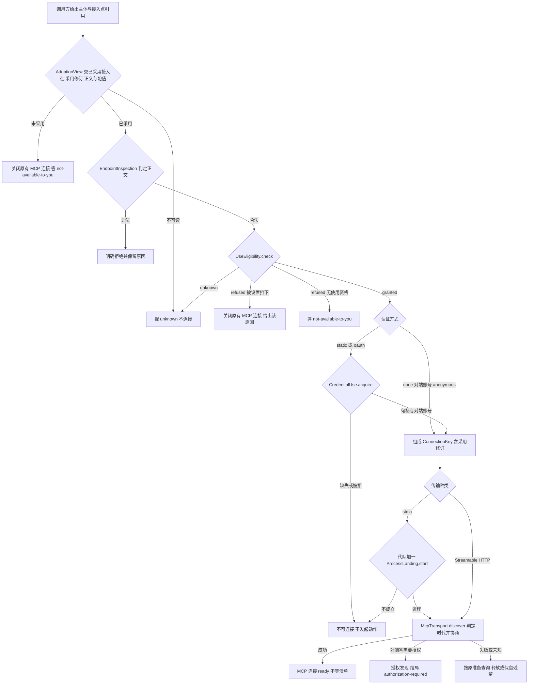
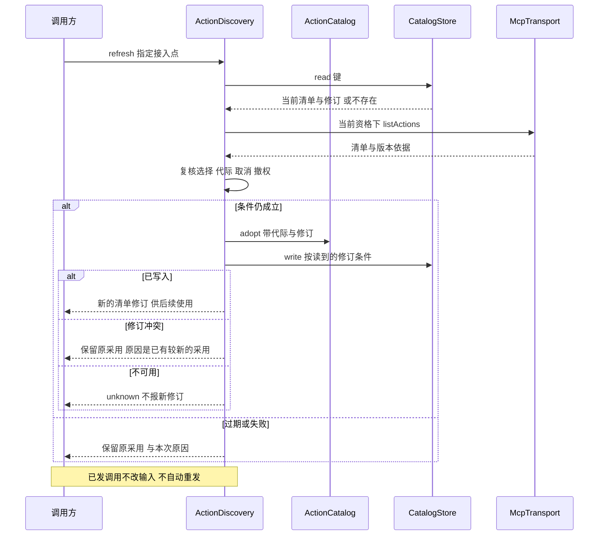
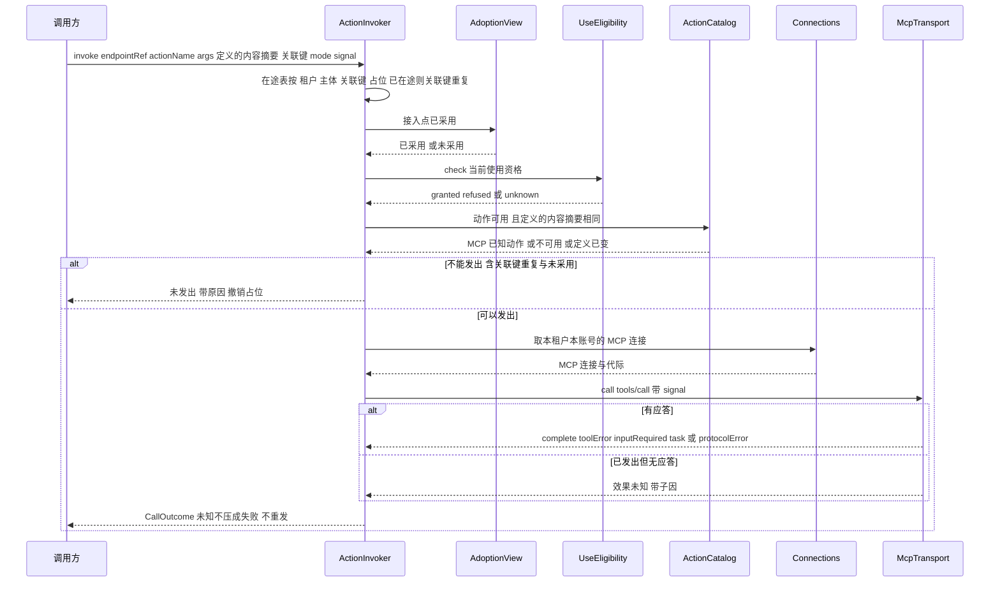

# MCP组内逻辑责任流程

状态：工程设计草案。成员尚未建立，流程中的服务和端口都是候选，见[工程设计](architecture.md#模型)。完整公开行为仍在原任务的候选契约中，流程落位不表示已采用。跨领域交接见[领域流程](../../../docs/domains/mcp/key-flows.md)。本页只写本组承担的步骤。图中组外的一方合并为「调用方」，需求端口按端口名出现。

## F-MC01 接入点采用、凭据和 MCP 连接

对应 J-MC01，INV-MC01–07。

1. `Connections.ensure` 经 `AdoptionView` 取得已采用的接入点、采用修订、正文与配值。接入点不在其中（未采用）时，答 `not-available-to-you`，与无权、不存在不可区分。它原有的 MCP 连接在这之前关闭。`AdoptionView` 不可读时答 `unknown`。
2. `EndpointInspection` 判定 `AdoptionView` 交来的正文。存在但非法的来源给出拒绝原因，不当作空来源。
3. `Connections.ensure` 经 `UseEligibility.check` 核对本次使用资格。只有 `granted` 才继续。`refused` 的原因分两类：无使用资格（`not-eligible`），或有资格但被设置挡下（`local-command-not-enabled`、`disabled`）。被设置挡下时，也先关闭原有的 MCP 连接。两类原因怎样交给读面，见[工程设计的 MCP 声明的端口](architecture.md#mcp-声明的端口)。
4. 认证方式不是 `none` 时，`Connections` 经 `CredentialUse.acquire` 取得凭据句柄与对端账号。认证方式为 `none` 时，不调用这个端口，对端账号是 `anonymous`，凭据缺值不是失败。凭据缺失或被拒时停止，不退回其他凭据。
5. `Connections` 用租户、接入点持有、采用修订与对端账号组成 `ConnectionKey`，按它取得或建立 MCP 连接。采用修订变了，键就变，于是建立新的 MCP 连接。
6. stdio 接入点：代际加一，再经 `ProcessLanding.start(access, launch, env)` 取得本机进程。`launch` 是正文里的启动声明，stdio 不读连接目标。`env` 是非秘密配值加凭据句柄，秘密值由 `ProcessLanding` 注入。落点或设施不成立时停止，不静默落到宿主。
7. `McpTransport.discover` 判定对端时代并协商。成功后 MCP 连接进入 `ready`，不等 MCP 动作清单。Streamable HTTP 在这时代际加一。首次发现由调用方经 `ActionDiscovery.refresh` 触发，见 F-MC02。
8. Streamable HTTP 上对端答需要授权时，MCP 读取受保护资源元数据，交出签发者与 scope，结局是 `authorization-required`。MCP 不发起授权流程。

部分创建或取消后，依原准备身份查询及清理。资源关闭失败时保留下一处置者。首次失败不造合法清单。代际何时加一与状态转移见[工程设计](architecture.md#mcp-连接)。

## F-MC02 合法发现与不可用

对应 J-MC02、J-MC08，INV-MC08–10、INV-MC21。

首次发现由调用方经 `ActionDiscovery.refresh` 触发。在这之前，`ActionDiscovery.current` 交出的视图取得状态是「未取得」。

`ActionDiscovery.refresh` 在接入点已采用、当前资格和 MCP 连接条件成立时，先经 `CatalogStore` 读取当前清单及其修订，再调用 `McpTransport.listActions`。校验内容与来源后，它经 `mergeListing` 合成新清单，再经 `CatalogStore` 按读到的修订条件整份写入。每个 MCP 已知动作保留对端原样的定义，并带定义的内容摘要。

清单从未取得时报告「尚未取得」，与「已取得、动作有零个」分开。只有全部分页取完、每项合法、对端动作名不重复时才采用。逐动作权限项只在清单已取得后派生，见[设置声明与逐动作权限](architecture.md#设置声明与逐动作权限)。

无法发现不表示动作有零个。MCP 已知动作保留最近合法定义与封闭集合里的不可用原因；从未发现过的动作不生成。`ActionDiscovery.current` 交出这份视图，连同新鲜度与采用依据。对已知不可用的动作调用 `invoke` 时，MCP 返回「未发出」与原因，不启动远端动作。

## F-MC03 刷新竞争与后续采用

对应 J-MC03，INV-MC02、INV-MC09、INV-MC11–12。

求值触发后，`ActionDiscovery` 读取候选。发布前，它核对当前选择、资格、连接代际和较新的刷新。资格或来源过期时拒绝发布；校验失败时不混拼。`CatalogStore` 答修订冲突时，表示已有较新的采用，本次结果不覆盖它。写入不可用时，`refresh` 答 `unknown`，不报新修订。合法的新清单只影响后续调用，撤权在下一次使用时生效。已发出的调用按原输入执行。调用方带着旧的定义的内容摘要发起时，MCP 返回「未发出」，原因是定义已变，由调用方重新判断。结构变化交给装配。在途动作不自动重发。

## 组内调用路径

这一节是[领域流程 F-MC04](../../../docs/domains/mcp/key-flows.md#f-mc04-动作准入至可靠结果)在本组内的部分。

1. 调用方交来 `endpointRef`、`actionName`、`args`、预期的定义的内容摘要、`correlationKey`、`mode` 与 `signal`，调用 `ActionInvoker.invoke`。
2. `ActionInvoker` 用（租户、主体、关联键）在在途表里占位，查重与占位是一步。同一个键已在途时，返回「未发出」，原因是关联键重复。后面任一步返回「未发出」时，撤销这个占位。
3. `ActionInvoker` 经 `AdoptionView` 核接入点已采用，未采用时返回「未发出」，原因是 `not-available-to-you`。再经 `UseEligibility.check` 核当前使用资格，然后在 `endpointRef` 所指的 MCP 动作清单里核对 `actionName` 仍是可用的 MCP 已知动作，并比较定义的内容摘要。答复不是 `granted`、MCP 已知动作不可用，或定义的内容摘要不符时，返回「未发出」。
4. `ActionInvoker` 经 `Connections` 取得本租户、本对端账号、当前采用修订的 MCP 连接，记下代际，再把请求号记到第 2 步的占位上。
5. `McpTransport.call` 发出 `tools/call`，带 `signal`。
6. `classifyOutcome` 把应答分为六种[调用结果](architecture.md#调用结果)。已发出但无应答时为 `unknown`，带子因。
7. `ActionInvoker` 把结局交回调用方。`requestState`、`taskId` 与发出代际由调用方保存。

`continueWithInput` 由调用方带回 `endpointRef`、`actionName`、原参数、`requestState`、`inputResponses`、发出代际、`correlationKey`、`mode` 与 `signal`，按上面同样的步骤核对与登记，再发原请求。`cancel(access, correlationKey)` 按（租户、主体、关联键）在在途表里定位请求号，不核采用，也不核当前使用资格，再按传输发出取消信号：Streamable HTTP 关闭该请求的响应流，stdio 发送 `notifications/cancelled`。之后原调用的结局是 `unknown`，子因是本地放弃。取消信号不证明对端已停止。依据层：官方规格 [Cancellation「Transport-Specific Cancellation」](https://modelcontextprotocol.io/specification/2026-07-28/basic/patterns/cancellation#transport-specific-cancellation)。

任务用状态口的 `queryTask`、`taskResult` 与 `cancelTask`，由调用方带回 `taskId` 与发出代际。这些操作都带 `access`，执行前经 `AdoptionView` 核采用、经 `UseEligibility.check` 核资格。MCP 连接已换代时，处置按传输分开，规则见[工程设计的应用服务](architecture.md#应用服务)。

## 验证边界

F-MC01–07 的异常分支须由三份候选契约的 V-MC01–23 在实际拥有者上验证。图语法与追溯检查只检验表达。授权竞争、账号隔离、断连后的效果、迟到响应、实际资源释放及断电恢复需要真实组合证据。
