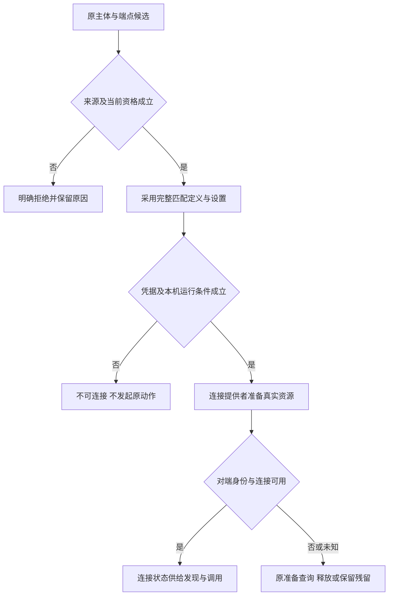
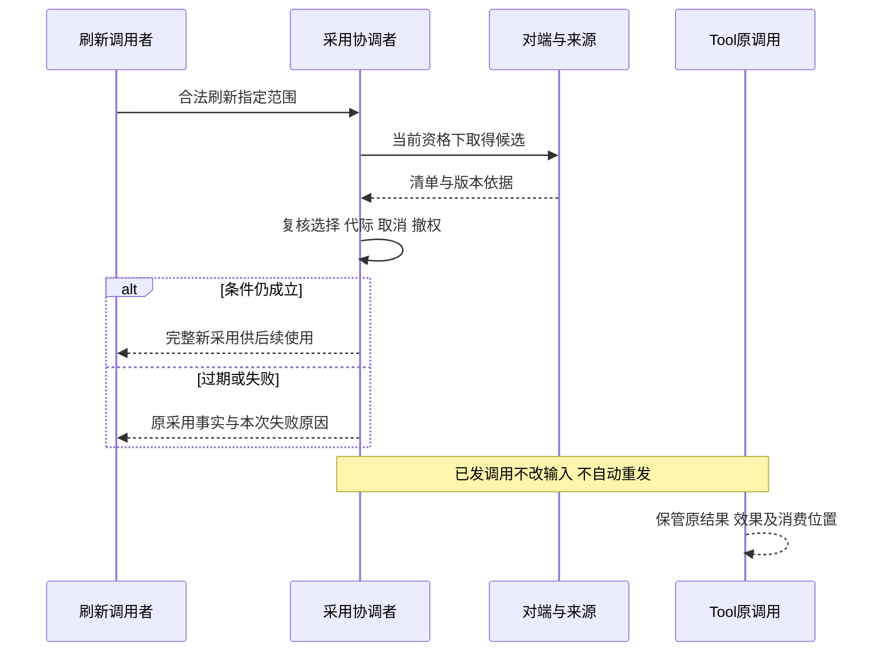

# MCP组内逻辑责任流程

状态：工程设计草案。没有具名运行成员，流程只说明本组逻辑责任的协作；完整公开行为仍在原任务 contracts，不能因流程落位认为已采用。

## F-MC01 端点采用、凭据和连接

对应 J-MC01，INV-MC01–07。端点采用者先核验候选读取与本次持有/设置资格，秘密拥有者确认租户凭据使用条件，连接提供者再取得真实资源并核验对端。正常连接为发现提供条件；来源非法、秘密不足或设施不匹配拒绝相关准备。部分创建或取消后依原准备身份查询及清理，资源关闭失败保留下一处置者，首次失败不造合法清单。

## F-MC02 合法发现与不可用替换

对应 J-MC02、J-MC08，INV-MC08–10、INV-MC21。发现者在当前资格和连接条件成立时读取对端清单，校验内容与来源再发布。动作工具条目保留端点关联，不建立独立持有。无法发现不表示动作零个；已知动作保留最近合法形状与安全不可用原因，未知动作不生成。对已知不可用动作的调用由 Tool 承接 dummy 逻辑执行，不启动原远端动作或真实原工具资源，真实替换开销及消费事实有人记录。

## F-MC03 刷新竞争与后续采用

对应 J-MC03，INV-MC02、INV-MC09、INV-MC11–12。求值触发后读取候选，发布前由采用协调者保护当前选择、资格、连接代际和较新刷新。资格或来源过期拒绝发布；校验失败不混拼。合法新清单影响后续调用，撤权即时作用于下一使用边界。已发调用按原输入，未发旧建议遇到约定变化回消费者重判；结构变化另交装配，不能自动重发在途动作。

## 验证边界

F-MC01–07 的异常分支须由三份契约的 V-MC01–23 在实际拥有者上验证。图语法与追溯检查仅检验表达，授权竞争、账户隔离、断连后效果、归档后迟到、实际资源释放及断电恢复需要真实组合证据。
