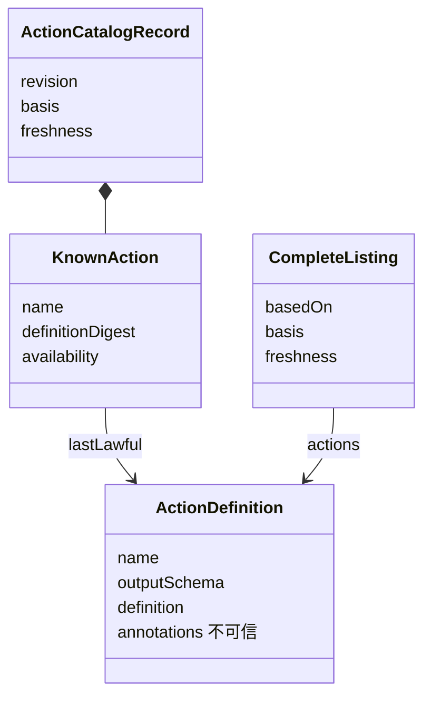

# 对象模型

本包没有类实例，只有不可变的值与纯函数。`ActionCatalogRecord` 是一份清单记录：它带修订、采用依据、新鲜度和按名字排序的 `KnownAction` 列表；每个 `KnownAction` 带最近合法定义、定义摘要和可用性。`CompleteListing` 是一次完整取得，带它所基于的修订。

## 对象与关系

## 生命周期

`completeListing` 构造并冻结完整清单。`mergeListing` 与 `markUnavailable` 每次产出一份新记录，修订加一，原记录不变。记录的保存归 `CatalogStore` 的实现方。
